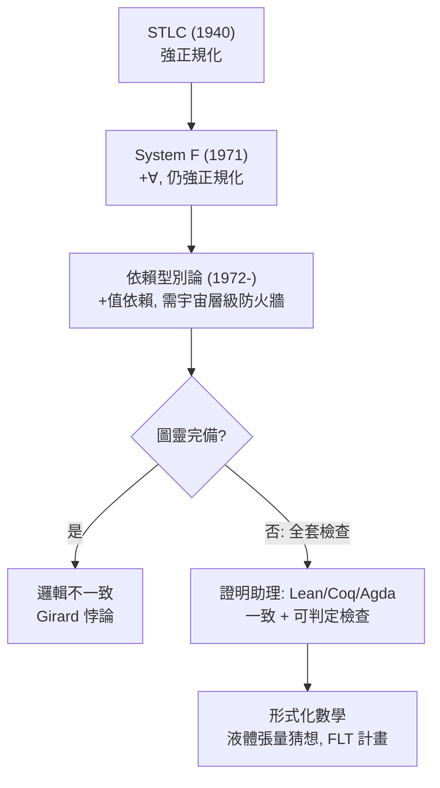

# 06.3 依賴型別：當型別可以依賴於值的時候

## 引言

一路走來，我們不斷逼近同一個極限：「型別」只能談**型別**，不能談**值**。`Vector<double>` 可以說「這是向量」，說不出「這是長度 3 的向量」。「長度」是值，型別系統夠不著——於是長度錯誤淪為執行期異常（`IndexError`）。

**依賴型別（dependent type）**打破這道牆：允許型別以值為參數。`Vec(Double, 3)` 是一個型別，`Vec(Double, 4)` 是另一個。當型別能談值，型別檢查就升格為**數學證明**；當型別即命題，程式即證明——Curry–Howard 從 04 章的隱喻變成日常工作工具。Lean、Coq、Agda 的形式化數學大廈，全部蓋在這一個觀念上。

---

## 1. 定義：依賴函數型別（ $\Pi$ 型）與依賴積型（ $\Sigma$ 型）

**定義 1.1（依賴函數型 / $\Pi$ 型）.** 對型別 $A$ 與（依 $a : A$ 而定的）型別族 $B(a)$ ：

$$
\Pi_{a : A}\, B(a) \;=\; \prod_{a \in A} B(a)
$$

其元素是函數 $f$ ，滿足對每個 $a : A$ ， $f(a) : B(a)$ 。**回傳型別依輸入值而定。**

**定義 1.2（依賴積型 / $\Sigma$ 型）.**

$$
\Sigma_{a : A}\, B(a) \;=\; \sum_{a \in A} B(a)
$$

其元素是配對 $(a, b)$ ，其中 $b : B(a)$ 。**第二欄位的型別依第一欄位的值而定。**

**特例即普通型別**：若 $B$ 不依賴 $a$ ，則 $\Pi_{a:A} B = A \to B$ 、 $\Sigma_{a:A} B = A \times B$ 。依賴型別是 05 章積和冪的**推廣**，不是另一套系統。

| 非依賴 | 依賴 | 數學原型 |
|---|---|---|
| $A \to B$ | $\Pi_{a:A} B(a)$ | 笛卡兒積族、纖維化 |
| $A \times B$ | $\Sigma_{a:A} B(a)$ | 積分： $\int_A B(a)\, da$ 、纖維叢 |

$\Sigma$ 的基數是 $\sum_{a} |B(a)|$ 、 $\Pi$ 的基數是 $\prod_a |B(a)|$ ——記號就是定義。05 章的「型別即代數式」在此升級為「型別即**無限代數式**（級數/積分）」。

---

## 2. 定理：依賴型別即命題——從標籤到數學

**定理 2.1（Curry–Howard 的完整形態）.** 在依賴型別論中：

- 命題 = 型別（包括帶參數的命題，如「 $m + n = k$ 」）；
- 證明 = 程式；
- 型別檢查 = 證明檢查（機械化、可判定）；
- 一致性 = 沒有型別為 `Empty` 的閉項（04.2 定理 3.3 的依賴版）。

於是可以把**數學定理寫成型別，把證明寫成程式**：

```lean
-- Lean 4：加法交換律，證明就是一個「型別為定理」的項
theorem add_comm (n m : ℕ) : n + m = m + n := by
  induction n with
  | zero => simp
  | succ k ih => simp [Nat.succ_add, ih]
-- 這段「程式」通過型別檢查 = 定理被形式化證明
-- 註：Lean 中 `n + m = m + n` 本身就是一個型別（Eq 是歸納型別）！
```

```lean
-- 「長度 n 的向量」：依賴型別的招牌例子
inductive Vec (α : Type) : Nat → Type where
  | nil  : Vec α 0
  | cons : α → {n : Nat} → Vec α n → Vec α (n + 1)

-- 「安全取第 i 項」：i < n 這個**數學條件**直接寫進型別
def safeGet {α : Type} {n : Nat} (v : Vec α n) (i : Nat) (h : i < n) : α :=
  match v, i, h with
  | Vec.cons x _,  0,      _ => x
  | Vec.cons _ xs, i + 1,  _ => safeGet xs i (Nat.lt_of_succ_lt_succ h)
-- 呼叫 safeGet v 5 h 時，h : 5 < n 必須在編譯期存在：
-- 越界不再是執行期異常，而是型別錯誤！
```

```python
# 對照：Python 只能「執行期檢查 + 型別註記閹割版」
from typing import Generic, TypeVar, NewType

T = TypeVar("T")
Length = NewType("Length", int)

class Vec(Generic[T]):
    def __init__(self, items: list[T]):
        self.items = items
    def __len__(self) -> int:
        return len(self.items)

def safe_get(v: Vec[T], i: int) -> T:
    # 長度條件無法進入型別；只能執行期檢查
    if i >= len(v.items):
        raise IndexError(f"index {i} out of range for length {len(v.items)}")
    return v.items[i]
# 差距一目了然：依賴型別把「if 檢查」搬進了型別系統
```

---

## 3. 範例：依賴型別的三個層次

依賴型別的威力按「編碼深度」遞增：

### 3.1 層次一：把資料不變式編入型別

```lean
-- 矩陣乘法：只有「內維吻合」的呼叫能通過編譯
def matMul {m n p : Nat} (A : Mat m n) (B : Mat n p) : Mat m p := ...
-- matMul A B 若 A 的行數 ≠ B 的列數，根本型別不合
-- 對照 NumPy：shape mismatch 是執行期 ValueError
```

### 3.2 層次二：把規格編入型別（refinement）

```lean
-- 「質數」作為型別：{ p : Nat // IsPrime p }（子型別/refinement）
def IsPrime : Nat → Prop
  | 0 | 1 => False
  | p => p ≥ 2 ∧ ∀ d, d ∣ p → d = 1 ∨ d = p

def Prime : Type := { p : Nat // IsPrime p }

-- 函數「給定任意 n > 1，存在質數 p > n」（歐幾里得）
theorem exists_prime_gt : ∀ n : Nat, ∃ p, p > n ∧ IsPrime p := ...
-- ∃ 是 Σ 型的 Prop 版；∀ 是 Π 型——邏輯連接詞全部成為型別構造子
```

### 3.3 層次三：宇宙層級——依賴型別論自身需要型別

```lean
-- 當型別可以依賴值，「所有型別的型別」= 宇宙（universe）
-- 但 Type : Type 會重建羅素悖論（Girard 悖論，1972）！
-- 解法：層級宇宙——這正是 04.3 羅素分層的再現
#check (Type 0 : Type 1)   -- Type 0 是 Type 1 的元素，但不包含自身
```

**Girard 悖論**（`Type : Type` 的矛盾）告訴我們：依賴型別論沒有逃出 04.3 的陰影，只是**每一層都要重新蓋防火牆**。強正規化（04.2）也以更複雜的形式被重新證明（Girard 的 $\Lambda$ 範疇法），以保證證明檢查終止。

---

## 4. 範例：證明助理的一天——二分查找的正確性

依賴型別最動人的應用：**程式與其正確性證明一起交付**。

```lean
-- 已排序陣列的二分查找：回傳「要嘛找到（帶索引），要嘛證明不存在」
inductive FindResult (a : Type) (xs : Array a) (target : a) : Type where
  | found : (i : Nat) → (i < xs.size) → xs[i] = target → FindResult a xs target
  | notFound : (∀ i, (h : i < xs.size) → xs[i] ≠ target) → FindResult a xs target
-- 這個和型的兩個分支各自攜帶「證明」：
-- found 帶「這個索引真的是目標」的證明
-- notFound 帶「任何索引都不是」的證明——不可能出現「沒找到但其實在」的 bug
```

Python 中同等規格只能靠註解與測試（契約，不是證明）：

```python
def binary_search(xs: list[int], target: int) -> int | None:
    """回傳 target 的索引，不存在則 None。
    註解說「不存在則 None」——但編譯器不知道，只有測試知道。
    依賴型別版本（上方 Lean）把這句話變成型別的一部分。"""
    lo, hi = 0, len(xs)
    while lo < hi:
        mid = (lo + hi) // 2
        if xs[mid] == target: return mid
        if xs[mid] < target:  lo = mid + 1
        else:                 hi = mid
    return None
```

這就是 **形式驗證（formal verification）** 的實務樣貌：seL4 作業系統核心、CompCert C 編譯器、Fiat Cryptography（TLS 憑證庫）都在 Coq/Lean 系譜上以依賴型別完成了機器檢查的正確性證明。

---

## 5. 定理：代價與張力——圖靈完備 vs 全面終止

**定理 5.1（停機問題的陰影）.** 若型別語言的項級計算是圖靈完備的，則「型別檢查」（需要對依賴型別做求值比較）不可判定。

**工程解法**：證明助理要求**所有函數全面終止**（structural recursion 或 well-founded recursion 檢查），使型別檢查可判定、邏輯一致；代價是寫不出一般遞迴——「想寫不終止的程式？請離開證明層，用 IO monad/不檢查的逃生口」。這是 04.2 結尾那條張力的最終形態：



---

## 6. 互相驅動：三股力量的匯流

- **數學驅動**：四色定理（1976，電腦輔助）引發「證明可信度」爭論；Gonthier 用 Coq 完整形式化（2005）平息之。依賴型別從此是數學的基礎設施。
- **工程驅動**：航空、密碼學、區塊鏈對「零 bug」的需求，讓形式驗證從學術走進產業（Rust 的型別系統也是這條光譜上的溫和版本）。
- **兩者回饋**：Lean 4 本身用 Lean 寫成（自舉），編譯器即定理——理論與工程在同一個依賴型別宇宙中閉環。

回望全程：**羅素悖論（04.3）→ 型別防火牆 → STLC 強正規化（04.2）→ 型別即安全網（04.1）→ 積和冪的代數（05）→ $\forall$ 與 $<:$ 的一般化（06.1–06.2）→ 值依賴的 $\Pi$ / $\Sigma$ （本節）**。型別論從救火隊成長為數學與程式共同的家。

---

## 7. 章末小結

- 依賴型別允許型別依賴值： $\Pi$ 型（回傳型別依參數）、 $\Sigma$ 型（欄位型別依前欄值）；非依賴型別是其特例。
- 基數記號 $\prod/\sum$ 與型別構造子一一對應，05 章的代數視角升級為級數/積分。
- Curry–Howard 完整化：命題即型別、證明即程式、型別檢查即證明檢查。
- `Vec α n`、refinement 型別、`FindResult`：資料不變式與規格編入型別。
- `Type : Type` 重建悖論（Girard），宇宙層級是 04.3 分層的再現；全套檢查保住一致性，圖靈完備性被置於證明層之外。

## 下一步

你已握有型別論的完整光譜：從錯誤檢查到定理證明。接下來的章節將沿兩個方向繼續：(1) **範疇論視角**——把積、和、冪、 $\Pi$ 、 $\Sigma$ 統一為極限與餘極限，型別論成為一個拓撲/幾何物件（homotopy type theory 的門檻）；(2) **計算效應**——當函數要與世界互動（IO、狀態、異常），純函數型別如何擴充（monad 即內部語言的擴張）。兩條路都從你此刻站立的這塊基石出發。
