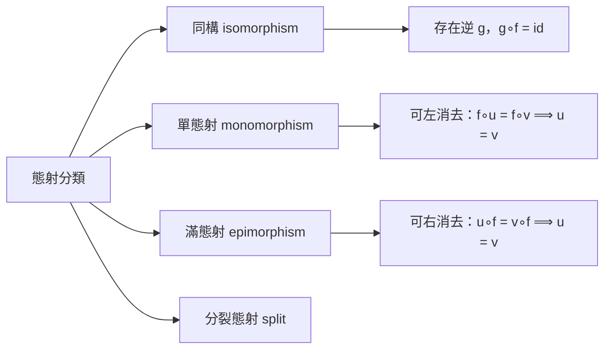
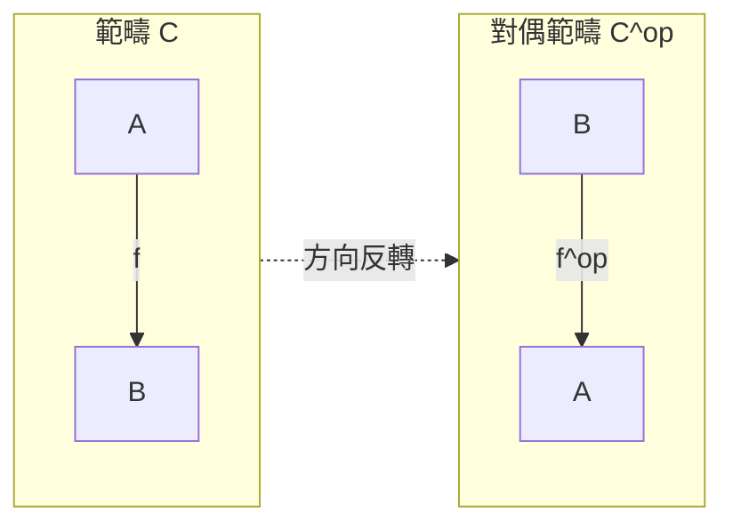
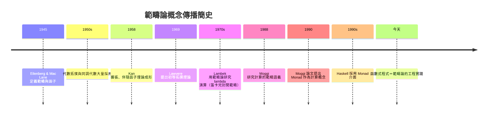

# 07.1 物件與態射：軟體世界的拼裝邏輯

## 前言：為什麼軟體需要「拼裝的邏輯」

現代軟體是由無數零件組合而成的：函式呼叫函式、型別組成型別、模組依賴模組。
但組合並非任意為之——有些組合會編譯失敗，有些會在執行期崩潰，只有少數組合
是「正確且可預期」的。範疇論（Category Theory）正是在二十世紀中葉，
為了回答「什麼樣的組合是合法的」這個問題而誕生的數學理論。

有趣的是，這門 originally 為代數拓撲服務的數學，在半世紀後成為 Haskell
型別系統的設計藍圖。本章我們從最基礎的「物件與態射」開始，理解這套
拼裝邏輯的原點。

## 1. 歷史前因：Eilenberg 與 Mac Lane 的統一企圖

1940 年代，Samuel Eilenberg 與 Saunders Mac Lane 面對一個尷尬的處境：
代數拓撲中到處都在談「同態」（homomorphism）、「映射」（map）、
「變換」（transformation），但每個領域的記號與直覺各自為政。

- 群論談群同態 $f: G \to H$。
- 拓撲學談連續映射 $f: X \to Y$。
- 模論談模同態。

他們注意到一個關鍵事實：**真正被研究的往往不是結構本身，而是結構之間
「保持結構的映射」，以及這些映射的複合（composition）**。例如拓撲空間
$X$ 與 $Y$ 的同倫等價，本質上是透過連續映射的複合性質來刻畫的。

1945 年，兩人發表論文 *General Theory of Natural Equivalences*，
正式提出範疇（category）與函子（functor）的定義。原本他們只是想
定義「自然變換」（natural transformation）——函子之間的映射——
但發現必須先定義函子，而定義函子又必須先定義範疇。這個「倒退三層」
的定義策略，意外地創造了二十世紀最重要的抽象語言。

## 2. 定義：範疇

**定義 2.1（範疇）**。一個範疇 $\mathcal{C}$ 由以下資料構成：

1. 一族**物件**（objects）$A, B, C, \dots$
2. 對每對物件 $(A, B)$，一個**態射集**（hom-set）
   $\mathrm{Hom}_{\mathcal{C}}(A, B)$，其元素稱為**態射**（morphisms），
   記作 $f: A \to B$。
3. **複合運算**：對 $f: A \to B$、$g: B \to C$，存在複合
   $g \circ f: A \to C$。
4. 對每個物件 $A$，一個**單位態射** $\mathrm{id}_A: A \to A$。

且滿足兩條公理：

- **結合律**：$(h \circ g) \circ f = h \circ (g \circ f)$。
- **單位律**：$f \circ \mathrm{id}_A = f = \mathrm{id}_B \circ f$。

注意：範疇論刻意**不問物件內部是什麼**，只問態射如何複合。
這種「外延式」（extentional）觀點正是它能描述程式組合的原因——
程式設計師關心的從來不是 `Int` 在記憶體中長什麼樣，
而是「從 `Int` 能寫出哪些函式、這些函式如何串接」。

## 3. 範例：三個具體範疇

### 3.1 範疇 **Set**

- 物件：所有集合。
- 態射：所有函數 $f: X \to Y$。
- 複合：一般函數複合。

這是最直觀的範疇，也是函數式程式的「純函數宇宙」的原型。

### 3.2 範疇 **Mon**（幺半群範疇）

- 物件：所有幺半群 $(M, \cdot, e)$。
- 態射：保持結構的群同態，即 $f(e) = e'$ 且 $f(x \cdot y) = f(x) \cdot' f(y)$。

注意物件**有內部結構**，態射**必須保持結構**。這預示了型別類
（type class）的世界：Haskell 的 `Monoid` 型別類正是幺半群的編碼。

```haskell
class Monoid m where
  mempty  :: m              -- 單位元 e
  mappend :: m -> m -> m    -- 二元運算 ·

-- 結合律與單位律由法律（laws）規定：
-- mappend mempty x = x = mappend x mempty
-- mappend x (mappend y z) = mappend (mappend x y) z
```

### 3.3 範疇 **Hask**（非正式）

把 Haskell 型別當物件、純函數當態射，我們得到一個近似 **Set** 的範疇，
社群慣稱 **Hask**：

```haskell
-- 物件：Int, Bool, [a], Maybe a, ...
-- 態射：
f :: Int -> Int
g :: Int -> Bool
g . f :: Int -> Bool   -- 複合，正是 (.)

-- 單位態射：
id :: a -> a
-- 公理：id . f = f . id = f；結合律自動成立
```

嚴格來說 Hask 因為 `seq`、bottom（$\bot$）等因素並非真正範疇
（有興趣可查「Hask is not a category」的討論），但在忽略這些
技術性問題後，它是學習範疇論最親切的實驗場。

## 4. 態射的分類學：軟體拼裝的語彙

態射不只是「箭頭」，它們依據與複合的互動方式形成一個分類體系：



**定義 4.1（同構）**。$f: A \to B$ 是同構，若存在 $g: B \to A$
使得 $g \circ f = \mathrm{id}_A$ 且 $f \circ g = \mathrm{id}_B$。
記作 $A \cong B$。

**軟體意義**：同構就是「無損可逆轉換」。`[a]` 與自訂的 `List a`
若能互轉且往返為恆等，它們在範疇意義上是同一個東西。這正是
重構（refactoring）的數學合法性來源：**重構不改變行為，等價於
在態射層次尋找同構替換**。

**定義 4.2（單態射／滿態射）**。$m: A \to B$ 稱為單態射，若對任意
$u, v: X \to A$，$m \circ u = m \circ v \Rightarrow u = v$。
$d: A \to B$ 稱為滿態射，若 $u \circ d = v \circ d \Rightarrow u = v$。

在 **Set** 中單態射對應單射函數、滿態射對應滿射函數；但在一般範疇中
這是「消去性質」的定義，不需要元素的概念。這又是範疇論「不用打開
物件」的示範：**單射性可以用複合的代數性質表達**。

```haskell
-- 型別層次的同構範例：
newtype Product a b = Product (a, b)  -- 與 (a, b) 同構

toP   :: (a, b) -> Product a b
toP   = Product

fromP :: Product a b -> (a, b)
fromP (Product p) = p

-- toP . fromP = id 且 fromP . toP = id
-- 這證明了 Product a b ≅ (a, b)
```

## 5. 對偶性：一個概念，兩個世界

範疇論有一個強大的原理：**對偶**（duality）。把所有態射方向反轉
（$f: A \to B$ 變成 $f^{op}: B \to A$），得到對偶範疇
$\mathcal{C}^{op}$。任何在 $\mathcal{C}$ 中成立的敘述，
在 $\mathcal{C}^{op}$ 中其對偶敘述也自動成立。

- 單態射在 $\mathcal{C}^{op}$ 中變成滿態射。
- 積（product）的對偶是餘積（coproduct）——第 9 章將看到，
  這正是 tuple 與 `Either` 的關係。
- 歸納（induction）的對偶是共歸納（coinduction）——9.3 節的主題。



對偶性告訴我們：軟體中的「構造資料」與「消費資料」、「定義」與
「觀察」，往往是同一枚硬幣的兩面。學會一個概念等於免費獲得另一半。

## 6. 前因後果：從拓撲到程式的傳播鏈



這條鏈的關鍵環節是 1970 年代 Joachim Lambek 的發現：**簡單型別
lambda 演算與笛卡兒封閉範疇（CCC）在數學上是同一件事**
（Curry–Howard 對應的範疇版本）。自此「型別＝物件、函式＝態射、
程式＝態射的證明」成為函數式程式的理論基石。

## 7. 深入：為什麼「公理化複合」如此有效

回頭看定義 2.1，範疇論只要求兩條公理：結合律與單位律。看似薄弱，
卻威力巨大，原因有三：

1. **結合律允許我們談「管線」而不管括號**。Unix 管線
   `cat f | sort | uniq`、函式鏈 `h . g . f`、中介軟體堆疊，
   都依賴結合性使順序語義明確、括號語義自由。
2. **單位律允許「無操作」的存在**。`id`、空管線、`mempty`、
   `return`，都是單位律在不同層次的化身。
3. **不開箱保證了通用性**。正因為不檢查物件內部，同一套定義
   同時適用於集合、拓撲空間、型別、資料庫 schema、甚至機率分佈。

這就是抽象化的報酬曲線：**公理越少，適用範圍越廣**。

## 8. 章末小結

- 範疇＝物件＋態射＋複合＋單位，僅需結合律與單位律兩條公理。
- 源於 1945 年 Eilenberg 與 Mac Lane 統合代數拓撲的企圖。
- 態射的性質（同構、單態射、滿態射）用複合的代數性質定義，
  不需打開物件——這正是「介面優於實作」的數學原型。
- 對偶性使我們免費獲得每個概念的鏡像版本。
- Hask 範疇是函數式程式與範疇論之間的橋樑。

## 下一步

本章建立了「物件與態射」的語言。下一章（07.2）我們將看到這套語言
如何從純數學走進程式語言設計：Moggi 的 1988–1990 工作、Wadler 的
推廣，如何讓範疇論成為 Haskell 的設計藍圖， Functor、Applicative、
Monad 的型別類階層如何在歷史中逐步浮現。
