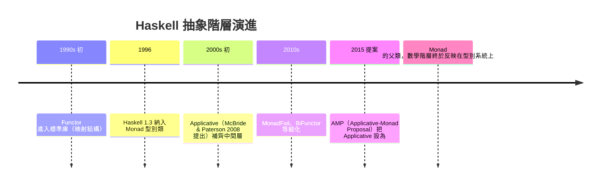
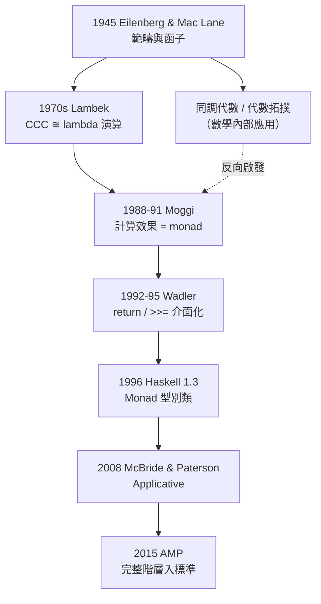

# 07.2 範疇論如何成為泛函編程的設計藍圖

## 前言：一場跨越四十年的接力

上一章我們看到，範疇論誕生於 1945 年 Eilenberg 與 Mac Lane 對代數
拓撲的統合。但一門為純數學服務的抽象理論，為何會在半世紀後成為
Haskell 這個程式語言的設計藍圖？本章講述這條傳播鏈上的四個關鍵
節點：Lambek 的範疇語義、Moggi 的計算概念、Wadler 的推廣，以及
Haskell 型別類階層的演進。理解這段歷史，你會明白函數式程式中的
每個抽象型別類都不是憑空發明，而是數學定理的工程投影。

## 1. 第一環：Lambek——lambda 演算就是範疇

1970 年代，Joachim Lambek 研究簡單型別 lambda 演算的語義時發現：

**定理 1.1（CCC 與 lambda 演算的等價）**。簡單型別 lambda 演算的
模型範疇，恰好是**笛卡兒封閉範疇**（Cartesian Closed Category, CCC）；
反之，任何 CCC 都給出一個 lambda 演算模型。

CCC 的三個要件與程式概念的對應：

| 範疇論概念 | lambda 演算概念 | Haskell 對應 |
|---|---|---|
| 積 $A \times B$ | 配對 $(x, y)$ | `(a, b)` |
| 指數 $B^A$ | 函數抽象 $\lambda x. e$ | `a -> b` |
| 求值態射 $\mathrm{ev}: B^A \times A \to B$ | 函數應用 | `($)` |

「笛卡兒封閉」指的是：對任意物件 $A, B$ ，指數物件 $B^A$ 存在且滿足
$\mathrm{Hom}(C \times A, B) \cong \mathrm{Hom}(C, B^A)$ 。
這條同構在程式中就是 **currying**：

```haskell
-- Hom(C × A, B) ≅ Hom(C, B^A) 的 Haskell 化身：
apply    :: (c, a) -> b  ≅  curryApply :: c -> a -> b
-- eval : (a -> b, a) -> b
eval (f, x) = f x

-- 換邊：evaluate :: ((a,b) -> c) -> a -> b -> c
evaluate f = \x y -> f (x, y)
```

這是第一個訊號：**語言的核心語法特徵（currying）原來是一條範疇論
同構**。Curry–Howard–Lambek 三位一體自此確立：命題、型別、物件
是同一件事在三種語言中的名字。

## 2. 第二環：Moggi——把「計算效果」變成數學物件

接下來的問題是：純 lambda 演算能描述「純函數」，但真實程式有
副作用——IO、例外、狀態、非確定性。1980 年代，指稱語義
（denotational semantics）面對副作用時陷入困境：
`getChar` 這種每次呼叫可能回傳不同值的函式，根本不是數學函數。

1988–1991 年，Eugenio Moggi 在米蘭與愛丁堡完成了關鍵突破。他在
論文 *Computational Lambda-calculus and Monads*（1991，LICS）
與 *Notions of Computation and Monads*（1991，IC，1990 年完成）中
提出革命性的觀點：

> **一個「計算」不是一個值，而是一個從值到值的特殊結構的映射。
> 用範疇語言說：副作用計算是 Kleisli 範疇中的態射。**

**定義 2.1（Moggi 的核心思想）**。設 $T$ 是一個攜帶計算效果的
函子（例如狀態、IO），則：

- 純值 $a$ 對應 $T a$ 中的「無效果計算」。
- 有效果的函式 $f: a \to T b$ 是 **Kleisli 態射**。
- 效果的「串接」由 $T$ 的 monad 結構（unit 與 multiplication）提供。

Moggi 系統地列出了常見計算效果對應的 monad：

| 計算效果 | Monad $T$ | $T a$ 的直覺 |
|---|---|---|
| 可能失敗 | Maybe / Option | $a$ 或「無」 |
| 非確定性 | List | 所有可能結果 |
| 讀取環境 | Reader $r$ | $r \to a$ |
| 可變狀態 | State $s$ | $s \to (a, s)$ |
| 例外 | Either e | $a$ 或錯誤 $e$ |
| 延續 | Cont $r$ | $(a \to r) \to r$ |
| 輸出輸入 | IO | 由 runtime 提供的動作 |

**這張表是本章最重要的成果**：副作用不是雜亂的語言特性，
而是有系統的數學分類。每一種效果對應一個具體的 monad 實例。

## 3. 第三環：Wadler——把 monad 帶進 Haskell

Moggi 的工作是語義學論文，一般程式設計師讀不懂也用不上。
1992 年，Philip Wadler 在會議中聽到 Moggi 的演講後意識到：
這可以直接變成程式語言介面。他在 *Monads for Functional Programming*
（1995）中完成翻譯工作：

1. **把 Moggi 的單位與乘法改名為 `return` 與 `>>=`（bind）**。
2. **證明只需這兩個運算，就能串接所有帶效果的計算**。
3. **示範直覺**：`m >>= f` 讀作「執行計算 `m`，把結果交給 `f`」。

```haskell
class Monad m where
  return :: a -> m a
  (>>=)  :: m a -> (a -> m b) -> m b

-- 範例：Maybe monad 處理「可能失敗」
data Maybe a = Nothing | Just a

instance Monad Maybe where
  return        = Just
  Nothing >>= _ = Nothing
  Just x  >>= f = f x

-- 用 bind 串接可能失敗的步驟，不用手寫層層 case：
eval :: Expr -> Maybe Int
eval e = do
  a <- evalSub e      -- 任何一步失敗，整體就是 Nothing
  b <- checkRange a   -- do 區塊只是 >>= 的語法糖
  return (a + b)
```

Wadler 的洞見在於：**do 記法的 `x <- e; rest` 就是 Moggi 的
let-binding**，而效果傳播（如 Maybe 的短路）全部封裝在 `>>=`
的實作裡。使用者寫起來像指令式程式，但每一步的組合仍是純粹的
代數運算。

Haskell 1.3（1996）正式把 `Monad` 型別類納入標準，從此
「monad」成為這個語言的招牌。

## 4. 第四環：型別類階層的歷史演進

Monad 並非憑空出現的孤立設計，Haskell 的抽象階層是逐步從範疇論
「還原」出來的：



這個階層的範疇論根源：

- **Functor**： $\mathcal{C} \to \mathcal{D}$ 的函子，保持複合與單位。
- **Applicative**：「帶張量結構的函子」，對應範疇論中的
  lax monoidal functor。
- **Monad**：幺半群在自函子範疇上的結構（08.2 詳述）。

**定理 4.1**。每個 Monad 都是 Applicative，每個 Applicative 都是
Functor。這不只是設計偏好，而是範疇論定理：monad 的 unit 態射
給出 applicative 的 `pure`，其 multiplication 給出 `<*>`。

```haskell
-- AMP 之後的階層：
class Functor f where
  fmap :: (a -> b) -> f a -> f b

class Functor f => Applicative f where
  pure  :: a -> f a
  (<*>) :: f (a -> b) -> f a -> f b

class Applicative m => Monad m where
  (>>=) :: m a -> (a -> m b) -> m b
```

## 5. 深入：為什麼「設計藍圖」的比喻是準確的

建築藍圖的特徵是：**結構先行、施工自由**。範疇論作為函數式程式
藍圖也一樣：

- **結構先行**：型別類的法律（laws）先於任何實例。`fmap` 必須滿足
  $F(f \circ g) = F(f) \circ F(g)$ 與 $F(\mathrm{id}) = \mathrm{id}$ ，
  這是函子公理的直接翻譯，不是建議而是義務。
- **施工自由**：同一個 `Functor` 介面下，`Maybe`、`[]`、`IO`
  各自用完全不同的方式實作。
- **可驗證性**：法律使性質測試（如 QuickCheck 驗證 monad laws）
  成為可能。

**範例 5.1（法律驅動的實作）**。假設要為 `Either e` 實作 Functor，
唯一正確的寫法由法律唯一決定：

```haskell
instance Functor (Either e) where
  fmap _ (Left e)  = Left e        -- 失敗不該被函數觸碰
  fmap f (Right x) = Right (f x)   -- 成功則映射內部值

-- fmap id = id：Left e 經 fmap id 仍是 Left e ✓
-- fmap (g . h) = fmap g . fmap h：右邊逐一驗證成立 ✓
-- 若寫成 fmap f (Left e) = Left (f e)，型別都不合——
-- 法律與型別系統聯手把錯誤實作擋在門外
```

這就是藍圖的意義：**正確的實作往往被法律「擠」出來**，寫錯的空間
極小。這種由數學結構指導實作的方法論，是函數式程式最深刻的實踐
紀律。

## 6. 前因後果總結：傳播鏈全圖



值得注意：這條鏈不是單向的。Moggi 的靈感部分來自電腦科學自身的
需求（副作用問題），而他的解又用回了數學最深處的結構。
**理論與工程互相驅動**，正是這段歷史最動人的地方。

## 7. 章末小結

- Lambek：lambda 演算與 CCC 等價，currying 是一條範疇論同構。
- Moggi（1988–1991）：副作用計算是 Kleisli 態射，各種計算效果
  對應具體 monad，副作用獲得系統性分類。
- Wadler（1992–1995）：把 monad 翻譯成 `return`／`>>=` 介面，
  do 記法是 Moggi let-binding 的語法糖。
- Haskell 型別類階層（Functor → Applicative → Monad）是範疇論
  結構的逐步還原，AMP 使數學階層反映在語言中。
- 「設計藍圖」方法論：法律先行、實作由法律唯一決定、可性質測試。

## 下一步

本章是歷史與概觀。下一章（07.3）我們深入第一個具體抽象：
**函子（Functor）**——在不同型別宇宙之間的安全映射。我們將定義
自函子、證明 fmap 法律、比較協變與逆變函子，並用 Haskell 與
Python 對照實作，看清「映射結構而不碰內容」這件事為何需要
數學來保駕護航。
