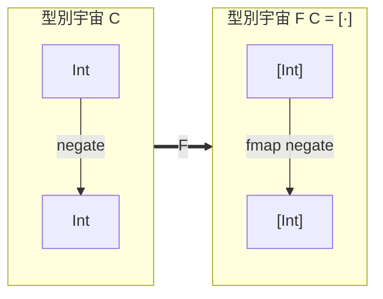

# 07.3 函子：在不同型別宇宙之間的安全映射

## 前言：當你只有「改變內容」的需求時

程式設計中最頻繁的操作之一是：**不改變容器，只改變容器裡的東西**。
把 `[Int]` 中的每個數字加一、把 `Maybe String` 中的字串轉大寫、
把 `IO Int` 中的結果做後續處理。這些操作的共同輪廓，就是範疇論
中的**函子**（functor）。

函子是範疇論在 1945 年的原生概念——Mac Lane 曾說，範疇、函子、
自然變換三者中，函子才是真正的主角，範疇只是為了定義函子而存在。
本章從數學定義出發，看它如何在型別系統中成為最基礎的抽象。

## 1. 定義：函子是「範疇之間的態射」

如果態射是物件之間的映射，那麼範疇之間呢？答案是函子。

**定義 1.1（協變函子）**。設 $\mathcal{C}$ 、 $\mathcal{D}$ 為範疇，
協變函子 $F: \mathcal{C} \to \mathcal{D}$ 指定：

1. 對每個物件 $A \in \mathcal{C}$ ，一個物件 $F(A) \in \mathcal{D}$ 。
2. 對每個態射 $f: A \to B$ ，一個態射 $F(f): F(A) \to F(B)$ 。

並滿足兩條公理：

- **保持單位**： $F(\mathrm{id}_A) = \mathrm{id}_{F(A)}$ 。
- **保持複合**： $F(g \circ f) = F(g) \circ F(f)$ 。

**定義 1.2（逆變函子）**。逆變函子 $G: \mathcal{C} \to \mathcal{D}$
反轉態射方向： $f: A \to B$ 映成 $G(f): G(B) \to G(A)$ ，
並滿足 $G(g \circ f) = G(f) \circ G(g)$ 。

注意 $F(g \circ f) = F(g) \circ F(f)$ 這條公理在程式中的化身：
**先複合再映射，等於先映射再複合**。這是 fmap 法律的第二條，
也是「安全映射」的精確含義——映射不會破壞組合結構。

## 2. 為什麼需要這兩條公理

公理不是繁文縟節，而是防呆設計。考慮一個違反公理的假想實作：

```haskell
-- 壞的 fmap：偷偷加入一個元素
badFmap :: (a -> b) -> [a] -> [b]
badFmap f xs = map f xs ++ [defaultValue]
```

這個實作型別正確、編譯通過、甚至大部分情況下「看起來對」，
但破壞了結構：`length (badFmap f xs)` 不再等於 `length xs`，
且 `badFmap (f . g) xs` 可能不等於 `badFmap f (badFmap g xs)`
（因為加了兩次預設值）。公理把這類「夾帶私貨」的實作宣判為非法。



函子 $F$ 把「物件」`Int` 映成 `[Int]`，把「態射」`negate` 映成
`fmap negate`，並且保證複合關係原封不動地搬過去。

## 3. Haskell 中的自函子

當 $\mathcal{C} = \mathcal{D}$ 時，函子稱為**自函子**
（endofunctor）。Haskell 的 `Functor` 型別類描述的正是 **Hask**
範疇上的自函子：

```haskell
class Functor f where
  fmap :: (a -> b) -> f a -> f b

-- 法律（ functor laws ）：
-- fmap id = id                       （保持單位）
-- fmap (g . h) = fmap g . fmap h     （保持複合）
```

型別變數 `f` 是「型別建構子」：它不是一個型別，而是一個從型別到
型別的函數（`Int ↦ [Int]`）。這個層次在範疇論中早有名字——
**Hask 的物件是型別，自函子作用在物件層**，型別建構子就是
物件層的映射，`fmap` 則補上態射層的映射。兩層合起來才構成函子。

### 3.1 實例：Maybe

```haskell
data Maybe a = Nothing | Just a

instance Functor Maybe where
  fmap _ Nothing  = Nothing
  fmap f (Just x) = Just f x
```

驗證法律：

- `fmap id (Just x) = Just (id x) = Just x`；`Nothing` 兩邊都是
  `Nothing`。✓
- `fmap (g . h) (Just x) = Just (g (h x))`，而
  `fmap g (fmap h (Just x)) = fmap g (Just (h x)) = Just (g (h x))`。✓

`Nothing` 的分支展示了函子的語義價值：**失敗的狀態對映射透明**。
你不需要在每次映射前檢查空值——`fmap` 已把檢查封裝一次。

### 3.2 實例：列表與樹

```haskell
instance Functor [] where
  fmap = map

data Tree a = Leaf a | Node (Tree a) (Tree a)

instance Functor Tree where
  fmap f (Leaf x)   = Leaf (f x)
  fmap f (Node l r) = Node (fmap f l) (fmap f r)
```

樹的實作展示了遞迴結構上的映射：`fmap` 沿結構遞迴、在葉子上應用
函數、內部節點形狀完全不變。這是「映射結構而不碰形狀」的又一例。

### 3.3 反例：Set 與逆變的 Predicate

並非所有型別建構子都能成為合法函子。兩個經典反例：

1. **集合**：若容器要求元素可排序（如 Data.Set），`fmap` 需要在
   映射後重新排序，這要求 `b` 有 `Ord` 實例——型別無法表達這種
   「條件式函子」（需要受限的 functor 抽象，如 Control.Lens 或
   constrained-monads 的討論）。
2. **逆變位置**：`newtype Predicate a = Predicate (a -> Bool)` 中
   `a` 出現在**輸入位置**。給定 `f :: a -> b`，我們只能把
   `Predicate b` 轉成 `Predicate a`（逆變），方向與協變相反：

```haskell
newtype Predicate a = Predicate (a -> Bool)

contramap :: (a -> b) -> Predicate b -> Predicate a
contramap f (Predicate g) = Predicate (g . f)
-- f: a → b，g 檢查 b；先經 f 轉成 b 再檢查
```

這就是 **Contra**（Contravariant）型別類。協變容器是「生產者」
（你可以從中取出 `a`），逆變容器是「消費者」（它吃進 `a`）。
方向取決於型別變數出現在正負位置。

## 4. 自然變換：函子之間的映射

有了函子，下一層自然浮現：**函子之間怎麼映射？** 這正是
Eilenberg–Mac Lane 當年真正想定義的概念。

**定義 4.1（自然變換）**。設 $F, G: \mathcal{C} \to \mathcal{D}$
為函子，自然變換 $\eta: F \Rightarrow G$ 是一族態射
$\eta_A: F(A) \to G(A)$ （每個物件一個），使得對每個態射
$f: A \to B$ ，下圖交換：

$$
\begin{array}{ccc}
F(A) & \xrightarrow{F(f)} & F(B) \\
\downarrow{\scriptstyle \eta_A} & & \downarrow{\scriptstyle \eta_B} \\
G(A) & \xrightarrow{G(f)} & G(B)
\end{array}
$$

交換性即： $\eta_B \circ F(f) = G(f) \circ \eta_A$ 。
**換個函子映射，路徑無關**——這就是「自然」的精確含義。

在 Haskell 中，自然變換是型別 `forall a. F a -> G a`：

```haskell
-- η : Maybe ⇒ []
maybeToList :: Maybe a -> [a]
maybeToList Nothing  = []
maybeToList (Just x) = [x]

-- 交換性驗證：對任意 f :: a -> b
-- fmap f . maybeToList  ==  maybeToList . fmap f
-- fmap f (maybeToList (Just x)) = fmap f [x] = [f x]
-- maybeToList (fmap f (Just x)) = maybeToList (Just (f x)) = [f x] ✓
```

自然變換是程式中「重包裝」操作的數學名字：把值從一個容器搬到
另一個容器，且搬家過程與內容物的映射互不妨礙。

## 5. 函子驅動的程式模式

理解函子後，許多設計模式獲得統一：

| 模式 | 函子角色 |
|---|---|
| 對集合元素做轉換（map） | fmap 於列表函子 |
| 空值安全處理 | Maybe 函子吸收失敗 |
| 非同步結果轉換 | Future/Promise 函子 |
| 解析器輸出轉換 | Parser 函子 |
| 讀取環境後轉換 | Reader 函子 |

**範例 5.1（Parser 函子）**。解析器把輸入字串轉為可能的多個結果，
先定義映射，之後所有「轉換解析結果」的程式都免費獲得：

```haskell
newtype Parser a = Parser { runParser :: String -> [(a, String)] }

instance Functor Parser where
  fmap f (Parser p) = Parser $ \s ->
    [ (f a, rest) | (a, rest) <- p s ]

-- 有了 fmap，解析「數字後轉整數」就是：
digit :: Parser Char
numParser :: Parser Int
numParser = readParser . digitParser   -- readParser = fmap read
-- 不需在解析器內部手寫轉換邏輯
```

## 6. 前因後果：函子概念的歷史位置

- **1942–1945**：Mac Lane 在與 Eilenberg 合作前，已試圖用「自然
  同構」描述群上同調的獨立性；函子是為了說清楚「什麼叫自然」
  而生。
- **1950s**：同調代數以函子為基本語言（Hom、 $\otimes$ 、
  Tor、Ext 都是函子）。
- **1970s**：Lambek 指出型別建構子（如 `List`）在語義上就是
  自函子。
- **1990s**：Haskell 標準庫採用 `Functor` 型別類。
- **之後**：Applicative 與 Monad 都是「加了結構的函子」，
  函子是整座抽象大廈的地基。

## 7. 章末小結

- 函子 $F: \mathcal{C} \to \mathcal{D}$ 同時映射物件與態射，
  並保持單位與複合兩條公理。
- 公理防止「夾帶私貨」的實作，是安全映射的精確定義。
- Haskell 的 `Functor` 是 Hask 上的自函子；型別變數出現在
  輸入位置時需要逆變函子（Contravariant）。
- 自然變換 $\eta: F \Rightarrow G$ 是函子之間的「路徑無關」
  映射，對應 `forall a. F a -> G a`。
- map、空值安全、Future、Parser 等模式都是 fmap 的化身。

## 下一步

函子解決了「映射結構」，但無法「串接計算」：你不能用 `fmap` 把
`Maybe Int` 與 `Maybe (Int -> Int)` 組合出效果，更無法處理 IO
與可變狀態。下一章（08.1）我們正面迎戰這個缺口：**為什麼純函數
需要 Monad**——從 IO 的語義困境說起，沿著 Moggi 的思路，看
「處理不確定性、IO 與狀態」如何逼出整個 monad 抽象。
