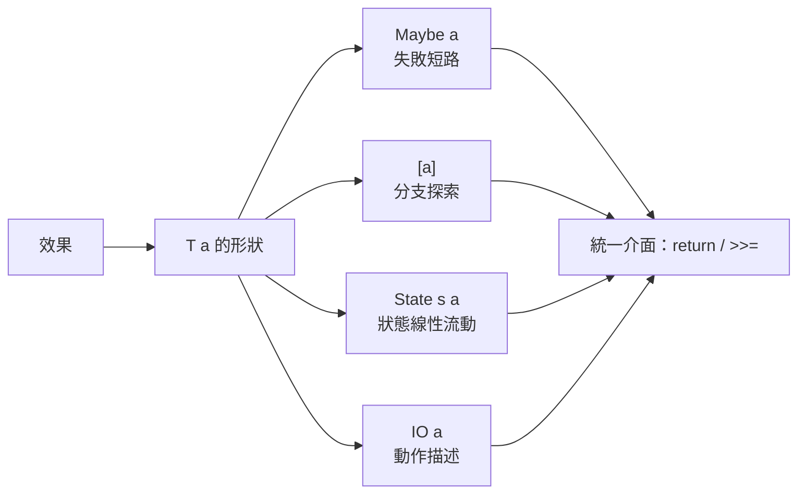

# 08.1 為什麼純函數需要 Monad：處理不確定性 IO 與狀態

## 前言：純淨世界的裂縫

純函數式程式有一個迷人的承諾：**函數是數學函數**——同樣的輸入
永遠得到同樣的輸出，沒有隱藏狀態，沒有時空依賴。這個承諾帶來
引用透明（referential transparency），使程式可以像代數式一樣
自由改寫、平行執行、自動測試。

但真實程式必須讀鍵盤、寫檔案、擲骰子、看時鐘。這些操作**違反
數學函數的定義**：`getLine` 兩次呼叫回傳不同字串，`random` 根本
不是函數。純淨世界出現了裂縫。本章講述這條裂縫如何被 Moggi 的
monad 概念縫合，以及 Haskell 為此付出的設計代價與換來的回報。

## 1. 問題一：IO 不是函數

考慮最簡單的例子。在指令式語言中：

```python
name = input()      # 第一次：使用者輸入 "Alice"
name = input()      # 第二次：使用者輸入 "Bob"
```

把 `input` 看成函數 `() -> String`，則兩次相同輸入得到不同輸出，
它不是數學函數。更糟的是：它與外界互動的**時間點**也很重要
（先讀檔再刪檔，與先刪檔再讀檔，結果天差地別）。

在指稱語義的框架下，這產生了嚴重困境：如果 `input` 沒有數學
意義，那麼整個程式的意義是什麼？1980 年代有幾種嘗試：

1. **放棄純度**：允許不純函數（Lisp、ML 的路線）。代價是引用
   透明消失，等式推理失效。
2. **把世界當參數**：`getLine :: World -> (String, World)`。
   世界 $\omega_1$ 經過讀取變成世界 $\omega_2$ ，型別上完全純。
   問題是 `World` 是無限大的物件，而且程式設計師可能濫用它——
   例如把同一個世界用兩次（複製宇宙！）：

```haskell
-- 危險的「世界傳遞」：
let (s1, w1) = getLine w0
    (s2, w2) = getLine w0   -- 錯！用了舊世界，時光倒流
```

純型別系統無法阻止這種「世界被重用」的 bug。我們需要一個辦法，
讓「世界」**只能線性使用、不能複製、不能丟棄**——但又能用
普通函式組合程式。

## 2. Moggi 的答案：把「動作」變成「值」

Moggi（1990）的洞見是換一個分類層次。他說：**不要把有效果的
操作當成函數，把「執行後才產生值的計算」當成一種新的值**。

型別上引入建構子 $T$ （對 IO 就是 `IO`）：

- 純值： $a$ 。
- 帶效果的計算： $T a$ ——「執行後會產生一個 $a$ 的動作描述」。

關鍵區分：`IO a` **不是** $a$ ，而是「取得 $a$ 的計畫」。計畫本身
是純粹的資料，可以傳遞、儲存、組合；只有 runtime 在最後執行它。
這樣 `getLine :: IO String` 有了明確的數學地位：它是 **Kleisli
範疇中的態射**，不是 Hask 中的函數。

$$
\text{Kleisli 範疇：物件是型別，態射是 } f: a \to T b
$$

純函數 $f: a \to b$ 可以「免費升級」為 $f': a \to T b$
（用單位 $\eta$ ），但反之不成立——這個不對稱正是安全的來源：
**效果可以被引入，但不能偷偷逃走**。

## 3. 串接動作：unit 與 bind

有了 $T a$ ，還需要把動作串起來。Moggi 給出兩個基本運算：

**單位（unit）**： $\eta: a \to T a$ ，把純值包裝成無效果的計算。

```haskell
return :: a -> IO a   -- 「什麼都不做，只是回傳 x」的動作
```

**綁定（bind）**：串接。給定動作 $m: T a$ 與後續 $f: a \to T b$ ，
產生合成動作 $T b$ ：

```haskell
(>>=) :: IO a -> (a -> IO b) -> IO b
```

有了這兩件工具，「先讀後寫」終於可以表達：

```haskell
echo :: IO ()
echo = getLine >>= \s -> putStrLn ("Hello, " ++ s)
```

而世界重用問題自動消失：`>>=` 的型別強制 $f$ 接收 $m$ 的**結果**，
舊世界根本不在手上。世界是線性流動的，型別系統保證了這一點。

## 4. 非確定性：List Monad 同一框架

同樣的框架完美處理非確定性。一個「可能有多個結果」的計算是
$T a = [a]$ ：

```haskell
-- 非確定性選擇：回傳多個可能值
choose :: a -> [a]
choose x = [x, x + 1]

-- 串接 = 對每個分支繼續探索
-- [1,2] >>= choose = [2,3,3,4]
```

這裡 `>>=` 是列表綜合的推廣：

```haskell
instance Monad [] where
  return x = [x]
  xs >>= f = concatMap f xs
  -- 即 [ (y) | x <- xs, y <- f x ]
```

**範例 4.1（N 皇后）**。用 list monad 表達搜尋：

```haskell
queens :: Int -> [[Int]]
queens n = foldM (\cols _ ->
    [ col : cols | col <- [1..n], safe col cols ])
    [] [1..n]

safe :: Int -> [Int] -> Bool
safe col cols = and [ checks col rows k | (k, rows) <- zip [1..] (tails cols) ]
  where checks c (r:rs) k = c /= r && abs (c - r) /= k && checks c rs k
        checks _ []     _ = True
```

`foldM` 是 monad 抽象的高階組合：同一段程式骨架，把 `[]` 換成
`Maybe` 就變成「找第一個解」。**效果的差異全部藏在 monad 實例裡，
演算法邏輯完全不變**——這是 Moggi 分類法的直接收益。

## 5. 可變狀態：State Monad 推導

狀態是第三種基本效果。「讀改寫一個變數」在純函數世界中的誠實
描述是：**吃進舊狀態、吐出新狀態與結果**：

$$
\text{State}\ s\ a \;=\; s \to (a, s)
$$

它也是一個 monad：

```haskell
newtype State s a = State { runState :: s -> (a, s) }

instance Monad (State s) where
  return x = State $ \s -> (x, s)
  m >>= f  = State $ \s ->
    let (x, s') = runState m s
    in  runState (f x) s'
```

串接時狀態自動流動：

```haskell
tick :: State Int Int
tick = do
  n <- get      -- State $ \s -> (s, s)
  put (n + 1)   -- State $ \_ -> ((), n + 1)
  return n

-- runState tick 0 = (0, 1)
-- 「看起來像指令式程式，實際是純函數的組合」
```

注意模式的一致性：



## 6. do 記法：指令式外觀，代數內核

Haskell 為 `>>=` 提供語法糖：

```haskell
program = do
  s1 <- getLine
  s2 <- getLine
  return (s1 ++ s2)

-- 脫糖：
program = getLine >>= \s1 ->
          getLine >>= \s2 ->
          return (s1 ++ s2)
```

每次 `<-` 都是一次 bind，效果（順序、短路、分支、狀態流動）由
對應 monad 的 `>>=` 實例決定。**do 區塊在 Maybe 中會短路、在
列表中會展開為所有組合、在 State 中會傳遞狀態**——同一種語法，
不同語義，這正是抽象的力量。

## 7. 代價與回報

這套設計不是免費的：

**代價**：
- 標記性儀式（`return`、`<-.`、lift）增加噪音。
- `IO` 會「傳染」：呼叫 IO 的函式必須標記為 `IO`。
- 學習曲線陡峭（「monad 是自函子上的幺半群……」的笑話由此而來）。

**回報**：
- **效果被型別記錄**：看簽名就知道函式做什麼，`IO` 不會藏在
  三層呼叫之下。
- **效果可組合**：monad transformer（09 章、08.3 延伸）讓
  「狀態＋例外＋日誌」有系統地疊加。
- **等式推理保留**：`>>=` 本身是純函數，monad laws 提供改寫
  依據，編譯器最佳化與程式變換有了數學基礎。
- **平行安全的自由**：純部分可以任意 evaluation order，編譯器
  （如 GHC）能大膽平行化。

## 8. 章末小結

- IO、非確定性、可變狀態都違反「函數＝數學函數」的承諾；
  「世界當參數」的樸素方案會導致世界重用 bug。
- Moggi（1990）：帶效果的計算是 $T a$ 型的值，是 Kleisli 態射；
  效果串接由 unit 與 bind 兩個運算承擔。
- `IO a` 是「動作描述」而非 $a$ ；`>>=` 保證世界線性流動。
- Maybe、List、State、IO 用同一介面（`return`／`>>=`）表達
  四種不同效果，差異全部封裝在實例中。
- do 記法是指令式外觀、代數內核；效果的型別傳染是特性不是缺陷。

## 下一步

我們已經直覺地使用了 monad，但它究竟「是」什麼？為什麼恰好是
這兩個運算、這幾條法律？下一章（08.2）給出嚴格定義：**Monad
是自函子範疇上的幺半群**——我們將拆解 Mac Lane 的這句名言，
定義 $\mu$ 與 $\eta$ 、證明三條 monad 法律、並展示 `>>=` 與
join 的等價性，讓「拼裝邏輯」的數學根基完全現形。
