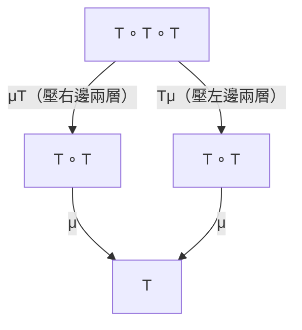
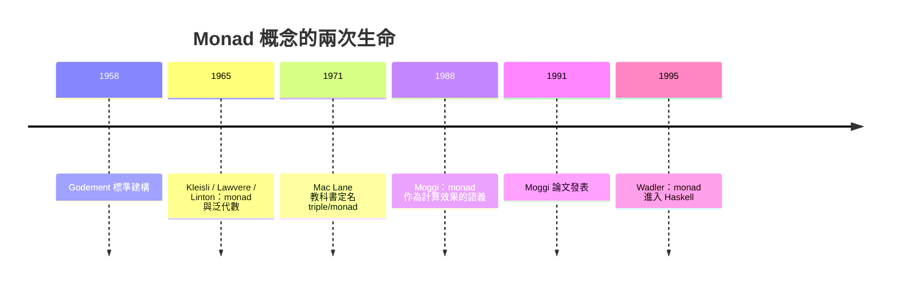

# 08.2 Monad 的數學定義：么半群在函子範疇中的自我運算

## 前言：一句名言的完全拆解

Philip Wadler 轉述 Mac Lane 的話（常被誤傳為笑話）：

> 「一個 monad 就是一個自函子範疇上的幺半群，這有什麼難懂的？」

這句話出自 Mac Lane 的《Categories for the Working Mathematician》
前言，並非玩笑：monad 的定義確實可以用一句話說完——但每個詞
（自函子、範疇、幺半群）都需要展開。本章逐詞拆解，讓這句話成為
你真正理解 monad 的鑰匙，而非恐懼的來源。

## 1. 先回顧：幺半群是什麼

**定義 1.1（幺半群，monoid）**。一個幺半群是三元組 $(M, \cdot, e)$：

- $M$ 是一個集合。
- $\cdot: M \times M \to M$ 是結合的二元運算：
  $(x \cdot y) \cdot z = x \cdot (y \cdot z)$。
- $e \in M$ 是單位元：$e \cdot x = x = x \cdot e$。

熟悉的例子：$(\mathbb{N}, +, 0)$、
$(\text{字串}, {+}, \epsilon)$、
$(\text{端點到自身的函數}, \circ, \mathrm{id})$。

第三個例子暗藏玄機：取 $M = X \to X$（$X$ 上所有自映射），
複合為運算、$\mathrm{id}$ 為單位。這提示幺半群的本質不在
「集合」而在**「可以複合、有單位的東西」**。把「集合」換成
「任何範疇的態射」，就得到幺半群的推廣。

## 2. 推廣：把集合換成自函子

現在進行 Mac Lane 的推廣。考慮範疇 $\mathcal{C}$（例如 **Hask**）
上的自函子，它們自身構成一個範疇 $\mathbf{End}(\mathcal{C})$：

- 物件：自函子 $F, G: \mathcal{C} \to \mathcal{C}$。
- 態射：自然變換 $\alpha: F \Rightarrow G$。

在這個「函子範疇」裡，幺半群的原料一應俱全：

| 幺半群（集合版） | 函子範疇版 |
|---|---|
| 底集合 $M$ | 自函子 $T$ |
| 乘法 $\cdot: M \times M \to M$ | 自然變換 $\mu: T \circ T \Rightarrow T$ |
| 單位 $e \in M$ | 自然變換 $\eta: \mathrm{Id} \Rightarrow T$ |
| 結合律 | $\mu \circ T\mu = \mu \circ \mu T$ |
| 單位律 | $\mu \circ \eta T = \mathrm{id} = \mu \circ T\eta$ |

**定義 2.1（範疇論 monad）**。範疇 $\mathcal{C}$ 上的 monad
是三元組 $(T, \eta, \mu)$，其中 $T$ 是自函子，
$\eta: \mathrm{Id} \Rightarrow T$（unit）、
$\mu: T^2 \Rightarrow T$（multiplication）是自然變換，
滿足：

$$
\mu \circ T\mu = \mu \circ \mu T \quad (\text{結合律})
$$
$$
\mu \circ \eta T = \mathrm{id}_T = \mu \circ T\eta \quad (\text{單位律})
$$

「么半群在函子範疇中」的意思至此完整：**把幺半群公理中的集合
換成自函子、乘積換成函子複合 $T \circ T$、元素換成自然變換**。
「自我運算」指的是 $\mu$ 把 $T$ 與自己複合的結果壓回 $T$ 本身——
一種自我消化。

## 3. 畫出交換圖

結合律的交換圖（兩條從 $T^3$ 到 $T$ 的路徑必須相等）：

$$
\begin{array}{ccc}
T^3 & \xrightarrow{\;\mu T\;} & T^2 \\
{\scriptstyle T\mu}\downarrow & & \downarrow{\scriptstyle \mu} \\
T^2 & \xrightarrow{\;\mu\;} & T
\end{array}
$$

單位律的交換圖：

$$
\begin{array}{ccc}
T & \xrightarrow{\;\eta T\;} & T^2 \\
{\scriptstyle \mathrm{id}}\downarrow & \nearrow{\scriptstyle \mu} &
\downarrow{\scriptstyle T\eta} \\
T & \xleftarrow{\;\mu\;} & T^2
\end{array}
$$



## 4. 翻譯成 Haskell

$\eta$ 就是 `return`/`pure`；$\mu$ 就是 `join`：

```haskell
class Functor m => Monad m where
  return :: a -> m a                 -- η : Id ⇒ m
  join   :: m (m a) -> m a           -- μ : m ∘ m ⇒ m
  (>>=)  :: m a -> (a -> m b) -> m b
```

**定理 4.1（bind 與 join 等價）**。給定 `return` 與 `join` 可以
定義 `>>=`；反之亦然：

```haskell
-- 用 join 定義 bind：
m >>= f = join (fmap f m)

-- 用 bind 定義 join：
join mma = mma >>= id
```

證明 sketch：`fmap f :: m a -> m (m b)` 把每個結果變成子計算，
`join` 把 $m^2$ 壓回 $m$。兩個方向代入 monad laws 即可驗證
等價。**所以「有三個運算」是假象：monad 只需要一對生成元
（$\eta, \mu$）加三條法律。**Haskell 標準的 `return`／`>>=`
版本只是把 $\mu$ 預先與 fmap 綁在一起。

用 join 重寫三條法律：

```haskell
-- 結合律：μ . fmap μ = μ . join
join . join == join . fmap join       -- 兩層嵌套，先壓哪層都一樣
-- 單位律：
join . return == id                   -- return 之 join = 不變
join . fmap return == id              -- fmap return 之 join = 不變
```

## 5. 具體驗證：List Monad

以列表為例逐一驗證。$T = [\,]$，
$\eta(x) = [x]$，
$\mu(\text{嵌套列表}) = \text{concat}$：

```haskell
-- η : a -> [a]
eta = \x -> [x]

-- μ : [[a]] -> [a]
mu :: [[a]] -> [a]
mu = concat
```

**驗證結合律** $\mu \circ \mu = \mu \circ T\mu$（此處 $T\mu$ 對
列表就是 `map concat`）：

```haskell
xs :: [[[Int]]]
xs = [[[1,2],[3]], [[4]]]

mu (mu xs)        -- concat (concat xs)      = [1,2,3,4]
mu (map concat xs) -- concat [concat e | e <- xs] = [1,2,3,4]
```

兩層壓平的順序無關緊要——正如連加時括號位置無關緊要。
**這就是「幺半群」比喻的實質**：concat 是列表的「乘法」，
`[[1],[2]]` 壓平成 `[1,2]`，完全類比 `1 + 2`。

## 6. Kleisli 態射與 bind 的真正身份

Moggi 的程式視角（08.1）在這個數學框架中的位置：

**定義 6.1（Kleisli 範疇）**。給定 monad $(T, \eta, \mu)$，
Kleisli 範疇 $\mathcal{C}_T$ 定義為：

- 物件：與 $\mathcal{C}$ 相同。
- 態射：$f: a \to T b$（Kleisli 態射）。
- 複合：$g \bullet f = \mu \circ T g \circ f$。
- 單位：$\eta$。

在 Haskell 中，Kleisli 複合就是：

```haskell
(>=>) :: (a -> m b) -> (b -> m c) -> (a -> m c)
f >=> g = \x -> f x >>= g

-- 三條 monad laws 在 Kleisli 語言下最為優雅：
-- return >=> f == f          （η 是左單位）
-- f >=> return == f          （η 是右單位）
-- (f >=> g) >=> h == f >=> (g >=> h)  （結合律）
```

**於是我們看清了全貌**：monad laws 說「Kleisli 態射在 $\bullet$
與 $\eta$ 下構成範疇」。帶效果的函式確實能組成一個全新的範疇——
這就是 08.1 開頭「Kleisli 範疇中的態射」的精確含義。

## 7. Monad 誕生的數學史前史

有趣的是，monad 在程式出現前早就是數學要角：

- **1958**：Godement 以「標準建構」（standard construction）研究
  層論，是 monad 的雛形。
- **1965 前後**：Huber、Kleisli、Lawvere、Linton 各自獨立提出
  monad 概念，用於研究泛代數。**Every monad arises from an
  adjunction**（每個 monad 都來自一對伴隨函子）與
  **monadic/ tripleable functor** 的刻畫在這時期完成。
- **1960s 末**：Linton 用 monad 統一泛代數——各種代數結構
  （群、環、格）都是某個 monad 的代數，monad 成為「廣義代數
  理論」的載體。
- **1988–1991**：Moggi 把 monad 從泛代數搬到計算語義，
  $\eta$ 變成 `return`，$\mu$ 變成 `join`，泛代數的「操作」
  變成計算效果。



## 8. 章末小結

- 幺半群 $(M, \cdot, e)$ 的本質是「可複合、有單位」；
  自映射幺半群是通往函子版本的跳板。
- Monad $(T, \eta, \mu)$：$\eta: \mathrm{Id} \Rightarrow T$、
  $\mu: T^2 \Rightarrow T$，滿足結合律與兩條單位律，
  即函子範疇中的幺半群。
- Haskell 的 `return`＝$\eta$，`join`＝$\mu$；
  `>>=` 與 `join`／`fmap` 互相定義，三條 laws 兩種寫法等價。
- Kleisli 範疇讓 monad laws 變成「帶效果函式構成範疇」的敘述。
- Monad 有三十年的數學史前史（泛代數、伴隨），Moggi 是把它
  帶進計算的關鍵人物。

## 下一步

抽象定義已經就位。下一章（08.3）我們檢驗三個最重要的 monad
實例——**Reader、State、Continuation**——的代數結構：它們各自
的 $\eta$ 與 $\mu$ 長什麼樣、如何互相轉換、以及 Continuation
這個「反轉控制流」的 monad 為何是表達力最強（也最燒腦）的例子。
這三個實例將成為第 09 章 monad transformer 的磚塊。
