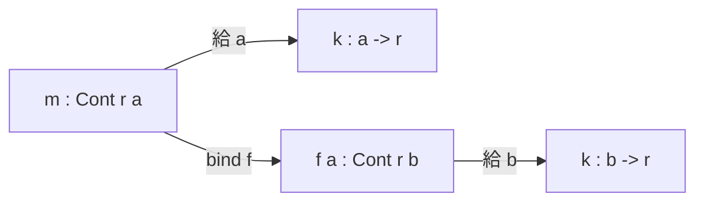
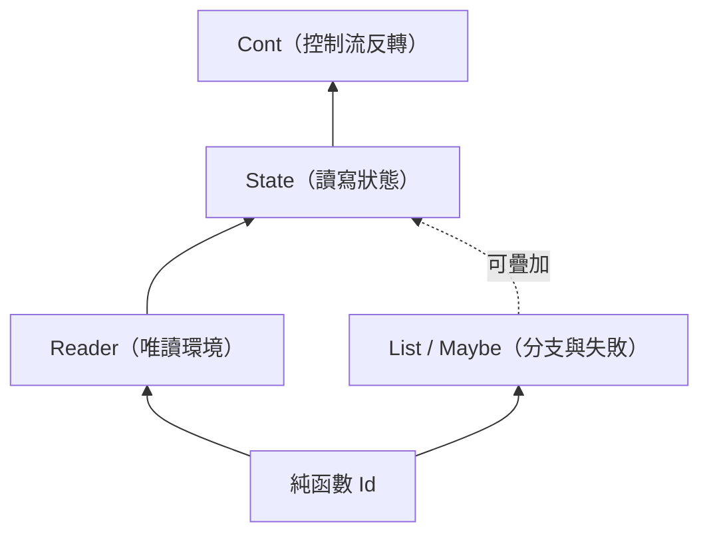

# 08.3 Reader、State 與 Continuation 單子的代數結構

## 前言：三個單子，三種「環境觀」

08.1 與 08.2 建立了一般理論；本章深入三個關鍵實例。它們代表
三種截然不同卻又互相關聯的計算觀：

- **Reader**：計算是「對環境的觀察」——$r \to a$。
- **State**：計算是「狀態的轉換」——$s \to (a, s)$。
- **Continuation**：計算是「對未來的承諾」——$(a \to r) \to r$。

理解它們的 $\eta$ 與 $\mu$，你將看到「monad 是幺半群」不只在
定義上成立，在每個實例中都可以手算驗證。這三者也構成了理解
monad transformer（效果疊加）的最佳起點。

## 1. Reader：計算即環境函數

**定義 1.1**。對固定型別 $r$，Reader monad 定義為

$$
R_r(a) = (r \to a)
$$

它把「依賴環境的計算」表達為環境函數。

```haskell
newtype Reader r a = Reader { runReader :: r -> a }

instance Functor (Reader r) where
  fmap f (Reader g) = Reader (f . g)   -- 函數的後複合

instance Applicative (Reader r) where
  pure a = Reader (const a)
  Reader f <*> Reader g = Reader $ \r -> f r (g r)
  -- 兩個函數餵同一個環境 r

instance Monad (Reader r) where
  return a = Reader $ \_ -> a
  m >>= f  = Reader $ \r -> runReader (f (runReader m r)) r
```

bind 的語義值得逐字細讀：`runReader m r` 用環境算出中間值，
傳給 `f` 得到新函數，**再用同一個環境 $r$ 求值**。同一環境、
多次觀察——這正是「全域設定檔」語義：

```haskell
data Config = Config { port :: Int, host :: String }

server :: Reader Config String
server = do
  h <- asks host
  p <- asks port
  return (h ++ ":" ++ show p)
-- 兩次 asks 都看到同一份 Config
```

### 1.1 Reader 的幺半群結構

- $\eta(a) = \lambda r.\, a$：常數函數（不看環境）。
- $\mu : (r \to r \to a) \to r \to a$，
  即 $\mu(f)(r) = f(r)(r)$——**對角化**（把環境餵兩次）。

驗證單位律 $\mu \circ \eta R = \mathrm{id}$：
$\mu(\eta \circ f)(r) = (\eta \circ f)(r)(r) = f(r)$ ✓。
$\mu$ 的對角線本質，使 Reader 與笛卡兒封閉結構深度相關
（它其實是一個 comonad 的對偶伙伴，見延伸閱讀）。

## 2. State：計算即狀態轉換

**定義 2.1**。對固定型別 $s$：

$$
S_s(a) = s \to (a, s)
$$

```haskell
newtype State s a = State { runState :: s -> (a, s) }

get   :: State s s
get   = State $ \s -> (s, s)

put   :: s -> State s ()
put n = State $ \_ -> ((), n)

instance Monad (State s) where
  return a = State $ \s -> (a, s)   -- 狀態原樣通過
  m >>= f  = State $ \s ->
    let (a, s') = runState m s      -- 先跑，得中間狀態 s'
    in  runState (f a) s'           -- 新狀態餵給後續
```

### 2.1 State 的幺半群結構

- $\eta(a) = \lambda s.\,(a, s)$：恆等狀態轉換。
- $\mu : (s \to (s \to (a, s), s)) \to s \to (a, s)$。

寫開來看：$S_s(S_s(a)) = s \to ((s \to (a,s)), s)$，是「一個
函數與一個狀態」的配對。$\mu$ 的動作：

```haskell
join :: State s (State s a) -> State s a
join (State f) = State $ \s ->
  let (inner, s')  = f s      -- 第一段：跑外層，得內層函數與新狀態
      (a,      s'') = runState inner s'  -- 第二段：在新狀態上跑內層
  in  (a, s'')
```

**狀態的線性流動 $s \to s' \to s''$ 正是 $\mu$ 的幾何**：
壓平兩層 State 時，兩段狀態轉換首尾相接成為一條鏈。結合律
（先壓外兩層或先壓內兩層結果相同）對應「三段狀態轉換無論怎麼
分組，最終狀態一樣」——這就是狀態序列的結合律。

### 2.2 Reader 是 State 的退化

一個漂亮的關係：若強制狀態「不能被寫回」，State 退化為 Reader。
形式上：

$$
r \to a \;\cong\; r \to (a, \mathbf{1}) \quad (\mathbf{1}\ \text{為單位型別})
$$

寫入端被壓成單位型別 `()`，狀態傳遞退化為「同一環境重複讀取」。
在程式上：

```haskell
-- Reader r a  ≅  State r a 的唯讀子空間
type Reader' r a = State r a   -- 約定只用 get/asks，不用 put
```

這預示了**效果強度階層**：Reader（唯讀）⊂ State（讀寫）。
型別簽名中的效果越弱，函式越容易推理與平行化——效果系統的
實用價值正在於可以**宣告並區分**這些強度。

## 3. Continuation：把「剩餘的計算」當值

**定義 3.1**。對固定結果型別 $r$：

$$
C_r(a) = (a \to r) \to r
$$

直覺：一個 `Cont r a` 是「一個還沒發生的故事」——它不產生 $a$，
而是**等著 $a$ 的消費者**（continuation，延續）上門，再把最終
答案 $r$ 交出來。

```haskell
newtype Cont r a = Cont { runCont :: (a -> r) -> r }

instance Monad (Cont r) where
  return a = Cont $ \k -> k a                     -- 直接把 a 交給延續
  m >>= f  = Cont $ \k -> runCont m (\a -> runCont (f a) k)
  -- 「先用 f a 佔住延續的位置；m 完成後，其結果 a 進入 f」
```

`return` 與 bind 的交換圖邏輯：



### 3.1 範例：提早返回與非本地跳轉

```haskell
-- callCC 提供「逃離當前延續」的能力
-- callCC :: ((a -> Cont r b) -> Cont r a) -> Cont r a

findFirstEven :: [Int] -> Cont r (Maybe Int)
findFirstEven xs = callCC $ \exit -> do
  mapM_ (\x -> if even x then exit (Just x) else return ()) xs
  return Nothing
-- exit 直接把控制流跳到呼叫 findFirstEven 的延續，
-- 等效於指令式語言的 break / early return
```

Continuation 是**表達力上限**的 monad：例外、產生器、協程、
非同步 callback 都能在 Cont 中編碼。Filinski（1994）證明：
**帶一階 continuation 的語言可以模擬所有 monad**——Cont 之於
效果，如同 lambda 演算之於計算。

### 3.2 Cont 的幺半群結構

- $\eta(a) = \lambda k.\,k(a)$：把 $a$ 交給延續（CPS 中的恆等步驟）。
- $\mu : ((a \to r) \to r) \to r \to r \to r$ 中間形態複雜，
  實際上是雙重 CPS 的壓平：

```haskell
join :: Cont r (Cont r a) -> Cont r a
join (Cont f) = Cont $ \k -> f (\inner -> runCont inner k)
-- 外層故事的「結局」是內層故事；把內層直接接到最終延續上
```

## 4. 三者比較與轉換

| 面向 | Reader $r$ | State $s$ | Cont $r$ |
|---|---|---|---|
| 形狀 $T a$ | $r \to a$ | $s \to (a, s)$ | $(a \to r) \to r$ |
| $\eta$ | 常數函數 | 恆等轉換 | 交給延續 |
| $\mu$ 的直覺 | 對角化（環境餵兩次） | 狀態鏈首尾相接 | 內外延續接軌 |
| 程式直覺 | 全域設定 | 可變變數 | 反轉控制流 |
| 效果強度 | 最弱 | 中 | 最強 |

它們並非孤立：Reader 與 State 可互相模擬（傳遞可變環境即 State、
凍結 State 即 Reader）；Cont 可以模擬前兩者（用延續傳遞環境與
狀態）。**效果能力形成偏序，Cont 幾乎在頂端**：



## 5. 前因後果：為什麼這三個成為教科書三原色

歷史上這三個 monad 幾乎同時進入 Haskell 的視野：

- **State** 來自 Moggi 論文的原始範例（可賦值儲存），也是
  Wadler 1992 年論文的重點演示。
- **Reader** 在 1990 年代中期由社群（如 Mark Jones 的工作脈絡）
  提煉，作為「依賴注入」的純函數式答案。
- **Cont** 更早：Scheme 的 `call/cc`（1980s，源自 1960s CPS
  譯碼研究）是它的原生棲地；Wadler 與 others 指出其 monadic
  本質後，它成為「表達力上限」的理論試金石。

三者共同構成後來 **MTL（Monad Transformer Library）** 的核心
積木：`ReaderT`、`StateT`、`ContT` 讓效果可以疊加，而疊加的
正確性最終依賴各自的幺半群結構——這是第 09 章的序曲。

## 6. 章末小結

- Reader $r\to a$：$\eta$ 為常數函數、$\mu$ 為對角化；語義是
  「同一環境多次觀察」。
- State $s\to(a,s)$：$\eta$ 為恆等轉換、$\mu$ 把兩段狀態轉換
  接成鏈；結合律即狀態序列的結合律。
- Cont $(a\to r)\to r$：$\eta$ 交給延續、$\mu$ 接軌內外延續；
  表達力最強，可模擬其他效果。
- 三者構成效果強度的偏序：Id < Reader < State < Cont，
  也是 MTL 函式庫的基礎積木。
- 「幺半群」不再是口號：每個實例的 $\mu$ 都能手算驗證單位律
  與結合律。

## 下一步

單一效果已經駕輕就熟，但真實系統同時需要「設定檔＋日誌＋例外＋
狀態」。下一章開始（09.1）我們暫別效果，回到資料結構的範疇論：
**積與餘積**——tuple 與 `Either` 的數學本質、它們的萬有性質、
以及為什麼「和與積」是所有代數資料型別（ADT）的兩種基本生成
方式。餘積的概念也將直接支撐 09.2 的初始代數與 09.3 的共歸納。
