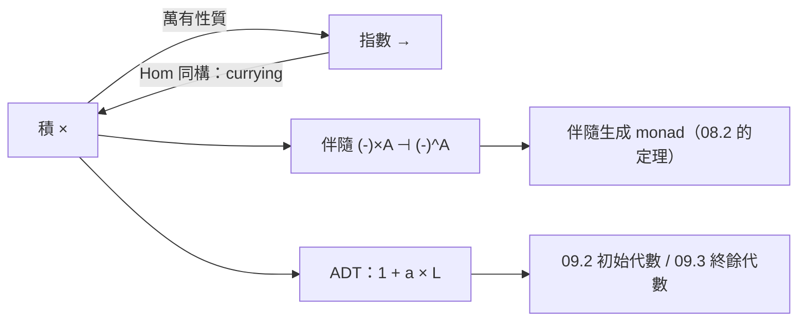

# 09.1 積與餘積在資料結構中的構造

## 前言：兩種最原始的「組合」

任何程式語言的資料結構，無論多複雜，幾乎都能拆解成兩種組合
方式的反覆套用：

1. **「同時擁有」**：一個座標點同時有 $x$ 與 $y$ → 積（product）。
2. **「擇一而存」**：一個結果要嘛成功要嘛失敗 → 餘積（coproduct）。

在 Haskell 中這就是 tuple 與 `Either`；在範疇論中，它們是**積**
與**餘積**——一對由對偶性相連的萬有構造（universal construction）。
本章將定義它們、證明萬有性質、示範代數資料型別（ADT）如何由
這兩種構造生成，並說明「萬有性質」為什麼是範疇論最鋒利的工具。

## 1. 積：萬有性質的第一次登場

**樸素定義的不足**。直覺上「積就是配對」，但範疇論要求我們
只用態射說話（不開箱）。什麼樣的物件 $A \times B$ 才配稱為積？

**定義 1.1（積）**。範疇 $\mathcal{C}$ 中物件 $A, B$ 的積是一個
物件 $A \times B$ 配上兩個投影態射：

$$
\pi_1 : A \times B \to A, \qquad \pi_2 : A \times B \to B
$$

滿足**萬有性質**：對任何物件 $X$ 與態射 $f: X \to A$、
$g: X \to B$，存在**唯一**態射 $\langle f, g \rangle: X \to A \times B$
使得下圖交換：

$$
\begin{array}{ccc}
& X & \\
{\scriptstyle f}\swarrow & {\scriptstyle \langle f,g\rangle}\downarrow & \searrow{\scriptstyle g} \\
A & \xleftarrow{\;\pi_1\;} & A \times B \xrightarrow{\;\pi_2\;} B
\end{array}
$$

即 $\pi_1 \circ \langle f, g \rangle = f$ 且
$\pi_2 \circ \langle f, g \rangle = g$。

**解讀**：萬有性質說「任何想同時進入 $A$ 和 $B$ 的方式，都必須
經過 $A \times B$，而且路徑唯一」。積是**進入 $A \times B$ 的
萬用介面**：兩個分量確定後，整個映射就唯一確定。

### 1.1 在 Set 與 Haskell 中

在 **Set** 中，$A \times B$ 就是笛卡兒積、$\pi_i$ 就是投影、
$\langle f, g \rangle (x) = (f(x), g(x))$。唯一性由函數的
外延性保證。

```haskell
-- Haskell 版本：
fst :: (a, b) -> a     -- π₁
snd :: (a, b) -> b     -- π₂

pair :: (x -> a) -> (x -> b) -> x -> (a, b)
pair f g = \x -> (f x, g x)   -- ⟨f, g⟩

-- 萬有性質的兩半：
fst . pair f g == f
snd . pair f g == g
-- 唯一性：若 h 滿足 fst . h = f 且 snd . h = g，則 h = pair f g
--         因為 h x = (f x, g x) 被兩條件完全決定
```

**注意**：唯一性使積「在本質上唯一」——若 $(A \times B, \pi)$
與 $(P, q)$ 都是積，則存在唯一同構 $A \times B \cong P$。
所以我們可以放心說「**the** product」。這是萬有構造的一般
模式：**萬有性質 ⇒ 存在（假設）＋唯一（定理）⇒ 本質唯一**。

## 2. 餘積：把箭頭全部反轉

對偶性（07.1）現在兌現紅利：把積的萬有性質中所有態射方向
反轉，得到餘積。

**定義 2.1（餘積）**。物件 $A, B$ 的餘積是物件 $A + B$ 配上
**內射**（injections）：

$$
\iota_1 : A \to A + B, \qquad \iota_2 : B \to A + B
$$

萬有性質：對任何 $f: A \to X$、$g: B \to X$，存在唯一
$[f, g]: A + B \to X$ 使
$[f, g] \circ \iota_1 = f$、$[f, g] \circ \iota_2 = g$。

$$
\begin{array}{ccc}
A & \xrightarrow{\;\iota_1\;} & A + B \xleftarrow{\;\iota_2\;} & B \\
& {\scriptstyle f}\searrow & {\scriptstyle [f,g]}\downarrow & \swarrow{\scriptstyle g} \\
& & X &
\end{array}
$$

在 **Set** 中，$A + B$ 是**不交聯集**（disjoint union），
$[f, g]$ 是分段定義函數。在 Haskell 中：

```haskell
data Either a b = Left a | Right b    -- ι₁ = Left, ι₂ = Right

either :: (a -> x) -> (b -> x) -> Either a b -> x
either f g (Left a)  = f a
either f g (Right b) = g b            -- [f, g]

-- 萬有性質：
either f g . Left  == f
either f g . Right == g
```

## 3. 對偶表對照

| | 積 $A \times B$ | 餘積 $A + B$ |
|---|---|---|
| 結構態射 | 投影 $\pi_i$（**射出**） | 內射 $\iota_i$（**射入**） |
| 萬有映射 | $\langle f, g \rangle: X \to A\times B$ | $[f, g]: A+B \to X$ |
| 定義方式 | 由「**出去**」的行為唯一決定 | 由「**進來**」的行為唯一決定 |
| Haskell | `(a, b)`，`fst`／`snd` | `Either a b`，`either` |
| 直覺 | 消費者觀點：怎麼拆 | 生產者觀點：怎麼選 |
| 集合基數 | $\|A\| \cdot \|B\|$ | $\|A\| + \|B\|$ |

最後一列解釋了命名：**集合的積是基數相乘、餘積是基數相加**。
這也讓型別的「代數」名稱名副其實：

```haskell
data Shape = Circle Double | Rect Double Double
-- Shape ≅ Double + (Double × Double)
-- 基數：|Double| + |Double| × |Double|
```

## 4. 代數資料型別：積與餘積的封閉世界

Haskell 的 ADT（algebraic data type）語法：

```haskell
data T = C1 a b | C2 c | C3
```

的含義正是：

$$
T \;\cong\; (a \times b) \;+\; c \;+\; \mathbf{1}
$$

每個 `|` 分支是一個**和**的項，每個欄位序列是一個**積**，
無欄位建構子是單位型別 $\mathbf{1}$（單元素型別）。

**範例 4.1**：

```haskell
data List a = Nil | Cons a (List a)
-- List a ≅ 1 + a × List a

data Tree a = Leaf | Node (Tree a) a (Tree a)
-- Tree a ≅ 1 + Tree a × a × Tree a

data Maybe a = Nothing | Just a
-- Maybe a ≅ 1 + a
```

這些是**遞迴方程式**（在型別上）：$L \cong 1 + a \times L$。
這個方程式的「最小解」與「最大解」正是 09.2 與 09.3 的主題
（初始代數與終餘代數）。ADT 語法就是把型別方程式直接寫進
程式語言——**型別宣告是等式，資料建構是項，模式匹配是
解方程**。

### 4.1 函數型別：指數

第三種構造是函數型別 $a \to b$，它在範疇論中是**指數**
$B^A$（07.2 已見）。基數上 $|b|^{|a|}$，故此得名。三者合起來
（$+$、$\times$、$\to$、加上 $\mathbf{0}$ 與 $\mathbf{1}$）
使 Haskell 型別形成一個（近似的）**半環**：

```haskell
-- 型別算術的驗證（同構層次）：
-- (a + b) × c ≅ a × c + b × c
dist :: (Either a b, c) -> Either (a, c) (b, c)
dist (Left a,  c) = Left (a, c)
dist (Right b, c) = Right (b, c)

-- a × 1 ≅ a
unitL :: (a, ()) -> a
unitL (a, ()) = a
-- 以及分配律、單位律、零律（a × 0 ≅ 0）……
```

**型別重構因此獲得代數依據**：`Either (a, c) (b, c)` 與
`(Either a b, c)` 在行為上同構，選哪個寫法是風格而非語義問題。

## 5. 萬有性質的威力：免費定理的來源

萬有性質不只定義物件，還**自動生成定律**。積的例子：

**定理 5.1（積的對稱性）**。$A \times B \cong B \times A$。

證明不需要看元素，只用萬有性質：$A \times B$ 有兩個投影，
反過來把它們「扭轉」後作為 $B \times A$ 進入積的資格，萬有性質
分別給出兩個方向的同構，再由唯一性證明互逆（兩個複合都是
「進入積的合法映射且分量正確」，故必等於身分）。

```haskell
swap :: (a, b) -> (b, a)
swap (a, b) = (b, a)
-- swap . swap = id，可由唯一性直接讀出
```

這個方法論的推廣極為深遠：**凡是能寫出萬有性質的構造，其
同構與定律都「免費」**。極限與餘極限（limit/colimit）是積與
餘積的一般化；第 09.2 的初始代數也是一種萬有構造。

## 6. 積與餘積之外：指數與 Currying 再訪

07.2 的 currying 同構在積的框架下獲得精確形式：

$$
\mathrm{Hom}(X \times A, B) \;\cong\; \mathrm{Hom}(X, B^A)
$$

這是**伴隨**（adjunction）$(-) \times A \dashv (-)^A$ 的實例。
伴隨是範疇論最深刻的構造之一（Mac Lane：「伴隨函子出現之處，
就有值得研究的東西」），而 monad 恰好來自伴隨對
（$T = GF$，其中 $F \dashv G$）——08.2 提到的「每個 monad
都來自伴隨」在此連上：**積、指數、currying、monad 在同一張
伴隨之網中互相定義**。



## 7. 章末小結

- 積 $(A \times B, \pi_1, \pi_2)$ 與餘積 $(A + B, \iota_1,
  \iota_2)$ 由萬有性質定義；萬有性質 ⇒ 本質唯一。
- Haskell 的 `(a, b)`／`fst`／`snd` 與 `Either`／`either`
  是兩者的直接實現；`either` 的兩條等式就是餘積萬有性質。
- ADT 是型別上的代數方程：`data` 的 `|` 是和、欄位是積、
  無參建構子是 $\mathbf{1}$。
- 型別上的算術（分配律、單位律）使重構有代數依據。
- 萬有性質是「免費定理」製造機；currying 是伴隨的實例，
  連向 monad 的起源。

## 下一步

我們在 09.1 末尾看到了遞迴型別方程 $L \cong 1 + a \times L$。
方程有沒有「正確的解」？為什麼 Haskell 的列表是「最小的」而
無限串流是「最大的」？下一章（09.2）進入**初始代數與終餘
代數**：Lambek 定理、catamorphism（摺疊）與 anamorphism
（展開），以及遞迴程式的範疇論本質——你將發現 `foldr` 不只是
一個高階函式，而是一條數學定理。
