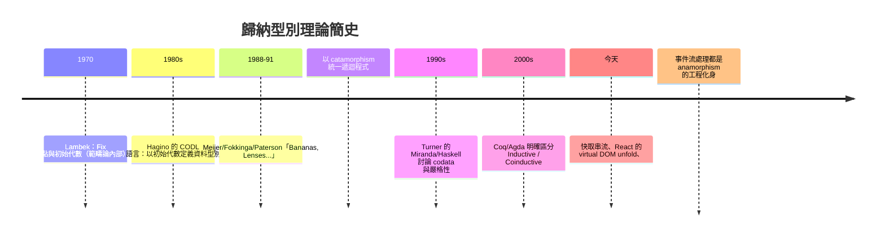

# 09.2 迭代遞迴與初始代數及終餘代數

## 前言：遞迴型別方程的「解」

上一章我們把列表寫成型別方程：

$$
L \;\cong\; 1 + a \times L
$$

代數上，這條方程有無窮多個「形式解」（把右邊反覆代入：
$1 + a + a^2 + a^3 + \cdots$ ）。但程式語言必須選一個具體的
型別來當 `List a`。選哪個？憑什麼？

範疇論給出精確答案：**最小解是初始代數，最大解是終餘代數**。
有限列表取最小解、無限串流取最大解。更驚人的是：兩種解各自
附贈一個程式構造——**catamorphism**（即 `foldr`）與
**anamorphism**（即 unfold）——它們不只是高階函式，而是初始性
與終極性的直接推論。本章沿著 Lambek 的工作走完這條路。

## 1. 代數與 F-代數

**定義 1.1（F-代數）**。設 $F$ 是範疇 $\mathcal{C}$ 上的自函子。
一個 $F$ -代數是配對 $(A, \alpha)$ ，其中 $A$ 是物件、
$\alpha: F(A) \to A$ 是態射。

**直覺**： $F$ 描述「一層結構」。對列表而言
$F(X) = 1 + a \times X$ ，於是 F-代數 $(A, \alpha)$ 是：

$$
\alpha : 1 + a \times A \to A
\quad\Longleftrightarrow\quad
\alpha : (\text{nil}) \in A,\; \alpha : a \to A \to A
$$

**一個 F-代數就是「一套解釋資料建構子的規則」**。
`[1, 2]` 的建構子 `Nil`／`Cons` 正是某個代數的 $\alpha$ 。

**定義 1.2（F-代數的態射）**。從 $(A, \alpha)$ 到 $(B, \beta)$
的態射是函數 $h: A \to B$ 使得 $h \circ \alpha = \beta \circ F(h)$ ：

$$
\begin{array}{ccc}
F(A) & \xrightarrow{\;F(h)\;} & F(B) \\
{\scriptstyle \alpha}\downarrow & & \downarrow{\scriptstyle \beta} \\
A & \xrightarrow{\;h\;} & B
\end{array}
$$

「先建構再翻譯」等於「翻譯建構規則」——這交換方塊就是
**結構保持**的精確形式。

## 2. 初始代數與 Lambek 定理

**定義 2.1（初始代數）**。 $(\mu F, \mathrm{in})$ 是 $F$ -代數
範疇的**初始物件**：對每個代數 $(A, \alpha)$ ，存在**唯一**
態射 $\mathrm{cata}_\alpha : \mu F \to A$ 使
$\mathrm{cata}_\alpha \circ \mathrm{in} = \alpha \circ F(\mathrm{cata}_\alpha)$ 。

**定理 2.1（Lambek，1970）**。若 $(\mu F, \mathrm{in})$ 是初始
$F$ -代數，則 $\mathrm{in}: F(\mu F) \to \mu F$ 是**同構**。

證明 sketch：初始性對代數 $(\mu F, \mathrm{in})$ 自己套用，得
$\mathrm{id}$ 是唯一的自態射； $\mathrm{in}$ 與其「候選逆」
$\mathrm{cata}$ 的複合都是自態射，由唯一性皆為 $\mathrm{id}$ 。∎

**意義**： $\mu F \cong F(\mu F)$ ——「列表」與「一層結構包著
列表」同構，這正是遞迴型別方程的解。初始性保證解是**最小**
的：只包含由建構子有限步生成的元素（**沒有無限值、沒有垃圾**）。

## 3. Catamorphism：初始性的免費贈品

初始性質立刻給出摺疊的定義與唯一性：

**定義 3.1（catamorphism）**。給定代數 $(A, \alpha)$ ，
從 $\mu F$ 出發的唯一同態 $\mathrm{cata}_\alpha$ 就是摺疊：

```haskell
-- 通用版本（自由寫法）：
newtype Fix f = In { out :: f (Fix f) }

cata :: Functor f => (f a -> a) -> Fix f -> a
cata f = f . fmap (cata f) . out

-- 初始性質即：cata f 是唯一的 h 滿足
-- h . In = f . fmap h
```

對列表（ $F(X) = 1 + a \times X$ ）具體化，就得到 `foldr`：

```haskell
foldr :: (a -> b -> b) -> b -> [a] -> b
foldr _ z []     = z                    -- 1-部分：nil ↦ z
foldr f z (x:xs) = f x (foldr f z xs)   -- a×-部分：cons ↦ f

-- 例：length = cata α，其中 α :: 1 + a × Int -> Int
--   α (Left ())  = 0
--   α (Right (_, n)) = n + 1

-- 例：sum = cata β
--   β (Left ())      = 0
--   β (Right (x, s)) = x + s
```

**摺疊的唯一性是免費定理**：任何「消耗列表產生值」的合理函數
都可以由某個 $\alpha$ 唯一決定。這使「以 foldr 表達一切遞迴」
（Bananas in Space 等程序式證明技術）成為可能：因為摺疊不僅
存在，而且**由代數唯一決定**。

## 4. 迭代視角：摺疊就是「代換-化約」

catamorphism 的計算過程：

$$
\mathrm{cata}_\alpha(\mathrm{in}(t))
= \alpha\big(F(\mathrm{cata}_\alpha)(t)\big)
$$

先深入結構最底層（遞迴），逐層用 $\alpha$ 化約。以
`foldr f z [1,2,3]` 為例：

```
f 1 (f 2 (f 3 z))
```

資料由內（深處）向外化約——這是**由資料驅動的迭代**。
對偶地，anamorphism 由種子展開。

## 5. 終餘代數與 Anamorphism

把所有箭頭反轉（對偶！），得到餘代數。

**定義 5.1（F-餘代數）**。配對 $(A, \gamma: A \to F(A))$ 。
一個 F-**終餘代數**（terminal coalgebra） $(\nu F, \mathrm{out})$
是餘代數範疇的終極物件：對每個餘代數 $(A, \gamma)$ 存在唯一
$\mathrm{ana}_\gamma : A \to \nu F$ 使
$\mathrm{out} \circ \mathrm{ana}_\gamma = F(\mathrm{ana}_\gamma) \circ \gamma$ 。

Lambek 定理的對偶： $\mathrm{out}: \nu F \to F(\nu F)$ 是同構。
$\nu F$ 是方程 $X \cong F(X)$ 的**最大解**：包含所有（包括
無限的）結構。

```haskell
ana :: Functor f => (a -> f a) -> a -> Fix f
ana g = In . fmap (ana g) . g

-- 串流（無限列表）作為終餘代數：
-- F(X) = a × X（這次沒有 1，因為串流永不停）
data Stream a = Cons a (Stream a)

-- unfold：由種子生成
unfoldr :: (b -> Maybe (a, b)) -> b -> [a]

-- 無限自然數串流：
nats :: [Integer]
nats = unfoldr (\n -> Just (n, n + 1)) 0
```

## 6. 最小解 vs 最大解：有限與無限的分界

這是本章最關鍵的觀察。同一條方程 $X \cong F(X)$ ：

| | $\mu F$ （初始代數） | $\nu F$ （終餘代數） |
|---|---|---|
| 解的性質 | 最小不動點 | 最大不動點 |
| 元素 | 有限步建構而成 | 可含無限結構 |
| Haskell | `data`（嚴格意義上的歸納型別） | `codata`／惰性無限值 |
| 消耗方式 | catamorphism（`foldr`） | anamorphism（`unfold`） |
| 證明方式 | 歸納法 | 共歸納法（09.3） |
| 停止條件 | 有 nil 分支就會耗盡 | 沒有出口，只有下一層 |

Haskell 沒有語法上區分 `data`／`codata`（因為惰性求值使
兩者混居），這帶來表達力也帶來風險：

```haskell
-- µ 世界的元素：
[1, 2, 3]            -- 有限，foldr 可以耗盡

-- ν 世界的元素：
let ones = 1 : ones  -- 無限串流，是「最大解」的成員
-- foldr (+) 0 ones   -- 永不終止！µ 的摺疊餵給 ν 的資料
-- take 5 ones        -- ✓ 用「有限窗口」觀察無限資料
```

**規則**：對初始代數的資料用歸納（foldr 安全終止）；對終餘
代數的資料用共歸納（只要求「每一步都生產」，不要求終止）。
混用的後果如上所示。這正是 09.3 要系統化的主題。

## 7. 前因後果：這套理論從哪裡來、到哪裡去



工程的迴響無處不在：資料庫的游標、無限惰性串流、觀察者模式、
產生器（generator）——本質上都是 anamorphism；而「遍歷語法樹
產生位元碼」「摺疊 JSON 產生摘要」是 catamorphism。**遞迴的
兩個方向（消耗與生成）各有其數學名字與法律保障。**

## 8. 章末小結

- F-代數 $(A, \alpha: F A \to A)$ 是資料建構規則；初始代數
  $(\mu F, \mathrm{in})$ 是遞迴方程的最小解。
- Lambek 定理： $\mathrm{in}: F(\mu F) \to \mu F$ 是同構——
  「型別方程有解」的範疇論形式。
- 初始性免費贈送 catamorphism（`foldr`）：唯一同態、由代數
  唯一決定；終極性免費贈送 anamorphism（`unfold`）。
- $\mu F$ 與 $\nu F$ 是同一方程的最小／最大解，分別對應
  有限資料與無限資料、歸納與共歸納。
- Haskell 的惰性使兩種世界交錯；正確配對（µ 配 fold、
  ν 配 observe）是無限程式的安全守則。

## 下一步

「對無限串流可以安全地做有限觀察」這句話仍欠一個數學基礎：
什麼叫兩個無限串流「相等」？為什麼不能歸納證明卻可以用
bisimulation？下一章（09.3）建立**共歸納法的數學基礎**：
餘代數語義、同餘與最大不動點、以及它如何解釋惰性求值下
`ones = 1 : ones` 這類自指定義的合法性。這將為本章的
$\nu F$ 補上最後一塊拼圖。
