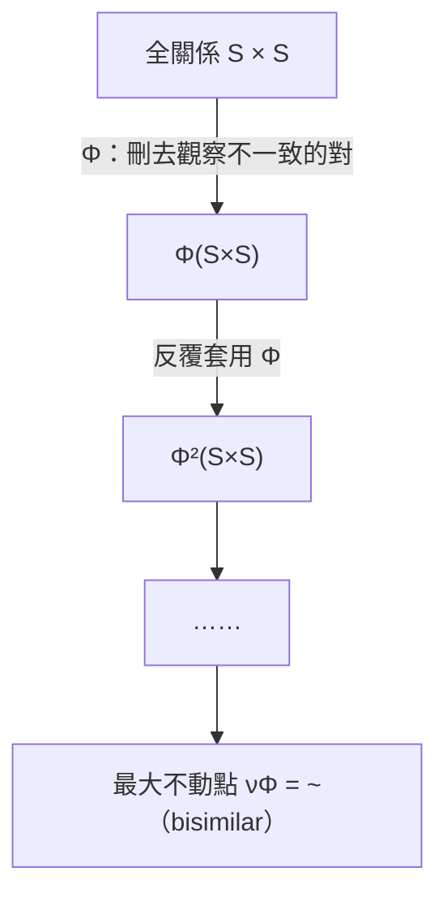
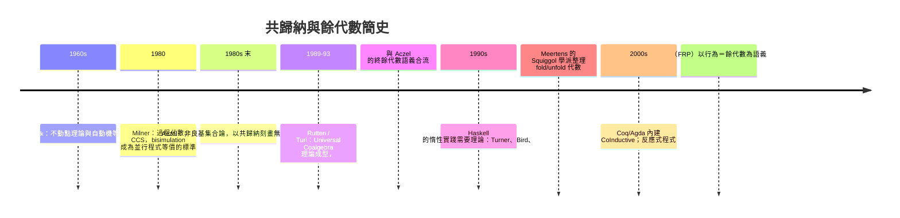

# 09.3 為什麼無限資料流可以運作：共歸納法的數學基礎

## 前言：一個看似自毀的定義

在 Haskell 中，這行程式完全合法而且有用：

```haskell
ones :: [Integer]
ones = 1 : ones        -- 自己定義自己！

-- take 3 ones = [1, 1, 1]  ✓ 正常運作
```

把 `ones` 代入自身，任何數學家的第一反應是「這是循環定義，
沒有良基（well-founded）基礎」。但在惰性求值下它運作良好，
甚至可以寫出整個費波那契數列：

```haskell
fibs :: [Integer]
fibs = 0 : 1 : zipWith (+) fibs (tail fibs)
-- take 8 fibs = [0,1,1,2,3,5,8,13]
```

為什麼循環定義沒有崩潰？答案是：**我們從來不需要「造完」
無限資料，只需要保證「任何有限觀察都有答案」**。把這句直覺
變成嚴格數學的理論，就是**共歸納**（coinduction）與
**bisimulation**（互模擬）。本章從餘代數語義出發，建立無限
資料流的數學基礎。

## 1. 歸納與共歸納：對偶的兩種證明觀

回顧 09.2 的對偶表，並聚焦在「相等」的定義上：

| | 歸納（induction） | 共歸納（coinduction） |
|---|---|---|
| 物件 | 初始代數 $\mu F$ | 終餘代數 $\nu F$ |
| 定義方式 | 由建構子有限生成 | 由觀察者行為刻畫 |
| 證明工具 | 歸納法：對建構步驟歸納 | Bisimulation：構造不變式 |
| 「相等」 | 語法樹逐層相同 | **所有有限觀察結果相同** |
| 否定情況 | 不存在「無窮元素」 | 不區分「永遠觀察不到的差異」 |

關鍵區分在最後兩行。對有限列表，「相等」就是逐元素相同，
歸納證明乾淨俐落。但對無限串流，逐層比較永遠做不完——
**我們需要一種不需要「看完」就能證明相等的工具**。

## 2. 餘代數語義：系統就是「觀察＋演進」

**定義 2.1（餘代數系統）**。一個 $F$-餘代數 $(S, \gamma)$，
$\gamma: S \to F(S)$，把每個狀態 $s \in S$ 映射到它的
「一層觀察與後續狀態」。

以串流為例，$F(X) = a \times X$，餘代數是：

$$
\gamma : S \to A \times S, \qquad
\gamma(s) = (\mathrm{head}(s), \mathrm{next}(s))
$$

**直覺**：串流不是「資料」而是**狀態機**——每個狀態提供
一個當前值（觀察）與一個下一狀態（演進）。兩個串流相等，
不是「內容相同」（它們沒有完整內容），而是：

**定義 2.2（bisimulation，互模擬）**。$S$ 上的關係 $R$ 是
bisimulation，若對所有 $(s, t) \in R$：

1. $\pi_1(\gamma(s)) = \pi_1(\gamma(t))$（當前觀察相同）；
2. $(\mathrm{next}(s), \mathrm{next}(t)) \in R$（後繼仍在 $R$ 中）。

兩狀態 **bisimilar**（記 $s \sim t$）若存在某 bisimulation
包含 $(s, t)$。**共歸納原理**：$\sim$ 是**最大**
bisimulation，並且通常取它作為 $\nu F$ 上的相等。

### 2.1 用 bisimulation 證明 ones 相等

```haskell
zeros :: [Integer]
zeros = 0 : zeros
```

證明 `zeros = 0 : zeros`（此處「=」取 bisimilar）。構造關係：

$$
R = \{ (\text{zeros},\ 0 : \text{zeros}) \}
$$

驗證：

1. 觀察：head(zeros) $= 0 = $ head(0 : zeros) ✓
2. 演進：tail(zeros) $=$ zeros，tail(0 : zeros) $=$ zeros，
   而 $(\text{zeros}, \text{zeros})$ 的規範形式
   $(\text{zeros},\ 0:\text{zeros}) \in R$ ✓

兩條件滿足，$R$ 是 bisimulation，故兩串流 bisimilar。∎

**注意方法的特點**：我們沒有做任何歸納，沒有「遞迴到基例」，
只是**構造一個封閉的關係**（不變式）並驗證封閉性。這是共歸納
證明的標準形態——與其說「證明相等」，不如說「證明差異永遠
觀察不到」。

## 3. 最大不動點：共歸納的序理論面貌

bisimulation 的最大性有經典的序理論解釋。在關係的全體
$\mathcal{P}(S \times S)$ 上（以包含為偏序），定義：

$$
\Phi(R) = \{(s,t) \mid \text{觀察相同且後繼對 } \in R\}
$$

- **Bisimulation 就是 $\Phi$ 的後不動點**：$R \subseteq \Phi(R)$。
- **$\sim$（bisimilar）是 $\Phi$ 的最大不動點**，由
  Knaster–Tarski 定理保證存在：
  $\sim = \bigcup \{ R \mid R \subseteq \Phi(R) \}$。

$$
\text{最大不動點 } \nu\Phi = \bigcup_{R \subseteq \Phi(R)} R
\qquad
\text{最小不動點 } \mu\Phi = \bigcap \{R \mid \Phi(R) \subseteq R\}
$$

與 09.2 的對偶完全一致：**歸納等於取最小不動點（由下往上堆），
共歸納等於取最大不動點（由上往下削）**。共歸納的「由上往下」
有個漂亮的解讀：**從「所有串流都相等」開始，不斷刪去觀察
不一致的對，剩下的極限就是相等關係**。這就是為什麼共歸納
證明只需展示「某個封閉關係」——它證明該對在刪除過程中
永遠存活。



## 4. 範例：證明 fibs 的代數性質

**命題**。定義 `fibs = 0 : 1 : zipWith (+) fibs (tail fibs)`，
則 `tail fibs` 與 `zipWith (+) (tail fibs) fibs` bisimilar
（即費波那契的移位關係）。

設 $f = \text{fibs}$，$g = \text{zipWith (+)} (\text{tail } f) f$。
構造關係：

$$
R = \{ (f,\ g),\ (\text{tail}\ f,\ \text{zipWith (+)} f\ g),\ \dots \}
$$

逐點驗證封閉性：

1. 觀察層：head $f = 0$，head $g = \text{tail } f$ 的頭 $+ $ $f$
   的頭 $= 1 + 0 = 1$；而 $0:1:\dots$ 與 $g$ 的開頭吻合。
2. 演進層：tails 之間的關係由 zipWith 的加法封閉性維持——
   每對的下一狀態仍是「費波那契式互補」的兩個串流。

有限視角驗證（take 5）：

```haskell
take 5 fibs                            -- [0,1,1,2,3]
take 5 (zipWith (+) (tail fibs) fibs)  -- [1,1,2,3,5]
-- 正是 fibs 平移一位——移位關係成立
```

完整證明需構造無限關係並驗證封閉，模式與 2.1 相同；這裡展示
的是**骨架**：共歸納證明＝構造不變式＋驗證封閉。

## 5. 惰性求值：為什麼工程上真的能跑

共歸納說明無限資料**語義上**有定義；惰性求值說明它**實作上**
能執行。兩者的接合：

- **thunk（延遲計算）**：Haskell 中每個值在需要前只是承諾。
  `ones = 1 : ones` 編譯成一個 thunks 的循環圖：
  第一個節點含 `1` 與指向自身的指標。
- **按需生產**：`take 3 ones` 只強制三個 head/tail 步驟，
  對應餘代數的三次 $\gamma$ 觀察。**執行過程就是有限次觀察，
  而 bisimulation 保證每次觀察都有定義。**
- **生產空間有限**：循環圖只佔常數空間（一個節點），
  不會無限膨脹——這是 `ones` 不會吃光記憶體的原因。

```haskell
-- 常數空間的無限串流：
ones = 1 : ones

-- 有狀態的展開（anamorphism 與共歸納的合流）：
iterate :: (a -> a) -> a -> [a]
iterate f x = x : iterate f (f x)

nats = iterate (+1) 0
-- take 4 nats = [0,1,2,3]
```

**風險面**（09.2 已警告）：`foldr (+) 0 ones` 對無限串流做
歸納式消耗，永不終止。安全守則重申：**無限資料配「有限觀察
操作」**（`take`、`zip`、`scanl`），歸納式摺疊只留給有限資料。

## 6. 前因後果：共歸納理論的源流



最終的匯流點：**並行系統（Milner）與函數式程式（Squiggol）**
在餘代數會師。今天，Rx/ReactiveX 的事件流、FRP 的 `Behavior`
、協程、甚至區塊鏈共識的「等價狀態」分析，語義骨架都是
bisimulation。**一個為驗證通訊協定發明的概念，成為一切無限
資料流的相等標準。**

## 7. 章末小結

- 循環定義（`ones = 1 : ones`）合法，因為無限資料的語義是
  餘代數狀態機：「有限觀察皆有答案」而非「完整建構完成」。
- Bisimulation：觀察相同且後繼繼續相似；bisimilar 是最大
  bisimulation 關係，由 Knaster–Tarski 的最大不動點保證。
- 共歸納證明＝構造封閉的不變式，不需基例、不需遞迴終止——
  與歸納（最小不動點、由下往上）完全對偶。
- 惰性求值的 thunk 循環圖實現了共歸納語義；執行即有限次
  $\gamma$ 觀察，常數空間。
- 歷史主軸：Park → Milner 的 bisimulation → Aczel/Rutten 的
  終餘代數 → Squiggol 的 fold/unfold → 現代反應式程式。

## 下一步

至此我們完成了第 07–09 章的弧線：從物件與態射的拼裝邏輯
（07.1），經函子（07.3）、Monad 的誕生與代數（08.1–08.3），
到資料構造的兩面——積與餘積、歸納與共歸納（09.1–09.3）。
回顧全程，你應該能看見一條統一的線：**萬有性質與不動點**
是所有構造的發動機。下一步的建議學習路徑：

1. **伴隨函子**：把 07.2 的 currying 與 08.2 的「monad 出自
   伴隨」系統化，是通往更高層抽象（Kan 擴張）的門票。
2. **Monoid / Monad 的程式實踐**：回到 08 章的 Reader/State/
   Cont，練習 monad transformer 疊加（MTL）。
3. **共歸納的程式專案**：用 `unfoldr` 實作一個事件流處理器
   或簡單 FRP，體驗「行為＝餘代數」的工程味。

理論的終點不是考試，而是下一次你寫 `data`、`foldr`、
`unfoldr`、`do` 時，能看見背後那張由 Eilenberg、Mac Lane、
Lambek、Moggi、Wadler 一路鋪來的地圖。
