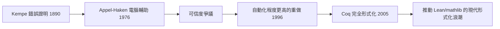

# 10.1 傳統數學證明的危機：四色定理與 Kepler 猜想的電腦輔助

## 前言：當「證明」的定義開始動搖

從歐幾里得《幾何原本》以來，數學證明一直是人類知識中最堅實的一環：一個命題只要被人類可讀、可逐步核對的演繹鏈條所支持，就被視為永恆為真。然而二十世紀後半，兩件大事撼動了這個傳統：**四色定理（1976）**與**Kepler 猜想（1998）**的電腦輔助證明。它們迫使我們追問：

- 一份沒有任何單一人類能完整核對的「證明」，算是證明嗎？
- 電腦程式本身的正確性，如何保證？
- 這個危機如何直接催生了往後五十年的**形式化驗證**與**證明助理**（Lean、Coq、Agda）產業？

這一章要講的正是這段因果鏈：**危機 → 懷疑 → 建構機器可核對的證明標準**。

---

## 一、四色定理的歷史與爭議

### 1.1 問題陳述

**定義（四色問題）**：任何平面地圖，是否都能只用四種顏色著色，使得任意兩個相鄰的區域顏色不同？

- 1852 年 Francis Guthrie 提出猜想
- 1879 年 Kempe 發表「證明」
- 1890 年 Heawood 指出 Kempe 的證明有致命漏洞——但他的「不可約構形」（unavoidable set of reducible configurations）方法是正確且影響深遠的

### 1.2 Appel 與 Haken 的 1976 證明

Kempe 的方法論給出一條路：若能找到一組「不可避免」的構形，且每個構形都「可約」（reducible，即出現時可局部簡化），則四色定理成立。Appel 與 Haken 用電腦：

1. 以**放電法**（discharging）證明 unavoidability；
2. 用程式檢查約 1,834 個構形的 reducibility，約耗時 1,200 小時計算。

他們的宣告震驚數學界，爭議隨之而來：

| 爭議點 | 具體內容 |
|---|---|
| 不可核對性 | 沒有人讀得完整份 400 頁微縮膠片附錄 |
| 程式正確性 | 1970 年代的 Fortran 程式無法被形式驗證 |
| 哲學觀點 | Tymoczko 稱其引入「實驗證據」，數學不再是純演繹 |

> Appel 本人坦言：「人類驗證程式的部分可以縮短，但無法完全消除。」

### 1.3 修復之路：Robertson–Sanders–Seymour–Thomas（1996）與 Gonthier（2005）

- 1996 年：四位數學家以更簡潔的 633 個構形重做證明，但仍依賴程式。
- 2005 年，Georges Gonthier（微軟研究院）用 **Coq 證明助理**完成**完全形式化**：每一行推理都由 Coq 核心檢查器驗證，連「程式算出的 reducibility」也化為可驗證的計算反射（reflection）。

這形成一條清晰的因果線：



**關鍵洞見**：爭議的根源不是電腦，而是「證明的可核對性」。形式化的解法是讓證明本身變成機器可檢查的資料——這正是 de Bruijn 在 Automath 中早已提出的願景（見 10.2 節）。

---

## 二、Kepler 猜想：更深的爭議

### 2.1 問題與證明史

**定義（Kepler 猜想，1611）**：在三維歐氏空間中，等半徑球的最密堆積密度為

$$
\delta = \frac{\pi}{\sqrt{18}} \approx 0.74048
$$

即橘子堆的「面心立方堆積」（FCC）。

- 1998 年 Thomas Hales 與 Samuel Ferguson 完成證明，涉及約 5,000 個線性規劃問題的暴力計算。
- 《Annals of Mathematics》審稿人說「99% 確定正確，但無法完全驗證」——這句話本身成為數學哲學的經典案例。2005 年終於刊出，附註明計算部分由獨立團隊以區間算術另行核對。

### 2.2 Flyspeck 專案：從懷疑到形式化

Hales 的反應極具代表性：**他不為爭議辯護，而是發起 Flyspeck 專案**（2003–2014），與 21 位合作者將整個證明形式化到 **HOL Light 與 Isabelle** 中，2014 年宣告完成。期間也嘗試以 Lean 重做部分核心（如 `sphere-packing` 專案，至 2023 年由小米峰等人在 Lean 4 中完成關鍵引理）。

這個案例確立了新範式：

1. 大型證明 → 電腦輔助不可避免；
2. 爭議 → 形式化是唯一讓社群完全信服的方法；
3. 形式化的成本 → 驅動證明助理（如 Lean）與自動化工具（如 `linear_arith`、SMT 整合）的研發。

---

## 三、範例：可約性的程式化思維

以下用 Python 展示「構形檢查」的核心精神——把組合命題化為窮舉搜尋，而這種「可反射為計算」的結構正是 Gonthier 形式化的關鍵：

```python
from itertools import combinations

def is_planar_colorable(adj, colors=4):
    """adj: dict 節點 -> 相鄰節點集合。檢查是否可 4-著色（回溯搜尋）。"""
    nodes = sorted(adj)
    assignment = {}

    def backtrack(i):
        if i == len(nodes):
            return True
        v = nodes[i]
        used = {assignment[u] for u in adj[v] if u in assignment}
        for c in range(colors):
            if c not in used:
                assignment[v] = c
                if backtrack(i + 1):
                    return True
                del assignment[v]
        return False

    return backtrack(0)

# 簡單平面圖：三角形
triangle = {0: {1, 2}, 1: {0, 2}, 2: {0, 1}}
print(is_planar_colorable(triangle))  # True
```

在 Lean 中，同樣的搜尋可以寫成產生**證明項**（proof term）的函式，讓電腦不只「算出答案」，還「附上證明」：

```lean
-- 概念示意：在 Lean 中以決策程序產生證明
example : ∃ f : Fin 3 → Fin 4,
    ∀ i j, i ≠ j → adj i j → f i ≠ f j := by
  decide   -- `decide` tactic 由編譯器窮舉並自動構造證明項
```

`decide` 這類 tactic 的哲學正來自四色定理形式化：**計算即證明**（computation as proof）。

---

## 四、哲學層面的深遠影響

### 4.1 數學知識的社會學轉變

| 傳統範式 | 電腦輔助範式 | 形式化範式 |
|---|---|---|
| 同儕可讀 | 同儕 + 機器可信度 | 機器完全可核對 |
| 錯誤由審稿把關 | 錯誤可能藏在程式碼 | 錯誤只剩公理與核心檢查器 |
| 信任個人與期刊 | 信任演算法與實作 | 信任小型可審計的核心（如 Lean kernel 約 1 萬行） |

### 4.2 零知識證明的伏筆

四色定理爭議中「驗證比生成容易」的直覺，日後在密碼學被極端化：**零知識證明**（見 12.2 節）允許證明者只揭露「我知道證明」這個事實而不洩露證明本身。理論基礎（如 Cook–Levin 定理、PCP 定理）都源自同一問題：**如何讓驗證變得便宜而可靠**。

---

## 小結與銜接

- 四色定理（1976）與 Kepler 猜想（1998）揭露了傳統同儕審查在大規模電腦輔助證明前的失效。
- Hales 的 Flyspeck（2014）與 Gonthier 的四色形式化（2005）確立「形式化是終極仲裁」的新規範。
- 這條危機線直接推動了互動式定理證明器的發展史——下一節（10.2）我們回到源頭，從 de Bruijn 的 Automath 講起。

## 練習

1. 用 Python 寫出 Petersen 圖的 4-著色檢查，並解釋為何平面性在此不重要。
2. 查閱 Flyspeck 專案報告，列出其形式化耗時與人力，估算「形式化成本 ≈ 原證明成本的幾倍」。
3. 討論：若一個定理只有形式化證明而無人類可讀證明，它對數學「理解」有貢獻嗎？
