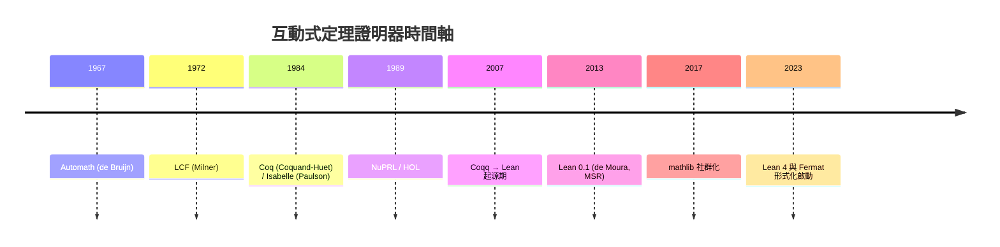
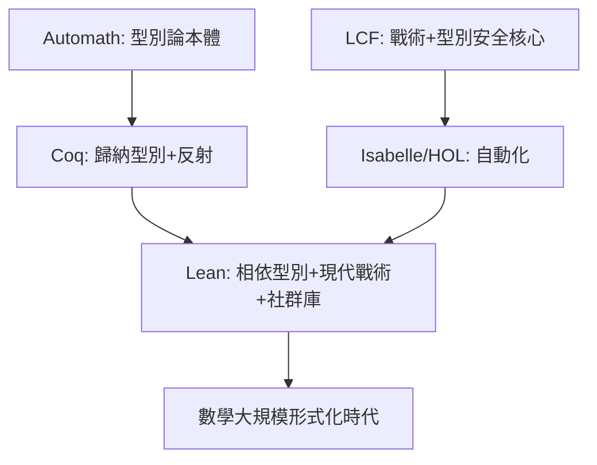

# 10.2 互動式定理證明器簡史

## 前言：從「驗證程式」到「驗證數學」

上一節看到，四色定理與 Kepler 猜想的爭議使人們意識到：證明必須變成**機器可核對的物件**。但這個想法並非 1976 年才出現——早在 1967 年，Nicolaas Govert de Bruijn 就已在荷蘭展開 **Automath** 專案。本節按時間軸梳理互動式定理證明器（Interactive Theorem Prover, ITP）的演化，並解釋每一代的設計選擇如何被前代的失敗與成功所驅動。



---

## 一、Automath（1967–1983）：一切的起點

### 1.1 de Bruijn 的洞見

de Bruijn 問：能否把整本數學教科書寫成機器可核對的形式？他的核心發明：

- **Dependent Type Theory（相依型別理論）**：命題即型別、證明即項（*propositions-as-types*）。一個命題 $P$ 的「證明」就是型別 $P$ 的一個項 $p : P$ 。
- **Curry–Howard 對應**：邏輯連接詞對應型別建構子

| 邏輯 | 型別論 |
|---|---|
| $A \land B$ | 配對型別 $(a, b)$ |
| $A \lor B$ | 和型別（標籤聯集） |
| $A \to B$ | 函數型別 |
| $\forall x, P(x)$ | 相依函數型別 $\prod_x P(x)$ |
| $\exists x, P(x)$ | 相依配對型別 $\sum_x P(x)$ |

- **小型核心檢查器**：核對證明的程式可以極小（數百行），這是「信任的錨點」思想的濫觴——日後 Lean 的 kernel 延續此傳統。

Automath 形式化了 Landau 的《分析基礎》（Grundlagen der Analysis）等著作，證明了整個方法可行，但因缺少自動化與社群規模，1983 年結束。**它留下的遺產是架構性的：相依型別 + 小核心 + 數學以資料結構儲存。**

---

## 二、LCF（1972）與「戰術」的誕生

Robin Milner 的 LCF（Logic for Computable Functions）面對的是程式驗證，卻發明了两個影響至今的機制：

1. **Tactic（戰術）**：證明不是一次寫成，而是由高階策略逐步「精化」目標（goal），例如 `induction`、`simp`。
2. **抽象型別保護核心**：透過 ML 的型別系統，讓只有核心模組能產生定理值——證明無法偽造。這就是所謂 **LCF 風格**，Isabelle、Lean 的戰術框架皆承襲之。

```text
用戶腳本（tactic 指令）
        │  精化
        ▼
   目標（goal）堆疊
        │  kernel 檢查
        ▼
   證明項（proof term）— 唯一可信的產物
```

**前因後果**：Automath 提供了「證明即資料」的本體論，LCF 提供了「互動式精化 + 型別安全核心」的工程方法論。兩者相乘才有現代 ITP。

---

## 三、Coq（1984–）：歸納型別與計算反射

Thierry Coquand 與 Gérard Huet 在 1984 年提出**歸納構造演算**（Calculus of Inductive Constructions, CIC），融合 Automath 的相依型別與 Martin-Löf 型別論的歸納型別，成為 Coq 的基礎。

### 3.1 關鍵里程碑

- **1989**：四色定理所需的構形窮舉概念驗證。
- **2004**：Gonthier 完成 **四色定理** 的 Coq 形式化（見 10.1）。
- **2005**：Georges Gonthier 與 13 位合作者在 Coq 中形式化 **Feit–Thompson 奇階定理**（2012 完成，約 17 萬行）。
- **2012 至今**：CompCert——以 Coq 驗證的 C 編譯器，成為工業級形式驗證的標竿（見 12.3 節的關鍵基礎設施議題）。

### 3.2 反射（Reflection）的威力

Gonthier 的四色工作引入**小規模反射**（small-scale reflection，後發展為 Coq 的 Ssreflect 外掛）：把決策程序寫進證明項內，由 kernel 直接執行，而非信任外部程式。這使得「電腦算的」與「證明裡寫的」不再是兩個世界。

---

## 四、Isabelle 與 HOL 家族：另一條路

- **HOL（1987）**：以經典簡單型別邏輯為基礎，放棄相依型別以換取簡單的語意與強大的自動化。
- **Isabelle（1986 起，Paulson）**：邏輯框架（logical framework），HOL 是其上最成功的實例。
- **2004–2012**：Nipkow 等人的《Isabelle/HOL: A Proof Assistant for Higher-Order Logic》教科書化；Isar 語言使證明更接近人類散文。
- **2014**：Hales 的 Flyspeck 主要以 **HOL Light + Isabelle** 完成（見 10.1）。

HOL 家族證明：**不採用相依型別也能做大數學**，其代價是無法自然表達「以型別攜帶結構資訊」的陳述（如「長度為 n 的列表」需以謂詞而非型別表達）。

---

## 五、Lean（2013–）：新一代的綜合

### 5.1 誕生動機

Leonardo de Moura（SMT 求解器 Z3 的作者）在微軟研究院設計 Lean，動機正是前三代的痛點：

| 前代痛點 | Lean 的回應 |
|---|---|
| Coq 核心較大、難以擴充 | Lean 4 核心可由 Lean 自身實作與擴充 |
| 戰術框架老舊 | `by` 區塊 + 元程式設計（macro/Elab）一體化 |
| 自動化不足 | 內建 `decide`、`omega`、SMT 風格 ` grind` |
| 函數式語言效能差 | Lean 4 同時是編譯型函數式語言 |

### 5.2 mathlib 與社群模式

- 2017 年起，**mathlib** 成為去中心化、CI 驅動的數學函式庫：任何人可提交 PR，審查者維持一致性。
- **2020 年代的大型成果**：
  - **2021**：劍橋、CMU 等成立 **Lean FRO**（Facebook/Facebook Reality Labs + Agile Vision 資助，後由 AWS、Simons 基金會支持）。
  - **2023**：**Fermat 大定理形式化專案**（見 11.1 節詳述）啟動，目標五年內完成。
  - **Liquid Tensor Experiment（2020–2022）**：Peter Scholze 的凝聚態數學（condensed mathematics）關鍵引理由社群在 Lean 中驗證，Scholze 親自確認結果。
- **2025**：**Terence Tao** 等人在 Lean 中完成 **PFR（Polynomial Freiman–Ruzsa）猜想**形式化，展現「藍圖（blueprint）+ 社群分工」的新工作模式。

### 5.3 Lean 中的最小證明

```lean
-- 2 + 2 = 4 的證明項，核心僅依賴少數公理
example : 2 + 2 = 4 := rfl

-- Curry–Howard：或命題的證明就是和型別的項
example (p q : Prop) (h : p) : p ∨ q := Or.inl h

-- 相依型別：長度為 n 的向量，型別攜帶結構
def replicate (n : Nat) (a : α) : Vector α n :=
  match n with
  | 0     => .nil
  | k + 1 => .cons a (replicate k a)
```

---

## 六、模式比較與啟示



**共同教訓**：
1. **小核心**是信任根基；
2. **自動化戰術**決定可用性；
3. **社群函式庫**決定能否觸及現代研究數學；
4. 每一代的設計缺陷都成為下一代的驅動力。

---

## 小結與銜接

- Automath 定下「命題即型別」，LCF 定下「戰術 + 保護核心」，Coq 融合兩者並以四色定理證明價值，Isabelle 證明經典邏輯路線可行，Lean 綜合前人之長並以 mathlib 與 FRO 模式進入研究數學主戰場。
- 下一節（10.3）我們深入比較 Lean、Coq、Agda 的**核心哲學差異**：構造性 vs. 古典、證明無關性、相依型別的細節取捨。

## 練習

1. 寫出 $\neg\neg P \to P$ 在 Coq（不含 `Classical`）中不可證的原因，並比較 Lean 的 `Classical.em`。
2. 比較 Automath 的 PAL 語言與 Lean 4 語法，指出兩處直接承襲的概念。
3. 研究 Liquid Tensor Experiment 的 GitHub 倉庫，找出「藍圖」檔案如何標註依賴關係。
