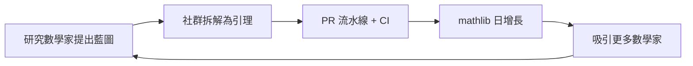

# 10.3 現代證明助理的崛起：Lean、Coq 與 Agda 的核心哲學

## 前言：三種型別論，三種數學觀

10.2 節的歷史脈絡顯示，Coq、Agda、Lean 三者共享 **Curry–Howard 對應**與**相依型別**這個 DNA，但在三個哲學問題上分道揚鑣：

1. **邏輯基礎**：構造性（intuitionistic）還是允許古典公理？
2. **證明無關性**：兩個證明同一命題，是否該視為相等？
3. **型別層級**：型別的型別的型別……如何避免 Girard 悖論？

這些選擇不僅是技術細節，更決定了「數學在機器中長什麼樣」，也直接影響 11.1 節中「如何形式化費馬大定理」這類頂級工程。

---

## 一、相依型別的基礎： $P : \mathrm{Prop}$ 與層級

**定義（型別宇宙層級）**：為避免 $\Omega = \{x \mid x \notin x\}$ 型悖論，型別論引入宇宙：

$$
\mathrm{Prop} : \mathrm{Type}\ 0 : \mathrm{Type}\ 1 : \mathrm{Type}\ 2 : \cdots
$$

在 Lean 中：

```lean
-- Prop 是所有命題的宇宙
#check (2 + 2 = 4 : Prop)        -- Prop
#check (Nat : Type)              -- Type
#check (Type : Type 1)           -- Type 1

-- 相依函數型別：∀ 的型別論化身
#check fun (n : Nat) => n + 0 = n  -- (n : Nat) → n + 0 = n : Prop
```

**Coq 同樣命名** `Prop` 與 `Set`/`Type`；**Agda** 則以 `Set : Set₁ : Set₂ : ...` 命名，且可自訂宇宙多態（universe polymorphism）。

---

## 二、三大證明助理核心哲學

### 2.1 Coq：CIC + 古典可插拔

- 基礎：**Calculus of Inductive Constructions**。
- 構造性為本，但提供 `Classical` 模組引入排中律（見 11.2 節的代價討論）。
- **證明無關性**：`Prop` 中的證明預設為 proof-irrelevant——`∀ p q : P, p = q`。
- 強項：**反射式決策程序**（Ssreflect/MathComp 傳統），四色定理、Feit–Thompson 的功臣。

```coq
(* Coq 範例：歸納定義與證明 *)
Inductive even : nat -> Prop :=
| even_O : even 0
| even_SS : forall n, even n -> even (S (S n)).

Theorem even_4 : even 4.
Proof. apply even_SS. apply even_SS. apply even_O. Qed.
```

### 2.2 Agda：純構造性、證明相關

- 基礎：**Martin-Löf 型別論**的擴充（含 mutual induction、induction-recursion）。
- **無戰術**：證明就是寫 Haskell 風格的函式；互動透過「洞」(hole, `?`) 進行。
- **證明相關**：`Prop` 與 `Set` 同層，證明物件真實存在（可用於計算），除非啟用 `--without-K` 等選項。
- 強項：**同倫型別論（HoTT）** 的自然棲所——`--cubical` 支援立方型別論。

```agda
-- Agda 範例：證明是一個函式
data _≡_ {A : Set} (a : A) : A → Set where
  refl : a ≡ a

sym : ∀ {A : Set} {a b : A} → a ≡ b → b ≡ a
sym refl = refl

even : ℕ → Set
even zero        = ⊤
even (suc zero)  = ⊥
even (suc (suc n)) = even n
```

### 2.3 Lean：工程綜合體

- 基礎：**依賴型別論的歸納構造**，與 CIC 同源但實作不同。
- **構造性 + `Classical.em` 內建為核心公理**（以 `axiom` 宣告，kernel 認可），證明無關性僅作用於 `Prop`。
- Lean 4 自舉：**Lean 用 Lean 寫成**，編譯器與 kernel 都在 Lean 語言內，擴充容易。
- mathlib 是其超級武器（見 10.2）。

```lean
-- Lean：歸納定義同 Coq
inductive Even : Nat → Prop where
  | zero : Even 0
  | step : Even n → Even (n + 2)

theorem even_4 : Even 4 := .step (.step .zero)

-- 排中律作為核心公理（可檢視）
#print axioms even_4   -- 'even_4' depends on axioms: [] -- 構造性
theorem em_test (p : Prop) : p ∨ ¬p := Classical.em p
#print axioms em_test  -- 'em_test' depends on axioms: [propext, Classical.choice, Quot.sound]
```

---

## 三、比較表與取捨分析

| 面向 | Coq | Agda | Lean |
|---|---|---|---|
| 邏輯 | CIC + 可插拔古典 | Martin-Löf（構造性） | CIC 變體 + 內建古典公理 |
| 證明無關性 | Prop 預設無關 | 證明相關（可選擇） | Prop 無關 |
| 戰術 | Ltac/Ssreflect | 無戰術，純函式 | `by` + Elab 元程式 |
| 工業應用 | CompCert | 少 | 數學、軟體驗證、AI 數學 |
| 社群數學庫 | MathComp | 標準庫較小 | mathlib（最活躍） |
| 特色 | 反射式證明 | HoTT、立方型別 | 自舉、效能、AI 整合 |

### 3.1 為何哲學差異重要？

**例：選擇公理與 Banach–Tarski 悖論**。Lean 中 `Classical.choice` 可證明球可分解重組為兩顆同體積球（非構造性的荒謬但古典為真）；Agda 純構造則無法——這不是缺陷，而是**構造性證明攜帶計算內容**（見 11.2）。

**例：數值運算**。構造性證明 `∃ x, f x = 0` 可以直接 `extract` 出程式算出 $x$ ；古典證明則否。這使 Agda 與 Coq 的構造部分在**程式萃取**（如 Coq 的 `Extraction`）上具實用價值。

---

## 四、社群驅動：mathlib 的生態經濟學

Lean 的崛起不只因為語言好，更因為**社群基礎設施**：



- **PFR 猜想（2023）**：Terence Tao 發起，約 20 人數月內完成 9000 行形式化。
- **Fermat 大定理專案（2024–）**：以藍圖追蹤數百個引理，動員國際團隊（見 11.1）。
- **AI 輔助**：OpenAI、DeepMind（AlphaProof，2024 銀牌級 IMO 表現）以 Lean 為訓練與驗證環境——**機器可核對的證明格式正是強化學習的完美 reward signal**。

---

## 五、深層視角：型別論作為「機器可核對的公理系統」

三者的共同承諾是：**最終可信的物件只有一個——kernel 核對過的證明項**。用戶層的戰術、巨集、AI 產生的腳本都只是「產生證明項的工廠」。這個分層讓我們可以放心地：

1. 讓 AI 大量生成猜測與證明草稿；
2. 由 kernel 做最終裁決；
3. 錯誤只可能來自「公理選擇」或「kernel 本身」（可獨立審計）。

這就是 10.1 節危機的終極解法：**把信任問題收斂到最小核心**。

---

## 小結與銜接

- Coq 強在反射與工業驗證；Agda 純構造、HoTT 的家；Lean 是工程綜合 + 社群數學庫的贏家。
- 哲學差異（構造 vs. 古典、證明相關 vs. 無關）不是品味問題，而是「數學的計算內容」存不存在的問題。
- 下一節（11.1）我們把鏡頭拉到頂級目標：如何用這些工具**精確陳述黎曼猜想與費馬大定理**——這是形式化數學語言的第一課。

## 練習

1. 在 Lean 中用 `#print axioms` 檢查 `Nat.add_comm` 與 `Classical.em` 的依賴差異。
2. 寫一段 Agda 程式，把 `even n` 的證明**計算化**為一個傳回半數的函式，體會構造性。
3. 比較 Coq `Extraction` 與 Lean 4 編譯器對「證明即程式」的不同體現。
