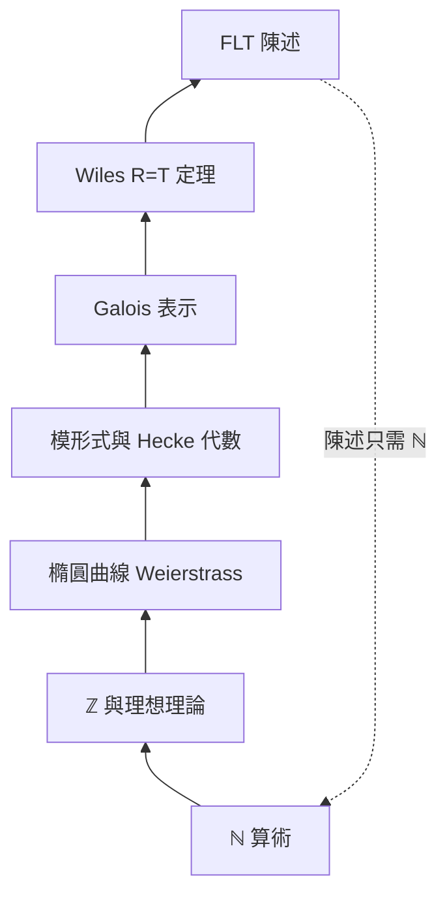

# 11.1 形式化數學語言：如何用程式碼精確陳述黎曼猜想與費馬大定理

## 前言：把人類最深奧的猜想寫給機器看

一個常見誤解是「形式化就是把定理翻譯成程式」。實際上，**陳述一個大猜想**往往比證明它還要耗工：費馬大定理的陳述需要橢圓曲線、模形式、Galois 表示；黎曼猜想需要 zeta 函數在複平面的解析延拓。這些「前置工程」正是 10.3 節哲學差異的試金石，也是 2024 年 Lean 中 Fermat 形式化專案的真正難點。

---

## 一、基礎：命題、型別、證明

**定義（命題即型別）**：命題是一個型別為 `Prop` 的項；其證明是該型別的項。

```lean
-- 平凡但完整：一個形式化證明的解剖
example : ∀ n : Nat, n + 0 = n := fun n => Nat.add_zero n
```

Curry–Howard 對應表（延續 10.2）：

| 數學陳述 | 型別論物件 |
|---|---|
| $P \Rightarrow Q$ | 函數型別 $P \to Q$ |
| $\forall x, P(x)$ | 相依函數 $\prod_{x} P(x)$ |
| $\exists x, P(x)$ | 相依配對 $\sum_{x} P(x)$ |
| $P \land Q$ | $P \times Q$ |

---

## 二、費馬大定理：陳述本身就是一座山

### 2.1 經典陳述

$$
\forall n \geq 3,\ \forall a,b,c \in \mathbb{Z}_{>0},\ a^n + b^n \neq c^n
$$

看似簡單——只需自然數。**但 Wiles 的證明路徑完全不同**：

$$
a^n+b^n=c^n \text{ 有解} \Longrightarrow \text{Frey 曲線 } E_{a,b,c} \text{ 半穩定} \Longrightarrow \text{模性失敗} \ \Rightarrow\!\Leftarrow\ \text{與 Wiles–Taylor 模性定理矛盾}
$$

### 2.2 Frey 曲線的定義：形式化的第一關

給定互素三元組 $(a,b,c)$ ，Frey 曲線為

$$
E_{a,b,c} : y^2 = x(x - a^n)(x + b^n)
$$

在 Lean 中需要先有**橢圓曲線**的定義。mathlib 中（簡化示意）：

```lean
-- mathlib 中的橢圓曲線：Weierstrass 方程 + 非退化條件
structure WeierstrassCurve (R : Type*) [CommRing R] where
  a₂ a₄ a₆ b₂ b₄ b₆ b₈ : R

-- 精確陳述 FLT（目標層級，示意）
theorem fermat_last (n : ℕ) (hn : 3 ≤ n)
    (a b c : ℤ) (ha : a ≠ 0) (hb : b ≠ 0) (hc : c ≠ 0) :
    a ^ n + b ^ n ≠ c ^ n := by
  ...
```

**真正的工程量**：2024 年啟動的 Fermat 專案把證明拆成數百個引理（Galois 上同調、模形式空間的維度計算、 $R = T$ 定理……），以**藍圖**（blueprint，用 `plausible`/GitHub Pages 產生依賴圖）協調國際團隊分工。**陳述層的依賴**如下：



**弔詭之處**：陳述本身只要 ℕ 算術，**證明路徑**卻穿過代數幾何最深處——形式化的價值在於把兩者都變成可核對的資料。

---

## 三、黎曼猜想：解析延拓與無零點區域

### 3.1 陳述

Zeta 函數的解析延拓 $\zeta(s) = \sum_{n\ge1} n^{-s}$ （ $\mathrm{Re}(s) > 1$ ）延拓到 $\mathbb{C}\setminus\{1\}$ ，且**非平凡零點都在臨界線** $\mathrm{Re}(s) = 1/2$ 上。

形式化必須先處理：
1. **無窮級數**的一致收斂與解析延拓（需複分析基礎設施）；
2. **複數分析**在型別論中的存在——mathlib 提供 `Complex` 與解析函數理論；
3. **「非平凡零點」**這個集合的精確定義。

### 3.2 Lean 中的陳述（示意）

```lean
open Complex

-- ζ(s) 在 Re(s) > 1 的級數定義
noncomputable def riemannZeta' (s : ℂ) : ℂ :=
  ∑' n : ℕ, ((n + 1 : ℕ) : ℂ) ^ (-s)

-- 黎曼猜想（目標陳述，示意；mathlib 尚無完整 ζ 延拓的 RH 等價形式）
def riemannHypothesis : Prop :=
  ∀ s : ℂ, riemannZeta' s = 0 →
    s ≠ 1 → 0 < s.re → s.re < 1 → s.re = 1/2
```

**難點剖析**：
- 解析延拓不能用「同一個式子」定義，需透過函數方程 $\zeta(s) = 2^s\pi^{s-1}\sin(\pi s/2)\Gamma(1-s)\zeta(1-s)$ 在不同區域拼接；
- mathlib 已形式化 $\Gamma$ 函數與部分 ζ 理論（截至 2025 年，臨界帶的完整處理仍在建設中）。

### 3.3 陳述層的「等價鏈」

數學家常說 RH 有數十個等價形式；形式化時可**分開形式化再證等價**：

| 等價形式 | 所需前置 |
|---|---|
| 經典（臨界線零點） | 複分析、解析延拓 |
| Robin 不等式 $\sigma(n) < e^\gamma n \log\log n$ （ $n>5040$ ） | 算術函數 σ、常數 $\gamma$ |
| Lagarias 形式 $\sigma(n) \le H_n + e^{H_n}\log H_n$ | 調和數 |
| Nyman–Beurling | 函數空間、積分 |

**教訓**：等價形式中，**最「初等」的陳述往往最難形式化背後的等價證明**——例如 Robin 形式的等價證明涉及大量解析數論。

---

## 四、範例：從 Python 到 Lean 的陳述轉換

先用 Python 檢查（不是證明）Collatz 或 Robin 不等式，體會「數值證據 ≠ 形式證明」：

```python
from math import isqrt

def sigma(n):  # 除數和函數 σ(n)
    s, i = 0, 1
    while i * i <= n:
        if n % i == 0:
            s += i
            if i != n // i:
                s += n // i
        i += 1
    return s

# Robin 不等式：n > 5040 時 σ(n) < e^γ · n · log log n
import mpmath as mp
gamma = mp.euler
bad = [n for n in range(5041, 10**5) if sigma(n) >= mp.e**gamma * n * mp.log(mp.log(n))]
print("前 10 萬內的反例：", bad)  # 空 → 佐證 RH，但不是證明
```

對應的 Lean 陳述（示意）：

```lean
def σ (n : ℕ) : ℕ := (n.divisorsFinset.sum fun d => d)

def robinBound (n : ℕ) : ℝ :=
  Real.exp 0.5772156649 * n * Real.log (Real.log n)

def robinInequality : Prop :=
  ∀ n : ℕ, 5040 < n → (σ n : ℝ) < robinBound n
```

---

## 五、形式化陳述的設計原則

1. **最小化依賴**：陳述儘量用最基礎的物件（ℕ、ℤ），讓等價形式各自發展。
2. **保留結構**：不要把「橢圓曲線」內聯展開成座標條件——用結構化定義，否則引理無法複用。
3. **區分定義與定理**：`def` 是資料，`theorem` 是型別為 `Prop` 的項；兩者的分離讓重構安全。
4. **陳述可測試**：以 `example`/`#check` 驗證陳述非空、可例化，避免「vacuously true」陷阱（如定義寫錯使猜想變成 trivially true）。

---

## 小結與銜接

- 形式化陳述大猜想 = 建構完整數學理論基礎設施的工程；FLT 的陳述在 ℕ，證明在 Galois 表示；RH 的陳述在複分析，等價形式散布在數論與函數分析。
- 陳述一旦形式化，等價轉換、數值佐證、AI 輔助證明都能建立在同一份資料上。
- 下一節（11.2）探討另一個基礎問題：構造性與古典邏輯之爭——這決定了「 $\exists$ 」的證明是否攜帶演算法。

## 練習

1. 在 mathlib 中找出 `Polynomial.eval` 與 `Nat.Prime` 的定義位置，解釋「素數」的形式化為何需要 `irreducible` 與 `not_unit` 兩個條件。
2. 用 Python 驗證 $n \le 10^6$ 的 Robin 不等式，並解釋為何這不能替代形式證明。
3. 假設要在 Lean 中陳述 Goldbach 猜想，寫出你的版本，並說明你選擇「偶數」定義的理由（`Even` 型別還是謂詞 `2 ∣ n`）。
