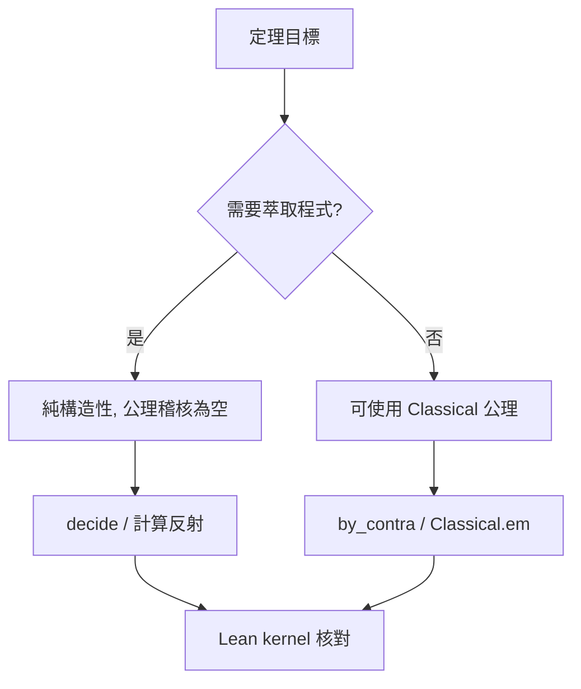

# 11.2 構造性證明與古典邏輯：排中律在機器中的代價

## 前言：當「存在」不再附贈「找得到」

古典數學中， $\exists x, P(x)$ 的證明常常是「假設不存在則矛盾」——這種證明**不附帶任何找 $x$ 的方法**。Brouwer（1908）與其後的 Heyting、Kolmogorov 提出**直覺主義**：數學證明應是「建造的說明書」。在 Curry–Howard 對應下，這個百年哲學爭論變成一個**技術問題**：你的型別系統是否強制證明攜帶演算法？

---

## 一、排中律：一本萬利與代價

**定義（排中律, LEM）**： $\forall P : \mathrm{Prop},\ P \lor \lnot P$

**定理（Bishop 點評）**：「排中律的無限制使用，會使存在性證明失去計算內容。」

### 1.1 經典反例：二進位展開的「不存在證明」

定義實數序列 $x_n$ ：若迄今為止 Collatz 猜想未反例則 $x_n = 0$ ，否則 $x_n = 1$ 。則：

- **古典證明**： $\exists x, x \in \{0,1\}$ 且 $x$ 是 Collatz 反例指示——由 LEM，命題 $P$ =「Collatz 無反例」滿足 $P \lor \lnot P$ ，故 $\exists x$ 成立。
- **構造性證明**：必須**知道** Collatz 是真是假才能給出 $x$ 。

這不是詭辯：**Brouwer 的反例方法**（1908）顯示，若你對所有命題接受 LEM，就會被迫接受對「未解問題」的存在性主張。機器無法執行這種證明。

### 1.2 Curry–Howard 下的代價

| 邏輯規則 | 構造性內容 |
|---|---|
| $\exists$ -intro：由 $P(a)$ 得 $\exists x, P(x)$ | 配對 $(a, p)$ —— 有 witness |
| $\exists$ -elim | 解構配對 —— witness 可用 |
| **LEM + 歸謬** | **不產生 witness** |

在 Lean 中可以實際驗證：

```lean
-- 構造性 ∃：可以提取 witness
example (h : ∃ n : Nat, n * n = 16) : True := trivial

-- 古典 ∃：無法提取（型別系統阻擋）
example (h : (∃ n : Nat, n * n = 16) ∨ ¬ (∃ n : Nat, n * n = 16)) : True := by
  rcases h with h | h
  · exact trivial
  · exact trivial

-- 檢查古典工具的公理依賴
theorem lem (p : Prop) : p ∨ ¬p := Classical.em p
#print axioms lem
-- 'lem' depends on axioms: [propext, Classical.choice, Quot.sound]
```

`Classical.choice` 正是破壞計算內容的元兇：它允許從 `Nonempty α`（邏輯上的存在）跳到 `α`（真實物件），而這一步**沒有對應的演算法**。

---

## 二、構造性數學的正面力量

### 2.1 演算法從證明中「免費」掉出來

**定理（構造性中值定理, Bishop）**：若 $f : [0,1] \to \mathbb{R}$ 連續且 $f(0) \cdot f(1) < 0$ ，則**給定精度 $\epsilon$ ，可構造** $x$ 使 $|f(x)| < \epsilon$ 。

構造性證明直接給出**二分法演算法**；古典證明（用 LEM 與完備性）只說「存在」。對照程式：

```python
def bisect(f, a, b, eps=1e-9):
    """構造性中值定理的證明即此程式"""
    fa = f(a)
    while b - a > eps:
        m = (a + b) / 2
        fm = f(m)
        if fm == 0:
            return m
        if fa * fm < 0:
            b = m
        else:
            a, fa = m, fm
    return (a + b) / 2
```

### 2.2 Coq 的程式萃取

Coq 的 `Extraction` 指令把構造性證明編譯為 OCaml/Haskell 程式：

```coq
Require Import Coq.Arith.Arith.

(* 構造性證明：對任意 n 存在偶數大於 n *)
Fixpoint double (n : nat) : nat :=
  match n with
  | 0 => 0
  | S k => S (S (double k))
  end.

Lemma exists_even : forall n, exists m, m > n /\ Nat.Even m.
Proof.
  intros n. exists (S (double n)).
  split; [lia | unfold Nat.Even; exists (S n); reflexivity].
Qed.

(* 萃取為 OCaml 程式：證明部分被剝離，計算部分保留 *)
Extraction exists_even.
```

**這是 11.1 節「陳述即型別」思想的工程兌現：證明同時是程式。**

---

## 三、三個系統的取捨（延續 10.3）

### 3.1 Lean 的折衷方案

Lean 選擇「**構造性為本，古典為用**」：

- 核心是構造性；
- `Classical.em`、`Classical.choice` 是**核心認可的公理**，隨時可用；
- `Nonempty α`（邏輯存在）與 `α` 的區分保留在型別系統中，強迫用戶意識何時跨過了「無演算法」的界線；
- `decide` 戰術：對可判定命題（如有限域上的命題），**構造性計算自動產生證明**，無需古典公理。

```lean
-- decide：可判定命題的構造性證明，零公理
example : 17 ≤ 5 * 4 + 1 := by decide

-- Classical.byContradiction：跨入古典世界
theorem not_not_intro (h : ¬¬p) : p := Classical.byContradiction h
#print axioms not_not_intro  -- 需要古典公理
```

### 3.2 Agda：純構造的代價

Agda 不內建 LEM。要使用古典推理必須**明確宣告**：

```agda
postulate
  em : (P : Set) → P ⊎ (P → ⊥)   -- 明確標記為 postulate
```

這使依賴關係**完全可見**：任何使用 `em` 的定理都會被追蹤。好處是計算純度；壞處是現代數學大量使用超限歸納與 Zorn 引理，形式化成本劇增。

### 3.3 Coq：模組化古典

Coq 把 `Classical` 做成可 import 的模組，與 Lean 類似；其 `Prop` 的 proof-irrelevance 使「邏輯層」與「計算層」分離，是 MathComp 龐大代數庫可行的原因。

---

## 四、深層議題：選擇公理與等價的層次

**命題**（Grothendieck 宇宙與大基數）：HoTT 學派（Agda Cubical 的哲學母體）主張以**同倫層次**重新理解邏輯：

- 命題 = $(-1)$ -type（至多一個證明，up to homotopy）
- 集合 = $0$ -type
- 群胚 = $1$ -type

在此框架下：
- **構造性 $\exists$ ** 對應**點**的存在；
- **古典 LEM** 對應**每個命題都是可判定點集**——一個強得多的拓樸假設。

這解釋了為什麼**剪貼公理（univalence）**與古典邏輯相容但與「命題即集合」的舊圖像不相容：證明可以不等（不同倫），命題可以不僅是真假。

---

## 五、工程視角：何時該用古典公理？

實務準則（mathlib 風格）：

1. **陳述層**儘量構造性（保留 `Nonempty` 與 `∃` 的差異）；
2. **證明層**可用古典——反正 proof-irrelevant，計算內容不受損（除非你要萃取程式）；
3. **需要計算的定理**（如決策程序、資料結構正確性）**嚴禁古典**，否則 `decide`、`native_decide`、編譯器驗證全部失效；
4. 用 `#print axioms` 做**公理稽核**，確保關鍵定理的依賴符合預期。



---

## 小結與銜接

- LEM 在機器中的代價 = 失去 witness 提取 = 失去「證明即程式」。
- Lean/Coq 以「構造性核心 + 可插拔古典 + proof-irrelevance」務實折衷；Agda/HoTT 走純構造與拓樸詮釋。
- 這個取捨直接影響 11.3 節的主題：**數學家把日常推理交給編譯器時，何時能享受自動化、何時必須手寫構造**。

## 練習

1. 在 Lean 中寫出「 $\exists n, \text{Even}(n) \land n > 100$ 」的構造性證明，並用 `#print axioms` 確認零公理依賴。
2. 解釋為何 `Classical.choice` 無法用於萃取程式，而 `Nat.lt_irrefl` 可以。
3. 用 Python 實作構造性的「實數中值定理」，比較與古典證明的資訊差異。
