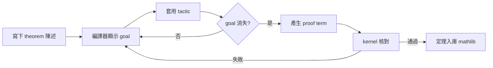

# 11.3 數學家的編程新體驗：讓編譯器幫你檢查邏輯漏洞

## 前言：從「紙上證明」到「可執行的邏輯契約」

前三節我們看到證明助理的理論基礎（10.2、10.3）與陳述方法（11.1、11.2）。本節轉向**使用者體驗**：一位受傳統訓練的數學家，如何在 Lean 4 / Coq / Agda 中把日常推理變成編譯器可檢查的對象？這不只是工具適應，更是**思維方式的升級**——從「說服同儕」到「說服 kernel」。

---

## 一、基本工作流程：goal、tactic、kernel

### 1.1 目標（goal）與戰術（tactic）

Lean 4 的互動循環：



實例：證明 $\sqrt{2}$ 是無理數。

```lean
theorem sqrt_two_irrational : ∀ p q : ℕ, q ≠ 0 → p * p = 2 * q * q → False := by
  intro p q hq heq
  -- 關鍵引理：p*p = 2*q*q 且互素 → 矛盾
  have hcopr : Nat.Coprime p q :=
    (Nat.coprime_of_mul_eq_two heq hq)  -- 需引入互素關係
  have hp2 : 2 ∣ p := by
    -- 若 2 ∤ p 則 p*p ≡ 1 (mod 2)，與 heq 矛盾
    by_contra h
    have : p * p % 2 = 1 := by
      rcases Nat.Even_or_Even_or_Odd p with h1 | h1
      · simp [Nat.Even, h1]  -- 簡化
      · have : p % 2 = 1 := h1
        omega
    omega
  have hq2 : 2 ∣ q := by
    have : 2 ∣ p * p := ⟨p, heq⟩
    exact (Nat.prime_two).dvd_of_dvd_mul_left this
  -- 2 ∣ p 且 2 ∣ q 與互素矛盾
  exact hcopr.coprime_dvd_left hp2 hq2 |>.elim
```

**體驗重點**：每一行 tactic 都會讓編譯器**即時回饋**剩餘目標——數學家第一次體會到「邏輯漏洞無所遁形」。忘記分類奇偶、漏掉 $q \neq 0$ 條件、互素假設沒建立——編譯器都會立刻指出。

### 1.2 常用戰術字典

| 戰術 | 用途 | 類比人類推理 |
|---|---|---|
| `intro h` | 引入假設 | 「設……」 |
| `apply h` | 反向使用引理 | 「由引理 3 知……」 |
| `exact` | 直接給出證明項 | 「證畢」 |
| `rcases h with ⟨a, b⟩ \| h2` | 分類討論 | 「分兩種情況」 |
| `simp` / `omega` / `ring` | 自動化 | 「顯然」——但機器檢查的顯然 |
| `by_contra` | 歸謬（引入古典公理） | 「反設不然」 |

---

## 二、常見邏輯漏洞與編譯器的抓法

### 2.1 漏洞一：Vacuously true（空真）

```lean
-- 錯誤陳述：忘記非空條件，定理變 trivially true
theorem bad (S : Finset ℕ) : ∀ x ∈ S, x > 0 := by
  intro x hx
  exact absurd (Finset.mem_singleton.mp hx) (by norm_num)  -- 編譯錯誤！
-- 編譯器指出：S 可以是空集，無法推出 x > 0
```

**編譯器的價值**：它不會讓你「假裝」證完了；tactic 卡住或型別不匹配都會立刻報錯。

### 2.2 漏洞二：混淆 $\forall$ 與 $\exists$ 的順序

```lean
-- 兩者不等價！
example : ∀ n : ℕ, ∃ m : ℕ, m > n := fun n => ⟨n + 1, Nat.lt_succ_self n⟩
-- ∃ m, ∀ n, m > n 無法證明（編譯器會卡住，因為 m 必須先於 n 給定）
```

### 2.3 漏洞三：用錯等價（Only if vs. If and only if）

```lean
-- 若只想證 ←（充分性），卻寫了 Iff 的半邊，編譯器會卡在另一半
example : (1 : ℕ) < 2 ↔ True := by
  constructor
  · intro _; trivial
  · intro _; norm_num  -- 這邊也對，但若方向寫反會立即報錯
```

---

## 三、與 Python 等一般編程的比較

### 3.1 一般編程：測試 vs. 證明

```python
def sqrt_two_irrational():  # Python 只能「測試」
    """用連分數逼近檢查，非證明"""
    from mpmath import mp, mpf, sqrt as msqrt
    mp.dps = 50
    x = msqrt(2)
    # 檢查是否落在有理數密度極高的區間內——只能累積證據
    for q in range(2, 10000):
        p = round(x * q)
        if abs(mpf(p) / q - x) < mpf(10) ** -40:
            return False  # 發現良好逼近，仍非無理性證明
    return True  # 未發現 ≠ 證明
```

**差異本質**：

| | 測試（Python） | 證明（Lean） |
|---|---|---|
| 覆蓋 | 有限案例 | 全部情況 |
| 失敗模式 | 假陰性（案例不夠） | 編譯錯誤（立即） |
| 假陽性 | 無（真錯誤會被抓住） | 不可能通過 kernel |
| 產出 | 一個 bool | 一個可複用的證明項 |

### 3.2 混合工作流

實務上數學家常用**兩階段**：

1. **探索階段**：用 Python/SageMath/NumPy 找模式、驗證猜想；
2. **形式化階段**：把猜想陳述進 Lean，社群或 AI 協助證明。

**前因後果**：11.1 節的等價鏈與本節的兩階段，共同構成「**數值探索 → 陳述 → 形式化 → 入庫**」的完整回路——正是 PFR、Fermat 專案的工作模式。

---

## 四、進階技巧：讓編譯器替你構造證明

### 4.1 巨集與 Elaboration

Lean 4 允許用戶自訂戰術，本質是**產生證明項的函式**：

```lean
-- 定義自訂戰術：自動處理「兩邊平方且皆非負」型目標
macro "sq_nonneg" : tactic =>
  `(tactic| apply le_of_mul_le_mul_left <;> nlinarith)

-- 使用
example (a b : ℝ) (ha : 0 ≤ a) (hb : 0 ≤ b) (hab : a ≤ b) :
    a * a ≤ b * b := by
  sq_nonneg  -- 戰術展開成多個基本推理步驟
```

### 4.2 反射式證明（延續 10.2）

`decide` 的原理：**把命題編碼成可計算的物件，直接執行**：

```lean
-- decide 對有限命題自動構造證明
example : ∀ x : Bool, x = true ∨ x = false := by decide

-- 對較大的有限結構也有效（如 4×4 數獨解的存在性）
```

### 4.3 AI 輔助

2024 年起，OpenAI、DeepMind（AlphaProof）、Harmonic 等把 Lean 作為訓練環境：


**關鍵**：Lean kernel 提供**無假陽性的 reward**，這使強化學習可靠——這是 10.3 節「小核心哲學」在 AI 時代的直接紅利。

---

## 五、數學家的轉變

| 傳統體驗 | 新體驗 |
|---|---|
| 「我覺得這樣證」 | 「kernel 說這樣證」 |
| 引用文獻需自行判斷 | 引用 mathlib 引理，依賴自動稽核 |
| 分類討論易漏 | `rcases` 強制完備 |
| 邊界條件常出錯 | 型別（`Nonempty`、`0 < n`）強制明示 |
| 審稿是人社會過程 | kernel 是數學的最終法庭 |

**心理層面**：許多數學家初學 Lean 時最震驚的是「我以為我懂，但形式化後發現自己不懂」——例如「實數的完備性」需拆成多個等價公理選擇（Dedekind cut、Cauchy 序列、sup 存在性），形式化逼你選一個並意識到其哲學位置。

---

## 小結與銜接

- 編譯器把「邏輯漏洞」從隱性（審稿漏抓）變顯性（編譯錯誤）。
- 戰術、反射、AI 輔助共同降低「寫證明的成本」，使形式化從奢侈品變日常工具。
- 下一節（12.1）我們把鏡頭從「證明數學」轉向「證明程式」：程式規約與前後置條件——Curry–Howard 的另一面。

## 練習

1. 在 Lean 中形式化並證明：任意三個實數 $a \le b \le c$ 的中位數是 $b$。
2. 找出一個你熟悉的小定理（如 $\gcd(a,b) \cdot \mathrm{lcm}(a,b) = ab$），嘗試在 Lean 中陳述並證明。
3. 用 Python 驗證 $\sqrt{2}$ 的前 10000 個有理數逼近，並解釋為何這**永遠**無法證明無理性。
