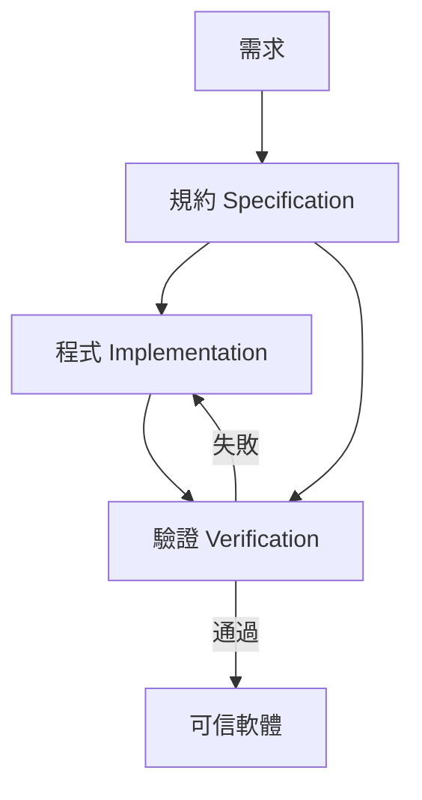

# 12.1 程式規約與前後置條件

## 前言：給程式寫「定理」

前一章我們形式化數學；本章把鏡頭反轉——**程式本身也是數學物件**，可以陳述定理、可以證明。這門學問叫**程式驗證**（program verification），核心工具是 **Hoare 邏輯**（1969, C.A.R. Hoare）：以**前置條件**（precondition）與**後置條件**（postcondition）構成的「規約」（specification），描述程式的行為契約。

**為何重要**：從 CompCert 編譯器（見 12.3）到 seL4 作業系統核心，形式驗證已在工業落地；而 Rust 的借用檢查器、Python 的 type hints、Solidity 的 SmartCheck 都是這條脈絡的輕量版。零知識證明（12.2）也把「執行滿足規約」作為核心命題。

---

## 一、Hoare 三元組：規約的語言

**定義（Hoare 三元組）**：

$$
\{P\}\ C\ \{Q\}
$$

意為：若程式 $C$ 在滿足 $P$ 的狀態下開始執行且終止，則終止時 $Q$ 成立。

**範例**：

$$
\{x = a \land y = b\}\ \text{tmp} \leftarrow x;\ x \leftarrow y;\ y \leftarrow \text{tmp}\ \{x = b \land y = a\}
$$

### 1.1 推論規則（Hoare 邏輯的公理系統）

**賦值公理**：

$$
\{Q[E/x]\}\ x \leftarrow E\ \{Q\}
$$

**順序組合**：

$$
\frac{\{P\}\ C_1\ \{R\}\quad \{R\}\ C_2\ \{Q\}}{\{P\}\ C_1;C_2\ \{Q\}}
$$

**條件**：

$$
\frac{\{P \land b\}\ C_1\ \{Q\}\quad \{P \land \lnot b\}\ C_2\ \{Q\}}{\{P\}\ \text{if}\ b\ \text{then}\ C_1\ \text{else}\ C_2\ \{Q\}}
$$

**While 迴圈**（需要**不變式**，見第二節）：

$$
\frac{\{I \land b\}\ C\ \{I\}}{\{I\}\ \text{while}\ b\ \text{do}\ C\ \{I \land \lnot b\}}
$$

---

## 二、迴圈不變式：驗證的靈魂

**定義（迴圈不變式）**：謂詞 $I$ 滿足 (1) 迴圈開始時成立；(2) 每次迭代後仍成立；(3) 迴圈結束時連同 $\lnot b$ 蘊含後置條件。

**經典範例**：計算 $x^n$ 的不變式。

```python
def power(x, n):
    """驗證規約：回傳 x^n，n ≥ 0"""
    result = 1
    k = n
    # 不變式 I: result * x^k == x^n  且  k ≥ 0
    while k > 0:
        if k % 2 == 0:
            x = x * x
            k = k // 2
        else:
            result = result * x
            k = k - 1
    return result
```

驗證步驟（Hoare 風格）：

1. **初始**：`result=1, k=n` ⟹ $1 \cdot x^n = x^n$ ✓， $n \ge 0$ ✓
2. **保持**：
   - $k$ 偶： $result \cdot (x^2)^{k/2} = result \cdot x^k = x^n$ ✓， $k/2 \ge 0$ ✓
   - $k$ 奇： $result \cdot x \cdot x^{k-1} = result \cdot x^k = x^n$ ✓， $k - 1 \ge 0$ ✓
3. **終止**： $k = 0$ ⟹ $result = x^n$ ✓
4. **變化量**（variant）： $k$ 嚴格遞減且非負 ⟹ 迴圈終止 ✓（**完全正確性**，不僅部分正確性）

---

## 三、在證明助理中做程式驗證

### 3.1 Lean 4 的 `Do`-block 與函數式驗證

函數式路徑：程式即函數，規約即型別。以**相依型別**直接把規約放進回傳型別：

```lean
-- 「回傳長度為 n 且每項為 a 的向量」——規約就是型別
def replicate' (n : Nat) (a : α) : Vector α n :=
  match n with
  | 0     => .nil
  | k + 1 => .cons a (replicate' k a)

-- 等價地，用 subset type 把不變式內嵌
def sortedTake (l : List ℕ) (n : ℕ) (h : n ≤ l.length) :
    { l' : List ℕ // l'.length = n } :=
  ⟨(l.take n), by simp [List.length_take, h]⟩
```

### 3.2 Dafny 與契約式設計

Dafny 是專為驗證設計的語言，把 Hoare 邏輯變成語法糖：

```dafny
method Max(a: array<int>) returns (m: int)
  requires a.Length > 0
  ensures forall i :: 0 <= i < a.Length ==> a[i] <= m
  ensures m in a[..]
{
  m := a[0];
  var i := 1;
  while i < a.Length
    invariant 1 <= i <= a.Length
    invariant forall j :: 0 <= j < i ==> a[j] <= m
    invariant m in a[..i]
  {
    if a[i] > m { m := a[i]; }
    i := i + 1;
  }
}
```

Z3 SMT 求解器自動檢查每個 verification condition。**前因後果**：Dafny 的自動化來自 SMT（de Moura 的 Z3，見 10.2），而 Lean 的自動化較弱但表達力較強——兩者是同一問題的兩種工程取捨。

### 3.3 Java Modeling Language 與工業契約

```java
//@ requires x != null;
//@ ensures \result == x.length;
int length(int[] x);
```

契約式設計（Design by Contract, Eiffel 的 Meyer，1986）把 Hoare 邏輯帶進 OOP。如今 Rust 的 `#[requires]` crate、Ada SPARK、F*（微軟，用於驗證密碼學協定實作，見 12.2）都是此譜系。

---

## 四、規約的三個層次

| 層次 | 描述 | 工具 |
|---|---|---|
| **語法層** | 型別檢查（Hindley–Milner、線性型別） | OCaml、Rust borrow checker |
| **契約層** | 前後置條件 + 不變式 | Dafny、SPARK、JML |
| **全形式層** | 語意 + 程式邏輯的全部推理 | Coq/CompCert、Lean、F*、Isabelle |

**取捨**：層次越高，成本越高。工業上常「分而治之」：關鍵模組用高層次，其餘用測試 + 型別。



---

## 五、深度議題：規約正確性問題

**定理（無法逃脫的循環）**：形式驗證只能證「程式符合規約」，無法證「規約符合人類意圖」。

- **CompCert 的回答**：以 Coq 證明「CompCert 原始碼語意 ≡ 組合語言語意」，規約是**數學語意**而非人類意圖——這比「規約寫錯」可信得多。
- **seL4 的回答**：規約以**數學模型**（抽象機器）給出，並以證明連結到實作。
- **實務啟示**：規約要**小而清晰**（如「排序後是輸入的排列」），避免規約本身成為第二份 bug 原始碼。

---

## 六、完整範例：二分搜尋的規約與驗證

```python
def binary_search(arr, target):
    """規約：若 target 在 arr 中，回傳其 index；否則回傳 -1。
       前置：arr 已升冪排序。"""
    lo, hi = 0, len(arr) - 1
    # 不變式 I: arr[lo-1] < target（若 lo>0）且 target < arr[hi+1]（若 hi<len-1）
    # 變化量: hi - lo 嚴格遞減
    while lo <= hi:
        mid = (lo + hi) // 2
        if arr[mid] == target:
            return mid
        elif arr[mid] < target:
            lo = mid + 1
        else:
            hi = mid - 1
    return -1
```

驗證的關鍵陷阱：`(lo + hi) // 2` 在某些語言會溢位（Java 的歷史 bug，2006 年才被發現）——形式驗證會**立即**抓住，因為整數範圍在規約中必須明示。正確寫法 `lo + (hi - lo) // 2`。

在 Lean 中形式化（示意）：

```lean
def bsearch (target : ℕ) (arr : Array ℕ) (lo hi : Nat) : Option Nat :=
  if lo > hi then none
  else
    let mid := lo + (hi - lo) / 2
    if h : mid < arr.size then
      if arr[mid] == target then some mid
      else if arr[mid] < target then bsearch target arr (mid+1) hi
      else bsearch target arr lo (mid-1)
    else none

-- 規約：回傳 Some i 時 arr[i] = target
theorem bsearch_correct (h : bsearch target arr 0 (arr.size-1) = some i) :
    i < arr.size ∧ arr[i]! = target := by
  ...
```

---

## 小結與銜接

- Hoare 三元組 + 迴圈不變式 + 變化量 = 程式正確性的完整證明框架。
- 三層規約（型別、契約、全形式）提供工程成本光譜。
- 「規約本身正確嗎？」是無法完全解決的問題，但用**數學語意**當規約（CompCert 範式）可把風險降到極低。
- 下一節（12.2）我們看另一個把「驗證」推向極致的領域：**零知識證明**——不揭露證明內容也能驗證其存在，其數學結構正是前幾節多項式、橢圓曲線的匯流。

## 練習

1. 為 `power` 函式寫出完整的 Dafny 規約（含 terminates 證明）。
2. 在 Lean 中用 `Vector` 型別證明 `replicate'` 的長度正確性。
3. 找出一個真實世界的軟體 bug（如 Ariane 5 或 Therac-25），分析它會被哪一層規約抓住。
