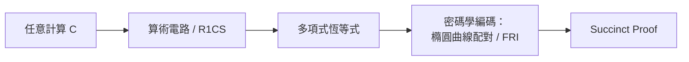
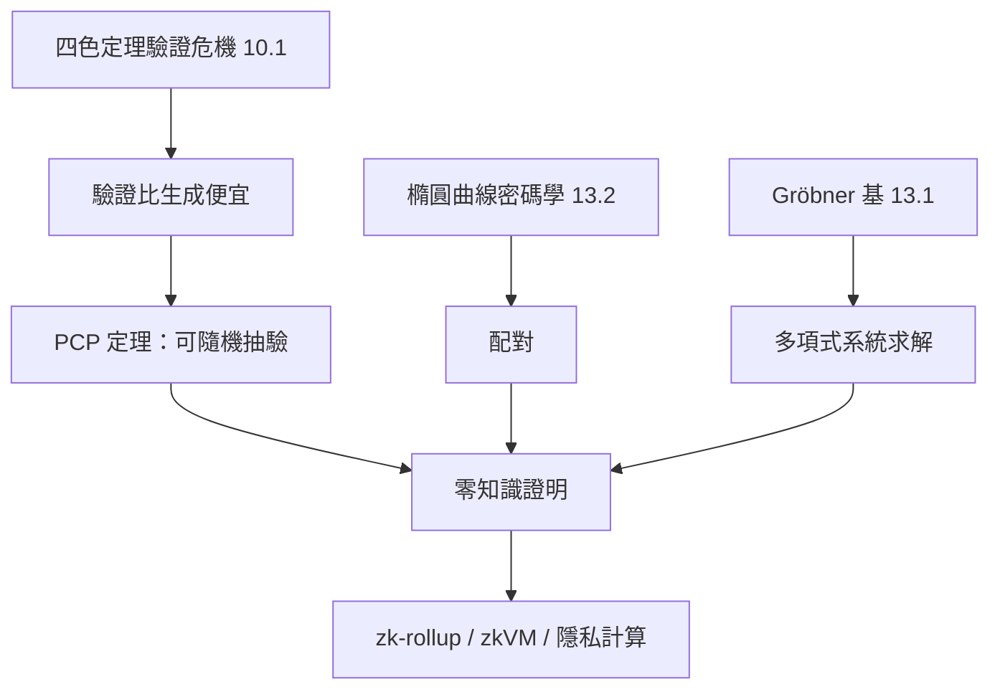

# 12.2 零知識證明與密碼學中的數學結構

## 前言：證明而不揭露

1985 年，Goldwasser、Micali、Rackoff 發表「互動式零知識證明」：證明者 $P$ 能讓驗證者 $V$ 確信某命題為真，**卻不洩露任何「為何為真」的資訊**。這個看似悖論的概念，如今支撐 Zcash 的隱私交易、以太坊的 zk-rollup 擴容、以及各種身份驗證協定。本章要講清楚它背後的**數學結構**：多項式、群、橢圓曲線、配對——以及這些結構如何與 10.1 的「驗證比生成容易」直覺、13.1 的 Gröbner 基、13.2 的橢圓曲線匯流。

---

## 一、定義與三性質

**定義（零知識證明, ZKP）**：證明者 $P$ 與驗證者 $V$ 的互動協定，滿足：

1. **完備性**（Completeness）：若命題為真且 $P$ 誠實，$V$ 以壓倒性機率接受。
2. **健全性**（Soundness）：若命題為假，任何作弊 $P$ 皆以極小機率通過。
3. **零知識性**（Zero-Knowledge）：$V$ 除了「命題為真」之外，學不到任何資訊（以**模擬器**（simulator）形式化：$V$ 自己就能生成與互動過程不可區分的 transcript）。

### 1.1 經典範例：Ali Baba 洞穴

- 洞穴有兩條路 A、B 匯合於深處的魔法門（需密語開啟）。
- $P$ 進入洞穴（隨機選 A 或 B），$V$ 在洞口喊「從 A 出來」或「從 B 出來」。
- 若 $P$ 真知密語，總能滿足；若不知，每次被抓到機率 1/2。
- 重複 $n$ 次：作弊成功率 $(1/2)^n$。

**零知識性**：$V$ 在過程中學到的只是「$P$ 能通過挑戰」，其本身可模擬（擲硬幣即可）。

---

## 二、NP 完全問題：ZKP 的理論基座

**定理（Goldreich–Micali–Wigderson, 1986）**：**任何 NP 問題都有零知識證明**（假定單向函數存在）。

關鍵：把任意計算**編碼為多項式**或**電路可滿足性**（見 13.3 的 P vs. NP 基座）。這解釋了為何現代 zk-SNARK 全部以**算術電路**或**多項式恆等式**為中間表示：



**R1CS 範例**：命題「我知道 $x$ 使 $x^3 + x + 5 = 35$」化為約束：

$$
\begin{aligned}
x \cdot x &= x_1\\
x_1 \cdot x &= x_2\\
(x_2 + x) \cdot 1 &= x_3\\
x_3 + 5 &= 35
\end{aligned}
$$

這正是 13.1 節 Gröbner 基所處理的**多項式理想成員問題**！理論匯流點：ZKP 把「找 witness」歸約為「在有限域上解多項式系統」。

---

## 三、SNARK 與 STARK：兩條技術路線

### 3.1 zk-SNARK（簡潔非互動零知識論證）

**特性**：證明極小（數百位元組）、驗證極快（毫秒級）。

**數學核心**：**多項式承諾**（polynomial commitment）+ **雙線性配對**。

- **KZG 承諾（Kate–Zaverucha–Goldberg, 2010）**：對多項式 $f(x)$，承諾 $C = f(s) \cdot G$，其中 $s$ 是**儀式**（trusted setup）產生的祕密。
- **雙線性配對** $e : G_1 \times G_2 \to G_T$ 滿足 $e(aP, bQ) = e(P, Q)^{ab}$，使驗證者能檢查**加密的多項式在點 $s$ 的值**而不揭露 $s$。

**Pi 恆等式**：證明「$f$ 在點 $z$ 的值為 $v$」等價於「$f(x) - v$ 在 $x = z$ 有根」，即存在 $h$ 使 $f(x) - v = h(x)(x - z)$。在加密域檢查此恆等式。

### 3.2 zk-STARK（透明、抗量子）

- 不需 trusted setup（無毒儀式），用 **FRI 協定**（Fast Reed–Solomon IOP）+ **Merkle 樹**。
- 基於**有限域上的 Reed–Solomon 碼**，抗量子攻擊。
- 證明較大（數百 KB），但可擴展性更好。

| | SNARK | STARK |
|---|---|---|
| 證明大小 | ~200 B | ~100 KB |
| 驗證時間 | 毫秒 | 數十毫秒 |
| Trusted setup | 需要（KZG） | 不需要 |
| 抗量子 | 否 | 是 |
| 數學基礎 | 配對、橢圓曲線 | Reed–Solomon、Hash |

---

## 四、Python 範例：簡化的多項式承諾直覺

用小質數域 $p$ 模擬 KZG 的精神（非真實密碼學強度）：

```python
from sympy import symbols, Poly, GF

p = 97  # 小質數，真實系統用 254-bit 質數

def poly_eval_mod(f_coeffs, x, p=p):
    """在 GF(p) 上計算多項式 f(x)"""
    return sum(c * pow(x, i, p) for i, c in enumerate(f_coeffs)) % p

def poly_div_mod(f, g, p=p):
    """在 GF(p) 上做 f(x) / g(x) 的多項式除法，回傳商"""
    # f, g 以係數列表表示（升冪）
    f = f[:]
    q = [0] * len(f)
    g_lead = len(g) - 1
    inv_g = pow(g[-1], -1, p)  # 模反元素
    for i in range(len(f) - 1, g_lead - 1, -1):
        c = f[i] * inv_g % p
        q[i - g_lead] = c
        for j in range(g_lead + 1):
            f[i - g_lead + j] = (f[i - g_lead + j] - c * g[j]) % p
    return q[:len(q)], f[:g_lead]

# 證明者：承諾 f(x) = x^2 + 2x + 3，宣稱 f(5) = 38
f = [3, 2, 1]
x = symbols('x')
z, v = 5, 38

# 檢查 f(z) = v
assert poly_eval_mod(f, z) == v

# 構造 h(x) = (f(x) - v) / (x - z)
numerator = [(f[i] - v) % p if i == 0 else f[i] for i in range(len(f))]
numerator[0] = (f[0] - v) % p
quotient, _ = poly_div_mod(numerator, [(p - z) % p, 1])

# 驗證者：檢查 f(x) - v = h(x)(x - z) 在隨機點 r 成立
import random
r = random.randrange(2, p)
lhs = (poly_eval_mod(numerator, r)) % p
rhs = poly_eval_mod(quotient, r) * ((r - z) % p) % p
print(lhs == rhs % p)  # True
```

真實 KZG 把「多項式值」換成「橢圓曲線點」，用**配對**讓驗證者在**不知道 $h$** 的情況下檢查恆等式——這就是 13.2 節橢圓曲線密碼學的實際應用。

---

## 五、應用場景

### 5.1 區塊鏈

- **Zcash**：shielded transaction 用 zk-SNARK 證明「交易有效且金額平衡」，不揭露金額。
- **以太坊 zk-rollup**：把數千筆交易的執行壓縮成一個 ZKP，Layer 1 只驗證證明——**擴容即 ZKP**。

### 5.2 身份與隱私

- **年齡證明**：證明「我 ≥ 18 歲」而不揭露出生日期。
- **無酬資格**：證明「我的收入在 X 範圍」而不揭露確切數字。

### 5.3 形式化數學的交叉

- **證明的證明**：把 Lean 證明項轉成 ZKP，可公開驗證「此定理已被形式化」而不需下載 mathlib（如 proof-carrying data 研究）。
- **zkVM**：把通用計算（如 RISC-V）包進 ZKP，可驗證任意程式執行正確——**這是 12.1 節規約驗證的極致版本**。

---

## 六、深度議題：零知識性的資訊論詮釋

**模擬器的定義**：對每個（可能作弊的）驗證者 $V^*$，存在多項式時間**模擬器** $S$，使其輸出分佈與 $V^*$ 與真實 $P$ 互動的 transcript **計算上不可區分**。

**深層含義**：$V^*$ 能「自己想出」的資訊 = 它從互動中得到的資訊 = 除了真偽之外**零**。這是**資訊論**與**計算複雜度**（13.3）的交匯：零知識性是計算不可區分性（非資訊論完美零知識）的絕大多數情況。

**前因後果的收束**：



---

## 小結與銜接

- ZKP 的本質：**把「計算正確性」化為「多項式恆等式」**，再用**數論結構**（橢圓曲線、有限域）使其可驗證而不可偽造。
- SNARK/STARK 的取捨：簡潔 vs. 透明 vs. 抗量子。
- 理論根：NP 完全性（13.3）+ PCP 定理；數學根：多項式（13.1）+ 群論（13.2）。
- 下一節（12.3）看 ZKP 與形式驗證如何共同守護**智慧合約與關鍵基礎設施**——「零缺陷」的實際戰場。

## 練習

1. 實作 Ali Baba 洞穴協定的 Python 模擬，驗證作弊成功率趨近 $(1/2)^n$。
2. 用 GF(p) 上的多項式除法，實作「承諾 + 挑戰 + 開承諾」的簡化 Schnorr 型協定。
3. 說明為何 KZG 需要trusted setup，而 FRI 不需要。
