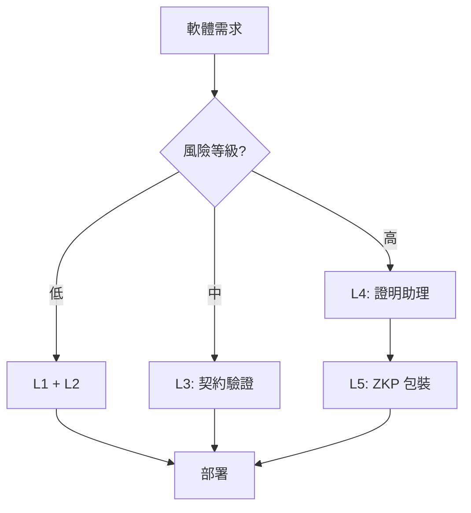
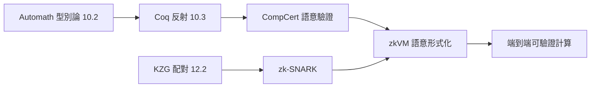

# 12.3 智慧合約與關鍵基礎設施的零缺陷數學證明

## 前言：當 bug 的代價是數億美元

2016 年 The DAO 事件：以太坊上一個智慧合約因重入攻擊被盜走 3.6M ETH（當時約 6,000 萬美元），導致以太坊硬分岔。2010 年 Toyota 煞車系統事故、Therac-25 放射治療機致死、Ariane 5 火箭爆炸——**軟體 bug 的代價早已是生命與數億美元**。

本章整合前三章的工具：形式驗證（12.1）、零知識證明（12.2）、證明助理（10.3），看它們如何在**智慧合約**與**關鍵基礎設施**中實現「零缺陷」的承諾，以及這個承諾的邊界在哪裡。

---

## 一、為何智慧合約是形式驗證的絕佳戰場

**智慧合約特性**：
1. **程式碼即法律**（code is law）：部署後難以修改；
2. **開放執行環境**：任何人可呼叫，攻擊面極大；
3. **不可逆的經濟後果**：一個 bug 立即變現為損失；
4. **天然規約清晰**：如 ERC-20 的 transfer 應「扣減餘額、增加收款人餘額、保持總量」。

**完美風暴**：高風險 + 高誘因 + 可形式化規約 = **形式驗證的應用天賜良機**。

### 1.1 經典攻擊的規約視角（延續 12.1）

**重入攻擊（Reentrancy）**：

```solidity
// 漏洞版
function withdraw(uint amount) public {
    require(balances[msg.sender] >= amount);
    (bool ok, ) = msg.sender.call{value: amount}("");  // ← 外部呼叫
    require(ok);
    balances[msg.sender] -= amount;  // ← 扣款太晚！
}
```

形式規約（Hoare 三元組，見 12.1）：

$$
\{\text{balance}[a] = b\}\ \text{withdraw}(a, v)\ \{\text{balance}[a] = b - v \land \text{total supply 不變}\}
$$

**不變式**：`sum of all balances == totalSupply`。漏洞版在 `call` 期間違反此不變式（攻擊者的 fallback 可再次呼叫 `withdraw`）。

**形式驗證工具**：
- **Certora**：以 SMT 求解器驗證 Solidity 合約的規約，用於 Aave、Uniswap 等主流協議。
- **K Framework**：以語意為基礎的形式驗證，曾用於 EVM 完整語意。
- **Coq/Lean 定制驗證**：少數頂級專案直接用證明助理。

---

## 二、里程碑案例：CompCert 與 seL4

### 2.1 CompCert：驗證過的 C 編譯器

**前因**：10.1 的四色定理爭議 → Coq 反射技術成熟 → 2005 年起 Xavier Leroy 團隊建構 CompCert。

**成果**：CompCert 的**前端 + 中端 + 後端關鍵 pass** 全部在 Coq 中驗證，證明：

$$
\text{CompCert}(P) \text{ 的語意} \equiv P \text{ 的語意}
$$

**實際影響**：空巴、達梭等航空業者採用 CompCert 編譯飛控軟體，因為它把「編譯器 bug」這個原本不可控的風險**形式化為零**。

**哲學意義**（承接 12.1）：CompCert 證明的是「編譯器保持語意」，而非「原始碼無 bug」。這是**規約分層**的典範——每一層的驗證都縮小了信任範圍。

### 2.2 seL4：驗證過的作業系統核心

- 2009 年，澳洲 NICTA 團隊以 Isabelle/HOL 完成 seL4 微核心的功能正確性證明（約 87 萬行 Isabelle）。
- 之後補齊：安全性（access control）、資訊流、即時性、C 實作對應。
- **應用**：汽車、醫療、軍事等高安全場景。

**啟示**：**形式驗證已能處理真實規模的系統軟體**，但成本驚人（seL4 約每行 20-30 人時）。

---

## 三、形式驗證的經濟學

| 等級 | 技術 | 成本 | 適用 |
|---|---|---|---|
| L1 | 型別 + Lint | 低 | 所有軟體 |
| L2 | 測試 + Fuzzing | 中 | 多數軟體 |
| L3 | 契約 + SMT（Dafny, Certora） | 中高 | 金融邏輯、協議核心 |
| L4 | 全形式驗證（Coq, Lean, Isabelle） | 高 | 編譯器、OS 核心、高額 TVL 合約 |
| L5 | + 零知識證明（zkVM） | 高 | 可公開驗證的計算 |



---

## 四、zkVM 與可驗證計算：ZKP 與形式驗證的匯流

**zkVM**（zero-knowledge virtual machine）：把一個**通用 VM**（如 RISC-V）的執行過程包裹成 ZKP。

**意義**：

1. **計算完整性**：任何人可驗證「這段程式真的產生了這個輸出」，不需重跑。
2. **與 12.2 的連結**：zkVM 內部正是把「VM 執行步驟」化為多項式恆等式。
3. **與 12.1 的連結**：若 VM 的**語意**本身已形式化（如用 Lean 形式化 RISC-V 語意），則 ZKP 的健全性 + 語意正確性 = **端到端可驗證**。

**實例**：
- **RISC Zero、SP1（Succinct）**：RISC-V zkVM，已用於以太坊 rollup。
- **Formal Methods 與 zk 的研究**：把 zkVM 的 ISA 語意在 Lean/Isabelle 中形式化，使 ZKP 建立在經過證明助理檢查的語意上。

**前因後果收束**：



---

## 五、Python 範例：合約不變式的模型檢查

以 Python 模擬簡單代幣合約的**不變式檢查**（模型檢查的精神，12.1 的契約層）：

```python
from dataclasses import dataclass, field

@dataclass
class Token:
    total_supply: int
    balances: dict = field(default_factory=dict)

    def invariant(self):
        """形式化不變式：所有餘額總和 == total_supply"""
        return sum(self.balances.values()) == self.total_supply

    def transfer(self, frm, to, amount):
        """規約（Hoare 風格）：
           Pre:  balances[frm] >= amount, frm != to
           Post: balances[frm] -= amount, balances[to] += amount,
                 invariant 仍然成立
        """
        assert frm in self.balances, "Precondition: sender exists"
        assert self.balances[frm] >= amount, "Precondition: sufficient balance"
        old = dict(self.balances)

        # 模擬「重入」：在扣款前允許外部回呼
        # 取消註解即可重現 The DAO 漏洞：
        # self.external_hook(frm)   # ← 攻擊面

        self.balances[frm] -= amount
        self.balances[to] = self.balances.get(to, 0) + amount
        assert self.invariant(), "Postcondition violated: 不變式被破壞"
        return old

# 窮舉小狀態空間（模型檢查精神）
import itertools
ok = True
for state in itertools.product([0, 1, 2], repeat=3):
    t = Token(total_supply=sum(state))
    for i, v in enumerate(state):
        t.balances[f"u{i}"] = v
    try:
        for frm in list(t.balances):
            for to in list(t.balances):
                for amt in range(3):
                    tt = Token(t.total_supply, dict(t.balances))
                    if tt.balances.get(frm, 0) >= amt:
                        tt.transfer(frm, to, amt)
    except AssertionError as e:
        ok = False
        print(f"違反: {state} -> {e}")
print("所有小狀態皆滿足不變式" if ok else "發現漏洞")
```

**局限**：模型檢查只能窮舉**有限**狀態空間（見 13.3 的 P vs. NP 障礙）；大合約需**符號執行** + SMT（如 Certora）或**完全證明**（Lean/Coq）。

---

## 六、深度議題：「零缺陷」的邊界

**定理（無免費午餐）**：形式驗證的正確性受限於：

1. **規約正確性**（見 12.1 第五節）：規約寫錯則證明無意義；
2. **模型正確性**：EVM 語意、RISC-V 語意等**模型**是否真實反映執行環境；
3. **可信基礎**：證明助理 kernel（10.3 的小核心）、SMT 求解器的 bug；
4. **社會攻擊面**：預言機、治理、私鑰管理——這些**在合約之外**。

**實務結論**：「零缺陷」是**分層縮小信任範圍**的過程，不是絕對保證。CompCert 仍需信任 Coq kernel；zkVM 仍需信任密碼學假設（離散對數、碰撞抵抗）。但相較「測試過了就好」，這是**數量級的提升**。

---

## 小結與銜接

- 智慧合約 + 高價值 + 清晰規約 = 形式驗證的完美應用。
- CompCert、seL4 證明「真實規模的形式驗證可行」；zkVM 把「驗證計算」推向公開、去中心化。
- 「零缺陷」的真正內涵：**信任範圍的數學化縮小**——從「信任整個軟體」到「信任 kernel + 公理 + 密碼學假設」。
- 下一章（13.1）轉向計算代數的引擎：**Gröbner 基**——它既支撐 SMT 中的多項式求解，也支撐 12.2 中 ZKP 的多項式恆等式檢查。

## 練習

1. 為 ERC-20 的 `transfer` 寫出完整 Hoare 規約（含事件觸發的後置條件）。
2. 用 Python 實作「重入攻擊」的模擬，並用不變式檢查抓住它。
3. 調查 CompCert 的「未驗證組件」有哪些，討論它們如何影響「零缺陷」承諾。
