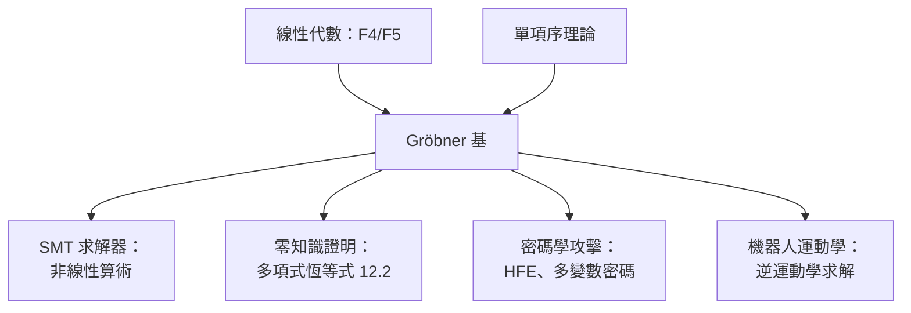

# 13.1 Gröbner 基與多項式理想的電腦計算

## 前言：把代數幾何變成演算法

1965 年，Bruno Buchberger 在其博士論文中提出 **Gröbner 基**，使得 Hilbert 的**理想成員問題**、**零點存在問題**（Hilbert 零點定理的計算版）從抽象理論變成可執行的演算法。這是「計算代數」的誕生時刻，也成為後來：

- **符號計算系統**（Mathematica、Maple、SageMath）的核心引擎；
- **SMT 求解器**處理多項式約束的後端之一；
- **零知識證明**中多項式恆等式檢查的理論基座（見 12.2）；
- **機器人運動學**、**密碼學攻擊**（如 HFE）的實用工具。

本章講清楚：Gröbner 基是什麼、為何需要它、它如何把「無窮多解」化為「有限計算」。

---

## 一、問題：多項式理想中的「餘式」不唯一

**設定**：在環 $k[x_1,\dots,x_n]$ （ $k$ 為體，通常 $\mathbb{Q}$ 或有限域 $\mathbb{F}_p$ ）中，給定多項式集合 $F = \{f_1, \dots, f_s\}$ ，其生成的**理想**：

$$
I = \langle f_1, \dots, f_s \rangle = \left\{ \sum_i h_i f_i \mid h_i \in k[x_1,\dots,x_n] \right\}
$$

**核心問題**：給定 $g$ ，判斷 $g \in I$ ？

**困難**：一元多項式有「帶餘除法」——用 $f$ 除 $g$ 得唯一餘式 $r$ （次數小於 $\deg f$ ），且 $g \in \langle f \rangle \iff r = 0$ 。但**多元**情況下，除法結果**依項序與 $f_i$ 順序而變**！

**範例**：在 $\mathbb{Q}[x,y]$ 中， $f_1 = xy + 1$ ， $f_2 = y^2 - 1$ ，以 $g = xy^2 - x$ 除：

- 先用 $f_1$ ： $g = y(xy+1) - (y + x)$ ，再用 $f_1$ 除 $-x$ （不動），得餘式 $-(y+x)$ 。
- 先用 $f_2$ ： $g = x(y^2-1)$ ，得餘式 $0$ 。

兩個餘式不同，但都「合法」。**這破壞了 $g \in I \iff r = 0$ 的判準**。

---

## 二、Gröbner 基：恢復唯一餘式

**定義（Gröbner 基）**：給定單項序（monomial order，如 lex 或 grevlex），理想 $I$ 的一組生成元 $G = \{g_1,\dots,g_t\}$ 稱為 Gröbner 基，若每個 $g \in I$ 以 $G$ 做帶餘除法的**餘式恆為 0**。等價地， $G$ 生成的**首項理想**與 $I$ 相同：

$$
\langle \mathrm{LT}(G) \rangle = \langle \mathrm{LT}(I) \rangle
$$

**定理（Buchberger）**：每個理想都有 Gröbner 基，且可由 Buchberger 演算法**有限步**計算。

**定理（唯一性）**：**約化 Gröbner 基**（reduced Gröbner base）唯一——這使「兩組多項式生成同一理想嗎？」有**可計算**的判準。

### 2.1 Buchberger 演算法

核心是 **S-多項式**：

$$
S(f, g) = \frac{\mathrm{LCM}(\mathrm{LT}(f), \mathrm{LT}(g))}{\mathrm{LT}(f)} f - \frac{\mathrm{LCM}(\mathrm{LT}(g), \mathrm{LT}(f))}{\mathrm{LT}(g)} g
$$

演算法：

```text
輸入: F = {f_1, ..., f_s}
G ← F
重複:
  對每對 (g_i, g_j) ∈ G:
    S ← S(g_i, g_j)
    r ← S 對 G 的餘式
    若 r ≠ 0: G ← G ∪ {r}
直到所有 S-多項式餘式為 0
輸出: G（Gröbner 基，可再約化為 reduced 版本）
```

---

## 三、Python 實作：SageMath 與純 Python

### 3.1 SageMath（工業級）

```python
R.<x,y,z> = PolynomialRing(QQ, order='lex')
f1 = x^2 + y^2 + z^2 - 1
f2 = x^2 + y^2 - z^2 - 1
f3 = x + y - z

G = Ideal([f1, f2, f3]).groebner_basis()
print(G)
# 輸出 reduced Gröbner 基；lex 序下可「讀出解」：
# x - 1/2, y - 1/2, z ... 等形式的結果直接給出零點座標
```

**lex 序的威力**：lex Gröbner 基呈「**三角形式**」，像消去法一樣可直接讀出方程組的解。

### 3.2 純 Python 實作核心

```python
from fractions import Fraction

def monomial_lt(a, b):
    """lex 單項序比較（指數向量）"""
    return a > b

def poly_key(p):
    """多項式（dict: 指數tuple -> 係數）取首項"""
    return max(p.keys())

def s_polynomial(f, g):
    """計算 S(f, g)"""
    lf, lg = poly_key(f), poly_key(g)
    lcm = tuple(max(lf[i], lg[i]) for i in range(len(lf)))
    mf = tuple(lcm[i] - lf[i] for i in range(len(lf)))
    mg = tuple(lcm[i] - lg[i] for i in range(len(lg)))
    result = {}
    for m, c in f.items():
        result[tuple(m[i] + mf[i] for i in range(len(m)))] = c
    for m, c in g.items():
        k = tuple(m[i] + mg[i] for i in range(len(m)))
        result[k] = result.get(k, 0) - c
    return {m: c for m, c in result.items() if c != 0}

def reduce_mod_g(p, G):
    """以 Gröbner 基 G 做帶餘除法"""
    p = dict(p)
    changed = True
    while changed:
        changed = False
        for g in G:
            gl = poly_key(g)
            for m in sorted(p.keys(), reverse=True):
                # 檢查 m 是否被 gl 整除
                if all(m[i] >= gl[i] for i in range(len(m))):
                    q = tuple(m[i] - gl[i] for i in range(len(m)))
                    coef = p[m] / g[gl]
                    for mm, c in g.items():
                        k = tuple(mm[i] + q[i] for i in range(len(mm)))
                        p[k] = p.get(k, Fraction(0)) - coef * c
                    p = {m2: c for m2, c in p.items() if c != 0}
                    changed = True
                    break
    return p

# 範例：在 Q[x,y] 中檢查 x*y^2 - x 是否屬於 <xy+1, y^2-1>
f1 = {(1,1): Fraction(1), (0,0): Fraction(1)}   # xy + 1
f2 = {(0,2): Fraction(1), (0,0): Fraction(-1)}  # y^2 - 1
g  = {(1,2): Fraction(1), (1,0): Fraction(-1)}  # x*y^2 - x

# Buchberger：從 {f1, f2} 開始
G = [f1, f2]
S = s_polynomial(f1, f2)
r = reduce_mod_g(S, G)
if r:
    G.append(r)
print("餘式:", r)  # 應為空 dict → g ∈ 理想
```

**工程注意**：中間係數膨脹（coefficient swell）是 Buchberger 的實務瓶頸；工業系統用 **F4/F5**（Faugère, 1999/2002）以**線性代數**（Gauss 消去）批量處理 S-多項式，速度提升數量級。

---

## 四、理論成果：由 Gröbner 基讀出幾何

**定理（Hilbert 零點定理的計算版）**： $F$ 在代數封閉體上**無公共零點** $\iff$ reduced Gröbner 基 $= \{1\}$ 。

**定理（維度計算）**：從 Gröbner 基可計算**代數簇的維度**與**Hilbert 多項式**。

**範例**：求 $\{x^2 + y^2 = 1, x - y = 0\}$ 的解：

```python
# 在 SageMath
R.<x,y> = PolynomialRing(QQ, order='lex')
G = Ideal([x^2 + y^2 - 1, x - y]).groebner_basis()
print(G)  # [x - y, 2*y^2 - 1] → 三角形式 → y = ±1/√2, x = y
```

---

## 五、與其他領域的匯流



- **與 12.2 的連結**：ZKP 把計算化為多項式恆等式；驗證恆等式本質上是理想成員問題的變體（特別在有限域上，KZG 承諾即是「多項式在點 $s$ 的值」的密碼學化）。
- **與 13.2 的連結**：多變數公鑰密碼（如 HFE）的安全性正被 Gröbner 基演算法（F4/F5）的進步所威脅——**演算法進步直接改寫密碼學版圖**。
- **與 13.3 的連結**：理想成員問題是 **EXPSPACE-完備**的（一般情況），Gröbner 基的複雜度是**雙指數級**（lex 序）——這是計算複雜度的真實展現。

---

## 六、計算複雜度：為何「能算」不等於「好算」

| 問題 | 複雜度 |
|---|---|
| 理想成員（一般，lex） | EXPSPACE-完備 |
| 理想成員（固定變數數） | P |
| Gröbner 基計算（grevlex） | 指數級 |
| 零點存在（ $\mathbb{Q}$ 上） | NP-hard |

**啟示**：Gröbner 基的價值不在「快」，在「**完備且可終止**」——它把「理論上可解」變成「實際上（小規模）可算」。這與 12.1 的 SMT、13.3 的 P/NP 主題相扣。

---

## 小結與銜接

- 多元多項式除法的**非唯一性**是核心障礙；Gröbner 基以**單項序 + 首項理想**恢復唯一性。
- Buchberger 演算法（1965）→ F4/F5（1999/2002）→ 工業應用（SMT、ZKP、密碼學）。
- 理論成果：零點定理的計算化、維度計算、理想成員判定。
- 下一節（13.2）轉向**抽象代數在密碼學的計算實現**——橢圓曲線與格，看「代數結構」如何直接成為「計算難題」的載體。

## 練習

1. 在 SageMath 中計算 $\langle x^2 + y^2 - 1, x^2 - y \rangle$ 的 lex Gröbner 基，並讀出零點。
2. 實作 Buchberger 的 toy 版本，處理 $\{x - 1, y - 1\}$ 與 $\{xy - 1\}$ 。
3. 說明為何 reduced Gröbner 基唯一，並舉例說明其如何用於判斷兩組生成元是否生成同一理想。
