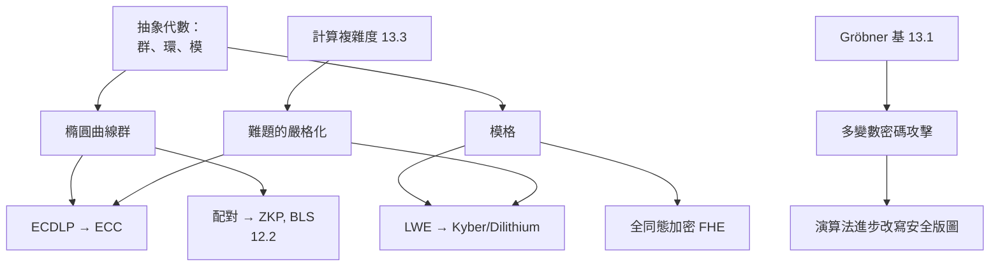

# 13.2 抽象代數在密碼學中的計算實現：橢圓曲線與格密碼學

## 前言：從代數結構到計算難題

密碼學的奇蹟在於：**某些代數結構上的函數，正向容易、反向極難**。這個「容易/難」的分界不是直覺，而是由**計算複雜度**（13.3）與**演算法進步**（如 13.1 的 Gröbner 基對多變數密碼的衝擊）共同決定的。本章聚焦兩大支柱：

1. **橢圓曲線密碼學（ECC）**：以群論 + 有限域為基礎，當前公鑰密碼主力；
2. **格密碼學（Lattice-based）**：以線性代數 + 幾何數論為基礎，**後量子時代**的標準答案（NIST 2024 年標準化的 ML-KEM/Kyber、ML-DSA/Dilithium）。

兩者的共同點：**抽象代數結構 → 計算難題 → 密碼學假設 → 工業標準**。

---

## 一、橢圓曲線：代數幾何的密碼學化身

### 1.1 定義與群律

**定義（橢圓曲線）**：特徵不為 2,3 的體 $K$ 上，曲線

$$
E : y^2 = x^3 + ax + b,\quad \Delta = -16(4a^3 + 27b^2) \neq 0
$$

加上無窮遠點 $\mathcal{O}$，以「割線法」定義加法：三點共線則和為 $\mathcal{O}$。$(E(K), +)$ 是**交換群**，單位元為 $\mathcal{O}$。

**密碼學版本**：取 $K = \mathbb{F}_p$（大質數 $p$）或 $\mathbb{F}_{2^m}$。群上的**離散對數問題（ECDLP）**：

$$
\text{給定 } P, Q = kP \in E(\mathbb{F}_p),\ \text{求 } k
$$

目前最強演算法（Pollard rho）需 $O(\sqrt{p})$ 步，**無亞指數演算法**——這是 ECC 比 RSA（有亞指數 NFS）用更短金鑰的原因（256-bit ECC ≈ 3072-bit RSA 安全等級）。

### 1.2 Hasse 定理與群階

**定理（Hasse, 1933）**：$\#\,E(\mathbb{F}_p) = p + 1 - t$，其中 $|t| \le 2\sqrt{p}$。

這使「計算群階」（Schoof 演算法，1985，多項式時間）可行——**密碼學選曲線**必須知道群階，以避開：
- **MOV 攻擊**：嵌入度小（如 1, 2）時可化為有限體 DLP，需避免；
- **Smart 攻擊**：異常曲線（$\#\,E = p$）可用 $p$-adic 對數破；
- **Pohlig–Hellman**：群階光滑則 ECDLP 崩解。

### 1.3 Python 實作：小質數上的 ECC

```python
# 仿射座標下的橢圓曲線 E: y² = x³ + ax + b (mod p)
p = 9739
a, b = 497, 1768
O = None  # 無窮遠點

def add(P, Q):
    if P is None: return Q
    if Q is None: return P
    x1, y1 = P; x2, y2 = Q
    if x1 == x2 and (y1 + y2) % p == 0:
        return O
    if P == Q:
        if y1 == 0: return O
        m = (3 * x1 * x1 + a) * pow(2 * y1, -1, p) % p
    else:
        m = (y2 - y1) * pow(x2 - x1, -1, p) % p
    x3 = (m * m - x1 - x2) % p
    y3 = (m * (x1 - x3) - y1) % p
    return (x3, y3)

def mul(k, P):
    """純量乘法（倍加法）"""
    R = O
    while k:
        if k & 1: R = add(R, P)
        P = add(P, P)
        k >>= 1
    return R

# 點 P = (1804, 5368) 在此曲線上
P = (1804, 5368)
Q = mul(1337, P)
print(Q)  # 橢圓曲線 Diffie–Hellman 的基本運算

# ECDH 金鑰交換示範
a_priv, b_priv = 1337, 7
A = mul(a_priv, P)  # 公鑰 a
B = mul(b_priv, P)  # 公鑰 b
print(mul(a_priv, B) == mul(b_priv, A))  # True：共享密鑰一致
```

**注意**：實務用 **Jacobian 投影座標**避免模反元素（昂貴）、用 **Montgomery ladder** 抵抗 timing attack、用**恒定時間實作**。

---

## 二、雙線性配對：從 ECC 到 ZKP

**定義（雙線性配對）**：$e : G_1 \times G_2 \to G_T$ 滿足 $e(aP, bQ) = e(P,Q)^{ab}$。

**實作基礎**：在**超奇異橢圓曲線**或 **BN/ BLS 曲線**上，用 **Weil 或 Tate 配對**（Miller 演算法，1986）計算。

**應用**（承接 12.2）：
- **BLS 簽章**（Boneh–Lynn–Shacham, 2001）：聚合簽章，以太坊共識層使用；
- **KZG 承諾**：zk-SNARK 的核心，以太坊 EIP-4844（danksharding）採用；
- **身份基加密（IBE）**。

```python
# Miller 演算法的精神（偽碼化，非真實實作）
def miller_loop(P, Q, n):
    """計算配對 f_{n,P}(Q)，用於 Weil/Tate 配對"""
    f, R = 1, P
    for bit in bin(n)[2:]:
        f = f * f * line(R, R, Q)
        R = double(R)
        if bit == '1':
            f = f * line(R, P, Q)
            R = add(R, P)
    return f
```

---

## 三、格密碼學：後量子時代的支柱

### 3.1 格與困難問題

**定義（格）**：$\mathbb{R}^n$ 中的離散加法子群：

$$
\mathcal{L}(B) = \left\{ \sum_i z_i b_i \;\middle|\; z_i \in \mathbb{Z},\ b_i \in B \right\}
$$

**核心難題**：
- **SVP**（最短向量問題）：找 $\mathcal{L}$ 中最短非零向量；
- **CVP**（最近向量問題）：給定 $t$，找 $\mathcal{L}$ 中最近向量；
- **LWE**（Learning With Errors, Regev 2005）：給定 $(A, As + e)$，$A$ 隨機矩陣、$s$ 祕密、$e$ 小誤差，恢復 $s$。

**定理（Ajtai, 1996; Regev, 2005）**：LWE 的平均情況難度可**歸約到**最壞情況的格問題（帶量子歸約）——這使格密碼有**最壞情況保證**，遠優於 RSA/ECC 的「無證明假設」。

### 3.2 為何抗量子？

**Shor 演算法**（1994）在量子電腦上以多項式時間解**因數分解**與**離散對數**——**RSA 與 ECC 全部崩解**。但 Shor 對**格問題**無效（目前無量子多項式演算法）。NIST 2024 年標準化：

- **ML-KEM（Kyber）**：基於 Module-LWE 的金鑰封裝；
- **ML-DSA（Dilithium）**：基於 Module-LWE 的簽章；
- **SLH-DSA（SPHINCS+）**：基於 hash 的簽章（保守備選）。

### 3.3 Python 實作：玩具 LWE

```python
import numpy as np
from numpy.random import default_rng

rng = default_rng(42)
n, q = 8, 97  # 真實 Kyber 用 n=256, q=3329

def keygen():
    s = rng.integers(0, q, n)          # 祕密
    A = rng.integers(0, q, (n, n))     # 公開隨機矩陣
    e = rng.integers(-1, 2, n)         # 小誤差
    t = (A @ s + e) % q                # 公鑰 t = As + e
    return A, t, s, e

def encrypt(A, t, m):
    """m ∈ {0,1}^n，回傳密文 (u, v)"""
    r = rng.integers(-1, 2, (n, n))
    e1 = rng.integers(-1, 2, n)
    e2 = rng.integers(-1, 2)
    u = (r.T @ A + e1) % q
    v = (r.T @ t + e2 + (q // 2) * m) % q
    return u, v

def decrypt(s, u, v):
    c = (v - u @ s) % q
    return (c > q // 4).astype(int) & (c < 3 * q // 4).astype(int)

A, t, s, e = keygen()
m = np.array([1, 0, 1, 1, 0, 0, 1, 0])
u, v = encrypt(A, t, m)
m_rec = decrypt(s, u, v)
print("明文:", m)
print("解密:", m_rec)
print("正確:", (m == m_rec).all())
```

**核心數學**：$(v - u \cdot s) \approx e_2 + \text{小誤差} + \frac{q}{2} m$——**誤差項**使解 LWE 變成「帶噪聲的線性代數」，這是格密碼與傳統「乾淨代數」密碼的本質差異。

---

## 四、結構比較

| 面向 | 橢圓曲線 | 格 |
|---|---|---|
| 代數結構 | 交換群（曲線點） | 模、線性代數 + 誤差 |
| 核心難題 | ECDLP | LWE / SVP |
| 亞指數演算法 | 無（經典） | 無（已知） |
| 量子攻擊 | Shor 崩解 | 目前無 |
| 金鑰大小 | 32 B | ~1 KB（Kyber 768） |
| 理論保證 | 無最壞情況歸約 | Ajtai/Regev 最壞情況歸約 |
| 應用 | TLS、以太坊簽章 | NIST 標準、FHE |

---

## 五、與前章的匯流



**深層啟示**：密碼學是**抽象代數的「計算物理」**——結構的微小差異（有無誤差、群是否可配對）決定數量級的安全差距。而 13.3 的複雜度理論是**唯一的裁判**：告訴我們哪些難題真的難。

---

## 小結與銜接

- ECC：代數幾何 → 交換群 → ECDLP → 高效公鑰密碼 + 配對使 ZKP 可行。
- 格密碼：線性代數 + 誤差 → LWE → 抗量子標準 + FHE。
- 兩者共同點：**結構 → 難題 → 假設 → 標準**；差異點：抗量子性與理論保證強度。
- 下一節（13.3）回到根源：**P vs. NP**——「難」的定義本身，以及它如何成為所有密碼學假設的最終地基。

## 練習

1. 用 Python 實作 Pollard rho 求解小曲線上的 ECDLP，估算複雜度。
2. 解釋為何 LWE 的「誤差項」是安全性的核心，並展示無誤差時（即 $t = As$）如何用線性代數破解。
3. 說明 Ajtai 最壞情況歸約的意義，並比較其與 RSA「假設因數分解難」的認識論差異。
