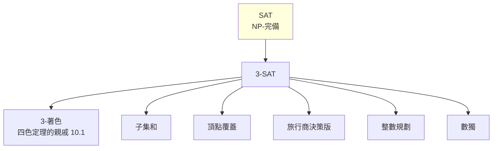
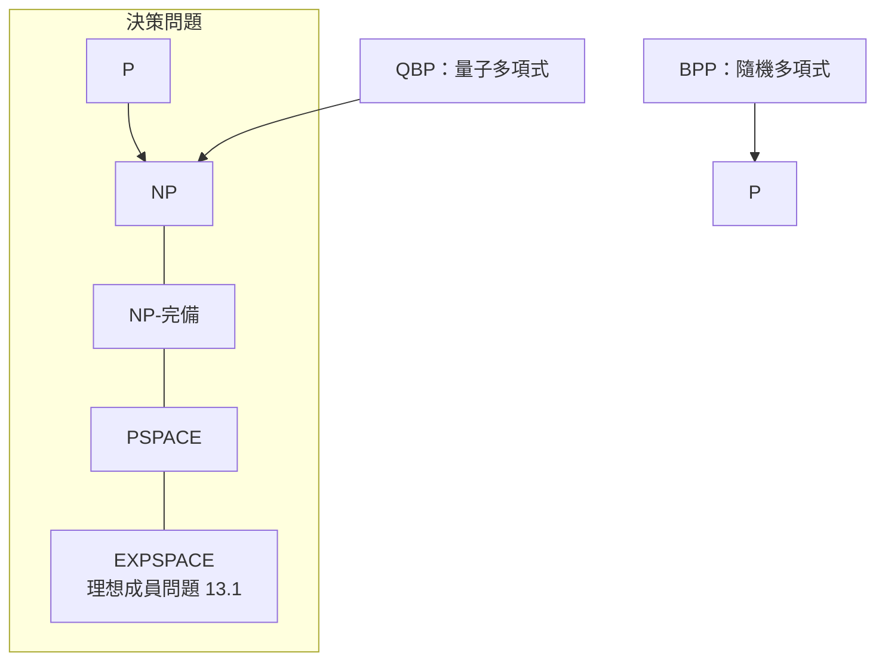
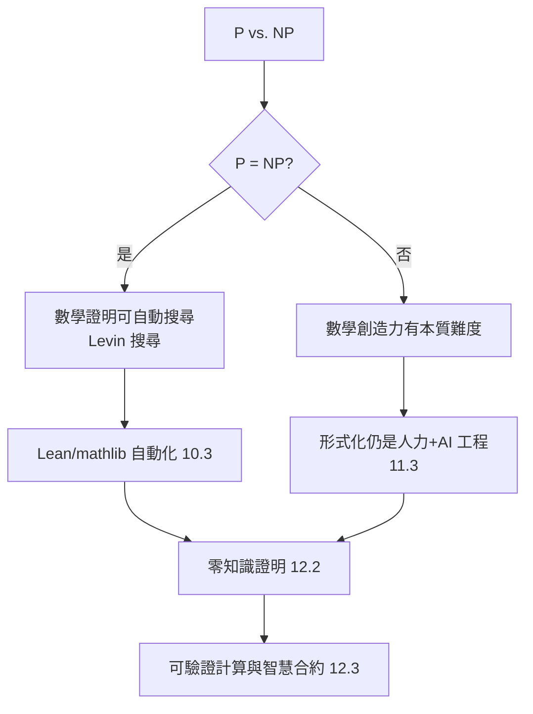

# 13.3 計算複雜度理論：P 與 NP 與數學結構的本質難度

## 前言：「難」的數學定義

前兩章我們假設「ECDLP 難」「LWE 難」；這一章把「難」本身變成**數學物件**。計算複雜度理論自 Cook（1971）與 Levin（1973）獨立提出 NP-完備性、Karp（1972）展示 21 個 NP-完備問題以來，成為理解「哪些數學結構本質上無法有效計算」的基礎語言。而 **P vs. NP** 是 Clay 千禧年七大難題之首——**若解決，密碼學（12.2、13.2）、形式驗證（12.1）、甚至數學發現本身都將重寫**。

本章把 P/NP 講清楚，並展示它與本書所有主題的根蒂關係。

---

## 一、基本定義

**定義（時間複雜度類）**：

- **P**：存在多項式時間**確定性**圖靈機可解的決策問題類。
- **NP**：存在多項式時間驗證器的問題類——即語言 $L \in \mathrm{NP}$ 當且僅當存在多項式時間關係 $R$ 使：

$$
x \in L \iff \exists y,\ |y| \le \mathrm{poly}(|x|),\ R(x, y)
$$

其中 $y$ 稱為**憑證**（certificate）或 witness。

**直覺**：NP = 「解難找，但好驗證」。這正是 **10.1 節**「驗證比生成便宜」的理論化身，也是 **12.2 節**零知識證明的存在前提（Goldreich–Micali–Wigderson：任何 NP 問題都有 ZKP）。

**範例**：

| 問題 | 驗證 | 憑證 |
|---|---|---|
| SAT | 檢查賦值滿足所有子句 | 變數賦值 |
| Hamiltonian 路徑 | 檢查序列是路徑且訪問所有點 | 頂點序列 |
| 整數因數分解（決策版） | 檢查 $p \cdot q = n$ | 因數 $p, q$ |
| 多項式可滿足性（13.1 的理想） | 檢查點代入所有多項式為 0 | 零點座標 |

**定理（Cook–Levin, 1971/73）**：**SAT 是 NP-完備的**——任何 NP 問題都可多項式時間歸約到 SAT。

**意義**：SAT 是 NP 的「計算普遍性」代表，如同圖靈機之於可計算性。**Karp（1972）的 21 個歸約**隨即把整個組合學、圖論、代數的經典問題都拉進 NP-完備的版圖。

---

## 二、歸約：問題之間的「至多一樣難」

**定義（多項式時間歸約）**：$A \le_p B$ 若存在多項式時間函數 $f$ 使 $x \in A \iff f(x) \in B$。

**重要性質**：若 $A \le_p B$ 且 $B \in \mathrm{P}$，則 $A \in \mathrm{P}$。故「難題」可以互相傳染——**一個 NP-完備問題有多項式演算法 ⟹ P = NP**。



**與 10.1 的連結**：四色定理中的「平面圖 4-著色」是 NP 的成員（甚至平面圖 3-著色是 NP-完備）。Appel–Haken 的「構形窮舉」正是**有限搜索空間的 NP 驗證器**實作。

---

## 三、P vs. NP：為何這麼難證？

**問題**：$\mathrm{P} \stackrel{?}{=} \mathrm{NP}$。

### 3.1 主流猜測與證明障礙

- **共識**：$\mathrm{P} \ne \mathrm{NP}$（Baker–Gill–Solovay 1975 的 oracle 相對化結果暗示，僅靠相對化技巧無法解決）。
- **障礙**：
  1. **相對化障礙**（Baker–Gill–Solovay, 1975）：任何只使用黑箱查詢的證明都無效；
  2. **自然證明障礙**（Razborov–Rudich, 1997）：大多數電路下界證明方法落入「自然」類，而這類方法若有效將違反**偽隨機函數**的存在——**與密碼學假設衝突**；
  3. **代數化障礙**（Aaronson–Wigderson, 2008）。

**深意**：障礙定理表明，P vs. NP 不只是技術問題，而是**數學基礎**問題——它可能需要全新的證明技術，甚至與「數學證明的本質」（本書第 10 章）相連。

### 3.2 若 P = NP 會怎樣？

| 領域 | 後果 |
|---|---|
| 密碼學（13.2） | **全面崩解**——RSA、ECC、格密碼全部失效（找解與驗證一樣快） |
| 形式驗證（12.1） | Hoare 邏輯驗證、SMT 求解多項式時間化 |
| 數學（11.1） | 有限陳述的定理可在多項式時間自動搜尋證明（若證明長度多項式） |
| 運籌學 | 旅行商、排程全部可解 |

**「數學證明的自動化」與 P vs. NP 的關係**：若 P = NP，則 **Levin 搜尋**（universal search）能在多項式時間找到任何有短證明的定理的證明——這將使 **Lean/mathlib 的形式化**（第 10-11 章）從「人力工程」變成「自動搜尋」。反之，P ≠ NP 則說明**數學創造力有本質的不可壓縮性**。

---

## 四、複雜度類的地圖



**本書案例的複雜度定位**：

| 問題 | 類 | 註 |
|---|---|---|
| 線性規劃 | P | Khachiyan 1979，橢球法 |
| Gröbner 基計算 | EXPSPACE（lex） | 13.1，雙指數 |
| 理想成員 | EXPSPACE-完備 | 13.1 |
| ECDLP | NP ∩ co-AM | 13.2，未證 NP-難 |
| LWE | 平均-最壞歸約 | 13.2，量子歸約 |
| SAT | NP-完備 | Cook–Levin |
| 四色定理的構形窮舉 | NP | 10.1 |

---

## 五、Python 範例：SAT 求解器的 NP 體驗

```python
from itertools import product

def sat_brute(clauses, n_vars):
    """暴力 SAT：2^n 種賦值。驗證每個賦值只需 O(子句數)。
       —— 這就是 NP 的定義：找難、驗易。"""
    for assignment in product([False, True], repeat=n_vars):
        ok = True
        for clause in clauses:
            # clause: 如 [1, -2] 表示 x1 ∨ ¬x2
            if not any(assignment[abs(l) - 1] if l > 0 else not assignment[abs(l) - 1]
                       for l in clause):
                ok = False
                break
        if ok:
            return assignment
    return None

# 簡單範例：(x1 ∨ x2) ∧ (¬x1 ∨ x3) ∧ (¬x2 ∨ ¬x3)
clauses = [[1, 2], [-1, 3], [-2, -3]]
print(sat_brute(clauses, 3))  # 找到賦值

# 用 python-sat（工業級 CDCL 求解器）體會「驗證易、找解難」的工程面
try:
    from pysat.solvers import Glucose3
    g = Glucose3(bootstrap_with=clauses)
    print(g.solve(), g.get_model())
except ImportError:
    pass  # pip install python-sat
```

**CDCL（Conflict-Driven Clause Learning）** 求解器的存在說明：**實務中很多 NP-完備問題是可以解的**——理論的「難」是**最壞情況**，實務的成功靠**啟發式 + 結構**。這與 **12.1 節 SMT**、**13.1 節 F4/F5** 的精神一致：**理論保證 + 工程巧思 = 可用工具**。

---

## 六、延伸：複雜度與數學結構的「本質難度」

### 6.1 Levin 搜尋與數學發現

**Levin 搜尋**（universal search）：以加權交錯執行所有程式，時間上界僅比最優快 $O(1)$ 倍（常數依賴加權）。若 P = NP，它可在多項式時間找到**任何可驗證的解答**——**包括數學證明**。

**與本書主題的閉環**：



### 6.2 更細的分類

- **#P**：計數問題（如「多少個賦值滿足」）——比 NP 更難；
- **PCP 定理**（1990s）：NP 語言有**可隨機抽樣驗證**的證明——**直接催生 12.2 的 zk-SNARK**；
- **互動式證明**（IP = PSPACE，Shamir 1992）：證明者與驗證者互動可解 PSPACE——**驗證的力量超乎直覺**。

**哲學收束**：從 **10.1 的四色定理爭議**（驗證可信性）到 **12.2 的零知識證明**（驗證即服務）到本章的**複雜度理論**（驗證與生成的本質差距），我們看到一條清晰的線：**「驗證」是數學與計算的共同根基**，而 P vs. NP 是其最深層的未解之謎。

---

## 小結與銜接

- P/NP 的定義以「驗證容易」為核心，是本書所有「可核對性」主題的理論地基。
- Cook–Levin + Karp 使 NP-完備性成為橫跨數學各分支的「難度等價類」。
- P vs. NP 的證明障礙（相對化、自然證明）顯示其與密碼學、證明論的深刻糾纏。
- 本書的三條線——**形式化數學（10-11 章）**、**規約與驗證（12 章）**、**計算代數（13 章）**——在此匯聚：**數學結構的「本質難度」決定了我們能自動化多少、必須信多少**。

## 練習

1. 證明 3-SAT $\le_p$ 3-著色（提示：變數三角形 + 子句 gadget）。
2. 用 Python 實作 Levin 搜尋的玩具版，搜尋「判斷一個數是否為質數」的短程式，體會 universal search。
3. 討論：若明天有人證明 P ≠ NP 但證明用了「非相對化、非自然」的新技術，對密碼學（13.2）會有何影響？
