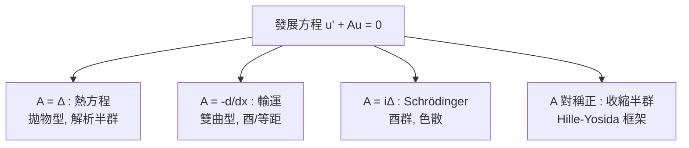

# 9.1 COSEMIGROUP與發展方程

## 本章導言

常微分方程 $\frac{du}{dt} = Au$ （ $A$ 有界）的解是 $u(t) = e^{tA}u_0$ 。無窮維（ $A$ 無界微分算子）中 $e^{tA}$ 不能用冪級數定義，但「解的存在+時齊性+因果性」迫使解族 $T(t)$ 滿足**半群律** $T(s + t) = T(s)T(t)$ 。1948 年 **Hille** 與 **Yosida** 獨立證明：壓縮 $C_0$ 半群 $\Longleftrightarrow$ 生成元是 $m$ -耗散閉算子。半群理論由此成為發展方程（熱、波、Schrödinger、Navier–Stokes）的統一框架。本節建立 $C_0$ 半群的基本理論，為 9.2 的 Hille–Yosida 定理鋪路。

### 半群的定義與例子

**定義 9.1.1**：算子族 $T(t) \in \mathcal{B}(X)$ （ $t \ge 0$ ）是 ** $C_0$ 半群**，若
1. $T(0) = I$ ， $T(s + t) = T(s)T(t)$ ；
2. 強連續： $t \to 0$ 時 $\|T(t)x - x\| \to 0$ 對每個 $x$ ；
3. **壓縮**（如要求）： $\|T(t)\| \le 1$ 。

**生成元**： $Ax = \lim_{t \downarrow 0} \frac{T(t)x - x}{t}$ ，域為極限存在之 $x$ 。

**基本例子**：
| 半群 | 生成元 | 方程 |
|------|--------|------|
| $T(t)f = e^{-nt}$ -型對角 | $M_{-a}$ | 衰減 |
| 平移 $T(t)f(x) = f(x - t)$ | $\frac{d}{dx}$ | 輸運 |
| $\frac{1}{\sqrt{4\pi t}}\int e^{-(x-y)^2/4t}f(y)dy$ | $\Delta$ | **熱方程** |
| $e^{it\Delta}$ | $i\Delta$ | Schrödinger |
| $e^{it\sqrt{-\Delta}}$ | $i\sqrt{-\Delta}$ | 波方程（半波） |

**理論 vs 有界情形**： $A$ 有界時 $T(t) = e^{tA}$ （冪級數收斂）且 $\|T(t)\| \le e^{\|A\|t}$ ——增長可控制； $A$ 無界時冪級數發散（ $\|A^n\|$ 爆炸），必須重新從「解的性質」出發定義指數。**Hille–Yosida 定理（9.2）正是「指數函數的無窮維公理化」**。

### 生成元的必然性質

**定理 9.1.2**： $C_0$ 半群的生成元 $A$ ：
1. **稠定閉**（7.1、7.2 節的概念在此派上用場）；
2. $T(t)x$ 對 $t \ge 0$ 可微 $\iff$ $x \in \operatorname{dom}A$ ，且 $\frac{d}{dt}T(t)x = AT(t)x = T(t)Ax$ （**解在 dom A 上滿足發展方程**）；
3. $Ax = \lambda x \Rightarrow T(t)x = e^{\lambda t}x$ （特徵向量演化）；**譜映射**： $e^{t\sigma(A)} \subset \sigma(T(t)) \setminus \{0\}$ 。

*證明要點*：(1) 稠定： $\frac{1}{t}\int_0^t T(s)x\,ds \in \operatorname{dom}A$ 且 $\to x$ （半群的積分恆等式 $T(h)\int_0^t T(s)x ds = \int_h^{t+h} T(s)x\,ds$ 差商收斂）。閉性： $x_n \to x$ 、 $Ax_n \to y$ 時用 $T(t)x_n - x_n = \int_0^t T(s)Ax_n ds$ 取極限得 $T(t)x - x = \int_0^t T(s)y\,ds$ ，除以 $t$ 取 $t \to 0$ 得 $Ax = y$ 。∎

**強連續性⇒多項式增長**（Banach–Steinhaus 的又一勝利）： $\exists M, \omega$ 使 $\|T(t)\| \le Me^{\omega t}$ （局部有界+半群律⇒指數型控制）——「炸開」不能是超指數的。

### 例題

**例題 9.1.1**：證明平移半群 $(T(t)f)(x) = f(x + t)$ （ $X = L^2(\mathbb{R})$ 或 $C_0(\mathbb{R})$ ）是 $C_0$ 半群，生成元為 $A = \frac{d}{dx}$ 、 $\operatorname{dom}A = H^1$ （ $L^2$ 情形），並驗證 $\|T(t)\| = 1$ （酉群： $\|T(t)f\|_2 = \|f\|_2$ ）。

**解**：半群律： $T(s + t)f(x) = f(x + s + t) = T(s)T(t)f(x)$ ✓。強連續： $\|f(\cdot + t) - f\|_2 \to 0$ （稠密函數類上直接驗證： $C_c^\infty$ 函數一致連續+有界支撐，用 Cauchy–Schwarz 估計；再 $\varepsilon/3$ 逼近一般 $f$ ）。生成元：差商 $\frac{f(x + t) - f(x)}{t} \to f'$ （ $L^2$ 意義）當 $f \in H^1$ ；反之若極限存在則 $f \in H^1$ （弱導數的定義）。酉性：平移不變 Lebesgue 測度。**Stone 定理（3.3）的特例**： $T(t) = e^{tD}$ 、 $D$ 自伴（7.3 節： $\frac{d}{dx}$ 的自伴性在 $\mathbb{R}$ 上「免費」，無邊界條件糾纏）。∎

**例題 9.1.2**：熱半群 $G(t) = e^{t\Delta}$ 在 $L^2(\mathbb{R}^n)$ 。用 Fourier 變換（酉，3.3）寫出 $G(t)$ 的對角化，並驗證它是壓縮半群、生成元 $A = \Delta$ 自伴負定。

**解**： $\widehat{G(t)f}(\xi) = e^{-t|\xi|^2}\hat f(\xi)$ ——**熱半群在頻域是乘法**！壓縮性： $|e^{-t|\xi|^2}| \le 1$ 。生成元： $\widehat{Af} = -|\xi|^2\hat f$ ，即 $A = \Delta$ 、域 $= \{f : |\xi|^2\hat f \in L^2\} = H^2$ （Sobolev 空間=閉算子的定義域，7.2 節）。 $A$ 自伴負定（ $M_{-|\xi|^2}$ 經 Fourier 酉等價），故 $G(t)$ 是**酉群的虛部化** $G(t) = e^{tA}$ 、 $-A$ 正——Stone 定理給 $e^{itA}$ 型酉群（Schrödinger 半群 $e^{it\Delta}$ 同源）。∎

### 發展方程的統一

半群理論把「初值問題」

$$
\frac{du}{dt} + Au = f(t), \quad u(0) = u_0
$$

統一為： $u(t) = T(t)u_0 + \int_0^t T(t - s)f(s)\,ds$ （**Duhamel 公式**——常數變易法的算子化）。各類方程只是生成元的不同選擇：

歷史線索：1930 年代 Stone（酉群）、von Neumann（量子動力學）之後，**Hille（1936–1948）** 在美國、**Yosida（1948）** 在日本、**Phillips**（耗散算子、Duhamel）建立一般理論；1948 年 Hille–Yosida 定理是半群理論的「Fredholm 定理時刻」（見 9.2）。

### 歷史啟示

- **「解的存在」先於「公式」**：無窮維中 $e^{tA}$ 不是定義而是**定理**（由 Yosida 逼近 $\| \cdot \|$ -收斂構造）——與 Volterra 級數（1.1）「先迭代後理解」一脈相承。
- **強連續性的精明選擇**：範數連續半群（ $\|T(t) - I\| \to 0$ ）當 $A$ 無界時**不可能**（除 $A = 0$ ： $\|e^{tA} - I\| = 1$ 對熱半群恒成立）——強連續是正確的鬆弛，又一次「弱化條件保全理論」。
- **生成元攜帶全部物理**： $\Delta$ （擴散）、 $\frac{d}{dx}$ （對流）、 $i\Delta$ （量子演化）——同一個半群框架，不同生成元=不同物理。算子理論的「分類本能」在發展方程中獲得最大回報。

## 與其他章節及領域的關聯

- **1.1 節**：Volterra 的迭代解法是 Duhamel 公式的先驅。
- **7.1–7.3 節**：生成元必須稠定閉；壓縮半群生成元 $m$ -耗散（9.2）；酉群生成元自伴（Stone，7.3 的果實）。
- **6.3 節**：譜分解給出半群的對角化（ $T(t) = \int e^{t\lambda}dE_\lambda$ ）；譜界⇒增長界的精確理論（ spectral bound vs growth bound 的裂縫=非正規現象）。
- **3.3 節**：Stone 定理=酉 $C_0$ 半群；Wold 分解=等距半群。
- **9.2 節**：Hille–Yosida 定理=半群的存在性判定。
- **9.3 節**：熱與波方程的具體譜理論。
- **第 10 章**：Markov 過程的半群（Kolmogorov 1931 的先驅：Feller 半群、生成元=隨機過程的「無窮小行為」）；量子開放系統的 Lindblad 半群（1976）。

## 練習

1. 證明生成元稠定的積分論證（定理 9.1.2(1) 前半）。
2. 對平移半群在 $C_0(\mathbb{R})$ （一致範數）上：證明 $C_0$ 性、生成元域為 $C_0^1 \cap C^1$ 型的閉化（ $C^1$ 函數且 $f' \in C_0$ ）。
3. 證明 $\|T(t)\| \le Me^{\omega t}$ ：用 Banach–Steinhaus（局部有界）+半群律。
4. 熱半群：證明 $\|G(t)f\|_2 \le \|f\|_2$ 且 $\|G(t)f\|_\infty \le (4\pi t)^{-n/4}\|f\|_2$ （光滑化效應=核積分，5.1 節緊性的直覺）。
5. 思考題：為什麼 $A$ 無界時 $\|e^{tA} - I\|$ 不趨於 $0$ ？（用譜映射： $\sigma(e^{tA}) \ni e^{t\lambda}$ ， $|\lambda|$ 大⇒頻域高頻不衰減。）這與「壓縮半群的強連續但非一致連續」的關係？

## 進階研讀：三個深化場景

**場景一：解析半群**。熱半群 $G(t)$ 對 $t > 0$ 可解析延拓到扇形 $\{|\arg t| < \pi/4\}$ ——**拋物方程的解析正則性**（瞬間光滑化： $G(t) : L^2 \to C^\infty$ ）。解析半群理論（Yosida 1960、Kato、Sobolevskii）刻畫「拋物型」生成元（扇形條件 $|\arg(A - \omega)| < \pi/2$ ），是 Navier–Stokes 理論（Leray 1934 的半群重寫，Kato 1984）的基礎。

**場景二：Feller 半群與馬爾可夫過程**。Feller（1952–1954）： $C_0$ 上的正壓縮半群（保正、保 $1$ ） $\leftrightarrow$ 強 Markov 過程；生成元是「二階橢圓+跳躍」的位勢型算子。**半群理論=隨機過程的微積分**（Itô 公式是 Duhamel 的隨機版）；Lévy–Khintchine 公式=生成元的 Lévy 三元組表示。

**場景三：非自給半群與算子值函數**。Sz.-Nagy–Foiaş 壓縮半群的膨脹（9.3 場景）、Lumer–Phillips 的耗散幾何（1961： $\operatorname{Re}\langle Ax, Jx\rangle \le 0$ 的「耗散」不依賴內積——duality map $J$ ）、以及最大耗散擴張（7.3 的半群版）。半群理論在控制論（H∞、LQR）與量子開放系統（GKSL/Lindblad 生成元 1976）中持續生長。

### 名詞速查表

- ** $C_0$ 半群**：半群律+強連續； $\|T(t)\| \le Me^{\omega t}$ 。
- **生成元**： $A = \lim_{t\to0}\frac{T(t) - I}{t}$ ，稠定閉。
- **Duhamel 公式**：非齊次解=T(t)u₀+捲積。
- **譜映射定理**： $e^{t\sigma(A)} \subset \sigma(T(t))$ 。
- **平移半群**：生成元 $\frac{d}{dx}$ ，酉。
- **熱半群**： $e^{t\Delta}$ ，頻域乘 $e^{-t|\xi|^2}$ ，壓縮+瞬間光滑。
- **Stone 定理**：酉 $C_0$ 半群↔自伴生成元。

### 年表速查

- 1931：Kolmogorov 隨機過程的微分方程（半群思想先驅）。
- 1932：Stone 酉群定理。
- 1936：Hille 開始半群研究。
- 1948：Hille–Yosida 定理（獨立）；Phillips 耗散理論。
- 1952–1954：Feller 半群與 Markov 過程。
- 1957：Hille–Phillips《泛函分析與半群》教科書。
- 1961：Lumer–Phillips 耗散判據；Kato 型理論。
- 1976：Lindblad 量子 Markov 生成元。
- 1984：Kato 對 Navier–Stokes 的半群處理。

### 深化問答三則

**問：為什麼「半群」而非「群」？**
答：因為時間單向（ $t \ge 0$ ）：熱方程不可逆（高頻衰減無法恢復， $e^{t\Delta}$ 在 $t < 0$ 不是有界算子—— $\|G(-t)\| = e^{t|\xi|^2}$ 爆炸）。可逆系統（波、Schrödinger、平移）生成**酉群**（Stone）；耗散系統只有半群。**可逆性=生成元自伴（或反自伴）**，不可逆性=耗散——半群理論把「時間之箭」變成算子的譜性質。

**問：生成元的定義域為什麼必須稠密？**
答：因為初值可以任意（物理態空間全部），解的初值條件 $u(0) = u_0$ 必須對「稠密的初始類」有意義再延拓： $T(t)u_0$ 對一切 $u_0$ 定義（半群作用），但「滿足微分方程」只在 $\operatorname{dom}A$ 上。稠定性保證 $T(t)$ 由 $\operatorname{dom}A$ 上的行為唯一決定——**弱形式的方程+稠密測試函數**是現代分析的一般模式（分布論同構）。

**問：譜映射定理為什麼是包含而非等式？**
答： $e^{t\sigma(A)} \subsetneq \sigma(T(t))$ 的例子：平移半群 $T(t)$ 酉、 $\sigma(T(t)) = \mathbb{T}$ （單位圓），而 $\sigma(A) = i\mathbb{R}$ 、 $e^{t\sigma} = \mathbb{T}$ ——此例相等。反例在平移半群限制在半直線（單側）： $T(t)$ 在 $C_0[0,\infty)$ ， $\sigma(T(t)) = \overline{\mathbb{D}}$ （ $t$ 固定），但 $e^{t\sigma(A)} \subset \mathbb{D}$ ——邊界圓上的點是「譜之外的增長」。**等式需要生成元的額外正則性**（如解析半群或緊軌道）；這個裂縫是「增長界 vs 譜界」問題（9.2 深化）的根源。

（本節完）
