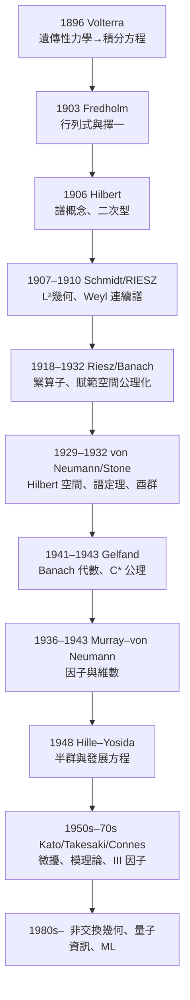

# 10.3 迴顧從積分方程到現代分析

## 本章導言

從 Volterra 1896 年的遺傳性桿件，到 Connes 1980 年代的非交換幾何，本書走過了整整一個世紀。本節做三件事：**回顧**主線（技術與理論如何互相驅動）、**總結**跨章的統一主題（可逆性、對稱性、逼近、對偶）、**前瞻**這門學科在新時代的位置（機器學習、量子資訊、數學物理）。這也是一次方法論的反思：算子理論的歷史，是「具體問題逼出抽象結構，抽象結構反哺具體問題」的循環最佳範本。

### 主線的百年地圖

**驅動關係的解剖**：每個階段都有「技術難題」與「概念突破」的配對：
- Volterra–Fredholm：**解積分方程**（技術）→ 算子與譜（概念）；
- Hilbert：**完備性與展開**（技術：Sturm–Liouville 懸案）→ Hilbert 空間（概念）；
- Banach–Riesz：**去計算化**（技術：擺脫行列式）→ 緊算子與公理（概念）；
- von Neumann：**量子力學的合法性**（技術：無界算子）→ 譜定理與代數（概念）；
- Gelfand：**Wiener 定理與非交換性**（技術）→ $C^*$ 理論（概念）；
- Hille–Yosida：**發展方程存在性**（技術）→ 半群理論（概念）。

### 統一主題五則

**一、可逆性是譜的定義**（2.2 → 4.1 → 8.1）。從 Fredholm 行列式到 Gelfand 譜空間，「譜=不可逆集」的定義使理論跨空間（Banach）、跨代數（ $C^*$ ）、跨應用（指標、散射、控制）存活。**好的定義的標誌：遷移性**。

**二、對稱性買回有限維直覺**（3.2 → 4.2 → 6.2 → 8.2）。自伴⇒實譜、正交、無剩餘譜、譜定理；正規⇒乘法模型；交換⇒函數。每加一層對稱，有限維的直覺就多存活一分。**對稱性=結構的匯率**。

**三、逼近與完備性製造存在性**（1.1 → 5.2 → 7.2 → 9.2）。Volterra 迭代、Galerkin、Yosida 逼近、Baire 綱——四種「用近似列的極限定義解」的模式共用一個引擎：完備性。**分析學的存在性=完備性+一致控制**。

**四、對偶使理論對稱**（2.3 → 5.3 → 8.3）。 $T^*$ 的伴隨、 $f \perp \ker$ 的擇一、 $\mathcal{A}^{**}$ 的雙對偶——每個一元概念都有對偶影子，且影子的性質（剩餘譜、指標、超選擇區）反過來照亮原問題。**對偶=理論的鏡子，照出隱藏的結構**。

**五、層次由拓撲與演算決定**（6.1 → 6.2 → 6.3 → 8.2 → 8.3）。多項式演算→級數演算→連續演算→Borel 演算；範數拓撲→弱拓撲。**允許的函數越野，需要的代數越大**： $C^*$ 容納連續、 $W^*$ 容納 Borel——理論的層次譜系。

### 十個「最值得帶走」的定理

| # | 定理 | 意義 |
|---|------|------|
| 1 | Riesz 表示定理（3.1） | Hilbert 空間自對偶；一切伴隨理論的地基 |
| 2 | 譜半徑公式（8.1） | 分析量=代數量；複分析的算子化 |
| 3 | Hahn–Banach（2.3） | 對偶不空；分離幾何 |
| 4 | Fredholm 擇一（5.3） | 可解性=唯一性；正交障礙 |
| 5 | Hilbert–Schmidt 譜定理（6.2） | 緊自伴的完備展開；Sturm–Liouville 終結 |
| 6 | von Neumann 譜定理（6.3） | PVM；連續譜的測度論化 |
| 7 | von Neumann 擴張定理（7.3） | 對稱→自伴的完整分類；Cayley 變換 |
| 8 | Gelfand–Naimark（8.2） | 抽象=具體；非交換拓撲的字典 |
| 9 | Stone 定理（3.3/9.1） | 酉群=自伴生成元；量子動力學 |
| 10 | Hille–Yosida（9.2） | 發展方程的存在性總定理 |

### 例題（總結性的綜合演練）

**例題 10.3.1**：把第 1 章的積分方程 $\varphi = \lambda K\varphi + f$ （ $K$ 對稱 Green 核）完整地在現代語言中重建：定義算子、證明緊自伴、求譜、陳述擇一、寫半群 $e^{tK}$ 、並指出每一步對應的歷史人物。

**解**：
1. $K : L^2[0,1] \to L^2[0,1]$ ， $(Kf)(x) = \int_0^1 G(x,t)f(t)dt$ ， $G = \min(x,t)$ ；
2. 緊性：連續核⇒Hilbert–Schmidt（5.1 例題 5.1.3）——**Fredholm 1903 的隱含假設**；
3. 自伴性： $G$ 對稱（3.2 例題）——**Hilbert 1906**；
4. 譜： $\mu_n = \frac{1}{n^2\pi^2}$ 、 $e_n = \sqrt2\sin n\pi x$ （6.2 例題）——**Sturm–Liouville 1836、完備性 Hilbert–Schmidt 1907**；
5. 擇一： $\lambda \neq n^2\pi^2$ 時唯一解 $\sum\frac{f_n}{1 - \lambda\mu_n}e_n$ ； $\lambda = n^2\pi^2$ 時正交障礙——**Fredholm 1903、Riesz 1918**；
6. 演化： $e^{tK} = \sum e^{t/n^2\pi^2}P_n$ （收斂因 $\mu_n \to 0$ ）——**半群理論的特例，Hille–Yosida 1948**；
7. 若 $\lambda > 0$ 大： $K$ 的正性（Mercer 1903）⇒ 雙線性型 $q(f) = \langle K^{-1}f - \lambda f, f\rangle$ 的變分結構——**7.3 節 Friedrichs 型理論**。

一個方程，百年理論的縮影。∎

### 前瞻：算子理論的當代疆界

- **機器學習**：神經算子（學習 $F : \mathcal{U} \to \mathcal{V}$ 的算子映射）、核方法（RKHS）、譜方法（圖神經網路的 Laplacian 譜）、泛化理論的「複雜度=算子範數」——**學習理論正在重新發明泛函分析**；
- **量子資訊**：糾纏譜（Schmidt 分解 6.1 的雙態版）、通道=完全正映射（Kadison 不等式 8.2）、量子誤差矯正的代數條件（Knill–Laflamme）——**8.3 節非交換測度論的工程化**；
- **數學物理**：拓撲物質的指標（Fredholm 指標的凝聚態化身）、隨機算子（Schmidt、Sinai 的 Anderson 模型譜理論）、非厄米物理（10.1 場景三）——**第 5、7 章的理論在活躍擴張**；
- **開放問題**：不變子空間問題（4.3）、自由群因子問題（8.3）、譜隙猜想（Kazhdan 的延伸）、Navier–Stokes 的半群正則性（9.3）——**教科書的終點是研究的前線**。

### 歷史啟示

- **具體與抽象的鐘擺**：Fredholm（具體計算）→ Hilbert（抽象結構）→ Gelfand（更抽象）→ Connes（非交換幾何）——但每次抽象化後都有「回歸具體」的反向流（數值線性代數、機器學習）。**理論的活力在於雙向翻譯**。
- **「被迫登場」的譜系**：複數（1.1 節姊妹卷）、算子（本書 1.1）、無界算子（7.1）、非交換代數（8.3）——每個新對象都是「舊框架故障」逼出來的。**故障點=科學的顯微鏡**。
- **命名的偶然與必然**：「譜」（Hilbert 修辭借用）、「Hilbert 空間」（本人未命名）、「緊算子」（Riesz 的「完全連續」被改名）——概念的名稱常有偶然性，但概念在理論網絡中的**位置**是必然的。

## 練習（總複習）

1. 對 Green 核 $K$ （例題 10.3.1）：寫出 $K$ 的偽逆 $K^+$ （6.1 場景二的無窮維版），並用它解第一類方程 $K\varphi = f$ 的正則化形式。
2. 綜合 4.2+7.3+9.1：對 $-\frac{d}{dx}$ 的各種自伴實現（Dirichlet、準週期），比較其半群的長期行為（壓縮到零 vs 酉振盪）。
3. 綜合 6.3+8.2+10.1：用譜測度語言重述「氫原子的光譜」，並解釋為什麼 Balmer 系列是「點譜的可見投影」。
4. 跨章小論文：選一個主題（對偶、對稱性、逼近），寫 800 字論證「該主題如何貫穿第 1–10 章」，引用至少 6 個定理。
5. 思考題：如果 Volterra 1896 年就知道現代理論，他會用什麼語言重寫他的桿件論文？寫一段「時間旅行版」摘要。

## 進階研讀：三個深化場景

**場景一：教材與經典的閱讀地圖**。入門：Kreyszig《Introductory Functional Analysis》；進階：Reed–Simon I–IV（數學物理視角）、Kato《Perturbation Theory》、Dixmier（代數）、Hille–Phillips（半群）；歷史：Dieudonné《History of Functional Analysis》（1978）——本書的骨架與這些經典的對照表。

**場景二：算子理論的「失敗史」的價值**。不變子空間問題（1935–）、譜可分解的一般化（1954–）、Bergman 位移的結構（1960s–）——**「不成功的理論」塑造了成功理論的邊界**；研究前線的本質是「有限維直覺的哪一部分終究不可挽救」的考古學。

**場景三：算子理論作為思維方式**。本書的三個隱喻值得帶走：(1) 「算子=空間的幾何」（譜=主軸）；(2) 「對偶=鏡子」（每個概念檢查其影子）；(3) 「逼近=橋樑」（有限維與無窮維之間）。這些思維模式超越了數學——工程（濾波）、物理（可觀測量）、計算科學（降維）都是它們的方言。

### 名詞速查表（全書總覽）

- **積分方程 → 算子**（第 1 章）：概念的誕生。
- **賦範空間 → Banach 代數**（第 2、8 章）：公理化與代數化。
- **Hilbert 空間 → 譜定理**（第 3、6 章）：幾何化與對角化。
- **譜分類 → 緊算子**（第 4、5 章）：結構理論的兩翼。
- **無界算子 → 半群**（第 7、9 章）：微分方程的算子化。
- **代數 → 非交換幾何**（第 8 章）：20 世紀後半的抽象高峰。
- **應用**（第 10 章）：物理、工程、學習的回饋。

### 年表速查（全書總覽）

- 1896–1903：Volterra、Fredholm——積分方程。
- 1906–1910：Hilbert、Weyl——譜概念與微分算子。
- 1907–1918：Schmidt、Riesz——幾何化與緊算子。
- 1922–1932：Banach 學派、von Neumann、Stone——公理化與量子力學。
- 1936–1948：Murray–von Neumann、Gelfand、Hille–Yosida——代數、半群。
- 1950s–1970s：Kato、Krein、Takesaki、Connes——精緻化與模理論。
- 1980s–：非交換幾何、自由機率、量子資訊、機器學習——新戰場。

### 深化問答三則

**問：如果只能帶走一個「元教訓」，是什麼？**
答：**定義是理論的心臟**。「譜=不可逆集」一個定義撐起四章；「緊=有界集的相對緊像」一個定義統一積分方程與 Sturm–Liouville；「自伴」一個定義連接物理與分析。Volterra 時代的積分方程有很多「定義候選」（行列式、極限過程、二次型），最終勝出的是最簡、最遷移的那個——**尋找定義，就是尋找理論的基因**。

**問：算子理論與其他數學分支的「免疫系統」關係？**
答：算子理論多次「吸收」其他領域的危機並轉化為新結構：複分析（Liouville→譜非空）、測度論（Lebesgue→ $L^2$ 與譜測度）、拓撲（K 理論→指標）、機率（隨機矩陣→自由機率）。反方向，它供血給 PDE、數論（Selberg 跡公式）、表示論。**健康的數學=有活躍雙向膜的分支**。

**問：這本書的敘事有什麼內在偏見？**
答：三點自我批評：(1) 中心偏向 Göttingen–Princeton 軸線，蘇聯學派（Gelfand 除外：Krein、Lyapunov、Sobolev）與日本學派（Yosida 之外：Kakutani、Itô）的角色被壓縮；(2) 「技術與理論互相驅動」的敘事可能低估了純粹好奇心的獨立貢獻（von Neumann 的因子分類並無物理壓力）；(3) 應用章（10.2）對計算科學的覆蓋偏淺。**歷史敘事是模型，不是實錄**——用它組織理解，但保持懷疑。

（全書完）
