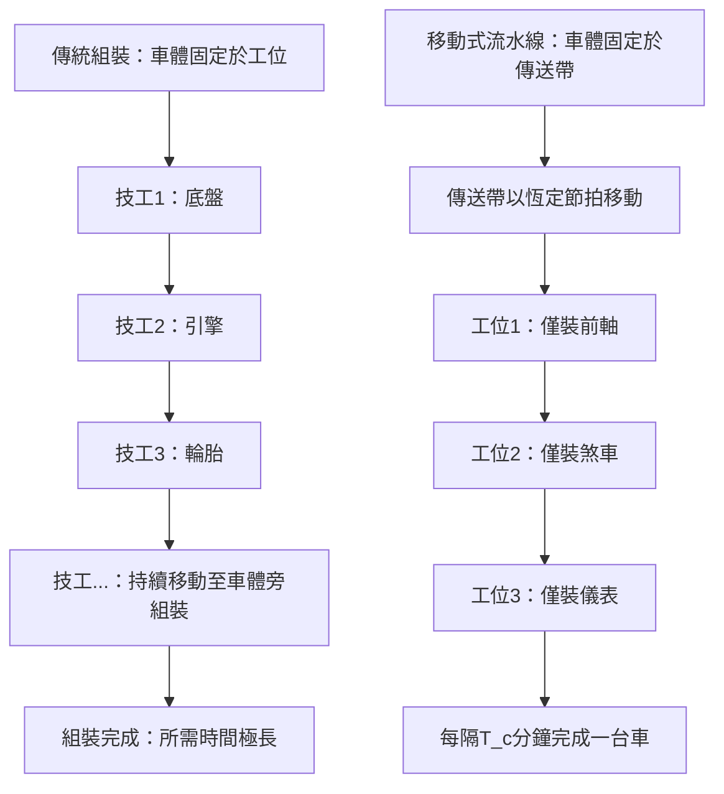

# 1.2 Ford 流水線與節拍均衡

## 本章導言

若說 Taylor 的科學管理回答了「每個工序該用多快的速度、用什麼方法最有效率」，那麼亨利·福特（**Henry Ford，1863–1947**）要回答的問題則是：「如何把這些工序串接起來，使整條生產線不會出現瓶頸，且能持續不間斷地流動？」

十九世紀末的汽車製造仍屬手工組裝。底盤停在固定工位上，一群技工圍繞它搬運零件、逐一組裝，整台車往往要數週才能完成。不僅效率低，成本更是高昂，當時汽車多是富裕階級的奢侈品，與平民百姓無緣。

福特的願景截然不同：**「讓每個人都買得起汽車」**。要達成這個目標，唯有大幅降低單位成本。成本下降的關鍵不在於加班，而在於**流程的重新設計**。福特及其工程團隊（尤其是 **Clarence Avery、Charles Sorensen** 等人）觀察屠宰場的「分屍流水」（disassembly line）得到靈感：若將肉品移動到固定工人面前，工人只需重複一個簡單動作，便能大幅提升效率。反其道而行之，能否讓**汽車本身移動**，讓工人固定在工位，只做極少數動作？

答案是：可以。1913 年 10 月，福特汽車公司在**海藍公園廠（Highland Park Plant）** 首度實施**移動式組裝線（moving assembly line）**。這項創新在短短幾年內將 Model T 的組裝時間從超過 $12$ 小時暴降至約 $93$ 分鐘，單位成本大幅下降，Ford 得以於 1908–1927 年間生產超過一千五百萬輛 Model T，徹底改寫大眾交通的歷史。

### 節拍：流水線的心跳

移動式組裝線成功的關鍵概念是**節拍（takt time）**。節拍指的是「為了滿足顧客需求，每隔多長時間必須完成一個產品」。

假設工廠每日可用生產時間為 $T_{avail}$ ，預計每日需求為 $D$ ，則理論節拍為：

$$
T_{takt} = \frac{T_{avail}}{D}
$$

舉例來說，若每日可用時間 $480$ 分鐘，日需求 $240$ 輛車，則節拍必須是 $2$ 分鐘／輛。也就是說，每隔 $2$ 分鐘，組裝線就必須產出一台完整的車。只要每個工位的作業時間都不超過節拍，整條線就不會拖慢整體產出；若某工位作業時間遠超節拍，該工位就會成為**瓶頸（bottleneck）**，決定全線的最大產能。

### 線平衡與工作站劃分

在實際設計流水線時，工程師必須將全部組裝作業**分解**為一系列基本任務（task）。每個任務都有其最短必要作業時間 $t_i$ ，且部分任務之間存在**優先順序限制（precedence constraints）**——有些零件必須先裝上底盤，後續才能裝上其他組件。

任務劃分給各個**工作站（workstation）** 後，每個工作站的作業時間 $S_j = \sum_{i \in W_j} t_i$ 必須盡可能接近節拍 $T_c$ （cycle time，實際採用的生產節拍）。理想情況下 $S_j \le T_c$ 且全線平衡。

衡量線平衡好壞的常用指標有：

$$
\text{線平衡效率（Line Efficiency）} = \frac{\sum_{i=1}^{n} t_i}{k \times T_c} \times 100\%
$$

其中 $n$ 為任務總數， $k$ 為工作站數。分母 $k \times T_c$ 代表全線理論最大可用工時總量，分子則是實際必要工時總量。效率愈接近 $100\%$ ，代表各工作站愈平均、空閒愈少。

另一個概念是**平衡延誤（balance delay）**：

$$
\text{Balance Delay} = 1 - \text{線平衡效率} = \frac{k \times T_c - \sum t_i}{k \times T_c} \times 100\%
$$

**例題 1.2.1**：某簡化組裝線有 $5$ 個任務，作業時間分別為 $t_1=0.4, t_2=0.3, t_3=0.5, t_4=0.2, t_5=0.6$ （單位：分鐘），總工時 $\sum t_i = 2.0$ 分鐘。若設計 $4$ 個工作站，採用節拍 $T_c = 0.6$ 分鐘。

**解**：全線最大可用工時 $4 \times 0.6 = 2.4$ 分鐘。

線平衡效率：

$$
E = \frac{2.0}{2.4} \times 100\% \approx 83.33\%
$$

平衡延誤：

$$
BD = 1 - 0.8333 = 0.1667 = 16.67\%
$$

這表示仍有約 $16.7\%$ 的工作站工時處於空閒。實際劃分時若能將任務重新分配，往往可減少工作站數或提升效率。

### 流水線的數學意涵：節拍均衡的邏輯

Ford 的革命不僅是機械佈局，更是**時間的標準化**。要讓移動式傳送帶以恆定速度前進，傳送帶每單位距離所需時間就必須對應全線的節拍。若傳送帶速度過快，某些精細工序來不及完成；速度過慢，則整條線的產能白白浪費。工程師必須在「可行」與「最小延誤」之間反覆調整，這正是最早的**產能平衡（capacity balancing）** 實務。

值得注意的是，Ford 流水線的成功建立在一個前提：**高度標準化的產品**。Model T 長年只生產黑色單一款式，零件公差極為統一，才使得「每個工人只做一個動作」成為可行。這個前提直接呼應 1.1 節 Taylor 的主張：要實施精密的標準時間與標準流程，產品本身也必須標準化。

### 流程圖：從工序到移動組裝線

以下簡化流程圖說明傳統固定組裝與移動式流水線的差異：

### 前因後果與驅動關係

- **管理問題驅動理論**：汽車若要成為「大眾商品」，單價必須從數千美元降至幾百美元。僅靠削減工資無法達成這種量級的成本下降，必須從**生產系統設計**本身找出解法。
- **理論如何改變實務**：移動式組裝線將「勞動分工」推向極致——不只是分工合作，更是**時間與空間的同步**。1914 年 Ford 實施「每日工作五美元」（$5 day）政策，不僅是提高工資，更是為了降低離職率、穩定這套高度精密的流水線。
- **對後續章節的影響**：1.3 節的工廠數據統計將更系統地量測各工序產出與停機，驗證線平衡成效。第3章線性規劃中的「指派問題」（3.3 節）與「資源配置」可用於求解最小工作站數或最佳任務分配。第6章專案管理雖源自建設業，但其「時程壓縮」與「瓶頸管理」思路與流水線的節拍觀念一脈相承。
- **與兄弟書的連結**：《經濟的數學》第4章探討規模經濟（economies of scale），Ford 流水線正是規模經濟在製造業最具象的實踐案例。透過大量生產攤薄固定成本，單位成本隨產量大幅下降，這個現象也可與《會計的數學》第6章本量利分析結合討論。

## 練習

1. 某工廠每日可用時間 $420$ 分鐘，預計日需求 $140$ 件。求理論節拍 $T_{takt}$ （分鐘／件）。
2. 接上題。現有 $6$ 個工作站，總作業時間 $70$ 分鐘，實際採用節拍 $T_c = 3.2$ 分鐘。計算線平衡效率與平衡延誤。
3. 某流水線有任務總工時 $48$ 分鐘，若欲達到至少 $90\%$ 的線平衡效率，最少需要幾個工作站？（假設最小工作站數由總工時除以節拍的上取整概算，需說明理由）
4. 思考題：移動式組裝線大幅提升產能的同時，為何也導致工作單調、缺乏技能成長？從「效率」與「人性」的角度分析。
5. 思考題：福特堅持長期生產單一款式 Model T 有何戰略考量？若改為多款混線生產，對「節拍」與「線平衡」會造成什麼挑戰？

### 年表速查

- 1908：Ford 推出 Model T，定價約 $850 美元。
- 1910–1913：福特工程團隊研究傳送帶應用於各工序。
- 1913 年 10 月：海藍公園廠實施第一條汽車移動式組裝線。
- 1914：實施「每日工作五美元」政策，工資幾乎翻倍。
- 1915–1916：Model T 單價大幅下降至約 $360 美元，大量銷售。
- 1927：Model T 停產，累計生產超過 $15,000,000$ 輛。

### 名詞速查表

- **移動式組裝線（moving assembly line）**：車體隨傳送帶移動，工人固定於工作站重複作業的生產方式。
- **節拍（takt time）**：滿足需求所需的理論生產間隔（ $T_{avail}/D$ ）。
- **循環時間（cycle time）**：實際用於線平衡設計的生產節拍（ $T_c$ ）。
- **工作站（workstation）**：分配一組任務、由一名或數名工人負責的作業單位。
- **優先順序限制（precedence constraints）**：任務間必須遵守的先後關係。
- **線平衡效率（line efficiency）**：總必要工時佔全線可用工時的比例。
- **瓶頸（bottleneck）**：作業時間最長、限制全線產能的工作站。
