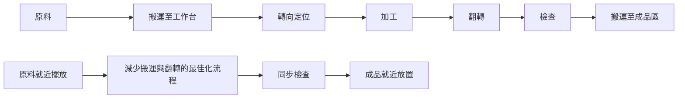

# 1.3 時間研究與工廠數據的統計

## 本章導言

科學管理從 Taylor 的個人觀測開始，到了二十世紀初期，便從「單次碼錶測量」逐漸走向有系統的**數據收集與統計分析**。工廠不再只記錄完成量，更開始記錄作業時間、停機原因、廢品率、等待時間等一系列操作數據，嘗試將車間現場的變異（variability）也納入管理的計算範圍。

這項轉變的推手之一是 **Frank B. Gilbreth（弗蘭克·吉爾布雷斯，1868–1924）** 與 **Lillian M. Gilbreth（莉蓮·吉爾布雷斯，1878–1972）** 夫婦。他們延伸 Taylor 的時間研究，創立了**動作研究（motion study）**。吉爾布雷斯夫婦相信：「減少不必要的動作，往往比加快動作更有效」。他們利用電影與燈光軌跡（cyclegraphic）、微動作研究（micromotion study）將動作拆解為最基本的單元（therbligs，Gilbreth 字母倒拼而來），尋找「最經濟的動作序列」。

另一方面，Taylor 學派的追隨者也意識到：現場測量必定有隨機變動。若只憑一兩次觀測就定出標準時間，容易受到工人狀態、機器溫度或環境干擾的影響。因此，時間研究逐步引入**樣本觀測、平均值、分佈與變異數**的想法，為後來的品質管制與統計方法鋪路。

### 從單點測量到樣本統計

時間研究者面對的現實是：完成同一工序的時間並非恆定，而是有一個**分佈（distribution）**。理想化的標準時間 $T_s$ 是對「正常作業狀態」下所需時間的合理估計。實務上，研究人員會在不同時段、不同班次觀測 $n$ 次，記錄每次觀測時間 $x_1, \ldots, x_n$ 。

最基本的統計量是**樣本平均數**與**樣本標準差**：

$$
\bar{x} = \frac{1}{n}\sum_{i=1}^{n} x_i, \qquad s = \sqrt{\frac{1}{n-1}\sum_{i=1}^{n} (x_i - \bar{x})^2}
$$

平均值 $\bar{x}$ 用於估計「典型時間」，標準差 $s$ 則用於衡量作業時間的**一致性（consistency）**。若 $s$ 相對 $\bar{x}$ 過大，表示作業變異大，可能是工作標準不夠明確、工具不穩定，或是存在不可預期的干擾，宜先穩定流程再訂定標準時間。

### 機率的導入：常態近似與「正常時間」

時間研究早期並未明確引用高斯分配，但實務觀測中，重複作業的時間分佈往往呈現**略偏右（right-skewed）**：大多數次數集中在較短區間，偶爾因故障、尋找工具等原因出現較長的尾巴。儘管如此，當觀測次數夠大且排除明顯異常值後，常用**平均值加寬放**的方式來訂定標準時間。這套做法間接預告了後世將工序時間視為隨機變數的思路。

Gilbreth 夫婦的動作研究則強調「剔除無效動作（ineffective motions）」。他們將動作歸納為 $17$ 類 **therbligs**（如抓取、運送、定位、檢查、休息等），並標示有效與無效。藉由消除無效動作，不僅降低平均時間 $\bar{x}$ ，更能顯著降低變異 $s$ ，達到「穩定流程」的目的。

### 工廠數據：產出、停機與效率指標

隨著生產規模擴大，車間管理需要更宏觀的指標。最基本的是**機器利用率（machine utilization）**與**總合設備效率（Overall Equipment Effectiveness，OEE）**的早期雛形。

**機器利用率**定義為：

$$
U = \frac{\text{實際生產時間}}{\text{計畫可用時間}} \times 100\%
$$

其中「計畫可用時間」是排定生產的工時，「實際生產時間」則扣除停機（downtime）。但單看利用率仍不足以反映品質與速度。現代 OEE 將效率拆解為**可用率（Availability）**、**性能率（Performance）**、**品質率（Quality）** 三者乘積，此思路可追溯到二十世紀初對「有效產出」的量化努力。

另一個重要指標是**勞動生產力（labor productivity）**：

$$
P = \frac{\text{產出量（件）}}{\text{投入工時（人時）}}
$$

Taylor 的標準時間提供了「理論產出」的基準，因此可以計算**效率比率（efficiency ratio）**：

$$
E_{eff} = \frac{\text{標準工時}}{\text{實際工時}} \times 100\% = \frac{\text{實際產出} \times T_s}{\text{實際工時}} \times 100\%
$$

若 $E_{eff} > 100\%$ ，表示工人實際效率高於標準；反之則低於標準。這個比率將「主觀評估」轉換為可比較的**相對效率數據**，是管理控制最早的量化工具之一。

**例題 1.3.1**：某工序標準時間 $T_s = 2.5$ 分鐘／件。某班次生產 $180$ 件，實際工時 $480$ 分鐘（8 小時）。計算該班次的效率比率。

**解**：標準工時 = $180 \times 2.5 = 450$ 分鐘。

效率比率：

$$
E_{eff} = \frac{450}{480} \times 100\% = 93.75\%
$$

也可從勞動生產力角度看：理論生產力 $480 / 2.5 = 192$ 件／班，實際 $180$ 件， $180/192 \approx 93.75\%$ ，結果一致。

### 變異的量化：為何要統計？

工廠現場最重要的洞見之一是：**流程的穩定性（stability）比單次的效率更重要**。如果每日產出波動極大，排程、物料與人力就無法預測。時間研究從樣本標準差出發，逐步引導管理思維從「追求極限值」轉向「控制變異」。

這個思路在日後被 **Walter A. Shewhart（沃爾特·休哈特，1891–1967）** 明確化為**統計製程管制（Statistical Process Control, SPC）**（見第7章）。雖然 Shewhart 的管制圖要到 1924 年才問世，但早在 1910 年代，Gilbreth 與許多工業工程先驅已經在強調「動作的一致性」與「流程的可重複性」。可以說，工廠數據的統計，是品質管制數學理論的直接前身。

### 從管理數據到數列與預測

隨著記錄的累積，工廠開始擁有按日、按週、按月的**時間序列數據（time series）**：產量、停機時數、廢品數、訂單量等。這些數列自然地引出「趨勢與波動」的問題。如何根據過去的產出預測未來需求？如何區分暫時波動與長期趨勢？

這些問題正是第2章「成長、平滑與預測數列」的起點。2.2 節的學習曲線描述的是生產經驗累積帶來的平均時間下降，2.3 節的指數平滑則直接利用歷史觀測數據做短期預測。可以說，1.3 節將「車間的觀測」系統化為**可分析的數據庫**，才使得後續的預測模型成為可能。

### 動作研究的可視化：流程簡化

Gilbreth 夫婦強調將動作流程繪製出來以便分析。簡單的流程示意有助於看出不必要的移動：

上圖右側簡化後，消除了多餘的「搬運—轉向—翻轉」等無效動作，降低平均時間與變異。

## 前因後果與驅動關係

- **管理問題驅動理論**：單靠碼錶個人判斷難以應付大規模生產的變異。工廠需要**可重複、可驗證**的數據程序，才能在不同班次、不同車間維持一致的標準。
- **理論如何改變實務**：時間研究與動作研究將「效率」從直覺量化為指標體系（標準時間、效率比率、生產力）。這套體系直接成為工廠成本會計的依據，也為管理控制制度奠基。此思路與《會計的數學》第7章預算差異分析（實際 vs. 標準）密切相關。
- **對後續章節的影響**：2.2 節學習曲線將「重複生產次數」與「平均單位時間」建模為數列函數。2.3 節指數平滑則利用歷史均值與變異的加權方式做預測。第7章品質管制更直接繼承「觀測樣本—計算變異—判斷是否異常」這條脈絡。
- **與兄弟書的連結**：《經濟的數學》第1章強調邊際分析，《機率統計》強調隨機樣本與估計，1.3 節則是這兩者最早在管理現場的實務應用。將作業時間視為隨機變數並用樣本估計，是統計思維滲入管理決策的重要橋樑。

## 練習

1. 某工序觀測 $5$ 次時間（秒）： $12.0, 11.8, 12.2, 11.9, 12.1$ 。計算 $\bar{x}$ 與 $s$ （取至小數點後二位）。
2. 某班次標準工時為 $960$ 分鐘，實際生產 $420$ 件，每件標準時間 $2.0$ 分鐘。計算效率比率，並解釋此數值的管理意義。
3. 機器利用率 $U = 80\%$ ，性能率 $90\%$ ，品質率 $95\%$ 。估算 OEE（百分比），並說明哪一項最可能是提升空間最大？
4. 思考題：Gilbreth 強調「減少動作數」勝過「加快動作速度」。試舉一個日常例子說明，並解釋其對「平均時間」與「變異」的影響。
5. 思考題：若工廠只記錄「總產量」而不記錄「停機原因分類」，對於持續改善（continuous improvement）會造成什麼困難？請用「數據驅動決策」的角度說明。

### 年表速查

- 1890 年代：F. B. Gilbreth 研究砌磚工人的動作，提出動作簡化。
- 1904：Gilbreth 開始運用電影記錄動作（micromotion study）。
- 1909：F. W. Taylor 發表《工廠管理》（*Shop Management*），強調系統化記錄。
- 1911：Taylor《科學管理原理》出版，推動時間研究標準化。
- 1917：Gilbreth 夫婦發表《應用動作研究》（*Applied Motion Study*），系統化 therbligs。
- 1924：W. A. Shewhart 發表管制圖（控制圖），將工廠數據正式導入統計製程管制。

### 名詞速查表

- **動作研究（motion study）**：分析與簡化作業動作以減少無效動作的研究方法。
- **微動作研究（micromotion study）**：用影片或高速攝影拆解至極小動作單元的分析技術。
- **Therbligs**：Gilbreth 將基本動作歸納的 17 類動作符號系統。
- **樣本平均數 $\bar{x}$ 、樣本標準差 $s$ **：描述觀測時間集中趨勢與離散程度的統計量。
- **效率比率（efficiency ratio）**： $\frac{\text{標準工時}}{\text{實際工時}}$ ，用以衡量實際作業效率。
- **機器利用率（utilization）**：實際生產時間佔計畫可用時間的比例。
- **OEE（Overall Equipment Effectiveness）**：可用率×性能率×品質率，用於衡量設備有效產出。
- **流程穩定性（process stability）**：作業結果波動在可控範圍內的狀態。
