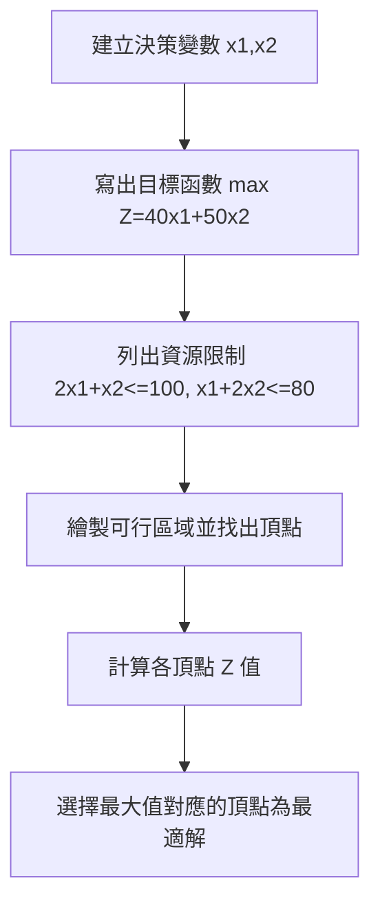
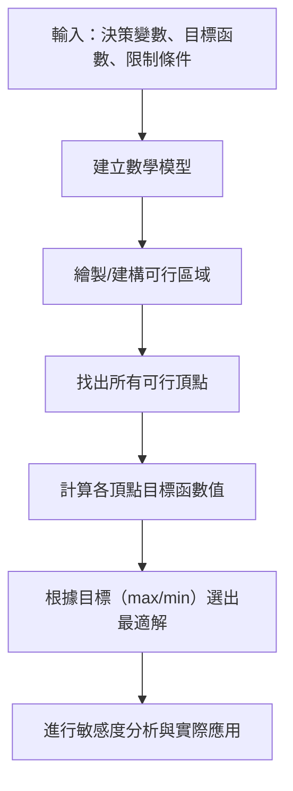

# 3.1 線性規劃與 Dantzig 單純形法 1947

## 本章導言

1940 年代中期，第二次世界大戰正處於後勤補給的關鍵時刻。盟軍必須在有限的運輸船隻、飛機、卡車、油料與人力下，決定要運送哪些物資、經由哪些路線、何時送達前線，才能支撐龐大的軍事行動。傳統上這些決策主要靠經驗與直覺判斷，卻往往無法在多重限制下找到最有效的配置方式。

為了解決這類複雜的資源配置問題，美國、英國等國組成了**作業研究（Operations Research, OR）** 團隊。這些團隊匯集數學家、統計學家、工程師與經濟學家，共同以科學方法研究軍事作業。戰爭結束後，這些人意識到：前線的後勤問題與平時企業的生產排程、原料採購、配送路線等問題在本質上極為相似。於是作業研究從軍事逐漸轉向民用，成為企業管理中最具影響的量化工具之一。

線性規劃（Linear Programming, LP）正是作業研究最重要的理論成果。它要解決的問題可概括為：**在一組線性限制條件下，求某一線性目標函數的最大值或最小值**。

關鍵人物是 **George B. Dantzig（喬治·丹齊格，1914–2005）**。1947 年夏天，Dantzig 在為美國空軍研究「規劃問題」（programming problem）時，提出了**單純形法（Simplex Method）**。這個演算法不僅能系統地求解線性規劃問題，更開啟了大規模最佳化的時代。Dantzig 本人曾幽默地說，他在研究所時以為某個作業是「習題」卻其實是待解的未解問題，這段軼事雖未必完全屬實，卻反映了他將實務挑戰轉化為數學問題的思路。

### 線性規劃的基本結構

一個標準形式的線性規劃問題可寫成：

**目標函數（Objective Function）**：
$$
\max Z = c_1 x_1 + c_2 x_2 + \cdots + c_n x_n
$$
（或 $\min Z$ ）

**限制條件（Constraints）**：
$$
\begin{aligned}
a_{11}x_1 + a_{12}x_2 + \cdots + a_{1n}x_n &\le b_1\\
a_{21}x_1 + a_{22}x_2 + \cdots + a_{2n}x_n &\le b_2\\
\vdots\\
a_{m1}x_1 + a_{m2}x_2 + \cdots + a_{mn}x_n &\le b_m
\end{aligned}
$$

**非負限制（Non-negative Constraints）**：
$$
x_1, x_2, \ldots, x_n \ge 0
$$

這裡 $x_i$ 稱為**決策變數（decision variables）**（要決定的數量，如生產數量）， $c_i$ 為**目標係數（objective coefficients）**（單位貢獻）， $a_{ij}$ 為**技術係數（technological coefficients）**（單位產品消耗資源量）， $b_i$ 為**資源限制（right-hand side）**（可用資源總量）。

線性規劃的三個關鍵假設：**比例性（proportionality）**（單位消耗與產出成正比）、**可加性（additivity）**（總資源消耗等於各產品消耗之和）、**連續性與確定性（divisibility and certainty）**（ $x_i$ 可取實數、所有參數已知）。

### 可行區域與最適解

所有同時滿足限制條件與非負限制的 $(x_1,\ldots,x_n)$ 組成**可行解集合（feasible region）**。由於限制條件都是線性的，可行解集合在 $n$ 維空間中是**凸多面體（convex polyhedron）**。

線性規劃理論的基本定理指出：**若線性規劤問題存在最適解，則最適解一定出現在可行區域的某個頂點（極點，vertex）**。因此，理論上我們只需要檢查所有頂點的目標函數值，就能找到最優解。單純形法的智慧正是：**不去窮舉所有頂點，而是從某個初始頂點出發，沿著可行區域的邊界逐步移動到相鄰頂點，每次都使目標函數值朝最優方向改善，直到無法再改善為止。**

### 圖解法（兩變數情況）

為了直觀理解，考慮最簡單的兩變數線性規劃。圖解法有助於建立「可行區域—頂點—最優解」的概念。

**例題 3.1.1**：某工廠生產兩種產品 A、B。每單位產品 A 需 $2$ 小時機器時間、 $1$ 小時人工時間，每單位產品 B 需 $1$ 小時機器時間、 $2$ 小時人工時間。工廠每週可用機器時間 $100$ 小時、人工時間 $80$ 小時。產品 A 每單位利潤 $40$ 元、產品 B 每單位利潤 $50$ 元。求如何安排生產才能使每週利潤最大。

**解**：設 $x_1$ 為產品 A 生產數量（單位）、 $x_2$ 為產品 B 生產數量（單位）。

目標函數（最大化利潤）：
$$
\max Z = 40 x_1 + 50 x_2
$$

限制條件：
$$
\begin{aligned}
2x_1 + 1x_2 &\le 100 \quad (\text{機器時間})\\
1x_1 + 2x_2 &\le 80 \quad (\text{人工時間})\\
x_1, x_2 &\ge 0
}
$$

找出可行區域頂點：

- 點 $O(0,0)$ ： $Z=0$
- 點 $P(50,0)$ ：由 $2x_1=100$ ， $Z=40\times50=2000$
- 點 $Q$ ：聯立 $2x_1 + x_2 = 100$ 與 $x_1 + 2x_2 = 80$
  解：由第一式 $x2 = 100 - 2x1$ 代入第二式： $x1 + 2(100 - 2x1) = 80 \Rightarrow x1 + 200 - 4x1 = 80 \Rightarrow -3x1 = -120 \Rightarrow x1 = 40, x2 = 100 - 80 = 20$ 。 $Z = 40\times40 + 50\times20 = 1600 + 1000 = 2600$
- 點 $R(0,40)$ ：由 $2x2=80, Z=50\times40 = 2000$

比較四個頂點，最大值在 $Q(40,20)$ ， $Z=2600$ 元。

因此最適解為生產產品 A $40$ 單位、產品 B $20$ 單位，每週最大利潤 $2600$ 元。

### 單純形法的基本思路（概念）

對於多變數多限制的問題無法用圖解，Dantzig 的單純形法解決了這個困難。其步驟大致如下：

1. **轉換為標準式**：將不等式限制加上**鬆弛變數（slack variables）** $s_i \ge 0$ ，轉為等式： $a_{i1}x_1+\cdots+a_{in}x_n + s_i = b_i$ 。
2. **找初始基本可行解**：以鬆弛變數作為初始基底，對應頂點 $(0,\ldots,0)$ 。
3. **建立單純形表（Simplex Tableau）**：將係數整理成表格。
4. **判斷是否最優**：若目標函數列（係數行）的所有係數（對最大化問題而言）都 $\le 0$ ，則目前解已最優。
5. **進入基底**：選擇目標函數列中**最正**的係數對應的變數作為**進入變數（entering variable）**。
6. **離開基底**：計算每個限制式的「比率」 $b_i / a_{ij}$ （僅考慮 $a_{ij}>0$ ），選擇**最小比率**對應的行作為**樞紐行（pivot row）**，該行的基底變數為**離開變數（leaving variable）**。
7. **樞紐運算（pivot operation）**：將樞紐元素化為 $1$ ，並將該變數列其他元素化為 $0$ （高斯消去法的思路），得到新的單純形表。
8. **重複步驟 4–7**，直到達到最優解。

單純形法的核心是「**從頂點到頂點的迭代**」。每一次迭代都恰好移動到鄰近一個頂點，且目標函數值非減（最大化）或非增（最小化），由於可行區域是有界多面體且頂點有限，演算法一定會在有限步驟內收斂到最優解（在一般情況下）。

### 單純形法的歷史意義

Dantzig 於 1947 年 10 月首次提出單純形法，並於 1949 年發表相關論文。這個演算法迅速成為作業研究的標準工具。1950 年代隨著電腦出現，線性規劃首次能夠求解成千上萬個變數與限制的實際問題（石油煉製的配比規劃、航空公司機組排班、鐵路貨運路線規劃等）。

值得注意的是，蘇聯數學家 **Leonid Kantorovich（列昂尼德·康托羅維奇，1912–1986）** 早在 1939 年就獨立提出類似線性規劃的問題解法（《生產組織與計劃中的數學方法》），並用於木材、皮革等工業的資源配置。然而由於當時蘇聯體系對「線性規劃」的理論背景不夠重視，康托羅維奇的成果長期未被國際廣泛認識。1975 年，康托羅維奇與荷蘭經濟學家 **Tjalling Koopmans（提亞林·科普曼斯，1910–1985）** 因「對資源最佳分配理論的貢獻」共同獲得諾貾爾經濟學獎。雖遲來的肯定，卻證明線性規劃確實是經濟學與管理學共同關心的「最佳資源配置」問題。

### 與其他章節及領域的連結

- **2.1 節**：線性規劃的限制條件本質是「資源約束」，與資本預算、現值比較一脈相承，都是在有限資源下追求效益最大化。
- **3.2 節**：將進一步介紹對偶理論與影子價格（shadow price），說明「每增加一單位資源的邊際價值」如何由線性規劃導出，這正與《經濟的數學》第2章效用與邊際分析遙相呼應。
- **3.3 節**：整數規劃（Integer Programming）是線性規劃的延伸，當決策變數必須是整數（人數、機台台數）時才適用.
- **《會計的數學》第7章**：預算差異分析與線性規劃的資源限制觀念密切相關。企業在編製預算時也必須考慮「有限資源下的最佳組合」。
- **《經濟的數學》第4章**：生產成本與要&輸出關係，是線性規劃「技術係數」の經濟根源。
- **第9章**：作業研究整合視角將會回顧線性規劃與其他最佳化方法的歷史與應用.

### 可行區域流程圖（概念）

## 前因後果與驅動關係

- **管理問題驅動理論**：戰時後勤極度需要「在最少運輸資源下完成最多補給」的系統方法。作業研究團隊從實際問題出發,催生線性規劃理論。
- **理論如何改變實務**：線性規劃將「配置問題」從經驗判斷轉為數學模型,使得管理者能在複雜限制下理性地權衡取捨。戰後它迅速應用於石油、化工、交通、農業規劃等幾乎所有產業。
- **對後續章節的影響**：3.2 節對偶理論解釋「影子價格」的經濟意義,幫助管理者判斷「多買一單位資源值得嗎」。3.3 節整數規劃處理更貼近實際的「整數決策」。第4章排隊論雖處理隨機系統,但最佳化思路與線性規劃一脈相承。
- **與兄弟書的連結**：《經濟的數學》第5章一般均衡理論關注「整個經濟體系的資源配置效率」,線性規劃則是從企業或計畫單位的「局部最佳化」切入,兩者在「效率」概念上互通。

## 練習

1. 試寫出下面問題的線性規劃模型：某廠要生產產品 X、Y。每單位 X 需 4 單位原料、2 單位勞力,利潤 3 元;每單位 Y 需 2 單位原料、4 單位勞力,利潤 5 元。原料限量 100 單位,勞力限量 100 單位。求利潤最大之生產組合。
2. 用圖解法解決練習 1,找出可行區域頂點及最適解.
3. 線性規劃為何一定有最適解就出現在可行區域頂點?試從「凸性」概念簡單說明。
4. 單純形法的「進入變數」與「離開變數」分別依據什麼準則選擇?
5. 思考題:康托羅維奇與 Dantzig 幾乎同時獨立發展線性規劃,卻獲得不同的國際認識。這個歷史事實對我們理解「科學發現的社會脈絡」有什麼啟示?

### 年表速查

- 1939：Leonid Kantorovich《生產組織與計劃中的數學方法》提出資源配置的線性最佳化模型。
- 1941–1945：二次世界大戰期間作業研究團隊在盟軍後勤中廣泛應用數量方法。
- 1947：George B. Dantzig 提出單純形法,奠定線性規劃的演算法基礎。
- 1949：Dantzig 等人發表線性規劃相關論文,理論逐漸系統化。
- 1951：首屆線性規劃國際會議等,學術交流快速展開。
- 1975：Kantorovich 與 Koopmans 獲得諾貝爾經濟學獎。

### 名詞速查表

- **作業研究（Operations Research, OR）**：以科學方法解決組織運作中最佳化問題的跨領域學科。
- **線性規劃（Linear Programming, LP）**：在線性限制下求線性目標函數最值的數學方法。
- **決策變數（decision variables）**：待決定的未知量（如生產數量）。
- **限制條件（constraints）**：資源或規則的限制式。
- **目標函數（objective function）**：欲極大化或極小化的線性函數。
- **可行解（feasible solution）**：滿足所有限制條件的解。
- **可行區域（feasible region）**：所有可行解的集合（凸多面體）。
- **頂點（vertex/extreme point）**：可行區域的角落點。
- **單純形法（Simplex Method）**：Dantzig 提出的系統求解線性規劃的迭代演算法。
- **鬆弛變數（slack variable）**：將 $\le$ 限制轉為等式所加的非負變數。
- **樞紐元素（pivot）**：單純形表中用於迭代的關鍵元素。
- **影子價格（shadow price）**：每增加一單位限制資源對目標函數最優值的邊際改善（見 3.2 節）。 
