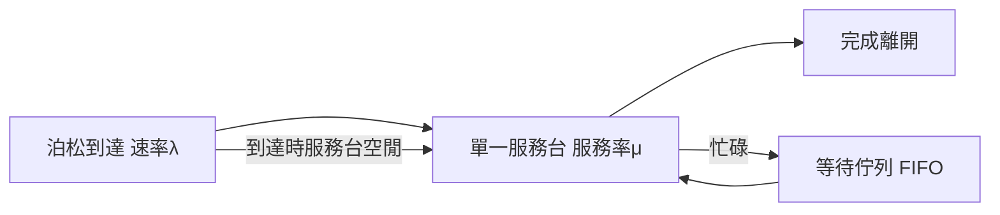

# 4.2 泊松到MM1排隊模型

## 本章導言

Erlang 在 1917 年解決了電話線路的阻塞問題，但他的模型瞄準的是「有幾條線」；工廠、銀行、餐廳與電腦系統面對的卻是另一種場景：只有**一個櫃台**、客人**不能趕走、只能排隊**。把 Erlang 的生滅過程收縮到單一服務台，就得到排隊論中最基本、也最常被用（與誤用）的模型：** $M/M/1$ 排隊系統**。

本節把「 $M/M/1$ 」拆開來看：第一個 $M$ 表示到達間隔為**無記憶**（Memoryless）分配——即泊松到達、指數間隔；第二個 $M$ 表示服務時間也是指數分配； $1$ 表示單一服務台。這套記號由 **David Kendall** 於 1953 年提出，把 Erlang 以降半世紀的各種模型整理成統一的命名語言。

### 建模：生滅平衡

設到達率 $\lambda$ 、服務率 $\mu$ 。系統狀態 $n$ 表示「佇列中有 $n$ 人（含服務中者）」。到達使狀態 $n \to n+1$ （速率 $\lambda$ ），完成服務使 $n \to n-1$ （速率 $\mu$ ）。令穩態機率為 $p_n$ ，則「流入＝流出」的平衡方程為

$$
\lambda p_n = \mu p_{n+1} \quad \Rightarrow \quad p_n = \rho^n p_0, \qquad \rho = \frac{\lambda}{\mu}.
$$

由總機率為 1 可得 $p_0 = 1 - \rho$ （必須 $\rho < 1$ ，否則佇列爆炸）。於是穩態分配為**幾何分配**：

$$
p_n = (1-\rho)\,\rho^n.
$$

由此推出排隊論最著名的四個公式：

$$
L = \mathbb{E}[N] = \frac{\rho}{1-\rho}, \qquad
L_q = \frac{\rho^2}{1-\rho},
$$

$$
W = \frac{1}{\mu - \lambda}, \qquad
W_q = \frac{\lambda}{\mu(\mu-\lambda)} = \frac{\rho}{\mu - \lambda}.
$$

$L$ 、 $W$ 分別是系統中平均人數與平均逗留時間， $L_q$ 、 $W_q$ 是純排隊的部分。 $L = \lambda W$ 這條關係是 **Little 定理**（J. D. C. Little, 1961）：任何穩定佇列中「平均人數＝到達率×平均逗留時間」，它不依賴任何分配假設，是排隊論中最普遍的定律。

### 流程圖：M/M/1 的數學結構

### 為何「無記憶」是關鍵

指數分配的無記憶性 $P(X > s + t \mid X > s) = P(X > t)$ 使「已經等多久」不提供任何資訊，因此任何時刻的剩餘服務時間仍是平均 $1/\mu$ 的指數分配——狀態 $n$ 就足以描述系統，馬可夫性成立，平衡方程才寫得出來。若服務時間是常數（ $M/D/1$ ）或對數常態（排隊論常見於 7.2 節討論的變異議題），公式會更複雜，且出現重要的管理訊息：**服務時間的變異本身會加長佇列**。以 Kingman 近似（1961）表示：

$$
W_q \approx \left(\frac{\rho}{1-\rho}\right)\left(\frac{c_a^2 + c_s^2}{2}\right)\frac{1}{\mu},
$$

其中 $c_a, c_s$ 是到達與服務時間的變異係數。變異係數減半，等待時間幾乎減半——這是流程管理「先降變異、再談產能」的數學根據。

### 例題：銀行櫃台的等待時間

**例題 4.2.1**：某銀行單一櫃台，客人平均每 5 分鐘到達一位（ $\lambda = 12$ 人／小時），平均服務時間 4 分鐘（ $\mu = 15$ 人／小時），到達與服務皆近似指數。求：（a）櫃台空閒機率；（b）系統中平均人數；（c）客人平均等待時間（不含服務）；（d）等待超過 10 分鐘的機率。

**解**：

$$
\rho = \frac{12}{15} = 0.8.
$$

(a) 空閒機率 $p_0 = 1 - \rho = 0.2$ ，即櫃台有 $20\%$ 時間閒著。

(b) $L = \dfrac{\rho}{1-\rho} = \dfrac{0.8}{0.2} = 4$ 人。

(c) $W_q = \dfrac{\rho}{\mu - \lambda} = \dfrac{0.8}{3} \approx 0.2667$ 小時 $= 16$ 分鐘。（驗證： $L_q = \rho^2/(1-\rho) = 3.2$ ， $L_q/\lambda = 3.2/12 = 0.2667$ 小時，符合 Little 定理。）

(d) 等待時間 $W_q$ 在 $M/M/1$ 中的分配： $P(W_q > t) = \rho\, e^{-(\mu-\lambda)t}$ ，故

$$
P(W_q > 10\,\text{分}) = 0.8\, e^{-3 \times (1/6)} = 0.8\, e^{-0.5} \approx 0.8 \times 0.6065 \approx 0.485.
$$

近半數客人要等超過 10 分鐘——儘管櫃台有 $20\%$ 時間是空的。這是排隊論對管理者的第二個震撼：**高利用率與長等待並不矛盾，而是必然**。

### 利用率的非線性陷阱

把 $W_q = \dfrac{\rho}{\mu(1-\rho)}$ 對 $\rho$ 作圖，可見 $\rho \to 1$ 時等待時間爆炸： $\rho = 0.8$ 時 $W_q = 16$ 分， $\rho = 0.9$ 時 $W_q = 36$ 分， $\rho = 0.95$ 時 $W_q = 76$ 分。這解釋了為什麼「再提高一點效率」常讓現場崩潰，也解釋了醫院與電腦系統為何刻意保留閒置產能（管理上常把目標利用率訂在 $75\%$ – $85\%$ ）。

## 前因後果與驅動關係

- **管理問題驅動理論**： $M/M/1$ 源於把 Erlang 的多線模型簡化到「單一窗口」的通用場景——櫃台、機器維修（一台機器壞了等一位修理工）、電腦的 CPU 排程。它回答的問題始終如一：**這個服務系統的等待成本值多少錢**。
- **理論如何改變實務**：Little 定理使管理者只需量到三個量中的兩個就能推第三個，成為精實生產（如 Toyota 的在製品控制）與敏捷開發（看板方法）的核心工具：控制 $L$ （在製品）即可壓縮 $W$ （前置時間）。Kingman 近似則把「降變異」從口號變成可計算的投資案。
- **對後續章節的影響**：4.3 節將 $W_q$ 乘上單位等待成本，與服務成本相加做最適服務率決策；5.2 節報童模型面對的是「存貨的排隊」對偶問題；6.2 節 PERT 中「瓶頸工序」的直覺即來自排隊網路的瓶頸分析。
- **與兄弟書的連結**：《機率統計》的指數分配、無記憶性與幾何分配是本節的數學基礎；《經濟的數學》第 4 章的產能利用率概念在此獲得隨機版本。

## 練習

1. 某診所單一窗口， $\lambda = 20$ 人／小時、 $\mu = 25$ 人／小時。求 $L$ 、 $L_q$ 、 $W$ 、 $W_q$ ，並用 $L = \lambda W$ 驗算。
2. 承上，若希望 $W_q$ 不超過 3 分鐘， $\mu$ 至少要多少？此時利用率為何？
3. 證明：在 $M/M/1$ 中 $W = W_q + 1/\mu$ ，並用例題 4.2.1 的數字驗證。
4. 用 Little 定理說明：工廠在製品從 100 件降到 50 件、節拍產出不變（ $\lambda$ 不變）時，平均前置時間如何變化。
5. 思考題：Kingman 近似顯示降變異與增產能同樣能縮短等待。若「標準化作業」（1.1 節）能把 $c_s$ 降一半而「加一位服務員」需增加成本，你會如何權衡？請指出此估算忽略了什麼。

### 名詞速查表

- **Kendall 記號 $A/B/s$ **：到達過程／服務過程／服務台數， $M$ 表無記憶（指數）、 $D$ 表確定性。
- **利用率 $\rho = \lambda/\mu$ **：服務台忙碌的時間比例，小於 1 才有穩態。
- **Little 定理**： $L = \lambda W$ ，任何穩定排隊系統皆成立。
- **生滅平衡**：相鄰狀態流入率＝流出率的穩態方程。
- **Kingman 近似**：等待時間與「利用率 $/(1-$ 利用率 $)$ 」及變異係數平方和成正比。
- **無記憶性**： $P(X>s+t\mid X>s)=P(X>t)$ ，指數分配的標記性質。

（本節完）
