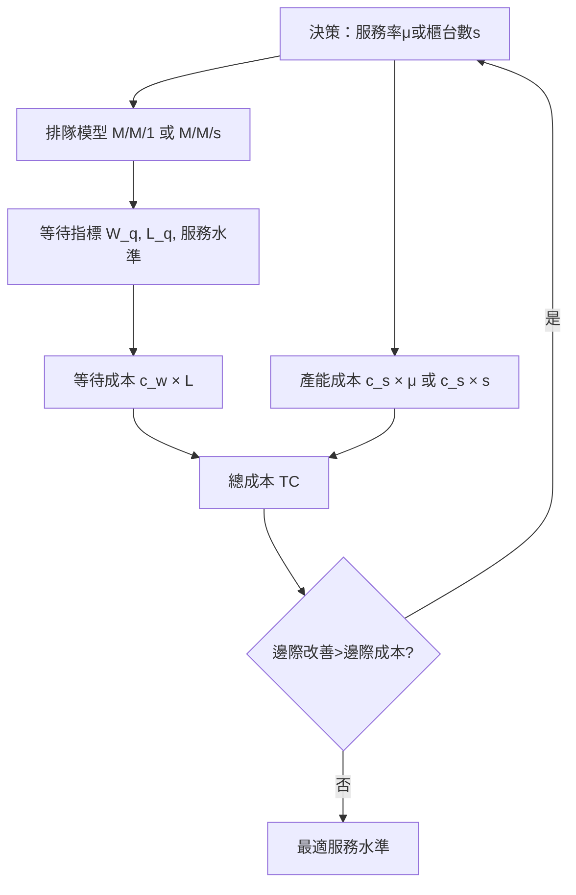

# 4.3 服務水準與成本的最佳化

## 本章導言

Erlang 與 $M/M/1$ 給了管理者「等待時間的計算尺」，但計算出等待時間之後，真正的管理問題才開始：**等待要花多少錢？服務要花多少錢？兩者加總在什麼水準下最小？** 一位急診室主任不會因「 $W_q = 16$ 分鐘」就自動知道該開幾個診間；一位客服經理也不會因「服務水準 $80\%$ 」就自動知道該排幾個班。把排隊論變成投資決策，需要在數學上補上最後一塊：**成本函數的最適化**。

### 成本結構：等待的代價 vs. 產能的代價

設等待一位顧客每小時的成本為 $c_w$ （顧客時間的機會成本、商譽損失、流失風險），每增加一單位服務率（或一位服務員）每小時的成本為 $c_s$ 。以 $M/M/1$ 為例，服務率 $\mu$ 是決策變數（假設可連續調整，成本與 $\mu$ 成正比），總成本為

$$
TC(\mu) = c_w \cdot L(\mu) + c_s \cdot \mu
= c_w \cdot \frac{\lambda}{\mu - \lambda} + c_s \,\mu, \qquad \mu > \lambda.
$$

對 $\mu$ 微分並令為零：

$$
\frac{dTC}{d\mu} = -\frac{c_w \lambda}{(\mu-\lambda)^2} + c_s = 0
\quad\Longrightarrow\quad
(\mu - \lambda)^2 = \frac{c_w \lambda}{c_s},
$$

$$
\mu^* = \lambda + \sqrt{\frac{c_w \lambda}{c_s}}.
$$

這個平方根形式的解告訴我們：**最適服務率比到達率高出的部分，隨等待成本的平方根成長、隨產能成本的平方根衰減**。邊際思考的語言是：加產能應加到「再加快一點所省下的等待成本，剛好等於多花的產能成本」為止。

### 例題：該把服務率調到多快

**例題 4.3.1**：某倉庫出貨口以 $M/M/1$ 近似，卡車到達率 $\lambda = 8$ 輛／小時。卡車司機與車輛閒置的總成本 $c_w = 600$ 元／輛．小時；裝卸速度由外包團隊決定，成本 $c_s = 900$ 元／（輛／小時）——即把服務率提高 1 輛／小時，每小時多花 900 元。求最適服務率 $\mu^*$ 、此時的卡車平均在場數與總成本，並比較「只用最低速 $\mu = 10$ 」的方案。

**解**：

$$
\mu^* = 8 + \sqrt{\frac{600 \times 8}{900}} = 8 + \sqrt{\frac{4800}{900}} = 8 + \sqrt{5.333} \approx 8 + 2.31 = 10.31 \ \text{輛／小時}.
$$

此時系統中平均卡車數

$$
L(\mu^*) = \frac{\lambda}{\mu^* - \lambda} = \frac{8}{2.31} \approx 3.46 \ \text{輛},
$$

總成本

$$
TC(\mu^*) = 600 \times 3.46 + 900 \times 10.31 \approx 2076 + 9279 = 11355 \ \text{元／小時}.
$$

比較 $\mu = 10$ ： $L = 8/(10-8) = 4$ 輛， $TC = 600 \times 4 + 900 \times 10 = 2400 + 9000 = 11400$ 元／小時。最適解每年（以 4000 小時計）可省約 $45 \times 4000 = 18$ 萬元——差異不大，這正是平方根解的特徵：**成本曲線在最適點附近平緩**，管理者因此有協商空間。

### 多櫃台排班：呼叫中心的經典問題

實務上更常見的是決策「開幾個窗口」： $M/M/s$ 模型、固定 $\mu$ ，選 $s$ 。設每位服務員成本 $c_s$ 、等待成本 $c_w$ ，總成本 $TC(s) = c_w L(s) + c_s\, s$ 。 $L(s)$ 隨 $s$ 遞減而 $c_s s$ 遞增，最適的 $s^*$ 滿足邊際比較：

$$
TC(s^*+1) \ge TC(s^*) \quad \text{且} \quad TC(s^*-1) \ge TC(s^*).
$$

計算時用 Erlang C 公式先求「需等待機率」，再求 $L_q = C(s,a)\cdot \dfrac{\rho}{1-\rho}$ （ $\rho = a/s$ ）與 $L = L_q + a$ 。呼叫中心業界通行的「服務水準」指標——如「 $80\%$ 的來話在 20 秒內接起」——正是把 $C(s,a)$ 與等待時間分配結合的產物： $P(W_q \le t) = 1 - C(s,a)\, e^{-(s\mu - \lambda)t}$ 。排班軟體背後就是這條式子在逐小時反解 $s$ 。

### 例題：該開幾個櫃台

**例題 4.3.2**：郵局某時段 $\lambda = 16$ 位／小時，每位服務員 $\mu = 10$ 位／小時（指數近似）， $c_w = 300$ 元／小時、 $c_s = 220$ 元／小時（每人）。計算 $s = 2, 3$ 的總成本並選優。（已知 $s=2$ 時 $L_q \approx 2.844$ 、 $s=3$ 時 $L_q \approx 0.380$ 。）

**解**： $s = 2$ ： $L = 2.844 + 16/10 = 4.444$ ，

$$
TC(2) = 300 \times 4.444 + 220 \times 2 = 1333 + 440 = 1773 \ \text{元／小時}.
$$

$s = 3$ ： $L = 0.380 + 1.6 = 1.980$ ，

$$
TC(3) = 300 \times 1.980 + 220 \times 3 = 594 + 660 = 1254 \ \text{元／小時}.
$$

$s = 4$ 時 $L_q$ 更小但 $c_s s = 880$ 上升，粗算 $TC(4) \approx 300 \times 1.68 + 880 \approx 1384 > 1254$ 。故 ** $s^* = 3$ **。注意多開一個櫃台的年效益（ $1773 - 1254 = 519$ 元／小時）遠超其人事成本（220 元／小時）——集中排班、尖峰加開，是排隊成本模型最直接的省錢手段。

### 服務水準的訂價本質

「服務水準 $80\%$ ／20 秒」不該是行業慣例，而是等待成本函數的影子。若能估出顧客流失與時間成本，服務水準應由最適化反推；若估不出，敏感度分析（如例題 4.3.1 中成本曲線平緩）至少告訴你容許誤差的範圍。這種「把服務品質翻譯成貨幣再最佳化」的思路，是作業研究帶給服務業最重要的心智工具。

## 前因後果與驅動關係

- **管理問題驅動理論**：戰後美國服務業與電腦分時系統的擴張，使「人力排班」成為億元級問題；呼叫中心產業在 1980–90 年代把 Erlang C 排班推成標準作業，醫院則在急診壅塞危機後跟進。
- **理論如何改變實務**：成本最適化使「服務品質」從抽象口號變成可預算的變數；排班軟體、急診分流標準（如五級檢傷的產能對應）、快遞取件時段承諾，都是「等待成本×排隊模型」的應用。
- **對後續章節的影響**：4.1 節的 Erlang B（損失制）與本節的等待制是同一框架的兩端；5.1 節 EOQ 的「訂購成本 vs. 持有成本」結構與本節的「產能 vs. 等待」同構，最適解都呈現「兩股反向成本的拉鋸」；8.1 節決策樹中顧客流失的期望值估計，正是 $c_w$ 的來源之一。
- **與兄弟書的連結**：《經濟的數學》第 4 章的成本函數與邊際分析提供了本節的微積分語言；《會計的數學》第 7 章預算差異可用來回饋校正 $c_w$ 、 $c_s$ 的估計值。

## 練習

1. $\lambda = 9$ 輛／小時、 $c_w = 500$ 元／小時、 $c_s = 800$ 元／（輛／小時）。求 $\mu^*$ 與最適時的 $L$ 。
2. 承例題 4.3.2，若等待成本升至 $c_w = 500$ 元／小時，重算 $TC(3)$ 與 $TC(4)$ （設 $L(4) \approx 1.68$ ），最適櫃台數是否改變？
3. 證明 $M/M/1$ 成本模型中 $\mu^* - \lambda = \sqrt{c_w\lambda/c_s}$ ，並說明為何 $\mu^*$ 恆大於 $\lambda$ （穩定性自動滿足）。
4. 某呼叫中心要求「 $90\%$ 來話在 30 秒內接起」。以 $M/M/s$ 等待時間分配式 $P(W_q \le t) = 1 - C(s,a)e^{-(s\mu-\lambda)t}$ 說明：話務量 $a$ 上升 1 Erlang 時，維持同一服務水準所需的 $s$ 通常不止增加 1 人。原因為何？
5. 思考題：急診室對「重病症人」的等待成本遠高於輕症。單一佇列、單一 $c_w$ 的模型必然失真。你會如何改進模型（例如分類多佇列、優先權排隊），且這與檢傷分類制度的設計有何呼應？

### 名詞速查表

- **等待成本 $c_w$ **：顧客（或工件）每單位時間等待的貨幣成本。
- **產能成本 $c_s$ **：提高服務率或增設服務員的單位成本。
- **最適服務率 $\mu^*$ **：使 $TC = c_w L + c_s\mu$ 最小的服務率， $M/M/1$ 下為 $\lambda + \sqrt{c_w\lambda/c_s}$ 。
- **服務水準（service level）**：如「 $x\%$ 顧客在 $t$ 時間內被服務」，由 Erlang C 與等待時間分配反解。
- **邊際分析**： $s^*$ 滿足 $TC(s\pm1) \ge TC(s)$ 的離散最適條件。
- **敏感度**：總成本曲線在最適點附近平緩，估計誤差容忍度高。

（本節完）
