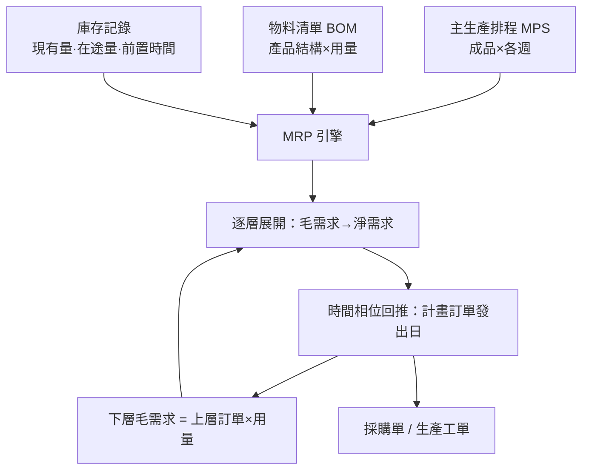

# 5.3 MRP與供應鏈的數列模式

## 本章導言

EOQ 與報童模型都把需求當成「從天上掉下來」的資料：要嘛是常數 $D$ ，要嘛是某個分配。但對一家製造整機的工廠而言，輪胎的需求根本不該預測——**它等於整機產量乘以 4**，而整機產量寫在主生產排程（MPS）裡。1960 年代，美國管理學者 **Joseph Orlicky**、以及 IBM 的工程師們把這個顯而易見卻被長期忽略的區分系統化：需求分兩種，**獨立需求**（成品，來自顧客，必須預測）與**相依需求**（零件，由上層成品推導，不該預測）。在此基礎上他們建立了**物料需求規劃（Material Requirements Planning, MRP）**——用一張料表（BOM）與一組時間相位（time-phased）計算，把「何時、訂多少」從猜測變成推導。

Orlicky 的《Material Requirements Planning》於 1975 年出版（他 1972 年即提出核心主張），配上美國生產與存貨管制學會（APICS）的推廣，MRP 在 1970–80 年代成為製造業資訊系統的骨幹，並逐步演化為 MRPII 與今日的 ERP。它是存貨管理的第三次浪潮：EOQ 管單品、報童管單期賭注，MRP 管**一整棵產品結構樹的數列**。

### 模型：BOM 展開與時間相位

MRP 的輸入有三：（1）**主生產排程（MPS）**：未來各週的成品需求（獨立需求）；（2）**物料清單（BOM）**：一個成品由哪些子件、各需幾個所構成的樹狀結構；（3）**庫存與前置時間記錄**：每個料號的現有量、在途量、採購或生產前置時間。計算自上而下逐層「展開」：

對每個料號，每期做

$$
\text{淨需求}_t = \max\left(0,\ \text{毛需求}_t - \text{現有庫存}_t - \text{在途量}_t + \text{安全庫存}\right),
$$

再由**前置時間**把「需求發生日」回推成「**下單日**」（時間相位：offset by lead time）。上層料的「計畫訂單發出」，乘上 BOM 倍數，即成為下層料的「毛需求」。

### 流程圖：MRP 的計算迴路

### 例題：一張時間相位的 MRP 表

**例題 5.3.1**：成品 A 的 MPS 為第 4、5、6 週各需 100 個。A 由 2 個零件 B 與 1 個零件 C 組成；B 的採購前置時間 2 週、現有庫存 80 個、在途量 0；安全庫存 0、無批量限制（逐批訂購 lot-for-lot）。寫出 B 的 MRP 計算。

**解**：先算 A 的計畫訂單發出：A 前置時間設為 1 週（組裝），故第 4、5、6 週交貨的組裝工單須在**第 3、4、5 週**發出，每張 100 個。

B 的毛需求＝A 的計畫訂單發出 × 2：

| 週 | 1 | 2 | 3 | 4 | 5 |
|---|---|---|---|---|---|
| B 毛需求 | 0 | 0 | 200 | 200 | 200 |
| 在途量 | 0 | 0 | 0 | 0 | 0 |
| 期初庫存 | 80 | 80 | 0 | 0 | 0 |
| 淨需求 | 0 | 0 | 120 | 200 | 200 |
| 計畫訂單收到 | 0 | 0 | 120 | 200 | 200 |
| **計畫訂單發出** | **0** | **120** | **200** | **200** | **0** |

第 3 週淨需求 $= 200 - 80 = 120$ ；前置時間 2 週故訂單於第 1 週發出——採購部門在**第 1 週**就收到「第 2 週訂 120、第 3、4 週各訂 200」的計畫。這張表就是 MRP 的全部：需求**不經預測**，由 MPS×BOM 逐層推導，並用前置時間把時間相位拉齊。

### 批量政策與 MRP 的數學困境

逐批訂購（lot-for-lot）使庫存極小但訂購（換線）次數最多；若設有固定成本，就得在每期「訂多少」間權衡——這正是 5.1 節 EOQ 的動態版，即**動態批量問題**（Wagner–Whitin 演算法, 1958，以動態規劃求最適解；實務常用 Silver–Meal 等啟發式）。MRP 還有一個著名的系統性缺陷：**逐層放大與時間抖動**。上層排程一週的波動，經 BOM 倍數與安全時間放大後，下層的毛需求可能劇烈震盪——這是供應鏈「牛鞭效應」（Lee, Padmanabhan 與 Whang 於 1997 年命名；其雛形 Forrester 早在 1961 年以系統動力學演示）的製造端版本。解法包括：縮短前置時間（使時間相位不失真）、需求資訊共享（把 MPS 直接給供應商看）、以及按變異調整安全庫存（5.2 節的 $z_\alpha \sigma_L$ ）。

## 前因後果與驅動關係

- **管理問題驅動理論**：1960 年代美國製造業產品種類爆炸、BOM 深達數層，人工展開物料需求已不可能；電腦的普及（IBM 等大型機）使「逐層逐期的大量算術」首次可行——MRP 是**電腦逼出來的管理方法**，沒有運算能力就沒有 MRP。
- **理論如何改變實務**：MRP 把生產、採購、庫存納入同一張數列帳，直接催生 MRPII（加入產能與財務）與 ERP；「相依需求不該預測」成為製造業的教養。它的失敗教訓（前置時間失真導致排程抖動）則推動了豐田式的拉動系統與後來的供應鏈協同（CPFR）。
- **對後續章節的影響**：5.1 節 EOQ 在此以動態批量問題的姿態回歸（Wagner–Whitin 即離散版 EOQ）；5.2 節的安全庫存集中管理於成品層，正是「變異應儘量在上游吸收」的原則；6.1 節甘特圖與 6.2 節 CPM 處理工序時間網路，與 MRP 的時間相位共同構成生產排程的兩翼。
- **與兄弟書的連結**：《會計的數學》第 5 章的存貨計價與第 7 章的預算差異，正是 MRP 輸出（預計收料、預計耗用）在財務帳上的對映；《經濟的數學》第 3 章的供需均衡，在 MRP 裡變成「逐層展開的確定性均衡」；10.2 節大數據需求預測，本質上是為 MPS 的獨立需求層換上更準的引擎。

## 練習

1. 成品 X 由 3 個零件 D 組成，X 的 MPS 為第 3、6 週各 50 個（組裝前置 1 週）。D 前置 2 週、現有庫存 60、無在途。用 lot-for-lot 寫出 D 的計畫訂單發出時程。
2. 承例題 5.3.1，若 B 改為「每批至少 300 件的批量政策」，重算計畫訂單，並計算第 5 週期末庫存與「多持有的件．週數」。
3. 說明為什麼「縮短前置時間」能同時降低 MRP 的庫存與排程抖動，並用時間相位回推的邏輯解釋。
4. Wagner–Whitin 演算法與 EOQ 的差異何在？什麼情況下 EOQ 近似會嚴重失準（提示：需求忽高忽低時）？
5. 思考題：MRP 是「推式」系統、豐田看板是「拉式」系統。請從「需求資訊的來源」與「變異放大的方向」兩方面比較兩者，並說明為何大批量、長前置的供應鏈用 MRP，小批量、短前置的現場用拉式，兩者其實可以共存於同一家工廠。

### 深化問答

**問：MRP 說「相依需求不該預測」，那安全庫存該放在哪一層？**
答：原則是「變異儘量在單一層吸收」。若上層排程可靠，下層零件的毛需求完全確定，在下層再放安全庫存只會放大抖動（每層的緩衝互相疊加）；應把安全庫存集中在 MPS 層（成品），使下層淨需求乾淨。例外是採購前置時間不可靠的關鍵零件——那裡的變異不是需求造成，必須就地備料。這條原則與 5.2 節「安全庫存與 $\sigma_L$ 成正比」一脈相承：變異在哪裡無法消除，緩衝就放在哪裡。

**問：MRP、EOQ、報童三者在供應鏈中如何分工？**
答：需求性質決定工具：成品（獨立需求、可重複訂購、需求穩定）用 EOQ＋ROP；成品（單期、賣剩報廢）用報童；下層零件（相依需求）由 MRP 推導，其中批量政策可選 lot-for-lot 或動態批量（Wagner–Whitin，EOQ 的離散推廣）。三者不是競爭而是同一張存貨地圖上的三個區塊。

**問：MRP 是「推式」系統，為何它能與「拉式」看板共存？**
答：因為兩者回答不同層次的問題。MRP 在**計畫層**運作：它需要預知未來幾週要造什麼，才能安排採購與產能；看板在**執行層**運作：它依實際消耗補貨，防止計畫與現場脫節。成熟工廠常見的混合模式是——MPS 與 MRP 定「每週的量與料」，看板定「現場每天流多少」；前置時間短、需求穩的料號交給看板，前置長、訂購週期長的料號留在 MRP。推與拉不是意識形態之爭，而是前置時間與變異大小決定的技術選擇。

### 名詞速查表

- **獨立需求 vs. 相依需求**：成品需求需預測；零件需求由 BOM 推導。
- **主生產排程（MPS）**：各週成品產出的計畫，MRP 的獨立需求輸入。
- **物料清單（BOM）**：產品結構樹，記錄子件與單位用量。
- **時間相位（time-phasing）**：以前置時間把需求日回推為下單日。
- **淨需求**：毛需求扣除現有庫存、在途量與安全庫存後的缺口。
- **lot-for-lot**：淨需求多少訂多少的逐批政策。
- **動態批量問題**：需求隨期變動時的最適批量問題（Wagner–Whitin）。
- **牛鞭效應**：需求波動沿供應鏈上游逐級放大。

### 深化問答二則補遺

**問：為什麼 MRP 需要「時間相位」而不直接每週重算一次就好？**
答：重算（regeneration）當然可行，也是實務標準做法；但時間相位的意義在於把「承諾日」與「行動日」分開——第 1 週發出的訂單是為第 3 週的需求服務的，採購部門因此能提前承諾價格與運能。若系統只顯示「本週毛需求」，管理者會系統性地把前置時間壓縮進當期，造成緊急採購與溢價——這正是 MRP 失效案例中最常見的實施錯誤。

**問：ERP 時代 MRP 的數學還有用嗎？**
答：更有用。ERP 把 MRP 從「獨立模組」變成「整個企業的預設運算」：採購建議、產能負載、財務預算（《會計的數學》第 7 章）全部踩在 BOM 展開與時間相位這兩件數學上。運算力早已不稀缺，稀缺的是對「相依需求不該預測、變異要在單一層吸收」這兩條原理的理解——工具越普及，原理越重要。

（本節完）
