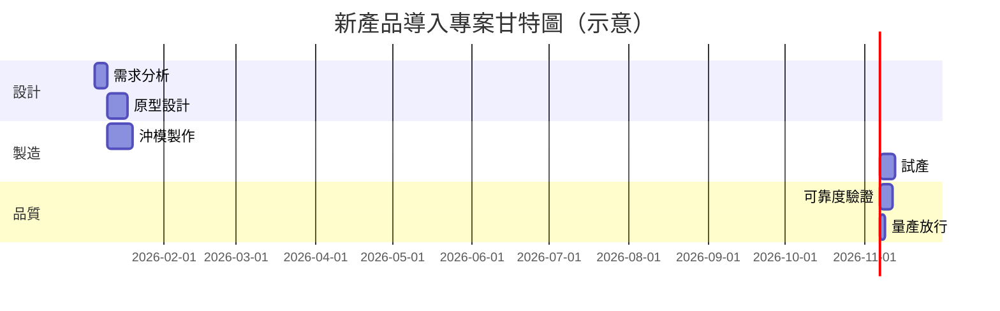

# 6.1 甘特圖（1917）

## 本章導言

專案管理是管理數學中最「圖論化」的一支：把一件工作拆成活動、把活動排成網路、在時間軸上找出瓶頸。這一切的起點是 **Henry Laurens Gantt（甘特，1861–1919）** 在 1917 年出版的《工作、工資與利潤》（*Work, Wages, and Profits*）中公開推廣的**甘特圖（Gantt chart）**——用橫條在時間軸上並列「計畫」與「實績」的圖表。甘特是 Taylor（見 1.1 節）的弟子與追隨者，但他對「科學管理」的關懷重心與老師不同：Taylor 管「單一工位的動作」，Gantt 管「整個工廠的流程」。本節將說明：一件跨部門、跨工序的管理工作，如何逼出「時間軸上的圖形語言」，以及這套語言如何演化成第 6 章後兩節的網路排程技術。

### 從秒錶到工廠大圖：管理問題的升級

Taylor 的時間研究（1.3 節）解決的是「一個工人做一個動作要幾秒」。但工廠主真正焦慮的是另一類問題：

1. **協調問題**：一件產品要經過鑄造、機械加工、組裝、檢驗等多道工序，任何一延誤，後面全停。
2. **視覺化問題**：報表上的數字無法讓人一眼看出「哪個部門在等哪個部門」。
3. **激勵問題**：Gantt 發明了著名的「任務與獎金制」（task-and-bonus system）——完成標準任務得基本工資，超額完成再得獎金；而「未完成」要讓管理人員也承擔責任。獎金制需要一個所有人公認的「進度基準」，這正是圖表的社會功能。

Gantt 的洞見是：**時間本身就是最稀缺、最不可儲存的資源**（與第 5 章可儲存的存貨恰成對比）。既然無法把多餘的時間「存起來下周用」，那就必須讓每一個人看見時間的使用狀況。於是他在 1910–1915 年間設計並在多個工廠試用一種「負荷與進度圖」（load and progress chart）：縱軸列出機台或工序，橫軸是日曆日，用橫條的長短表示預計工期、用符號或另一條對照橫條表示實際完成度。1917 年此圖隨著作公開，故史家常以 1917 年為甘特圖的誕生年。

### 圖的語法：任務、工期、時間軸

用現代語言，一張甘特圖就是一個四元組 $(V, \tau, s, f)$ ：

- $V$ ：任務集合 $\{v_1, v_2, \ldots, v_n\}$ ；
- $\tau(v_i)$ ：任務 $v_i$ 的工期（duration）；
- $s(v_i)$ ：任務 $v_i$ 的排定開始日；
- $f(v_i) = s(v_i) + \tau(v_i)$ ：完成日（在無中斷、單一資源的約定下）。

排程必須滿足**先後約束**（precedence constraint）：若任務 $j$ 依賴任務 $i$ ，則 $f(v_i) \le s(v_j)$ 。甘特圖的視覺價值在於：任何一條「橫條」若與依賴它的後繼任務出現空隙，就是可壓縮的等待；若多條橫條擠在同一資源列上，就是負荷超載。前者是第 6.2 節關鍵路徑的前身，後者是資源約束排程（resource-constrained scheduling）的主題。

### 例題 6.1.1

**例題 6.1.1**：某產品開發專案的活動表如下（單位：天），依賴關係為「後者須等前者全部完成」：

| 任務 | 工期 | 依賴 |
|------|------|------|
| A 需求分析 | 2 | — |
| B 原型設計 | 3 | A |
| C 材料採購 | 2 | A |
| D 沖模製作 | 1 | B、C |
| E 試產驗證 | 2 | D |

試畫出甘特圖排程（各任務儘早開始），並求專案總工期與各任務的最晚允許完成日（以不延後總工期為限）。

**解**：各任務的最早開始與完成（沿用 6.2 節記號 $ES, EF$ ）：

| 任務 | $ES$ | $EF=ES+\tau$ |
|------|------|---------------|
| A | 0 | 2 |
| B | 2 | 5 |
| C | 2 | 4 |
| D | $\max(5,4)=5$ | 6 |
| E | 6 | 8 |

總工期（makespan） $T = 8$ 天。倒推最晚完成日 $LF$ （總工期固定為 8）： $LF_E = 8$ ， $LF_D = 6$ ， $LF_B = LF_C = 5$ ， $LF_A = 2$ 。可見 C 完成於第 4 天、但只要求第 5 天前完成——C 有 1 天的**寬裕（float）**；B 則沒有任何寬裕。甘特圖上，C 的橫條右端留一個空格，正是「管理層應該盯住 B 而非 C」的視覺訊號。這個「寬裕」概念將在 6.2 節被精確化為總浮時（total float）與自由浮時（free float）。

### 甘特圖的兩次歷史大用

第一次是**第一次世界大戰**。1917 年美國參戰後，緊急生產委員會與各船廠大量採用甘特圖管理商船與軍艦的建造進度——數千項採購與工序必須對齊，圖表第一次成為跨廠商協調的公共語言。戰後，美國政府把甘特圖推廣為聯邦機構的標準管理工具，這使其知名度遠超 Taylor 的「工位圖表」。

第二次是**軟體與專案管理工業化**。1980 年代個人電腦上的專案軟體（如 Microsoft Project）把甘特圖內建為預設視圖，並自動計算關鍵路徑（6.2 節）；1990 年代後「甘特圖＋關鍵路徑」成為 PMBOK 等專案管理知識體系的標準配置。圖從「手繪的管理儀表板」升級為「排程演算法的輸出介面」——這正是本書反覆強調的模式：**實務問題逼出符號，符號計算成熟後回頭重組實務**。

### 前因後果與驅動關係

- **驅動**：泰勒制把工廠拆成工位後，跨工位協調成為新的瓶頸；一次大戰的緊急軍需生產把「進度可視化」從管理品味變成國防刚需。沒有 1.3 節的時間研究作為工期估計基礎，甘特圖只是沒有數字的空表。
- **回頭改變實務**：甘特圖確立了「以時間軸為公共記憶體」的管理文化，直接催生 6.2 節的 PERT／CPM（把圖升級為可計算的網路），並為 6.3 節的工期機率與緩衝設計提供「計畫基準線」。存貨章（第 5 章）管理可儲存的資源，本章管理不可儲存的時間——兩者合起來才是完整的營運管理。
- **兄弟書**：《會計的數學》第 7 章預算差異分析把「計畫 vs 實績」的比較延伸到成本；甘特圖是「計畫 vs 實績」在時間維度上的對偶物。

### 練習

1. 某装修工程活動表：A 隔間（3 天，無依賴）、B 水電（2 天，依賴 A）、C 天花（2 天，依賴 A）、D 地坪（1 天，依賴 B、C）。求總工期與各任務寬裕天數。
2. 若任務 C 的工期由 2 天延長為 4 天，總工期是否改變？試以甘特圖橫條的「空隙」解釋。
3. Gantt 的任務與獎金制中，若標準產量為每日 20 件、獎金為超額部分每件 5 元，工人日產 26 件當日工資與獎金共得多少？此制與 Taylor 差別工資制的差異何在？
4. 為什麼說甘特圖「看得到延期，看不到瓶頸」？請舉一個關鍵路徑非直觀的專案為例（提示：參考 6.2 節）。
5. 思考題：甘特圖假設工期確定、資源無限。若一台精密機床同時是三個任務的唯一資源，圖上會出現什麼矛盾？管理上有哪兩類化解策略（提示：一類見 6.2 節的時間分析，一類見 9.1 節的資源分配）？

### 年表速查

- 1903–1915：Gantt 逐步發展任務與獎金制及工廠進度圖表。
- 1910：Gantt 開始使用「負荷與進度圖」的早期形式。
- 1917：《工作、工資與利潤》出版，甘特圖公開推廣，成名之年。
- 1917–1918：美國一戰生產與船廠管理大量採用。
- 1919：Gantt 去世；其思想經 ASME 等管道持續傳播。
- 1957–1958：PERT／CPM 興起，甘特圖成為其輸出介面（見 6.2 節）。
- 1980s：電腦化專案軟體將甘特圖標準化。

### 名詞速查表

- **甘特圖**：以時間為橫軸、任務為縱軸、橫條表示工期與進度的圖形工具。
- **任務與獎金制**：完成標準得基本工資、超額得獎金、未完成連坐管理者的激勵制度。
- **先後約束**：後繼任務須在前驅任務完成後方可開始的排程限制。
- **總工期（makespan）**：全部任務完成時刻與開工時刻之差。
- **寬裕（float）**：任務在不延誤總工期前提下可延後的時間量。

（本節完）
