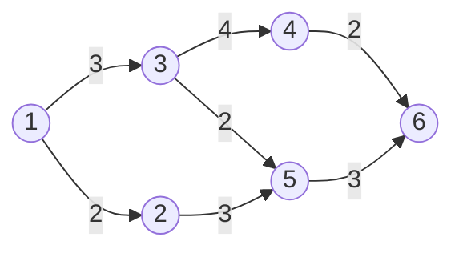

# 6.2 PERT 與 CPM：關鍵路徑（1957）

## 本章導言

甘特圖（6.1 節）讓進度「看得見」，卻回答不了一個更尖銳的問題：**整個專案最早何時完工？哪些任務一天都不能延？** 1957 年前後，兩條獨立的技術路線同時給出了答案：美國海軍特種計畫辦公室（Special Projects Office）為北極星飛彈潛艦計畫發展的 **PERT（Program Evaluation and Review Technique，計畫評核術）**，與 DuPont 公司內部為工廠維修停機問題發展的 **CPM（Critical Path Method，關鍵路徑法）**。兩者的核心數學相同——在**有向無環圖**上計算最長路徑——而出發點都是「冷戰軍備競賽與化工廠停機成本」這種等不起的實務壓力。本節將完整導出關鍵路徑的四時刻算法，並說明 PERT 與 CPM 在哲學上的關鍵差異：前者擁抱不確定性，後者專注確定性下的成本壓縮。

### 兩個 1957：北極星與杜邦

**PERT 的誕生**。1957–1958 年，美國海軍為縮短北極星（Polaris）飛彈系統的研發時程，委託 Booz Allen Hamilton 與 Lockheed 公司等發展新管理技術。PERT 的設計目標有二：（1）把數千家承包商的活動統一成一張網路；（2）允許工期為**隨機變數**，以機率語言回答「何時完工」（這個機率面向將在 6.3 節展開）。PERT 網路的節點代表事件（milestone）、邊代表活動，活動工期取三點估計的加權平均。

**CPM 的誕生**。幾乎同時，DuPont 的 James E. Kelly 與 Morgan R. Walker 在 IBM 協助下發展 CPM，第一個應用是化工廠停機大修：停機一天損失以十萬美元計，因此問題不是「預測完工日」而是「多付加班費換取提前完工是否划算」。CPM 假設工期**確定已知**，並引入「活動時間可壓縮、壓縮成本遞增」的**時間—成本權衡**（time–cost trade-off），這是與 PERT 最大的實務差異。

兩套方法在 1958 年被美國國防部納入承包商管理標準，隨後傳入企業界；今天兩者常被合稱為 CPM/PERT，成為專案管理知識體系（如 PMBOK）的核心。

### 數學結構：有向無環圖上的最長路徑

一個 CPM 網路是二元組 $(V, E)$ ，其中 $V$ 為事件節點、 $E \subset V\times V$ 為活動，並滿足：若 $(i,j) \in E$ 則 $i$ 可達 $j$ 且圖中無環（DAG）。每條活動 $(i,j)$ 配有工期 $t_{ij} > 0$ 。定義四個量：

- **最早開始** $ES(j) = \max_{(i,j)\in E} \big( ES(i) + t_{ij} \big)$ ，起點 $ES(1)=0$ （前向掃描，取 max）；
- **最早完成** $EF(j) = ES(j)$ （節點式記法中事件本身無工期；若用活動式記法， $EF = ES + t$ ）；
- **最晚完成** $LF(i) = \min_{(i,j)\in E} \big( LF(j) - t_{ij} \big)$ ，終點 $LF(n) = ES(n)$ （後向掃描，取 min）；
- **總浮時** $TF(i,j) = LF(j) - EF(i,j) = LF(j) - ES(i) - t_{ij}$ 。

關鍵性質：**關鍵路徑 = 圖上的最長路徑**，其長度 $T = ES(n)$ 即最短可能總工期（因為所有先後約束必須同時滿足，最長的約束鏈決定全局）。關鍵路徑上的活動 $TF = 0$ ，任何延誤直接延誤完工；浮時為正的活動則有緩衝。求最長路徑可在 DAG 上用動態規劃於 $O(|V|+|E|)$ 時間完成——這與《機率統計》隨機漫步章中的路徑計數、以及 9.1 節背包問題的 DP 表格同屬一族方法。

### 例題 6.2.1

**例題 6.2.1**：上圖網路的活動與工期為： $(1,3)=3$ 、 $(1,2)=2$ 、 $(2,5)=3$ 、 $(3,4)=4$ 、 $(3,5)=2$ 、 $(4,6)=2$ 、 $(5,6)=3$ 。求關鍵路徑、總工期與各活動總浮時。

**解**：前向掃描求 $ES$ ：

$$
ES(1)=0,\quad ES(2)=2,\quad ES(3)=3,\quad ES(4)=3+4=7,\quad ES(5)=\max(2+3,\,3+2)=5,
$$
$$
ES(6)=\max(7+2,\,5+3)=9.
$$

總工期 $T = 9$ 。三條 $1 \to 6$ 路徑及其長度：

| 路徑 | 長度 |
|------|------|
| $1\to3\to4\to6$ | $3+4+2 = 9$ |
| $1\to3\to5\to6$ | $3+2+3 = 8$ |
| $1\to2\to5\to6$ | $2+3+3 = 8$ |

最長路徑為 $1\to3\to4\to6$ ，即關鍵路徑。後向掃描求 $LF$ ： $LF(6)=9$ ， $LF(5)=6$ ， $LF(4)=7$ ， $LF(3)=\min(7-4,\,6-2)=3$ ， $LF(2)=6-3=3$ ， $LF(1)=\min(3-3,\,3-2)=0$ 。總浮時： $TF(1,3)=3-0-3=0$ （關鍵）、 $TF(3,4)=0$ （關鍵）、 $TF(4,6)=0$ （關鍵）； $TF(1,2)=3-0-2=1$ 、 $TF(2,5)=6-2-3=1$ 、 $TF(3,5)=6-3-2=1$ 、 $TF(5,6)=9-5-3=1$ （皆非關鍵）。管理結論：壓縮 $(1,2)$ 、 $(2,5)$ 一整天對總工期毫無幫助；要提前完工，只能在 $(1,3)$ 、 $(3,4)$ 、 $(4,6)$ 上想辦法——這正是「把錢花在瓶頸上」的排程版。

### 時間—成本權衡（CPM 的核心應用）

設活動 $e$ 的正常工期 $t_e$ 、正常成本 $c_e$ ；趕工工期 $\hat t_e < t_e$ 、趕工成本 $\hat c_e > c_e$ 。定義壓縮斜率

$$
k_e = \frac{\hat c_e - c_e}{t_e - \hat t_e} \quad\text{（每壓縮一單位時間的邊際成本）}.
$$

在總壓縮成本最小的目標下，貪心策略是：每次只壓縮**關鍵路徑上 $k_e$ 最小**的活動，重算關鍵路徑後重複——因為非關鍵活動的壓縮不改變完工日。注意壓縮可能使多條路徑同時變成關鍵，問題隨之非平凡；完整的時間—成本權衡可化為一個線性規劃（見 3.1 節），這是 CPM 與第 3 章 LP 的直接連接。

### PERT 與 CPM 的哲學差異

| 面向 | PERT（1957，海軍） | CPM（1957，杜邦） |
|------|---------------------|---------------------|
| 工期假設 | 隨機（三點估計） | 確定 |
| 主要目標 | 預測完工機率、管理風險 | 壓縮停機時間、控制成本 |
| 產出 | 完工日的機率分配 | 最優壓縮方案 |
| 相鄰技術 | 6.3 節 β 分配與緩衝 | 3.1 節線性規劃 |

歷史的諷刺是：兩者數學核心同為 DAG 最長路徑，差異全在「如何看待工期的不確定性」——這恰是管理數學中「描述性」與「規範性」兩種態度的縮影。

### 前因後果與驅動關係

- **驅動**：北極星專案要把 250 家承包商、數千項活動對齊到一個「發射日」；DuPont 的化工廠每多停機一天就損失鉅額利潤。兩者都無法容忍甘特圖「看得見進度、算不出完工日」的缺陷。二戰中運籌學（10.1 節）建立的「圖與路徑」語言，以及 1.3 節以來的工時標準化，是直接的技術前驅。
- **回頭改變實務**：PERT/CPM 讓「關鍵路徑」成為管理者的日常詞彙，催生了 6.3 節的機率化 PERT 三點估計、資源約束排程、以及後來的 MS Project 等軟體工業。軍方採用後，1960 年代起大型營建、造船、IT 系統導入全面標準化。
- **交叉引用**：時間—成本權衡是 LP 模型（3.1 節）；關鍵路徑的 DP 掃描與 9.1 節背包 DP、Pascal 遞迴（《機率統計》1.1 節）同源。風險面向見 6.3 節與第 8 章決策分析。

### 練習

1. 某專案活動表：A(2)起點→B、C；B(3)→D；C(1)→D；D(4)→終點。求 ES/EF、關鍵路徑與各活動浮時。
2. 活動 $(1,2)$ 正常工期 5 天成本 10 萬、趕工 3 天成本 16 萬。求壓縮斜率 $k$ ；若該活動在關鍵路徑上且另一關鍵活動斜率為 4 萬/天，應先壓縮哪一個？
3. 證明：若圖中所有工期為正，則關鍵路徑長度等於 $ES(n)$ ，且任一關鍵活動延誤 $\delta>0$ 將使總工期至少增加 $\delta$ 。
4. 若網路中存在兩條不相交的最長路徑，時間—成本壓縮會發生什麼情形？（提示：必須同時壓縮兩條。）
5. 思考題：PERT 用三點估計卻以「各活動期望工期」代入決定論網路求關鍵路徑——這會系統性高估或低估完工時間？為什麼？（提示：見 6.3 節。）

### 名詞速查表

- **PERT**：美國海軍 1957–58 年發展的計畫評核術，工期視為隨機變數。
- **CPM**：DuPont 同期發展的關鍵路徑法，工期確定且可壓縮。
- **關鍵路徑**：DAG 中決定總工期的最長路徑，其活動總浮時為零。
- **總浮時（total float）**：活動在不延誤總工期下可延後的最大時間。
- **時間—成本權衡**：以遞增的邊際成本換取工期壓縮的優化問題。

（本節完）
