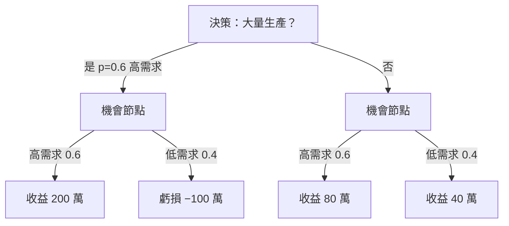

# 8.1 決策樹與期望值準則

## 本章導言

前面各章的數學都在回答「已知模型後怎麼算」；決策分析要回答更根本的問題：**在不確定下，理性的人該選哪一個行動？** 答案的雛形早在 1654 年 Pascal–Fermat 的通信中就已萌芽——期望值作為「公平價格」（《機率統計》1.1 節）；但把它系統化為管理工具，要到 20 世紀中葉。1930–50 年代，Frank Ramsey、Bruno de Finetti 與 John von Neumann 分別從主觀概率、 Dutch book 論證與賽局論逼近「理性決策」的公理；1950 年代美國蘭德公司（RAND Corporation）把決策樹發展為軍方與企業的標準分析圖。本節以**期望值準則（Expected Monetary Value, EMV）**為核心，展示決策樹如何把一個含機率、行動、結果的龐雜問題，組織成可逐步「修剪」的圖論計算——並指出它的邊界：對非線性效應與極端風險的失靈（8.2 節接棒）。

### 決策問題的三要素

一個決策問題 $(A, S, u)$ 由三者構成：

- **行動集合** $A = \{a_1, \ldots, a_m\}$ ：決策者可選擇的方案；
- **狀態集合** $S = \{s_1, \ldots, s_n\}$ ：不可控的未來情勢，附主觀或客觀概率 $p_j = P(s_j)$ ；
- ** payoff 函數** $u(a_i, s_j)$ ：行動 $i$ 在狀態 $j$ 下的結果（金錢、效用或任意價值尺度）。

**期望值準則**：選擇 $a^* = \arg\max_{a_i} \ \mathbb{E}[u(a_i, \cdot)] = \arg\max_{a_i} \sum_j p_j\, u(a_i, s_j)$ 。

決策樹把 $(A,S,u)$ 視覺化：**方形決策節點**分出行動分支、**圓形機會節點**分出狀態分支（各標概率），末端標 payoff。分析自右向左逆推（backward induction）：先對每個機會節點取機率加權平均，再在決策節點取最大，多餘分支「剪除」。這一「先算期望、再取極值、逐層剪枝」的結構，與動態規劃（9.1 節背包、《機率統計》Pascal 遞迴）完全同源——決策樹就是「隨機狀態下的 DP」。

### 完全情報的期望值（EVPI）

決策分析最漂亮的概念之一是**完全情報的期望值**（Expected Value of Perfect Information, EVPI）：假設有一個神諭能提前告知真實狀態，這份情報「至少值多少錢」。設

$$
\text{EV}_{\text{with PI}} = \sum_j p_j \max_{a_i} u(a_i, s_j), \qquad
\text{EVPI} = \text{EV}_{\text{with PI}} - \max_{a_i} \mathbb{E}[u(a_i,\cdot)].
$$

EVPI 給出了**市場調查、顧問報告、試點實驗的預算上限**：任何資訊服務的收費若超過 EVPI，理性上就不該購買。這個上限也可由對偶性導出：EVPI 恰等於 3.2 節對偶理論中「不確定性資源的影子價格」——管理數學各章的對偶思想在此匯流。

### 例題 8.1.1

**例題 8.1.1**：某公司考慮是否為新產品建立大量生產線。市場調查估計高需求機率 0.6、低需求 0.4。 payoff 表（單位：萬元）：

| 行動＼狀態 | 高需求（0.6） | 低需求（0.4） |
|-------------|----------------|----------------|
| 大量生產 | 200 | −100 |
| 小量生產 | 80 | 40 |

(1) 用 EMV 準則選擇行動；(2) 求 EVPI；(3) 若市場調查能完全確定需求（收費前），調查費上限多少？若調查有誤差——高需求時正確率 80%、低需求時正確率 70%——後驗期望收益會如何變化（先寫出 Bayes 更新式）？

**解**：

(1) $\mathbb{E}[\text{大量}] = 0.6 \times 200 + 0.4 \times (-100) = 120 - 40 = 80$ （萬元）。
$\mathbb{E}[\text{小量}] = 0.6 \times 80 + 0.4 \times 40 = 48 + 16 = 64$ （萬元）。
$80 > 64$ ，選**大量生產**。

(2) 完全情報下：高需求時選大量得 200，低需求時選小量得 40，
$$
\text{EV}_{\text{with PI}} = 0.6 \times 200 + 0.4 \times 40 = 120 + 16 = 136.
$$
$$
\text{EVPI} = 136 - 80 = 56 \text{（萬元）}.
$$

(3) 故完美市場調查的合理收費上限為 56 萬元。含誤差調查的更新用 Bayes 定理：設「調查說高」事件為 $T$ ，則

$$
P(\text{高}\mid T) = \frac{0.8 \times 0.6}{0.8\times0.6 + 0.3 \times 0.4} = \frac{0.48}{0.60} = 0.8,
$$
$$
P(\text{高}\mid \bar T) = \frac{0.2\times0.6}{0.2\times0.6 + 0.7\times0.4} = \frac{0.12}{0.40} = 0.3.
$$

調查「說高」時大量生產的後驗期望 $0.8\times200 - 0.2\times100 = 140$ ；「說低」時大量生產期望 $0.3\times200 - 0.7\times100 = -10$ ，改選小量得 $0.3\times80+0.7\times40 = 52$ 。總體期望（含兩種調查結果） $= 0.6\times140 + 0.4\times52 = 84 + 20.8 = 104.8$ 。**不完美情報的期望價值 $= 104.8 - 80 = 24.8$ 萬元**——不到完美情報（56 萬）的一半，精確量化了「調查品質」的價值。

### 期望值準則的邊界

EMV 在**重複決策**下表現優異（長期平均逼近期望值，見《機率統計》大數法則），但面對**一次性重大決策**會出現反直覺結果：一個 $0.5 \times$ 得 200 萬、 $0.5 \times$ 虧 100 萬的專案，EMV = +50 萬應接受——但一個耗盡公司全部現金、破產機率 40% 的專案，EMV 為正也可能不可接受。1738 年 Daniel Bernoulli 就以 St. Petersburg 悖論指出期望貨幣值的失靈，並提出改用**效用**的期望（8.2 節展開）。此外，EMV 還依賴概率本身的可靠性：對小概率事件（金融危機、斷電事故）的估計誤差，會主導整個決策樹的結果——《金融的數學》第 9 章將展示這一點在 2008 年危機中的代價。

### 前因後果與驅動關係

- **驅動**：二戰與冷戰的軍事決策（雷達部署、後勤路線、核武戰略）必須在情報不完整下選擇不可逆行動，蘭德公司的研究把「決策＝數學問題」的態度制度化；1950–60 年代石油與化工業的大型資本投資，把同一工具帶入企業規劃部門。
- **回頭改變實務**：決策樹成為新藥研發（臨床試驗的序貫決策）、油氣勘探、併購估值的標準工具；EVPI 概念使「情報」成為可定價的商品——直接催生 10.2 節 A/B 測試的「資訊價值」框架。
- **交叉引用**：期望值與 Bayes 定理見《機率統計》；期望效用公理見 8.2 節與《經濟的數學》第 2 章效用理論；EVPI 的對偶解釋見 3.2 節影子價格；序貫決策與資訊價值同《金融的數學》第 4 章選擇權（選擇權本質上就是「付權利金買情報價值」）。

### 練習

1. 承例題 8.1.1，若高需求機率降為 0.4，EMV 準則會選什麼？求此時的 EVPI。
2. 某勘探案：鑽井成本 20 萬，有油機率 0.3、有油時收入 100 萬。畫出決策樹並求 EMV；若「地震探勘」能完美探明有無油，費用 15 萬，是否值得？
3. 用逆推法證明：任何有限決策樹都可「修剪」為單一行動，且修剪順序（由末層往前）不影響結果。
4. EVPI 是否可能為零？舉一個 payoff 表的例子並解釋其管理意義。
5. 思考題：EMV 假設決策者對「100 萬」的價值與其財富水準無關。請舉一個小公司 vs 大公司的對比例子，說明同一 EMV 對兩者意味不同，並預告 8.2 節效用函數如何形式化這一差異。

### 名詞速查表

- **決策樹**：以決策節點與機會節點分層展開、逆推求解的圖形決策模型。
- **EMV 準則**：以期望貨幣收益最大化選擇行動。
- **EVPI**：完全情報的期望價值，資訊採購的預算上限。
- **Bayes 更新**：依調查結果修正狀態後驗概率。
- **逆推（backward induction）**：自末端向前逐層取期望與極值的求解順序。

（本節完）
