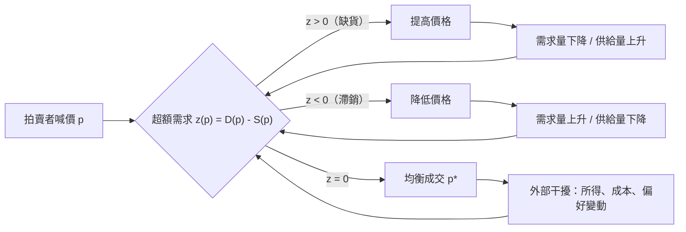

# 3.2 均衡的存在、唯一與穩定

## 本章導言

Marshall 的供需圖只用一眼就完成三件事：兩條曲線**有交點**、交點**只有一個**、交點**拉得回來**。這三件事在圖上近乎自明，在數學上卻都是需要證明（或反例）的命題。1954 年 Arrow 與 Debreu 的經典論文把「均衡存在性」提升為全書的核心定理；而 Sonnenschein、Mantel、Debreu 在 1970 年代證明的 **SMD 定理**更指出：只要偏好合理，**超額需求函數幾乎可以是任何樣子**——因此唯一性與穩定性無法從理性假設推出，必須另加條件。本節在一個市場的尺度上，把這三個問題徹底說清楚。

### 均衡的定義：超額需求為零

設單一市場的需求函數 $D(p)$ 與供給函數 $S(p)$ 在價格區間上連續，定義**超額需求（excess demand）**：

$$
z(p) = D(p) - S(p).
$$

**均衡**是使超額需求為零的價格：

$$
z(p^*) = 0 \qquad \Longleftrightarrow \qquad D(p^*) = S(p^*).
$$

注意：均衡是**約束**（條件），不是方法。要從「條件」變成「結論」，必須分別處理三道關卡。

### 第一關：存在性——中間值定理

**命題**：若 $D, S$ 在 $[p_{\min}, p_{\max}]$ 上連續，且 $z(p_{\min}) > 0$ 、 $z(p_{\max}) < 0$ ，則存在 $p^* \in (p_{\min}, p_{\max})$ 使 $z(p^*) = 0$ 。

**證明**： $z$ 連續且在區間兩端異號，由 Bolzano–中間值定理，必有零點。 $\blacksquare$

這就是全部——存在性的初等核心只是中間值定理。經濟學的真正困難在於：**高維情形**（ $n$ 個商品、 $n$ 個方程，且需同時滿足所有家庭與廠商的最適化）不能靠中間值定理，需要拓樸學的固定點工具。Arrow–Debreu 最終訴諸的是 **Brouwer 不動點定理**（經 Kakutani 推廣），這正是 5.2 節的主題。本節先記住這個對比：**一維用中間值，多維用不動點**。

### 第二關：唯一性——單調性

存在不保證唯一。標準的充分條件是：

**命題**：若 $z(p)$ 嚴格遞減（ $z'(p) < 0$ ），則均衡唯一。

**證明**：設 $p_1 < p_2$ 皆為均衡，則 $z(p_1) = z(p_2) = 0$ ，與嚴格遞減矛盾。 $\blacksquare$

$z'(p) < 0$ 的經濟拆解是：價格上升時，需求量不增（需求法則）、供給量不減（供給法則），故 $z' = D' - S' < 0$ 。但這只是**充分**條件。反例俯拾皆是：劣等品可能使 $D' > 0$ （Giffen，見 3.1 節）、勞動供給的後彎可能使 $S' < 0$ 、多重技術選擇可能使供給非單調——這些情形下可能有三個交點。當存在多個均衡時，「均衡分析」本身就有缺口，必須引入**選擇機制**（例如 7.1 節的 Cournot 路徑、9.3 節的拍賣設計）。

### 第三關：穩定性——調整過程

存在且唯一，仍不夠。還需問：**若價格偏離均衡，市場會自己走回來嗎？**答案取決於調整機制，而不是曲線本身。最古典的機制是 Walras 的**拍賣者試探（tâtonnement）**：一位虛擬拍賣者喊價，若超額需求為正就加價、為減就減價：

$$
\frac{dp}{dt} = k\, z(p), \qquad k > 0.
$$

下圖是這條回饋迴路的完整結構：

**線性穩定性分析**：設 $z$ 可微且 $z(p^*) = 0$ ，令 $p = p^* + \varepsilon$ ，線性化得

$$
\frac{d\varepsilon}{dt} = k\, z'(p^*)\,\varepsilon
\;\Longrightarrow\;
\varepsilon(t) = \varepsilon(0)\,e^{k z'(p^*) t}.
$$

收斂的充要條件是 $k\,z'(p^*) < 0$ 。因 $k>0$ ，故需

$$
\boxed{\,z'(p^*) < 0\,}
$$

——**恰好是唯一性所需的同一個條件**，這不是巧合：超額需求負斜率既排除多交點，也保證偏離會被壓回。離散調整 $p_{t+1} = p_t + k\,z(p_t)$ 的條件稍嚴： $|1 + k z'(p^*)| < 1$ ，即 $0 < k < \dfrac{2}{|z'(p^*)|}$ ——調整速度過快反而會震盪發散。

### 例題 3.2.1：三關全過的完整驗算

**例題 3.2.1**：設 $D(p) = 100 - 2p$ 、 $S(p) = -20 + 4p$ 。(1) 證均衡存在並求 $p^*$ ；(2) 證均衡唯一；(3) 以 $p_{t+1} = p_t + 0.1\,z(p_t)$ 、 $p_0 = 35$ 迭代三期，驗證收斂與收斂率；(4) 若調整速度改為 $k = 0.5$ ，判斷穩定性；(5) 若供給改為有落後的 $S_t = -20 + 0.5\,p_{t-1}$ （蛛網模型），判斷穩定性。

**解**：(1) $z(p) = D - S = (100-2p) - (-20+4p) = 120 - 6p$ 。 $z(0) = 120 > 0$ ， $z(30) = -60 < 0$ ，且 $z$ 為線性連續 $\Rightarrow$ 存在零點。解 $120 - 6p^* = 0$ 得

$$
p^* = 20, \qquad Q^* = D(20) = 100 - 40 = 60 = S(20) = -20+80 \;\checkmark
$$

(2) $z'(p) = -6 < 0$ 對所有 $p$ 成立 $\Rightarrow$ $z$ 嚴格遞減 $\Rightarrow$ 均衡唯一 ✓（由第二關的命題）。

(3) 令 $p_{t+1} = p_t + 0.1(120 - 6p_t) = p_t(1 - 0.6) + 12 = 0.4\,p_t + 12$ 。逐期計算：

| $t$ | $p_t$ | $p_t - 20$ |
|-----|-------|-----------|
| 0 | 35 | 15 |
| 1 | $0.4\times35+12 = 26$ | 6 |
| 2 | $0.4\times26+12 = 22.4$ | 2.4 |
| 3 | $0.4\times22.4+12 = 20.96$ | 0.96 |

偏差比值恆為 $6/15 = 2.4/6 = 0.96/2.4 = 0.4$ ，即 $|1 + k z'| = |1 + 0.1(-6)| = 0.4 < 1$ ，**幾何收斂**於 $p^* = 20$ ✓。每期偏差縮為 40%，再三期後偏差小於 1%。

(4) $k = 0.5$ ： $|1 + 0.5(-6)| = |-2| = 2 > 1$ ，**發散**——價格會以 2 倍速度離開均衡。穩定區間為 $0 < k < 2/6 = \frac13$ ，故 $k=0.5$ 已越界。**調整太快比太慢更危險**。

(5) 蛛網：市場出清 $D(p_t) = S_t \Rightarrow 100 - 2p_t = -20 + 0.5 p_{t-1}$ ，故

$$
p_t = 60 - 0.25\,p_{t-1}.
$$

迭代映射斜率 $|-0.25| < 1$ ，故**震盪收斂**（正負交替但幅度遞減）於 $p^* = 60/1.25 = 48$ 。驗算： $D(48) = 100-96 = 4$ 、 $S = -20 + 0.5\times48 = 4$ ✓。若供給較陡（例如 $S = -20 + 4p_{t-1}$ ，斜率絕對值 2），則迭代斜率為 $-2$ 、**震盪發散**——這正是農產品「價格循環」的經典成因（豬週期、玉米蛛網），也是 3.3 節彈性與動態討論的起點。

### 前因後果與驅動關係

**驅動**：三個問題各有實務來源。**存在性**來自 19 世紀末的疑問：供需「自然會找到價格」這句話，究竟是信仰還是定理？Walras 的拍賣者假設是為了讓調整過程有明確機制而虛構的角色，而要把「拍賣者喊價必然停在某處」變成定理，就必須動用固定點定理——**實務直覺（市場會出清）逼出了 20 世紀最抽象的拓樸工具**。**唯一性**來自公共政策：若同一組基本面有多個均衡，則「稅會讓價格從 A 走到 B」的論斷毫無意義，政策評估必須先知道均衡有幾個。**穩定性**來自最直接的經驗：19 世紀農產品價格的劇烈循環、經濟恐慌中的價格崩跌，都顯示市場未必溫和回歸。

**反向作用**：這三個問題的數學化反過來改變了經濟分析：(1) **固定點定理成為一般均衡的支柱**（5.2 節 Arrow–Debreu 1954 的證明架構）；(2) **SMD 定理（1970s）**從反面揭示——由理性假設出發，市場需求幾乎可以任意，因此**唯一性與穩定性是建模者的選擇，不是理論的推論**，這迫使實證與政策分析明示自己的假設；(3) **動態系統工具大量進場**——差分／微分方程的穩定性分析從此是標準裝備，一路延伸到 8.2 節 Solow 收斂、8.3 節商業循環與 10.2 節時間序列。

**對本書與兄弟書的指向**：
- 5.1 節：多市場版本的均衡與 Walras 定律；5.2 節：存在性的嚴格證明。
- 3.3 節：把本節的 $k$ 與 $z'$ 換成彈性，分析調整速度與超調。
- 7.1 節：Cournot 的反應函數交點，是本節唯一性與穩定性問題在雙寡頭的翻版。
- 8.3 節：蛛網與迭代映射的完整版（特徵根判別）。
- 《管理的數學》第 4 章排隊論的到達率＝服務率平衡、第 5 章存貨的訂購—耗盡迴路，都是同一類「回饋—穩定」結構的應用。

## 練習

1. 設 $D(p) = 200 - 3p$ 、 $S(p) = 20 + 2p$ ，求均衡 $p^*, Q^*$ ，並用 $z'(p)$ 與 $|1+kz'|$ 判斷 $k = 0.2$ 時的穩定性。
2. 承第 1 題，取 $p_0 = 60$ 、 $k = 0.2$ ，迭代三期（列出每期 $p_t$ 與偏差），計算偏差縮減率是否與理論值一致。
3. 設 $z(p) = -p^3 + 3p - 1$ 。計算 $z(0) = -1$ 、 $z(1) = 1$ 、 $z(2) = -3$ ，據此說明中間值定理保證區間 $(0,1)$ 與 $(1,2)$ 各有至少一個均衡；再用 $z'(p) = -3p^2 + 3$ 判斷這兩個均衡何者穩定、何者不穩定，並解釋經濟意義（供給曲線在何種斜率下會讓「穩定」失效）。
4. 蛛網模型 $p_t = 60 - 0.25 p_{t-1}$ 中，若 $p_0 = 56$ ，算出 $p_1, p_2, p_3$ ，驗證偏差以公比 $-0.25$ 遞減（正負交替），並求極限。
5. 思考題：SMD 定理說「由理性假設推不出唯一均衡」。若某產業確實存在多個可能的均衡（例如網路平台的兩種使用者規模），請舉一個真實例子，並說明政策制定者可以如何選擇或「協調」到其中一個（提示：思考政府標準、先行者、大眾預期各自扮演的角色，並連結 6.2 節 Nash 均衡的多重性）。

### 名詞速查表（本節出現的核心術語）

- **均衡**：使所有市場同時出清的價格向量；單市場即 $z(p^*)=0$ 。
- **超額需求**： $z(p) = D(p) - S(p)$ 。
- **存在性**：均衡點必存在；一維靠中間值定理，多維靠不動點定理。
- **唯一性**： $z(p)$ 嚴格遞減時均衡唯一（充分條件）。
- **穩定性**：偏離均衡後能否回歸；線性化條件 $k z'(p^*) < 0$ 。
- **tâtonnement（試探調整）**：Walras 拍賣者以超額需求訊號調整價格的虛擬過程。
- **蛛網模型**：供給對前期價格反應的離散動態，收斂條件為映射斜率絕對值小於 1。
- **SMD 定理**：理性偏好所能產生的超額需求幾乎任意，唯一性與穩定性須另加假設。

（本節完）
