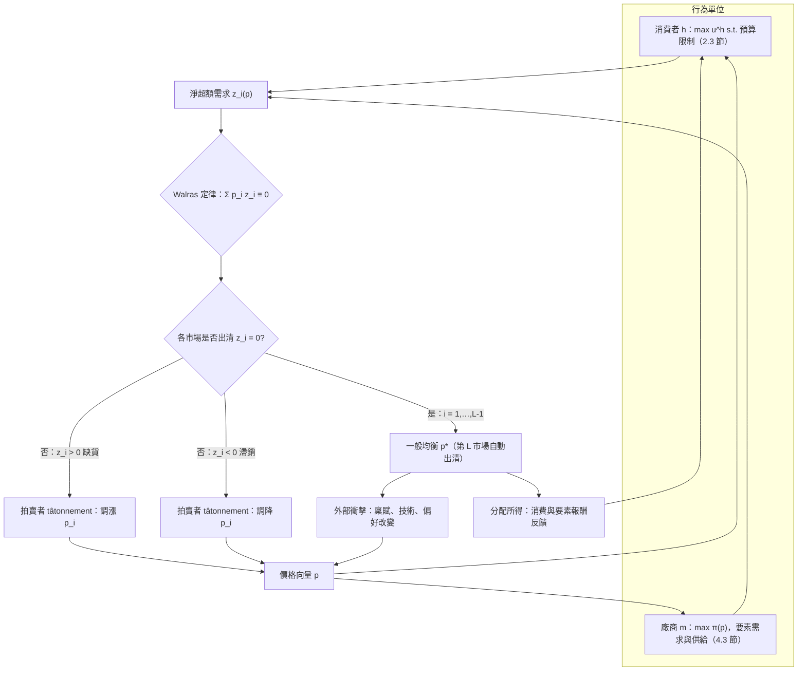

# 5.1 Walras 一般均衡（1874）

## 本章導言

Marshall 的局部均衡（3.1 節）刻意把其他市場當作不變；但現實中糧價動、麵包價就動，麵包價動、工資就動，工資動、糧價又動。1874 年，瑞士經濟學家 **Léon Walras（瓦爾拉斯，1834–1910）**在《純粹經濟學要義》第一部分提出了**一般均衡（general equilibrium）**的完整構想：把全經濟所有消費者、所有廠商、所有商品的行為寫成一個方程組，問**是否同時存在一組價格，使所有市場同時出清**。

Walras 的回答包含三個層次：**(1) 競爭市場如何調整到那組價格**——拍賣者試探（tâtonnement）；**(2) 方程個數是否與未知數匹配**——數目計數與 Walras 定律；**(3) 純粹理論與應用分析如何分工**。這套構想在 1874 年只是綱領，嚴格的存在性證明要等到 1954 年（5.2 節），而它的規範含意——福利經濟學兩定理——則在 5.3 節收成。本節重建這套構想的原始形態與關鍵機制。

### Walras 與他的時代

Walras 的學術道路坎坷：數學資優卻兩度考不進巴黎綜合理工學院，做過記者、銀行職員與家庭教師，靠其父（Auguste Walras，也是一位經濟學家）的經濟學教育與自修微積分，直到 1870 年代才取得洛桑學院（Académie de Lausanne）的政治經濟學教席。他的企圖極其明確——**把經濟學改造成像理論力學一樣的演繹科學**：從最少的公理（欲望極大化、技術約束、市場法則）出發，用方程推導出價格與數量的整體配置。《純粹經濟學要義》分部出版，第一部分 1874 年問世，此後反覆增補至 1900 年代。

這個「力學類比」不是修辭。Walras 把消費者想成在約束下最大化效用的質點、把價格想成使力平衡的變數、把調整過程想成趨向平衡的運動——**5.2 節的不動點定理正是這條「平衡必存在」直覺的嚴格化**，而 3.2 節的調整穩定性則是「運動會收斂」的檢驗。

### 模型的骨架

設經濟中有 $L$ 種商品、 $N$ 個消費者、 $M$ 家廠商：

**消費者** $h$ 持有初始稟賦 $\omega^h$ ，選擇消費 $x^h$ 以最大化效用：

$$
\max_{x^h} u^h(x^h) \quad \text{s.t.} \quad \sum_{i=1}^{L} p_i x_i^h = \sum_{i=1}^{L} p_i \omega_i^h + \pi^h(p),
$$

其中 $\pi^h(p)$ 為其分得的利潤（股利）。由 2.3 節得其需求 $x_i^h(p, \pi^h(p))$ 。

**廠商**使用投入產出生產，最大化利潤 $\pi(p)$ ，決定供給與要素需求（4.3 節的對偶結構）。

**市場**條件：每種商品的總需求等於總供給。定義淨超額需求：

$$
z_i(p) = \sum_{h=1}^{N} x_i^h(p) - \sum_{h=1}^{N}\omega_i^h - \sum_{m=1}^{M} y_i^m(p) .
$$

**一般均衡價格**是使所有商品同時出清的價格向量：

$$
z_i(p^*) = 0, \qquad i = 1,\dots,L .
$$

### 數目計數與 Walras 定律

Walras 的第一個技術貢獻是**數目計數**： $L$ 種商品有 $L$ 個價格，需 $L$ 個方程；但若所有 $p_i$ 同乘常數，需求與供給全不變（**零次齊次性**），故可正規化（例如令某一商品為計價物 $p_L = 1$ ），未知價格只剩 $L-1$ 個——**方程比未知數多一個，看似矛盾**。

Walras 定律解决了這個矛盾：

$$
\boxed{\;\sum_{i=1}^{L} p_i\, z_i(p) \equiv 0 \quad \text{對所有 } p > 0 \;}
$$

**證明**：每個消費者的支出恆等於其預算（2.3 節預算限制式），加總後全體的支出等於全體的收入；廠商的淨銷售等於其成本減要素支付，加總後相消。故「貨幣面」恆等式使淨支出恆為零。 $\blacksquare$

推論：**只要 $L-1$ 個市場出清，第 $L$ 個自動出清**（把 $\sum p_i z_i = 0$ 拆出最後一項即得）。於是「方程過多」的疑慮消失：獨立方程恰為 $L-1$ 個，與正規化後的未知數一致。

下面的圖把整個體系的訊號流動與回饋整理成一張流程圖：

### 與 Marshall 的分野

| 面向 | Walras（一般均衡） | Marshall（局部均衡） |
|------|-------------------|---------------------|
| 範圍 | 全體市場同時決定 | 單一市場，其他不變 |
| 價格 | 全部為內生變數 | 他市價格為外生 |
| 方法 | 方程組、固定點 | 兩線交點、圖形 |
| 時間 | 試探調整至全體出清 | 短期／長期的刀刃 |
| 適用 | 相互關聯強的市場（能源、匯率、總體） | 影響範圍小的商品 |

兩者不是競爭而是互補：3.1–3.3 節的局部工具仍是產業與政策分析的主力，而涉及**全體連動**的問題（某產業課稅的全面效果、貿易政策、總體衝擊）則必須升級到一般均衡。

### 例題 5.1.1：兩商品交換經濟的均衡與 Walras 定律

**例題 5.1.1**：經濟中有 A、B 兩人。A 的初始稟賦 $(8,2)$ 、B 的 $(2,10-2)=(2,8)$ ，效用皆為 $u = x_1 x_2$ ，商品 2 為計價物（ $p_2 = 1$ ，記 $p = p_1$ ）。(1) 對任意 $p$ 求兩人需求與市場淨超額需求；(2) 在 $p = 2$ 處計算 $z_1, z_2$ ，驗證 Walras 定律；(3) 求均衡價格與均衡配置，驗證兩市場同時出清。

**解**：(1) 對 $u = x_1x_2$ ，由 2.3 節份額公式：各商品支出占稟賦價值的一半。A 的稟賦價值 $m_A = 8p + 2$ ，B 的 $m_B = 2p + 8$ ，故

$$
x_1^A = \frac{8p+2}{2p},\quad x_2^A = \frac{8p+2}{2}, \qquad
x_1^B = \frac{2p+8}{2p},\quad x_2^B = \frac{2p+8}{2}.
$$

淨超額需求（總需求減總稟賦）：

$$
z_1(p) = \frac{8p+2}{2p} + \frac{2p+8}{2p} - 10 = \frac{10p+10}{2p} - 10 = \frac{5}{p} + 5 - 10 = \frac{5}{p} - 5,
$$

$$
z_2(p) = \frac{8p+2}{2} + \frac{2p+8}{2} - 10 = \frac{10p+10}{2} - 10 = 5p + 5 - 10 = 5p - 5 .
$$

(2) $p = 2$ 時： $z_1 = 5/2 - 5 = -2.5$ （商品 1 超額供給）、 $z_2 = 10 - 5 = 5$ （商品 2 超額需求）。**Walras 定律驗證**：

$$
\sum_i p_i z_i = 2(-2.5) + 1(5) = -5 + 5 = 0 \;\checkmark
$$

(3) 令 $z_1 = 0$ ： $5/p = 5 \Rightarrow p^* = 1$ 。此時 $z_2 = 5(1) - 5 = 0$ ✓（**第 2 個市場自動出清**，這正是 Walras 定律的威力——只需求解一個方程）。

均衡配置： $m_A = 8+2 = 10$ 、 $m_B = 2+8 = 10$ ，故 $x^A = (5,5)$ 、 $x^B = (5,5)$ 。驗證：商品 1 總需求 $5+5=10$ = 總稟賦 $8+2=10$ ✓；商品 2 總需求 $5+5=10$ = 總稟賦 $2+8=10$ ✓。兩人效用皆為 25，而 A 原本的效用為 $8\times2 = 16$ ——交換使雙方改善，兩人同時達到最適（此配置已在 5.3 節的契約曲線上）。

### 前因後果與驅動關係

**驅動**：一般均衡由三個問題逼出。其一，**Say 法則與經濟體系自我調節的爭論**——古典學派主張「供給自創需求」，但 19 世紀反覆的恐慌與失業顯示市場可能整體失衡；要嚴格討論「全體市場是否會同時出清」，就必須把全體寫成一個體系。其二，**連動性極強的產業政策**——鐵路運價、關稅、紙幣發行的效果都會波及全市場，局部均衡不夠用（這也是《會計的數學》第 2 章線性代數與會計中，投入產出表處理產業連動的同一動機）。其三，**經濟學的科學化企圖**——Walras 要與理論力學對標，就需要一套「全體變數同時決定」的數學，而非逐圖拼湊。

**反向作用**：一般均衡框架成熟後產生四項深遠影響：(1) **存在性成為嚴格命題**——「方程有解嗎」直接催生 5.2 節 Brouwer–Kakutani 不動點定理的應用，成為經濟學對數學的罕見反哺（不動點算法、一般均衡計算也隨之發展）；(2) **福利經濟學的公理化**——5.3 節的兩定理只能在一般均衡語境中陳述與證明；(3) **政策評估升級為系統模擬**——可計算一般均衡（CGE）模型用投入產出資料估參數後，模擬稅制、貿易與能源政策的全面效果（其數學骨架即本節的方程組，與《管理的數學》第 9 章網路與組合的系統分析相鄰）；(4) **總體經濟的微基礎**——8 章各模型皆可視為一般均衡的特例（只保留商品市場、或只保留跨期商品）。

**對本書與兄弟書的指向**：
- 3.2 節：tâtonnement 的單市場版；本節把它推廣到 $L$ 個市場。
- 5.2 節：本節只做了「數目計數」，**解的存在性**需不動點定理。
- 5.3 節：本節的均衡配置是否有「效率」？兩定理回答。
- 2.3 與 4.3 節：消費者與廠商的最適化是本節方程組的兩個來源。
- 8.1–8.3 節：總體模型是本節的跨期擴充（商品＝跨期消費）。
- 《會計的數學》第 2、3 章：投入產出與會計方程組是本節方程組的實務化身；《金融的數學》第 3 章的市場均衡價格體系（無套利條件）是金融版的 Walras 定律。

### 年表速查（本節涉及的關鍵年份）

- 1871：Walras 就任洛桑學院政治經濟學教席，開始建構體系。
- 1874：《純粹經濟學要義》第一部分出版，一般均衡構想公開。
- 1877–1880：第二、三部分陸續出版，生產與資本理論補齊。
- 1896：Pareto 接任洛桑教席，將體系改以序數效用重寫。
- 1932：Slutsky–Hicks 的需求分解使一般均衡的需求面更嚴謹。
- 1941：Lange 論一般均衡與競爭的資源配置。
- 1954：Arrow–Debreu《競爭經濟均衡的存在性》以不動點定理證明存在性。
- 1960s–1970s：Scarf 開發可計算一般均衡的數值演算法。
- 1969：Leontief 以投入產端方法獲諾貝爾獎，一般均衡的實務分支成熟。

### 名詞速查表（本節出現的核心術語）

- **一般均衡**：所有市場同時出清的整體價格向量與配置。
- **淨超額需求 $z_i(p)$ **：總需求減總供給（含稟賦與生產）。
- **Walras 定律**： $\sum_i p_i z_i(p) \equiv 0$ ，故僅 $L-1$ 個獨立方程。
- **零次齊次性**：所有價格同比例放大不改變實質需求與供給，價格可正規化。
- **tâtonnement**：拍賣者依超額需求訊號試探調整價格的虛擬過程。
- **計價物（numéraire）**：被正規化為 1 的商品，用以衡量其他價格。
- **交換經濟**：只有稟賦與消費、無生產的一般均衡模型。
- **契約曲線**： Edgeworth box 中無法再互利的配置連線（見 5.3 節）。

（本節完）
