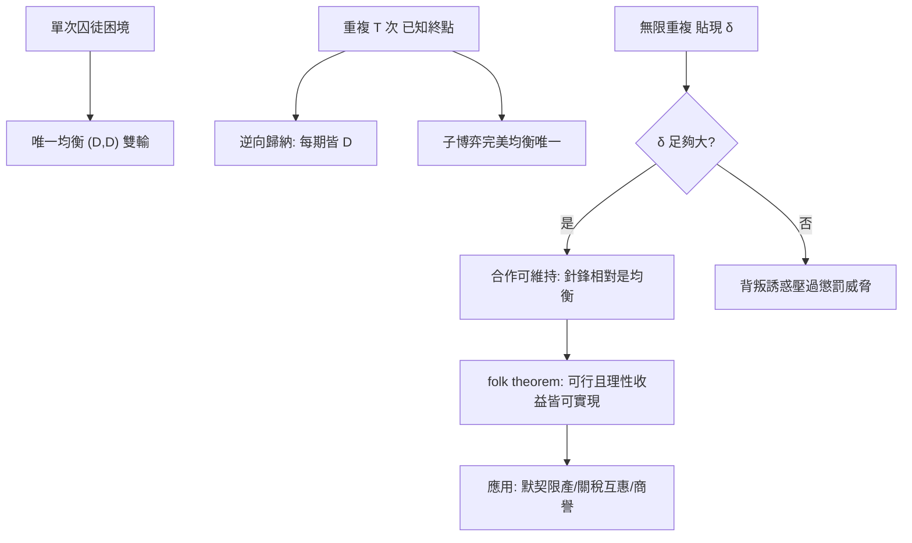

# 06.3 重複賽局與進化穩定策略

## 本章導言

囚徒困境（6.2 節）給出一個冷酷的結論：單次互動中，理性個體注定雙輸。但現實的交易與競爭不是一錘子買賣——廠商年復一年地定價，鄰居低頭不見抬頭見，物種的行為策略在世代間傳承。**當同一場賽局反覆上演，或當策略由「自然選擇」而非「大腦計算」決定時，合作會不會湧現？**本節沿兩條線回答：一是 1950–60 年代由 **Flood（弗勒德）與 Dresher（德雷希勒）1950 年在 RAND 公司做的實驗**、以及 **Luce與Raiffa（1957）** 所整理的重複賽局理論，最終凝成 **folk theorem（通俗定理）**；二是生物學家 **John Maynard Smith（梅納德．史密斯，1920–2004）** 與 **George Price（普萊斯，1932–1975）** 於 1973–1974 年提出的**進化穩定策略**（evolutionarily stable strategy, ESS），把「均衡」從「理性計算的產物」改造成「演化篩選的結果」。

### 條線一：重複賽局——耐心如何創造合作

設囚徒困境單次收益如 6.2 節： $(C,C)=(-1,-1)$ 、 $(D,D)=(-6,-6)$ 、單方背叛得 0、單方受騙得 $-9$ 。單次賽局的唯一均衡是 $(D,D)$ 。把這場賽局重複 $T$ 次（有限）或無限期（無限）。

**有限 $T$ 次的逆向歸納**：第 $T$ 次等同單次賽局，故必為 $(D,D)$ ；既然第 $T$ 次無論如何都是 $D$ ，第 $T-1$ 次的「名譽」不值一文，也是 $D$ ；一路倒推，**唯一子博弈完美均衡是每期都 $D$ **。合作在有限且已知長度的重複下不可能——這個反直覺結論是 Selten（1965）「連鎖商店悖論」的核心。

**無限重複（或未知終點）的情形完全不同**。設每期貼現因子為 $\delta \in (0,1)$ （可解釋為利率： $\delta = 1/(1+r)$ ，見《金融的數學》第 1 章）。考慮**針鋒相對策略**（tit-for-tat）：第 1 期合作，之後照抄對手上一期的行動。Axelrod（1984）的電腦競賽顯示：在多種策略混戰的環境中，簡單的針鋒相對長期表現極佳——它兼具「善良」（從不先背叛）、「可激怒」（被抓到就報復）與「可寬恕」（對方回頭就跟著回頭）。

**無條件合作何以成為均衡**：若雙方都打算「只要對方合作就合作、一被抓到就永遠懲罰」，則每期合作的貼現總收益為

$$
\frac{-1}{1-\delta} \;\ge\; 0 + \delta \cdot \frac{-6}{1-\delta}
\;\Longleftrightarrow\; -1 \ge -\delta \cdot 6
\;\Longleftrightarrow\; \delta \ge \frac{1}{6}.
$$

也就是說：**只要足夠有耐心（ $\delta \ge 1/6$ ），合作的長期誘惑就大過短期背叛的甜頭**。一般地，folk theorem 斷言：在無限重複賽局中，只要貼現足夠接近 1，**任何可行且個人理性（不高於單次納許收益）的收益向量**都可以被某個均衡實現——「可行集」由收益矩陣的凸包決定（6.1 節混合策略的幾何再度登場），「個人理性」由單次 Nash 均衡的收益封底。重複把均衡集合從「一個點」擴張成「一整片多邊形」，這既是它的解釋力（合作、默契限產、關稅互惠皆可維持），也是它的麻煩（**均衡太多**，又回到 6.2 節的均衡選擇難題）。

### 條線二：進化穩定策略——沒有大腦的均衡

另一條路徑完全放棄「理性計算」。1973 年，英國生物學家 Maynard Smith 與 Price 在研究動物打鬥行為時提出：假設動物**不思考**，只按基因給定的策略行事，策略若在族群中佔多數，任何稀少的「變異策略」都無法入侵——這樣的策略稱為 **ESS**。形式定義：策略 $s$ 是 ESS，若對任意變異策略 $s' \ne s$ ，滿足下列二者之一：

$$
u(s,s) > u(s',s),
\qquad\text{或}\qquad
u(s,s) = u(s',s) \ \text{且} \ u(s,s') > u(s',s').
$$

第一個條件：變異者在純種族群中吃虧（不可入侵）；第二個條件：即使短期打平，變異者互撞時較吃虧。ESS 與 Nash 均衡的關係是：**每個 ESS 都是對稱賽局的 Nash 均衡，但反之不成立**——ESS 是「抗演化」的精煉均衡（refinement）。

### 鷹鴿賽局：ESS 的經典計算

動物爭奪資源（價值 $V$ ），選「鷹」（ $H$ ：打到贏為止）或「鴿」（ $D$ ：虛張聲勢、被打就退）。打鬥中鷹的代價為 $C$ （受傷）。收益：

| \  | $H$ | $D$ |
|----|-----|-----|
| $H$ | $\frac{V-C}{2}$ | $V$ |
| $D$ | $0$ | $\frac{V}{2}$ |

設族群中鷹的比例為 $p$ 。兩策略的期望收益：

$$
\pi_H = p\cdot\frac{V-C}{2} + (1-p)V,
\qquad
\pi_D = p\cdot 0 + (1-p)\cdot\frac{V}{2}.
$$

令 $\pi_H = \pi_D$ ：

$$
p\frac{V-C}{2} + V - pV = \frac{V}{2} - \frac{pV}{2}
\;\Longrightarrow\; V - \frac{p(V+C)}{2} = \frac{V}{2} - \frac{pV}{2}
\;\Longrightarrow\; p^* = \frac{V}{C}.
$$

當 $0 < V < C$ （打鬥代價大於獎品）， $p^* \in (0,1)$ ：**混合 ESS 存在，純種的「全鷹」或「全鴿」都不是穩定的**——全鴿會被潛在的鷹佔便宜，全鷹又因自相殘殺而讓鴿型白吃白喝。自然界中同一物種內常見「儀式化打鬥」（恫嚇而不真打），正是 $p^* = V/C$ 的實證身影：獎品越貴、代價越低，真打的比例越高。

### 從生物到經濟：ESS 的經濟學應用

Maynard Smith 本人強調 ESS 是生物學工具，但經濟學家很快把「演化動態」接到市場上：新廠商嘗試新策略（差別定價、平台補貼）、被市場淘汰，留下的形態近似 ESS（參見《管理的數學》第 5 章存貨與第 10 章數位管理中的「策略試錯」案例）；重複交易中的「商譽機制」則是針鋒相對的商業版（9.3 節機制設計提供制度面的對照）。兩條線的共同教訓：**均衡不必來自全知計算，也可以來自「偏差被系統性清除」**。

### 一個具體例題

**例題 06.3.1**：設鷹鴿賽局中 $V = 100$ 、 $C = 250$ （打鬥代價遠大於獎品）。

(a) 求混合 ESS 中鷹的比例 $p^*$ 與兩策略的均衡收益。  
(b) 若因環境變化 $V$ 升為 $160$ ，新的 $p^*$ 為何？這對「儀式化打鬥」的盛行意味著什麼？  
(c) 在無限重複的版本中，兩「個體」以 $\delta = 0.9$ 貼現，驗證「永遠鴿」策略能否抵抗「永遠鷹」的單期偏離（以 $V$ 為共同合作收益、被入侵損失類比）。

**解**：

(a) 由 $p^* = V/C = 100/250 = 0.4$ 。均衡收益（代入 $\pi_D$ ）： $\pi_D = (1-0.4)\times 50 = 30$ ，故 $\pi_H = \pi_D = 30$ 。驗算 $\pi_H = 0.4 \times \frac{100-250}{2} + 0.6 \times 100 = 0.4 \times (-75) + 60 = -30 + 60 = 30$ ✓。族群中 40% 真打、60% 虛張聲勢，平均每隻動物期望收益 30。

(b) $p^* = 160/250 = 0.64$ 。獎品變貴，真打比例從 0.4 升到 0.64——**儀式化打鬥的盛行程度下降**，打鬥「升級」為實質衝突。反向推論：若觀察到某物種長期維持低強度儀式化打鬥，可反推其 $V/C$ 很小（獎品平凡或代價極高）。

(c) 「永遠鴿」雙方每期得 $V/2 = 50$ ，貼現總收益 $50/(1-0.9) = 500$ 。單期偏離為「扮鷹」得 $V = 100$ ，但之後對方轉為「永遠鷹」（無限報復），自己每期只能得 $\frac{V-C}{2} = -75$ ，貼現總收益 $100 + 0.9 \times (-75)/(1-0.9) = 100 - 675 = -575 \ll 500$ 。故「永遠鴿」在 $\delta = 0.9$ 下是均衡的一部分（懲罰威脅足以遏止偏離）；注意此處的「合作」收益 $V/2$ 高於單次混合 ESS 的 30——**重複把總剩餘從演化均衡的 30 抬到 50**。

### 名詞速查表

- **重複賽局**：同一收益結構多期上演，參與者可觀察歷史並據以調整。
- **子博弈完美均衡**：在每個歷史節點上都構成均衡的策略組合（逆向歸納的推廣）。
- **針鋒相對**：先合作、之後照抄對手上一期行動的簡單策略（Axelrod 競賽冠軍原型）。
- **folk theorem**：無限重複下，貼現足夠大時所有可行且個人理性的收益皆可由某均衡實現。
- **ESS（進化穩定策略）**：不可被稀少變異策略入侵的對稱策略；Nash 均衡的抗演化精煉。
- **混合 ESS**：以正機率使用兩種以上策略的穩定狀態（如鷹鴿賽局的 $p^* = V/C$ ）。
- **貼現因子 $\delta$ **：未來一期收益的當期價值； $\delta$ 大代表有耐心（與《金融的數學》第 1 章利率折扣同義）。

### 前因後果與驅動關係

**什麼問題驅動了它**：其一，囚徒困境與「合作何以可能」——單次均衡（6.2 節）無法解釋市場中大量存在的互惠、商譽與默契（現實中廠商很少把價格戰打到底）；RAND 公司 1950 年的 Flood–Dresher 實驗中，受試者在重複囚徒困境裡實際發展出合作與報復的節奏，理論卻還沒準備好。其二，生物學的挑戰：動物行為顯示出「均衡形態」卻沒有理性計算，迫使理論家思考「均衡」是否可以完全不依賴全知假設——這條線最終回頭滋養了演化經濟學與行為賽局論（第 9 章）。

**數學工具如何反過來改變實務**：folk theorem 把「耐心 $\delta$ 」變為可量化的政策槓桿——關稅互惠、卡特爾限產、平台與商戶的長期合約，設計重點都是**提高背叛的長期代價**（提高貼現、留下可觀察的歷史紀錄）；Axelrod 競賽把「什麼策略在生態中活得久」變成可電腦實驗的問題，是計算實驗方法的先聲（10.3 節的模擬方法）；ESS 則為標準化組織、產業慣例與制度演化提供了語言——產業標準戰（如格式之爭）常見的「路徑依賴鎖定」就是多重 ESS 之間的選擇問題。**對政策的警告**也在此：提高貼現（如更透明的交易紀錄）能促進合作，但也能讓「默契共謀」更穩固——反托拉斯法與 9.3 節的機制設計必須與之作對抗設計。

### 年表速查（本節涉及的關鍵年份）

- 1921：Shackle 等人對「重複互動中的預期」之早期討論（思想前身）。
- 1950：Flood 與 Dresher 在 RAND 進行重複囚徒困境實驗。
- 1957：Luce 與 Raiffa《賽局與決策》系統整理重複賽局與實驗結果。
- 1965：Selten 提出子博弈完美均衡，導出有限重複囚徒困境的合作不可能。
- 1973：Maynard Smith 與 Price 提出 ESS 概念。
- 1976：Maynard Smith《賽局論與動物行為》系統化。
- 1979–1982：Friedman、Fudenberg–Maskin 等證明 folk theorem 的各種版本。
- 1984：Axelrod《合作的演化》出版，針鋒相對廣為人知。

### 歷史啟示

- **實驗先於理論**：RAND 的實驗室裡合作早已長出來，folk theorem 只是把它「合法化」——經驗與理論的時間差提醒我們，理論常是事後追認。
- **「耐心」是一種資源**：貼現因子 $\delta$ 把道德問題（合作）化約為數量問題（時間偏好與利率），這是數學化最典型的魅力，也是最典型的危險——它同時把「寬恕」與「報復」變成可計價的東西。
- **均衡概念可以沒有理性**：ESS 說明「穩定性」不必來自計算，只需來自「偏差被清除」——這個思想後來滲透到演化博弈、機器學習的對抗訓練與市場微觀結構。

## 練習

1. 設重複囚徒困境單次收益： $(C,C)=(2,2)$ 、 $(D,D)=(0,0)$ 、背叛誘惑 $T=3$ 、受騙代價 $S=-1$ 。求「只要對方合作就合作、否則永遠背叛」成為均衡所需的最小貼現因子 $\delta^*$ （用無偏離條件 $2/(1-\delta) \ge 3 + \delta \cdot 0/(1-\delta)$ 並考慮最惡劣懲罰路徑）。
2. 鷹鴿賽局： $V = 80$ 、 $C = 200$ 。求 $p^*$ 與均衡收益；再求「全鷹」策略的收益，並說明它為何不是 ESS。
3. 在例題 06.3.1(c) 中，若 $\delta$ 降為 $0.5$ ，驗證「永遠鴿」不再能遏止偏離，並求此時「永遠鷹 vs 永遠鷹」的貼現收益，比較兩種純策略均衡。
4. 證明：若 $u(s,s) > u(s',s)$ ，則 $s$ 對 $s'$ 不可入侵；並舉一個「 $u(s,s)=u(s',s)$ 但 $s$ 仍為 ESS」的數值例子（用第二個不等式）。
5. 思考題：folk theorem 說「合作可以維持」，卻沒說「會不會維持」。試討論：在寡占市場中（7.1 節 Cournot 模型），什麼制度設計（公開價格、定期議價、第三方稽核）最能把均衡從「價格戰」推向「默契合作」？此處的效率含意與 5.3 節福利定理有何張力？

（本節完）
