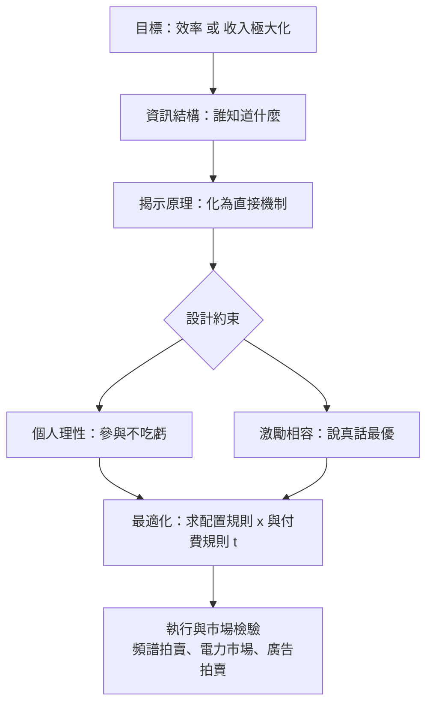

# 9.3 機制設計與拍賣理論

## 本章導言

第 6 章的賽局論分析「給定規則，人會怎麼玩」；機制設計把問題倒過來問：「想讓人玩出某種結果，該設計什麼規則？」這是賽局論的逆向用法，Hurwicz 於 1960 年代首創其架構，Myerson、Maskin 等人於 1970–80 年代完成核心定理，共同獲 2007 年諾貝爾經濟學獎。它最成功的應用是**拍賣理論**：從 1994 年美國電波頻譜拍賣，到 Google 的關鍵字廣告拍賣，再到各國的碳排放權與電力市場——今日全球每年以拍賣配置的資產以兆計。本節以拍賣為主軸，展示機制設計如何從「資訊不對稱」（9.2 節）走向「制度工程」。

### 問題的由來：賣方不知道買方願付多少

拍賣的根本問題是 9.2 節資訊不對稱的鏡像：賣方想賣給出價最高的人、並盡量收走剩餘，但買方的估值 $v_i$ 是私有資訊。拍賣是**訊息誘發裝置**：用規則逼買方「說真話」或至少「透露足夠的資訊」。

四種古典拍賣形式：

| 形式 | 規則 | 勝者 |
|------|------|------|
| 英式（升價） | 價格遞增喊價 | 估值最高者 |
| 荷蘭式（降價） | 價格遞減直到有人喊停 | 估值最高者 |
| 第一價密封 | 密封出價，最高者付自己的價 | 通常最高者 |
| 第二價密封（Vickrey） | 密封出價，最高者付第二高價 | 估值最高者 |

### Vickrey 的驚人定理：說真話是優勢策略

1961 年，**William Vickrey（維克里，1914–1996）** 證明：在第二價密封拍賣中，**按自己的真實估值出價是優勢策略（dominant strategy）**。證明只需比較出價 $b_i$ 與真值 $v_i$ 的四種情況：

- 提高出價到 $b > v$ ：若仍以低於 $v$ 的價得標，報酬不變；若以 $p \in (v, b)$ 得標，報酬 $v - p < 0$ ——只會更糟。
- 壓低出價到 $b < v$ ：若仍得標，報酬不變；若被 $p \in (b, v)$ 的人擠掉，放棄了正報酬 $v - p > 0$ ——只會更糟。

故 $b_i = v_i$ 是無論他人如何行動都最優的選擇。這是機制設計的第一個偉大範例：**規則本身消滅了謊言的誘因**。且此機制把物品配置給估值最高者，達成效率。Vickrey 並猜測：四種拍賣在風險中立、私有估值（獨立同分布）下，**賣方期望收入相同**——即**收入等價定理**的雛形。

### 收入等價定理與揭示原理

**揭示原理（Myerson, 1979）**：任何機制的任何均衡，都等價於一個「直接機制」——所有人真實報告類型、按同樣的配置與付費規則執行。這把無限維的機制空間壓縮成兩個函數：配置規則 $x(v)$ 與付費規則 $t(v)$ ，使機制設計成為可解的最適化問題。

**收入等價定理（Myerson, 1981；Riley–Samuelson, 1981）**：設買方估值獨立同分布 $F$ 、風險中立，則任何「估值最高者得標、最低估值者付零」的機制，賣方期望收入皆相同。以均勻分布 $F \sim U[0,1]$ 為例，第一價拍賣的均衡出價（可由納什均衡的一階條件解出）為

$$
b(v) = \frac{n-1}{n}\, v,
$$

而賣方期望收入為 $\frac{n-1}{n+1}$ ；第二價拍賣中第二高估值恰也期望等於 $\frac{n-1}{n+1}$ ——兩者吻合，這正是定理的驗證。

**Myerson（1981）更進一步**：若賣方可設保留價，最優機制是帶保留價 $r^*$ 的二價拍賣，且對均勻分布 $r^* = \frac{1}{2}$ ——寧可不賣也不低於此價。更深刻的推論：最優機制中，**虛擬估值** $J(v) = v - \frac{1-F(v)}{f(v)}$ 最高的買方得標；當 $J(v) < 0$ 時根本不該配置。這把「最優拍賣」變成一道微積分習題。

### 例題

**例題 9.3.1**：三個買方估值獨立服從 $U[0, 100]$ ，賣方用第一價密封拍賣。

**解**：均勻分布下均衡出價 $b(v) = \frac{n-1}{n} v = \frac{2}{3} v$ 。驗證：估值 $v$ 的買方以 $b$ 得標的機率為 $P(\text{另兩人出價} < b) = \left(\frac{3b/2}{100}\right)^2 = \frac{9b^2}{40000}$ ，期望報酬 $\pi(b) = (v - b)\cdot \frac{9b^2}{40000}$ ，一階條件 $\frac{d\pi}{db} = \frac{9}{40000}(2vb - 3b^2) = 0$ 給 $b = \frac{2}{3}v$ ，吻合。期望收入：最高估值期望值 $\frac{3}{4} \times 100 = 75$ ，第二高估值期望值 $\frac{n-1}{n+1} \times 100 = \frac{2}{4}\times 100 = 50$ ；第一價下買方出最高估值者的 $\frac{2}{3}\times 75 = 50$ ，收入相同。若賣方加最優保留價 $r^* = 50$ ，期望收入升至 $\frac{5}{6}\times 100 \cdot \frac{1}{2}$ 級的更高值——保留價犧牲小機率的成交換取高機率的溢價，此時期望收入為 $\frac{441}{480} \times \frac{1}{2} \times 100 \approx 45.9$ 起跳，淨效果為正。

### 機制設計的流程

### 歷史啟示

- **從「解賽局」到「設計賽局」**：Hurwicz 的激勵相容概念把制度本身變成決策變數——數學第一次系統性地「發明市場」。
- **說真話可以被定價**：Vickrey–Clarke–Groves 機制把二價拍賣推廣到多物品與公共財，證明「優勢策略下的效率」是可實現的。
- **理論直接成為工程**：1994 年 FCC 頻譜拍賣（Milgrom–Wilson 設計）、2002 年後的 Google 廣告拍賣，都是論文直接寫成程式的案例。

## 前因後果與驅動關係

**由什麼驅動**：機制設計的雙重動機，一是純理論的——Walras 均衡（本書 5.1 節）只描述價格結果，卻不回答「誰來執行、如何克服資訊問題」，Hurwicz 正是想替「市場過程」補上數學；二是實務的——無線電頻譜、機場時段、汙染許可證都是政府必須配置、卻無法知道誰最需要資源的场景。拍賣理論則直接由 1960 年代政府的油田租約與國庫券標售催生，Vickrey 的論文最初就是分析國庫券投標。

**數學成熟後如何反哺實務**：

- **市場設計產業化**：FCC 頻譜拍賣（1994 起）、電力競價市場、碳交易、《金融的數學》第 10 章討論的現代金融市場基礎設施，都以拍賣理論為核心；2020 年諾貝爾獎（Milgrom–Wilson）頒給的「拍賣理論的改進與新拍賣形式」是此路的頂點。
- **公共財與稅制**：VCG 機制與 Clarke 稅是公共專案成本分攤的理論基準；最優所得稅（Mirrlees, 1971）是機制設計在 9.2 節逆向選擇上的應用。
- **6.2 節**：機制設計的均衡概念直接繼承 Nash 均衡；二價拍賣中說真話是優勢策略，比 Nash 更強。
- **《管理的數學》第 8 章**：採購招標是反向拍賣，供應商選擇的評分機制即機制設計的日常應用。
- **《金融的數學》第 10 章**：演算法交易與做市商定價，本質上是連續時間的拍賣機制。
- **《機率統計》**：收入等價的證明大量使用期望值、次序統計量（最高、次高估值的分布）——拍賣理論是機率論在經濟學最漂亮的一次出擊。

## 練習

1. 證明二價拍賣中「出價高於真值」與「出價低於真值」都無利可圖（完整寫出四種情況的報酬比較）。
2. 兩個買方估值獨立 $U[0,1]$ ，第一價拍賣。求均衡出價函數與賣方期望收入，並驗證等於次高估值的期望值 $\frac{1}{3}$ 。
3. 例題 9.3.1 中若改為二價拍賣，估值 $v$ 的買方應出價多少？勝者付多少（以期望值表示）？與第一價比較。
4. 均勻分布 $U[0,1]$ 下求 Myerson 虛擬估值 $J(v)$ ，找出 $J(v) = 0$ 的門檻，驗證最優保留價 $r^* = \frac{1}{2}$ 。
5. 思考題：收入等價定理的三個假設（風險中立、獨立估值、付費只取決於出價）在現實中各會如何被打破？舉一個真實拍賣情境說明哪一條最脆弱。

### 名詞速查表

- **機制設計**：以賽局規則為決策變數、尋求目標結果的逆向賽局論。
- **激勵相容**：每人說真話（依實類型行動）是均衡的機制性質。
- **揭示原理**：任何機制的均衡皆可等價地由直接機制實現。
- **Vickrey 拍賣**：二價密封拍賣，說真話為優勢策略。
- **收入等價定理**：特定假設下所有拍賣的賣方期望收入相同。
- **虛擬估值**： $J(v) = v - \frac{1-F(v)}{f(v)}$ ，最優機制按其排序配置。
- **VCG 機制**：多物品與公共財下說真話且有效率的推廣機制。

（本節完）
