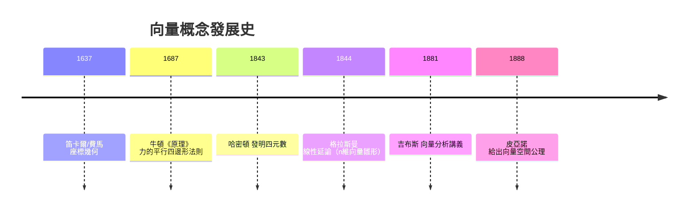
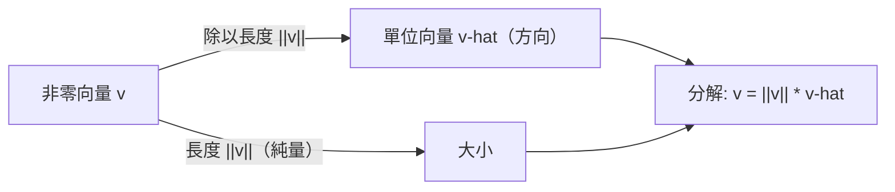

# 1.1 向量與幾何的相遇

## 前言：當數遇上方向

在人類文明的早期，「數」與「形」是兩條平行發展的線：算術與代數處理數量的運算，幾何處理空間中圖形的性質。古希臘人甚至認為幾何才是數學的本體，歐幾里得（Euclid，約西元前 300 年）的《幾何原本》以公理化的方式建立了整個幾何體系，而數只是線段的長度。要等到一千九百多年後，「把幾何用數來計算」這個革命性的想法才真正落地，而它的核心工具，就是我們今天所稱的**向量（vector）**。

向量這個概念的誕生，是線性代數故事的起點。本章我們將從歷史脈絡出發，認識向量的代數定義與幾何意義，學會向量的基本運算，並理解為什麼「向量」會成為連接代數與幾何的橋梁。

## 歷史前因後果

### 笛卡爾與費馬：座標的發明

1637 年，法國哲學家兼數學家**笛卡爾**（René Descartes, 1596–1650）在《方法論》的附錄《幾何學》（La Géométrie）中，以及在同一時期**費馬**（Pierre de Fermat, 1607–1665）的未刊手稿中，各自獨立提出了**座標幾何**的想法：平面上每一個點都可以用一對有序的數 $(x, y)$ 來標記，而每一條直線、圓、曲線都對應一個代數方程式。

這是一個劃時代的轉變：

- **解決了什麼問題**：古希臘幾何只能靠尺規作圖與邏輯論證，許多問題（例如三等分角）長期無解。座標化之後，幾何問題變成代數問題，可以用計算解決。
- **引發了什麼新問題**：有了座標，人們立刻需要一種「有方向、有長度的量」的代數表現方式。力、速度這些物理量顯然不能只用一個數描述——它們有方向。純粹的數（純量）不夠用了。

### 從力學到向量：萊布尼茲、牛頓到吉布斯

十七世紀，**牛頓**（Isaac Newton, 1643–1727）與萊布尼茲建立微積分，處理運動與變化。力學中力的合成遵循「平行四邊形法則」，這在直覺上早已被希臘時代的阿基米德與中世紀的學者認識，但它一直只是幾何作圖的技巧，而非代數運算。

到了十九世紀，愛爾蘭數學家**哈密頓**（William Rowan Hamilton, 1805–1865）於 1843 年發明**四元數**（quaternion），企圖把複數的運算推廣到三維空間。四元數包含一個純量部分與一個向量部分，但它的乘法不交換，而且過於複雜。1880 年代，美國物理學家**吉布斯**（Josiah Willard Gibbs, 1839–1903）與英國的**希維賽德**（Oliver Heaviside, 1850–1925）分別從四元數中「抽出」純量部分與向量部分，建立了今天我們使用的**向量分析**：向量加法、純量乘法、內積（點積）與外積（叉積）。吉布斯在 1881–1884 年間自印了《向量分析原理》講義，這套符號因為好用，迅速被物理學界採用。

- **為什麼提出**：物理學（電磁學、力學）迫切需要一種簡潔的語言來描述有方向的量。馬克士威的電磁方程組用四元數寫出來非常笨重，用向量符號則優雅得多。
- **引發了什麼新問題**：向量成功地處理了三維空間中的物理，但數學家開始追問：為什麼只能停留在三維？能不能有四維、 $n$ 維的「向量」？這條追問的路，最後通向 1844 年格拉斯曼（Hermann Grassmann）的《線性延論》以及十九世紀末的抽象向量空間理論（詳見第 4 章）。

## 向量的定義：代數觀點

### 序組作為向量

最直接的定義：一個 ** $n$ 維向量**是一個有序的 $n$ 個數所組成的組（tuple）。我們通常寫成直行（行向量）或橫排（列向量）：

$$
\mathbf{v} = \begin{bmatrix} v_1 \\ v_2 \\ \vdots \\ v_n \end{bmatrix}, \qquad \mathbf{w} = \begin{bmatrix} w_1 & w_2 & \cdots & w_n \end{bmatrix}
$$

其中的數 $v_1, v_2, \dots, v_n$ 稱為向量的**分量**（components）。在本書中，向量以粗體小寫字母 $\mathbf{u}, \mathbf{v}, \mathbf{w}$ 表示，純量（普通數）以小寫或希臘字母 $a, b, \lambda$ 表示。

在座標幾何的語言中，二維向量 $\begin{bmatrix} 3 \\ 4 \end{bmatrix}$ 可以看成從原點指向點 $(3,4)$ 的一支箭；也可以看成任意一支「平移後」方向相同、長度相同的箭。向量在幾何上只關心**方向**與**長度**，不關心起點。

### 幾何觀點：箭頭與位移

「位移」是理解向量最好的模型：從台灣大學走到師範大學，無論你走哪一條路，你這趟旅行的**淨位移**是一支固定的箭——有方向（往哪走）與大小（直線距離）。這支箭與你實際走的路徑無關。這說明了向量的本質：它把「結果」抽象出來，捨去過程。

### 向量相等、加法與純量乘法

兩向量相等，當且僅當每個對應分量都相等。基本運算採「逐分量」進行：

**定義（加法與純量乘法）**：對 $\mathbf{u} = (u_1, \dots, u_n)$ 、 $\mathbf{v} = (v_1, \dots, v_n)$ 與純量 $c$ ，

$$
\mathbf{u} + \mathbf{v} = \begin{bmatrix} u_1 + v_1 \\ \vdots \\ u_n + v_n \end{bmatrix}, \qquad c\,\mathbf{u} = \begin{bmatrix} c\,u_1 \\ \vdots \\ c\,u_n \end{bmatrix}
$$

幾何上：

- $\mathbf{u}+\mathbf{v}$ 遵循**平行四邊形法則**：把 $\mathbf{v}$ 的起點接到 $\mathbf{u}$ 的終點，從 $\mathbf{u}$ 起點連到 $\mathbf{v}$ 終點的箭就是和向量。這正是力學中力的合成法則——向量代數把物理直覺變成了可計算的規則。
- $c\,\mathbf{u}$ 把箭的長度放大 $|c|$ 倍；若 $c<0$ 則同時反向。 $c = -1$ 給出反向量 $-\mathbf{u}$ 。

### 零向量與基本性質

零向量 $\mathbf{0}$ 是所有分量皆為零的向量。這些運算滿足下列性質（都可由定義直接驗證）：

| 性質 | 表達式 | 幾何意義 |
|------|--------|----------|
| 交換律 | $\mathbf{u}+\mathbf{v}=\mathbf{v}+\mathbf{u}$ | 平行四邊形兩條路殊途同歸 |
| 結合律 | $(\mathbf{u}+\mathbf{v})+\mathbf{w}=\mathbf{u}+(\mathbf{v}+\mathbf{w})$ | 接龍位移的總和與分組無關 |
| 單位元素 | $\mathbf{u}+\mathbf{0}=\mathbf{u}$ | 原地不動 |
| 反元素 | $\mathbf{u}+(-\mathbf{u})=\mathbf{0}$ | 走出去再走回來 |
| 分配律 | $c(\mathbf{u}+\mathbf{v})=c\mathbf{u}+c\mathbf{v}$ | 縮放整個平行四邊形 |
| $(c+d)\mathbf{u}=c\mathbf{u}+d\mathbf{u}$ | | 兩次縮放合併 |

值得強調的是：這張表在 1888 年被義大利數學家**皮亞諾**（Giuseppe Peano, 1858–1932）精煉成抽象的「向量空間公理」（見 4.1 節）。也就是說，任何一套滿足這些性質的對象系統，即使完全不是「箭頭」，也可以用向量的方法研究——這正是線性代數威力無窮的原因。

## 向量的長度、距離與單位向量

### 範數（長度）

畢達哥拉斯定理告訴我們：二維向量 $(x, y)$ 的長度是 $\sqrt{x^2+y^2}$ 。推廣到 $n$ 維，定義**歐氏範數**（Euclidean norm）：

$$
\|\mathbf{v}\| = \sqrt{v_1^2 + v_2^2 + \cdots + v_n^2}
$$

範數滿足三個直覺性質：(1) $\|\mathbf{v}\| \ge 0$ ，等號成立當且僅當 $\mathbf{v}=\mathbf{0}$ ；(2) $\|c\mathbf{v}\| = |c|\,\|\mathbf{v}\|$ ；(3) **三角不等式** $\|\mathbf{u}+\mathbf{v}\| \le \|\mathbf{u}\| + \|\mathbf{v}\|$ ——三角形兩邊之和大於第三邊。兩向量 $\mathbf{u},\mathbf{v}$ 之間的**距離**定義為 $\|\mathbf{u}-\mathbf{v}\|$ 。

### 單位向量與方向

長度為 $1$ 的向量稱為**單位向量**。任何非零向量都可以「正規化」成單位向量：

$$
\hat{\mathbf{v}} = \frac{\mathbf{v}}{\|\mathbf{v}\|}
$$

$\hat{\mathbf{v}}$ 與 $\mathbf{v}$ 同方向，但長度為 $1$ 。於是每個非零向量都可以分解成「方向 $\times$ 長度」：

$$
\mathbf{v} = \|\mathbf{v}\| \cdot \hat{\mathbf{v}}
$$

標準單位向量 $\mathbf{e}_1 = (1,0,\dots,0)$ 、 $\mathbf{e}_2 = (0,1,0,\dots,0)$ 、……，在二維就是熟悉的 $\mathbf{i}$ 與 $\mathbf{j}$ 。這些「座標軸的方向」在 4.2 篇將被升級為「基底」的概念：任何向量都能用它們的線性組合表示，例如 $\begin{bmatrix} 3 \\ 5 \end{bmatrix} = 3\,\mathbf{e}_1 + 5\,\mathbf{e}_2$ 。

## 例題

**例題 1.1-1**：設 $\mathbf{u} = \begin{bmatrix} 3 \\ -1 \\ 2 \end{bmatrix}$ ， $\mathbf{v} = \begin{bmatrix} 1 \\ 4 \\ -2 \end{bmatrix}$ 。

1. 求 $\mathbf{u} + 2\mathbf{v}$ 。
2. 求 $\|\mathbf{u}\|$ 以及與 $\mathbf{u}$ 同方向的單位向量。
3. 求 $\mathbf{u}$ 與 $\mathbf{v}$ 的距離。

**解**：

(1) 
$$
\mathbf{u} + 2\mathbf{v} = \begin{bmatrix} 3 \\ -1 \\ 2 \end{bmatrix} + \begin{bmatrix} 2 \\ 8 \\ -4 \end{bmatrix} = \begin{bmatrix} 5 \\ 7 \\ -2 \end{bmatrix}
$$

(2) 
$$
\|\mathbf{u}\| = \sqrt{3^2 + (-1)^2 + 2^2} = \sqrt{14}, \qquad \hat{\mathbf{u}} = \frac{1}{\sqrt{14}}\begin{bmatrix} 3 \\ -1 \\ 2 \end{bmatrix}
$$

驗算： $\|\hat{\mathbf{u}}\| = \frac{1}{\sqrt{14}}\sqrt{14} = 1$ 。✓

(3) 
$$
\mathbf{u} - \mathbf{v} = \begin{bmatrix} 2 \\ -5 \\ 4 \end{bmatrix}, \qquad \|\mathbf{u}-\mathbf{v}\| = \sqrt{4+25+16} = \sqrt{45} = 3\sqrt{5}
$$

**例題 1.1-2（應用：合併力）**：兩台拖車分別以 $\mathbf{F}_1 = (120, 0)$ （牛頓）與 $\mathbf{F}_2 = (60\cos 60°, 60\sin 60°) = (30, 30\sqrt{3})$ 拉動一艘船。求合力的大小。

$$
\mathbf{F} = \mathbf{F}_1 + \mathbf{F}_2 = (150,\ 30\sqrt{3}), \qquad \|\mathbf{F}\| = \sqrt{150^2 + 2700} = \sqrt{25200} = 60\sqrt{7} \approx 158.7 \text{ 牛頓}
$$

若不用向量，你得畫平行四邊形再用餘弦定理；有了向量，加減即可——這正是吉布斯當年宣傳向量分析時最有力賣點。

## 向量的各種詮釋：同一個物件，多張面具

線性代數的美妙之處在於：同一個數學物件可以在不同情境下扮演不同角色。

| 觀點 | $\begin{bmatrix} 3 \\ 4 \end{bmatrix}$ 是什麼？ |
|------|------|
| 幾何 | 從原點出發的一支箭，方向 $\arctan(4/3)$ ，長度 $5$ |
| 物理 | 位移、速度、力 |
| 資料 | 一筆資料（身高 3 單位？體重 4 單位？），一列特徵 |
| 機率 | 有限的機率分布（分量非負、總和為 1） |
| 代數 | 方程組的係數、多項式 $3 + 4x$ 的係數向量 |

在機器學習中，一張 $28\times 28$ 的灰階手寫數字圖片被「攤平」成 $784$ 維向量；在量子力學中，粒子的狀態是複向量空間中的向量（Dirac 記號 $|\psi\rangle$ ）；在微分方程中，解在某一時刻的值是一個向量。**「向量」是資訊的容器**，而線性代數提供處理容器的一整套代數。這種「多張面具」的思維，會在 4.1 節抽象向量空間公理中獲得正式的表達。

## 與其他領域的關聯

- **微積分**：向量值函數 $\mathbf{r}(t) = (x(t), y(t), z(t))$ 的導數 $\mathbf{r}'(t)$ 是速度向量；多變數微積分中的梯度 $\nabla f$ 是一個指向函數上升最快方向的向量。梯度、散度、旋度都是向量運算。
- **微分方程**：線性微分方程組 $\mathbf{x}' = A\mathbf{x}$ 中，狀態 $\mathbf{x}(t)$ 是向量；解的行為由矩陣 $A$ 的特徵值決定（第 6 章）。
- **機器學習**：資料點是向量，模型的參數是向量，學習就是在向量空間中尋找方向（梯度下降）。
- **電腦圖學**：光線追蹤中每一條光線都是向量，反射定律靠向量內積與外積完成。
- **量子力學**：狀態疊加原理本質上就是「向量的線性組合」；測量的機率由向量與基底之間的關係決定（詳見第 6 章與第 8 章）。

## 本節小結

1. 向量是有序數組，幾何上是「方向與長度」的表現；它把代數與幾何縫合在一起。
2. 歷史上，座標幾何（1637）讓幾何可計算，力學需求催生向量分析（1880 年代），格拉斯曼（1844）與皮亞諾（1888）則把它推向抽象的 $n$ 維。
3. 基本運算是逐分量的加法與純量乘法，滿足八條基本性質；長度由歐氏範數衡量。
4. 任何非零向量可分解為「方向（單位向量）× 大小（純量）」。

## 進一步的運算：內積與叉積的初見

### 內積（點積）：把兩支箭壓成一個數

兩個同維向量的**內積**（inner product / dot product）定義為：

$$
\mathbf{u}\cdot\mathbf{v} = \sum_{i=1}^{n} u_i v_i = u_1v_1 + u_2v_2 + \cdots + u_nv_n
$$

它有三張同樣重要的面孔：

**面孔一（代數）**：逐分量乘積之和——一行公式，任何維度通用。

**面孔二（幾何）**：

$$
\mathbf{u}\cdot\mathbf{v} = \|\mathbf{u}\|\,\|\mathbf{v}\|\cos\theta
$$

其中 $\theta$ 是兩向量的夾角。由此立刻得到幾個推論：

- 兩向量**垂直** ⟺ $\mathbf{u}\cdot\mathbf{v} = 0$ （ $\cos 90° = 0$ ）——「正交性」的判準，第 7 章的核心；
- $\mathbf{u}\cdot\mathbf{u} = \|\mathbf{u}\|^2$ ——長度平方就是自己與自己的內積；
- $\mathbf{u}\cdot\mathbf{v} > 0$ 表示夾角小於 $90°$ （「同向感」）， $< 0$ 表示大於 $90°$ （「逆向感」）。

**面孔三（物理）**：力 $\mathbf{F}$ 沿位移 $\mathbf{d}$ 做的**功** $W = \mathbf{F}\cdot\mathbf{d}$ 。做功只計「有效分量」——垂直於位移的力不做功，這正是 $\cos\theta$ 因子的物理意義。

### 為什麼是「平方和」？

畢達哥拉斯定理不是巧合而是選擇：我們**要求**長度函數滿足畢氏性質 $\|\mathbf{u}+\mathbf{v}\|^2 = \|\mathbf{u}\|^2 + \|\mathbf{v}\|^2$ （當 $\mathbf{u}\perp\mathbf{v}$ ），而點積恰好使

$$
\|\mathbf{u}+\mathbf{v}\|^2 = \mathbf{u}\cdot\mathbf{u} + 2\,\mathbf{u}\cdot\mathbf{v} + \mathbf{v}\cdot\mathbf{v}
$$

中間項在垂直時為零。也就是說：「歐氏幾何 = 點積 + 畢氏定理」，兩者互為表裡。第 7 章會把這個觀察公理化：**任何**滿足適當公理的「內積」都會產生一套幾何——這是函數空間也能談長度與角度的原因。

### 二維的叉積：有向面積的預告

三維的叉積 $\mathbf{u}\times\mathbf{v}$ 產生垂直於兩者的向量（長度 = 平行四邊形面積，方向由右手法則）；在二維，我們用純量

$$
\mathbf{u}\times\mathbf{v} = u_xv_y - u_yv_x = \det\begin{bmatrix} u_x & v_x \\ u_y & v_y \end{bmatrix}
$$

它是兩向量張成的平行四邊形**有向面積**：正號表示 $\mathbf{v}$ 在 $\mathbf{u}$ 的逆時針方向，負號表示順時針。這個「有號面積」的直覺將在第 3 章發展成**行列式**的幾何靈魂：三維三向量的混合積 $\mathbf{u}\cdot(\mathbf{v}\times\mathbf{w})$ 正是一個 $3\times3$ 行列式，等於平行六面體的有號體積。

## 直線、平面與參數式：向量的第一個幾何應用

### 直線的向量方程

過點 $\mathbf{p}$ 、方向向量 $\mathbf{d}$ 的直線：

$$
\mathbf{x}(t) = \mathbf{p} + t\,\mathbf{d}, \qquad t \in \mathbb{R}
$$

三個數 $(p_x, p_y, p_z)$ + 三個數 $(d_x, d_y, d_z)$ 完全確定一條空間直線。分量形式：

$$
x = p_x + t\,d_x, \quad y = p_y + t\,d_y, \quad z = p_z + t\,d_z
$$

### 平面的向量方程

過點 $\mathbf{p}$ 、法向量 $\mathbf{n}$ 的平面：所有滿足

$$
\mathbf{n}\cdot(\mathbf{x} - \mathbf{p}) = 0
$$

的點集合。展開即熟悉的 $n_xx + n_yy + n_zz = c$ ——**平面的係數向量就是法向量**。這個觀察在 1.2 節將獲得深遠的推廣：一個線性方程 $a_1x_1 + \cdots + a_nx_n = b$ 在 $n$ 維空間中就是一個「超平面」，其法向量正是係數向量 $(a_1, \dots, a_n)$ 。**解線性方程組 = 求多個超平面的共同點**——這是解方程組的幾何讀法。

### 點到直線的距離

點 $\mathbf{q}$ 到直線 $\mathbf{p} + t\mathbf{d}$ 的距離：

$$
d = \frac{\|(\mathbf{q}-\mathbf{p})\times\mathbf{d}\|}{\|\mathbf{d}\|} \quad \text{（三維）}， \qquad d = \frac{|(\mathbf{q}-\mathbf{p})\times\mathbf{d}|}{\|\mathbf{d}\|} \quad \text{（二維叉積為純量）}
$$

直覺：以 $\mathbf{q}-\mathbf{p}$ 與 $\mathbf{d}$ 張成平行四邊形，面積 = 底 $\|\mathbf{d}\|$ × 高 $d$ ——「面積 ÷ 底 = 高」。**叉積天生在算面積，距離只是它的副產品**。

## 例題（續）

**例題 1.1-3（內積與角度）**： $\mathbf{a} = (1, 2, 2)$ 、 $\mathbf{b} = (2, 1, -2)$ 。求夾角並判斷是否垂直。

$$
\mathbf{a}\cdot\mathbf{b} = 2 + 2 - 4 = 0 \Rightarrow \text{垂直（夾角 } 90°\text{）}
$$

不需要算角度——**內積為零就是垂直**，這比「算出 $\cos\theta$ 再對照 $90°$ 」快得多。

**例題 1.1-4（平面方程）**：求過點 $(1, 2, 0)$ 、法向量 $\mathbf{n} = (2, -1, 3)$ 的平面。

$$
2(x - 1) - (y - 2) + 3z = 0 \Rightarrow 2x - y + 3z = 0
$$

（點 $(1,2,0)$ 代入： $2 - 2 + 0 = 0$ ✓。）

**例題 1.1-5（三角形面積）**：三點 $A(1,0,1)$ 、 $B(2,3,0)$ 、 $C(-1,1,2)$ 。求三角形面積。

$$
\mathbf{AB} = (1, 3, -1), \quad \mathbf{AC} = (-2, 1, 1)
$$

$$
\mathbf{AB}\times\mathbf{AC} = \begin{vmatrix} \mathbf{i} & \mathbf{j} & \mathbf{k} \\ 1 & 3 & -1 \\ -2 & 1 & 1 \end{vmatrix} = (3\cdot1 - (-1)\cdot1,\ (-1)(-2) - 1\cdot1,\ 1\cdot1 - 3\cdot(-2)) = (4, 1, 7)
$$

$$
\text{面積} = \frac12\|\mathbf{AB}\times\mathbf{AC}\| = \frac12\sqrt{16 + 1 + 49} = \frac{\sqrt{66}}{2} \approx 4.06
$$

## 練習題

1. 計算 $\|(2, -3, 6)\|$ 與其單位向量。
2. 已知 $\mathbf{u}\cdot\mathbf{v} = 6$ 、 $\|\mathbf{u}\| = 3$ 、 $\|\mathbf{v}\| = 4$ ，求夾角 $\cos\theta$ 。（答： $1/2$ ，即 $60°$ 。）
3. 證明 $(\mathbf{u}+\mathbf{v})\cdot(\mathbf{u}-\mathbf{v}) = \|\mathbf{u}\|^2 - \|\mathbf{v}\|^2$ ，並推論：等長向量的和與差必垂直（菱形對角線垂直）。
4. 求過點 $(2, 1, -1)$ 且垂直於向量 $(1, 4, -2)$ 的平面方程。
5. 二維中，用純量叉積判斷點 $(3, 4)$ 在直線 $\mathbf{p} + t\mathbf{d}$ （ $\mathbf{p} = (1,1), \mathbf{d} = (2,1)$ ）的哪一側。
6. （思考）為什麼「長度」可以有很多種定義（如 $\max|x_i|$ 、「計程車距離」 $\sum|x_i|$ ），而「內積誘生的歐氏長度」在數學上最特別？（提示：哪一種長度讓角度的語言成立？）

**預告**：一個線性方程組其實可以被讀成「在問：哪些向量經過某種組合會得到目標向量？」下一節 1.2 我們把向量排成矩形陣列——**矩陣**——讓線性方程組獲得全新的、結構化的生命。
