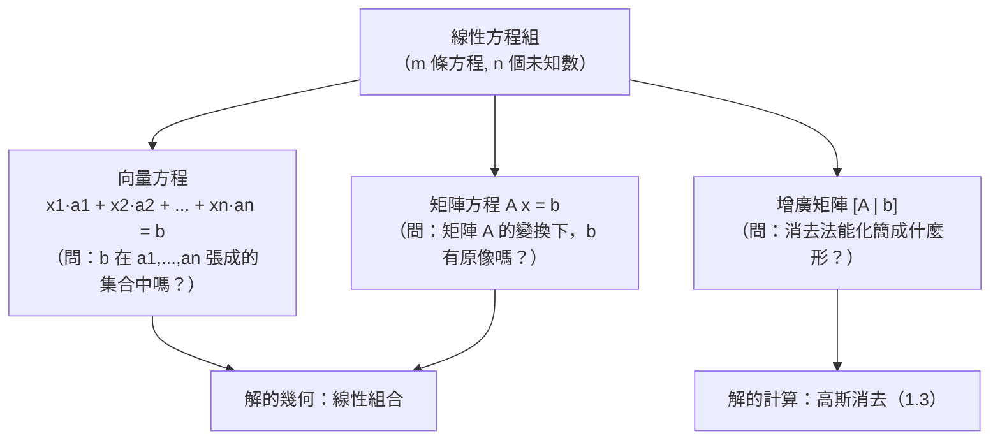

# 1.2 矩陣與線性方程組

## 前言：把問題排成表格

人類解線性方程組的歷史超過兩千年。中國漢代《九章算術》（約西元前 200 年）第八章「方程」就已經用算籌把多個未知數的方程組排成長方形陣列，並以「遍乘直除」的消去法求解——這正是**矩陣**與**高斯消去法**的雛形，比歐洲早了一千七百多年。但「矩陣」作為一個獨立的數學物件被研究，要等到十九世紀中葉。本節我們將看到：線性方程組一旦被排成表格，表格本身就成了新的數學對象——矩陣——而整個線性代數由此展開。

## 歷史前因後果

### 《九章算術》與劉徽

《九章算術》的「方程」章處理像這樣的問題：三種穀物每束的產量不同，已知幾種組合的總量，問各穀物每束產量。書中把各方程的係數排成一個方陣，用上下相消的方式逐步化簡，本質上就是矩陣的初等列變換。三國時代的**劉徽**（約 263 年）為《九章算術》作注，明確闡述了消去法的規則，並指出「舉率以減之」的機械化程序。

### 歐洲：萊布尼茨、高斯到凱萊

- 1678 年前後，萊布尼茨（Gottfried Wilhelm Leibniz, 1646–1716）在私人手稿中研究聯立方程組的係數排列，發展出消元法與後來稱為「行列式」的想法（見第 3 章）。
- 1810 年前後，**高斯**（Carl Friedrich Gauss, 1777–1855）為了處理小行星穀神星（Ceres）軌道的**最小平方**估計，發展了系統化的消去法，這就是今天所稱的**高斯消去法**（下一節詳述）。
- 1850 年，英國數學家**西爾維斯特**（James Joseph Sylvester, 1814–1897）首創「matrix（矩陣）」一詞——原意「子宮」——指「由行列式可生成的矩形陣列」。
- 1858 年，**凱萊**（Arthur Cayley, 1821–1895）發表《矩陣論回憶錄》，首次把矩陣當作獨立物件，定義矩陣的加法、純量乘法與**乘法**，並證明 $2\times 2$ 矩陣滿足自己的凱萊–哈密頓定理。矩陣從此脫離方程組，成為自主的代數體系。

- **解決了什麼問題**：把多變數線性關係的處理標準化、機械化；使理論（可解性判準）與計算（消去程序）分離又互相支援。
- **引發了什麼新問題**：矩陣乘法不交換（ $AB \ne BA$ ）——這個「缺陷」反而開啟了非交換代數的大門，日後在量子力學（海森堡矩陣力學，1925）中成為描述自然的基本語言。

## 矩陣：定義與記號

一個 $m\times n$ **矩陣**（matrix）是 $m$ 列（row） $n$ 行（column）的數表：

$$
A = \begin{bmatrix} a_{11} & a_{12} & \cdots & a_{1n} \\ a_{21} & a_{22} & \cdots & a_{2n} \\ \vdots & & & \vdots \\ a_{m1} & a_{m2} & \cdots & a_{mn} \end{bmatrix}, \qquad A = [a_{ij}]_{m\times n}
$$

元素 $a_{ij}$ 的下標：第一個是**列**號，第二個是**行**號——「先列後行，RC 船」是常用的記憶口訣。每一列是一個列向量（在 $\mathbb{R}^n$ 中），每一行是一個行向量（在 $\mathbb{R}^m$ 中）。這兩種「切片」觀點各自導出矩陣的重要詮釋（見下文）。

## 線性方程組的三種寫法

考慮一般的線性方程組：

$$
\begin{aligned}
a_{11}x_1 + a_{12}x_2 + \cdots + a_{1n}x_n &= b_1 \\
a_{21}x_1 + a_{22}x_2 + \cdots + a_{2n}x_n &= b_2 \\
\vdots \\
a_{m1}x_1 + a_{m2}x_2 + \cdots + a_{mn}x_n &= b_m
\end{aligned}
$$

同一件事有三種等價的寫法：

### 寫法一：方程組（傳統）

如上，逐一寫出各方程。

### 寫法二：向量方程

對每一個變數 $x_j$ ，收集它在各方程中的係數成為行向量 $\mathbf{a}_j$ ，則方程組等價於：

$$
x_1\mathbf{a}_1 + x_2\mathbf{a}_2 + \cdots + x_n\mathbf{a}_n = \mathbf{b}
$$

這讀作：「** $\mathbf{b}$ 能否表示成各係數向量的線性組合？權重是多少？**」例如 $\begin{bmatrix} 3 \\ 8 \end{bmatrix}$ 可否寫成 $x_1\begin{bmatrix} 1 \\ 2 \end{bmatrix} + x_2\begin{bmatrix} 2 \\ 4 \end{bmatrix}$ ？可以（取 $x_1 = -3, x_2 = 3$ ，甚至有無窮多組——因為第二個向量是第一個向量的兩倍）。這個問題的語言——線性組合、張成、獨立——將在 4.2 節正式發展。

### 寫法三：矩陣方程

$$
A\mathbf{x} = \mathbf{b}, \qquad \text{其中 } A = [a_{ij}]_{m\times n},\ \mathbf{x} = \begin{bmatrix} x_1 \\ \vdots \\ x_n \end{bmatrix},\ \mathbf{b} = \begin{bmatrix} b_1 \\ \vdots \\ b_m \end{bmatrix}
$$

其中乘積 $A\mathbf{x}$ 定義為 $A$ 的各行以 $\mathbf{x}$ 的分量為權重的線性組合：

$$
A\mathbf{x} = \begin{bmatrix} \mathbf{a}_1 & \mathbf{a}_2 & \cdots & \mathbf{a}_n \end{bmatrix}\begin{bmatrix} x_1 \\ \vdots \\ x_n \end{bmatrix} = x_1\mathbf{a}_1 + x_2\mathbf{a}_2 + \cdots + x_n\mathbf{a}_n
$$

## 增廣矩陣與列變換

為了用計算解方程組，我們把係數與常數項合併成**增廣矩陣**：

$$
[A \mid \mathbf{b}] = \begin{bmatrix} a_{11} & \cdots & a_{1n} & \vert & b_1 \\ \vdots & & \vdots & \vert & \vdots \\ a_{m1} & \cdots & a_{mn} & \vert & b_m \end{bmatrix}
$$

允許三種**初等列變換**（elementary row operations），它們不會改變方程組的解集：

1. **交換**兩列（ $R_i \leftrightarrow R_j$ ）：調換兩條方程的順序。
2. **倍乘**：以非零常數 $k$ 乘某一列（ $kR_i$ ）：方程兩邊同乘 $k$ 。
3. **倍加**：某列加上另一列的 $k$ 倍（ $R_i \to R_i + kR_j$ ）：兩方程相減消去變數。

| 列變換 | 方程組中的對應動作 | 解集是否改變 |
|--------|--------------------|--------------|
| 交換兩列 | 調換方程順序 | 否 |
| 某列乘非零常數 | 方程兩邊同乘 | 否 |
| 某列加上另一列的倍數 | 兩方程線性組合 | 否 |

這三種變換是整個解方程組演算法的引擎，也對應著三種特殊的**可逆矩陣**（初等矩陣，見 2.2 節與 1.3 節）。

## 解的可能情況：線性方程組的基本定理

一個線性方程組的解集只有三種可能：

- **恰有一解**（唯一解）；
- **無解**；
- **無窮多解**（且解可以用參數完整描述）。

絕不會出現「恰有兩解」。這是因為解集是幾何物件：在 $\mathbb{R}^2$ 中每條方程是一條直線，兩直線可能相交一點（唯一解）、平行不交（無解）、或重合（無窮多解）；在 $\mathbb{R}^3$ 中每條方程是平面，情況類似。一般 $n$ 維的版本依賴於 4.3 節的秩定理，屆時我們會獲得一個完全量化的判準：

$$
\text{一致有解} \iff \text{秩}(A) = \text{秩}([A\mid\mathbf{b}]), \qquad \text{唯一解} \iff \text{且有 } \text{秩}(A) = n
$$

| 比較項 | 唯一解 | 無解 | 無窮多解 |
|--------|--------|------|----------|
| 幾何（ $\mathbb{R}^2$ ，兩條方程） | 兩直線相交 | 平行 | 重合 |
| 增廣矩陣化簡後的特徵 | $0=0$ 型列有 $n$ 個主元 | 出現 $0=d\ (d\ne 0)$ 列 | 出現自由變數但無矛盾列 |
| 例子 | $\{x+y=3,\ x-y=1\}$ | $\{x+y=1,\ x+y=2\}$ | $\{x+y=1,\ 2x+2y=2\}$ |

## 例題

**例題 1.2-1**：解方程組

$$
\begin{cases}
x + 2y + z = 4 \\
2x - y + z = 3 \\
x + y + 2z = 5
\end{cases}
$$

先用向量方程觀點檢視：我們在問 $\begin{bmatrix} 4 \\ 3 \\ 5 \end{bmatrix}$ 是否為 $\begin{bmatrix} 1 \\ 2 \\ 1 \end{bmatrix}, \begin{bmatrix} 2 \\ -1 \\ 1 \end{bmatrix}, \begin{bmatrix} 1 \\ 1 \\ 2 \end{bmatrix}$ 的線性組合。以下用矩陣法求解。寫出增廣矩陣：

$$
\left[\begin{array}{ccc|c} 1 & 2 & 1 & 4 \\ 2 & -1 & 1 & 3 \\ 1 & 1 & 2 & 5 \end{array}\right]
\xrightarrow{R_2 \to R_2 - 2R_1,\ R_3 \to R_3 - R_1}
\left[\begin{array}{ccc|c} 1 & 2 & 1 & 4 \\ 0 & -5 & -1 & -5 \\ 0 & -1 & 1 & 1 \end{array}\right]
\xrightarrow{R_2 \leftrightarrow R_3}
\left[\begin{array}{ccc|c} 1 & 2 & 1 & 4 \\ 0 & -1 & 1 & 1 \\ 0 & -5 & -1 & -5 \end{array}\right]
$$

繼續化簡：

$$
\xrightarrow{R_2 \to -R_2}
\left[\begin{array}{ccc|c} 1 & 2 & 1 & 4 \\ 0 & 1 & -1 & -1 \\ 0 & -5 & -1 & -5 \end{array}\right]
\xrightarrow{R_3 \to R_3 + 5R_2}
\left[\begin{array}{ccc|c} 1 & 2 & 1 & 4 \\ 0 & 1 & -1 & -1 \\ 0 & 0 & -6 & -10 \end{array}\right]
$$

由第三列： $-6z = -10$ ，故 $z = \dfrac{5}{3}$ 。回代第二列： $y = -1 + z = \dfrac{2}{3}$ 。回代第一列： $x = 4 - 2y - z = 4 - \dfrac{4}{3} - \dfrac{5}{3} = 1$ 。

**驗算**： $2(1) - \frac{2}{3} + \frac{5}{3} = 2 + 1 = 3$ ✓， $1 + \frac{2}{3} + 2\cdot\frac{5}{3} = 1 + \frac{12}{3} = 5$ ✓。

故解為 $\mathbf{x} = \left(1, \dfrac{2}{3}, \dfrac{5}{3}\right)$ ，唯一解。

**例題 1.2-2（無解的辨識）**：

$$
\left[\begin{array}{cc|c} 1 & 2 & 1 \\ 2 & 4 & 5 \end{array}\right]
\xrightarrow{R_2 \to R_2 - 2R_1}
\left[\begin{array}{cc|c} 1 & 2 & 1 \\ 0 & 0 & 3 \end{array}\right]
$$

最下列讀作 $0x_1 + 0x_2 = 3$ ，矛盾，故**無解**。幾何上這是兩條平行線： $x+2y=1$ 與 $2x+4y=5$ 。

**例題 1.2-3（無窮多解與自由變數）**：

$$
\left[\begin{array}{cc|c} 1 & 2 & 1 \\ 2 & 4 & 2 \end{array}\right]
\xrightarrow{R_2 \to R_2 - 2R_1}
\left[\begin{array}{cc|c} 1 & 2 & 1 \\ 0 & 0 & 0 \end{array}\right]
$$

令 $y = t$ （自由變數），則 $x = 1 - 2t$ 。解集為一條直線：

$$
\begin{bmatrix} x \\ y \end{bmatrix} = \begin{bmatrix} 1 \\ 0 \end{bmatrix} + t\begin{bmatrix} -2 \\ 1 \end{bmatrix}, \quad t \in \mathbb{R}
$$

這個「特解 + 齊次解」的結構是通式，將在 4.3 與 5.3 節獲得系統性的解釋。

## 齊次方程組：永遠有解的特殊情況

當 $\mathbf{b} = \mathbf{0}$ 時， $A\mathbf{x}=\mathbf{0}$ 稱為**齊次方程組**。它永遠至少有零解 $\mathbf{x}=\mathbf{0}$ 。有趣的是：

- $A\mathbf{x}=\mathbf{0}$ **只有零解** $\iff$ $A$ 的行線性獨立 $\iff$ 唯一解；
- $A\mathbf{x}=\mathbf{0}$ **有非零解** $\iff$ $A$ 的行線性相依 $\iff$ 無窮多解。

非齊次組 $A\mathbf{x}=\mathbf{b}$ 的解集可以由齊次組的解集「平移」得到：若 $\mathbf{x}_p$ 是 $A\mathbf{x}=\mathbf{b}$ 的一個特解，則所有解為

$$
\mathbf{x} = \mathbf{x}_p + \mathbf{x}_h, \qquad A\mathbf{x}_h = \mathbf{0}
$$

這正是例題 1.2-3 中「直線 = 一點 + 方向向量」的現象；也是 5.3 節「秩–零度定理」的先聲。

## 與其他領域的關聯

- **微積分**：多變數函數的臨界點分類、泰勒展開的係數匹配，最後都化成線性方程組。
- **微分方程**：常係數線性微分方程組的解法，核心是先解 $A\mathbf{x}=\mathbf{0}$ 型的齊次問題（第 6 章）。
- **電路學**：克希荷夫定律寫出的節點方程就是線性方程組；「網路分析」是十九世紀推動矩陣方法的實際動力之一。
- **機器學習**：線性迴歸的正規方程 $A^TA\mathbf{x} = A^T\mathbf{b}$ 是一個線性方程組（9.2 節將用 SVD 深入分析）。
- **密碼學與圖論**：圖的鄰接矩陣、關聯矩陣上的線性系統描述網路流與訊息傳遞。

## 本節小結

1. 矩陣起源於《九章算術》的算籌陣列（西元前二世紀），於 1850–1858 年由西爾維斯特與凱萊確立為獨立代數物件。
2. 同一個線性方程組有三種等價觀點：方程組、向量方程（線性組合問題）、矩陣方程 $A\mathbf{x}=\mathbf{b}$ 。
3. 初等列變換不改變解集；它們是求解的計算引擎。
4. 解集只有三種情況：唯一解、無解、無窮多解；幾何上對應交點、平行、重合的推廣。
5. 齊次組 $A\mathbf{x}=\mathbf{0}$ 扮演「結構性」角色：非齊次組的解 = 一個特解 + 齊次組的解。

## 解的驗算與誤差敏感性的第一次接觸

### 驗算是紀律，不是選項

解線性方程組的每一步都可能出錯：抄錄係數、算術失誤、符號遺漏。養成三層驗算習慣：

1. **逐條代回**：把解代入每一條原方程（不是化簡後的方程——化簡過程若出錯，驗化簡後的方程查不出來）。
2. **特徵檢查**：若原方程組有明顯結構（對稱性、行比例），解應當滿足對應的關係。
3. **兩法互證**：同一題用兩種路線（如消去法與克萊姆法則）各解一次，結果必須一致。

歷史上，天文台計算小行星軌道時，人力「計算員」採用的正是**雙人獨立計算再核對**的制度——因為一個符號錯誤可能讓天文學家在錯誤的星空區域搜尋數月。今天的程式設計師面對 $10^6$ 維系統，同樣的紀律轉化為：單元測試、殘差檢查 $\|A\hat{\mathbf{x}} - \mathbf{b}\|$ 、與更高精度的交叉驗證。

### 一個小實驗：敏感的系統

考慮

$$
\begin{cases} x + y = 2 \\ x + 1.01y = 2.01 \end{cases}
$$

解為 $y = 1$ 、 $x = 1$ （兩式相減： $0.01y = 0.01$ ）。現在把第二式右端改為 $2.02$ （誤差僅 $0.01$ ）：

$$
0.01y = 0.02 \Rightarrow y = 2, \quad x = 0
$$

**右端的 1% 誤差使解完全翻轉**！原因是兩條方程「幾乎平行」——相交角度極小，交點位置對方程的微擾極端敏感。這個現象在 9.3 節會被精確量化為**條件數** $\kappa \approx 400$ ；在統計學中它就是「多重共線性」：兩個特徵高度相關時，迴歸係數的估計失去可信度。**線性代數的幾何直覺（交角）預言了數值與統計的深淵**——這是本課程反覆出現的主題：幾何圖像預先解釋代數現象。

### 病態與健康：兩個對照組

| 系統 | 幾何 | 敏感性 | 診斷 |
|------|------|--------|------|
| $\{x+y=2,\ x-y=0\}$ | 垂直相交（ $90°$ ） | 低（誤差 ~1:1 傳遞） | 健康良態 |
| $\{x+y=2,\ x+1.01y=2.01\}$ | 近平行（交角約 $0.57°$ ） | 高（放大數百倍） | 病態 |

「兩條方程的交角」由法向量 $\mathbf{a}_1, \mathbf{a}_2$ 的夾角決定：

$$
\cos\theta = \frac{\mathbf{a}_1\cdot\mathbf{a}_2}{\|\mathbf{a}_1\|\,\|\mathbf{a}_2\|}
$$

交角越接近 $0°$ 或 $180°$ （法向量近共線），系統越病態。這把「解方程組的穩定性」翻譯成一句向量幾何：**看係數向量的夾角**。

## 應用鏡頭：線性方程組在各領域的樣貌

### 電路分析（克希荷夫定律）

節點電流守恆與迴路電壓定律都是線性方程。一個含 5 節點、7 支路的電阻網路產生約 7 條方程、7 個支路電流未知數。 nineteenth 世紀末電機工程師（如 Kennelly、Kirchhoff 學派的後繼者）系統化的「網路分析」，正是推動矩陣方法實用化的重要動力之一。現代晶片含十億級節點，其直流工作點分析仍是大型稀疏線性系統（10.1 節）。

### 化學計量平衡

配平化學方程式： $\mathrm{C_3H_8 + O_2 \to CO_2 + H_2O}$ 。設係數 $(a, b, c, d)$ ，對每種原子（C、H、O）各寫一條守恆方程：

$$
3a = c \quad (\text{C}), \qquad 8a = 2d \quad (\text{H}), \qquad 2b = 2c + d \quad (\text{O})
$$

這是齊次線性方程組——解集是一維（比例由 $a$ 定），取最小整數解 $(1, 5, 3, 4)$ 。**化學平衡 = 齊次方程組的正整數解**。

### 交通流量與網路流

路口的「流入 = 流出」對每個交叉點是一條線性方程；整個路網的流量分配是一個大型線性系統。解可能有自由變數（某些路段流量無法唯一確定——秩不足），此時交通工程師會加入額外量測或最佳化目標。這個模型同樣適用於資料中心網路、供水管網、經濟的投入產出模型（Leontief 1941，諾貝爾獎 1973）。

### 有限元素與工程模擬

橋樑受力分析：把結構切成數萬個元素，每個節點的力平衡是一條線性方程。勁度矩陣 $K$ 對稱半正定（能量觀點，第 8 章預告），解 $K\mathbf{u} = \mathbf{f}$ 得位移場。CAD/CAE 軟體的每一次「模擬運行」都是一次大規模線性系統求解。

## 常見陷阱與學習建議

| 陷阱 | 後果 | 防範 |
|------|------|------|
| 列變換只作用在係數、漏掉常數項 | 解全錯 | 增廣矩陣一次寫全 |
| 行與列混淆 | 矩陣乘法/讀秩出錯 | 口訣「先列後行」；用尺寸檢查 |
| 把「無窮多解」寫成一個解 | 解集不完整 | 顯式寫出參數 $t$ 與通式 |
| 忘記驗算 | 錯誤傳播到後續題目 | 養成代回習慣 |
| 對「無解」與「解為零」混淆 | 語意錯誤 | 無解 = 沒有解；零解 = 解恰好是零向量 |

**學習建議**：每道題先花 30 秒做「幾何預判」（幾條方程？幾個未知數？可能相交/平行/重合嗎？），再做代數。預判與結果的對照會快速建立幾何直覺——這種直覺在第 4 章抽象化之後，是唯一能救你的東西。

## 練習題

1. 用三種寫法（方程組、向量方程、矩陣方程）表達 $\begin{cases} 2x - y = 3 \\ x + 3y = 5 \end{cases}$ ，並解之。
2. 判斷下列系統解的類型（唯一/無/無窮多），並說明幾何意義：
   (a) $\{x + y = 1,\ x + y = 3\}$ ；(b) $\{x - 2y = 0,\ 2x - 4y = 0\}$ ；(c) $\{x + y = 1,\ x - y = 3\}$ 。
3. 求使 $\begin{cases} x + 2y = 3 \\ 2x + ky = 6 \end{cases}$ 有無窮多解的 $k$ 。（答： $k = 4$ 。）
4. 三平麵方程組 $\{x+y+z=1,\ x+2y+3z=4,\ x+3y+5z=7\}$ 的解集是幾何物件？求其參數式。
5. （思考）齊次組 $A\mathbf{x}=\mathbf{0}$ （ $A$ 為 $m\times n$ ）何時必有非零解？（提示： $n > m$ 時「多即相依」——4.2 節將證明。）

**預告**：列變換的具體演算法——何時交換、如何避免分數、如何確認完成——就是下一節的高斯消去法。
