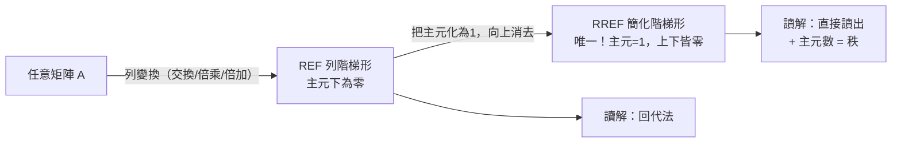
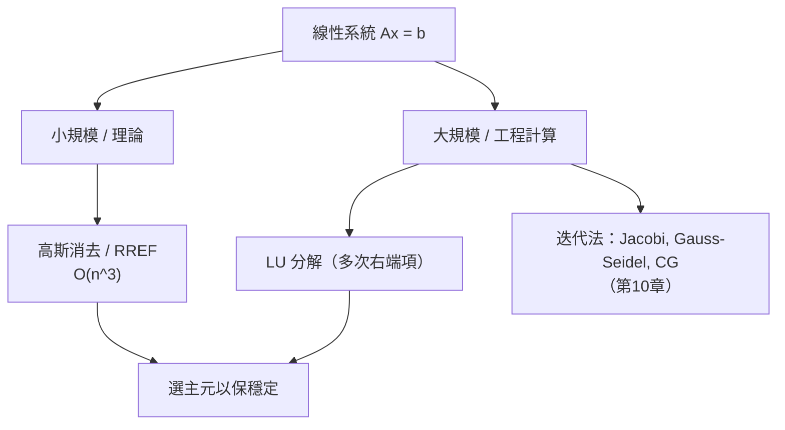

# 1.3 高斯消去法

## 前言：一個執行了兩千年的演算法

如果把數學史上最有實用價值的演算法列一張榜單，**高斯消去法**（Gaussian elimination）必定名列前茅。從中國《九章算術》的算籌，到高斯為行星軌道做的計算，到今天氣象預報、飛機設計、Google 網頁排序背後的超級電腦，這個演算法每天都在執行數萬億次。它的重要性不只是「能算出答案」，更在於它揭示了解集的**結構**：主元、階梯形、自由變數——這些概念將成為第 4 章向量空間理論的計算基礎。本節我們正式學習這個演算法，並分析它的效率與現代改良（LU 分解）。

## 歷史前因後果

### 從《九章算術》到高斯

- 《九章算術》「方程」章（約西元前 200 年）已有完整的消去程序：把係數排成方陣，用「遍乘」（乘以適當倍數）與「直除」（直接相減）化簡。劉徽在 263 年的注文中稱之為「舉率以減之」，並說明其正確性。
- 日本江戶時代的**關孝和**（Seki Takakazu, 1642–1708）與萊布尼茨大約同時獨立發展出行列式的概念，也是在處理聯立方程組時提出的。
- 1810 年，高斯在《天體運動論》中為了以最小平方法確定小行星穀神星的軌道，發展出系統化的「消去法」。他關心的是**計算效率**：如何用最少的乘法次數從觀測數據中解出軌道參數。現代術語中的「高斯消去法」「高斯–若爾當消去法」「高斯求積」等冠名，反映他在數值計算上的深遠影響。
- 德國測地學家**威爾海姆·喬丹**（Wilhelm Jordan, 1842–1899）在 1888 年的測量學教科書中推廣了「把消去法做到底、化為完全簡化階梯形」的版本，故稱**高斯–若爾當消去法**。（不要與矩陣力學的物理學家帕斯夸·若爾當混淆。）

- **解決了什麼問題**：任意大型線性方程組的機械化求解；理論上證明了「有限步驟、必得結果」的決定性程序。
- **引發了什麼新問題**：捨入誤差會在消去過程中放大（**數值穩定性**問題），催生了 1940 年代馮紐曼與圖靈時代的數值分析，以及**選主元**（pivoting）策略（詳見第 10 章與 9.3 節）。

## 階梯形與簡化階梯形

### 兩個核心概念

一個矩陣是**列階梯形**（row echelon form, REF），若滿足：

1. 全零列（若有）位於最下方；
2. 每列的第一個非零元素（稱為**主元**，pivot）位於上一列主元的右邊；
3. 主元下方的元素皆為零（由構造保證）。

若再滿足：

4. 主元為 $1$；
5. 主元**上方**的元素皆為零；

則稱為**簡化列階梯形**（reduced row echelon form, RREF）。

REF 只要求「下三角形清乾淨」，RREF 連上方也清乾淨。**每個矩陣的 RREF 是唯一的**（REF 則不唯一），這使 RREF 可以用來定義矩陣的**秩**（rank）——主元的個數——成為 4.3 節的理論基石。



### 演算法：高斯消去法

**輸入**：增廣矩陣 $[A\mid\mathbf{b}]$。
**步驟**：
1. 從最左邊的非零行開始，在該行中選一個非零元素作為主元（實務上選絕對值最大者以減少誤差，稱**部分選主元**）。
2. 必要時交換列，使主元位於目前處理列。
3. 用倍加變換把主元**下方**全部消為零。
4. 移到下一列、下一行，重複直到無法繼續 → 得 REF。
5. （若爾當階段）把每個主元化為 $1$，並把主元**上方**消為零 → 得 RREF。

### 從階梯形讀出解

設 RREF 中主元對應的變數為**基本變數**（basic variables），無主元的行對應**自由變數**（free variables）：

- 若出現 $0 = d\ (d\ne 0)$ 的列 → **無解**（不一致，inconsistent）。
- 若每個變數都是基本變數（主元數 $= n$）→ **唯一解**。
- 若有自由變數（主元數 $< n$）且一致 → **無窮多解**：把自由變數當參數，解用參數表示。

三種情況與主元數的關係，正是 4.3 節「秩定理」的計算面貌：

| RREF 的情況 | 主元數（秩） | 解的類型 | 幾何圖像（$n=3$） |
|-------------|--------------|----------|-------------------|
| 含 $0=d$ 列 | 與增廣矩陣不同 | 無解 | 平面無共點 |
| 每行有主元 | $= n$ | 唯一解 $\mathbf{x}_p$ | 一個點 |
| 有自由變數 | $< n$ | 無窮多解 | 一條線 / 一個平面（經特解平移） |

## 例題

**例題 1.3-1（完整的高斯–若爾當消去）**：解

$$
\begin{cases}
2x + y - z = 3 \\
x - 2y + 2z = 6 \\
3x + 2y + z = 7
\end{cases}
$$

**解**：先交換 $R_1, R_2$ 讓左上角為 $1$（減少分數）：

$$
\left[\begin{array}{ccc|c} 1 & -2 & 2 & 6 \\ 2 & 1 & -1 & 3 \\ 3 & 2 & 1 & 7 \end{array}\right]
\xrightarrow{R_2 \to R_2 - 2R_1,\ R_3 \to R_3 - 3R_1}
\left[\begin{array}{ccc|c} 1 & -2 & 2 & 6 \\ 0 & 5 & -5 & -9 \\ 0 & 8 & -5 & -11 \end{array}\right]
$$

$$
\xrightarrow{R_3 \to 5R_3 - 8R_2}
\left[\begin{array}{ccc|c} 1 & -2 & 2 & 6 \\ 0 & 5 & -5 & -9 \\ 0 & 0 & 35 & 17 \end{array}\right]
$$

得 REF。回代：$z = \dfrac{17}{35}$；$5y = -9 + 5z = -9 + \dfrac{17}{7} = -\dfrac{46}{7}$，故 $y = -\dfrac{46}{35}$；$x = 6 + 2y - 2z = 6 - \dfrac{92}{35} - \dfrac{34}{35} = \dfrac{210 - 126}{35} = \dfrac{84}{35}$。

驗算第一條：$2\cdot\frac{84}{35} + (-\frac{46}{35}) - \frac{17}{35} = \frac{168 - 46 - 17}{35} = \frac{105}{35} = 3$ ✓。唯一解 $\mathbf{x} = \left(\frac{84}{35}, -\frac{46}{35}, \frac{17}{35}\right)$。

**例題 1.3-2（RREF 與參數解）**：解

$$
\begin{cases}
x + 2y - z + w = 2 \\
2x + 4y - 2z + 2w = 4 \\
-x - 2y + z - w = -2
\end{cases}
$$

**解**：第 2、3 條分別是第 1 條的 $2$ 倍與 $-1$ 倍，增廣矩陣化簡後：

$$
\left[\begin{array}{cccc|c} 1 & 2 & -1 & 1 & 2 \\ 0 & 0 & 0 & 0 & 0 \\ 0 & 0 & 0 & 0 & 0 \end{array}\right]
$$

秩為 $1$，$y, z, w$ 是自由變數。令 $y=s,\ z=t,\ w=u$，則解集為：

$$
\mathbf{x} = \begin{bmatrix} 2 \\ 0 \\ 0 \\ 0 \end{bmatrix} + s\begin{bmatrix} -2 \\ 1 \\ 0 \\ 0 \end{bmatrix} + t\begin{bmatrix} 1 \\ 0 \\ 1 \\ 0 \end{bmatrix} + u\begin{bmatrix} -1 \\ 0 \\ 0 \\ 1 \end{bmatrix}, \quad s,t,u \in \mathbb{R}
$$

這是 $\mathbb{R}^4$ 中經過點 $(2,0,0,0)$、由三個方向向量張成的三維「平面」。結構再次呈現「**特解 + 齊次解**」：第一項是特解，其餘是齊次組 $A\mathbf{x}=\mathbf{0}$ 的解（4.3 節將證明它們形成一個子空間）。

## LU 分解：高斯消去法的矩陣化

高斯消去法的每一步「$R_i \to R_i - kR_j$」「交換兩列」「$R_i \to kR_i$」都可以用一個特殊矩陣左乘來實現（**初等矩陣**，詳見 2.2 節）。因此整個消去過程可以寫成：

$$
E_k \cdots E_2 E_1\, A = U
$$

其中 $E_i$ 是初等矩陣、$U$ 是上三角矩陣（階梯形）。整理得：

$$
A = LU, \qquad L = (E_k\cdots E_1)^{-1} \text{（下三角，對角線為 1）}
$$

這就是 **LU 分解**。它的威力在於**重複求解**：對多個右端項 $\mathbf{b}_1, \mathbf{b}_2, \dots$，先花一次成本算好 $L, U$，之後每次只需解兩個三角系統：

$$
L\mathbf{y} = \mathbf{b} \quad \text{（前代法）}, \qquad U\mathbf{x} = \mathbf{y} \quad \text{（回代法）}
$$

| 方法 | 首次成本 | 每多解一個 $\mathbf{b}$ 的成本 |
|------|----------|-------------------------------|
| 每次重新高斯消去 | $O(n^3)$ | $O(n^3)$ |
| 先做 LU 分解 | $O(n^3)$ | 僅 $O(n^2)$ |

在科學計算（如有限元素法反覆求解不同載重下的結構變形）中，這個 $O(n^2)$ 與 $O(n^3)$ 的差異就是「瞬間」與「數小時」的差異。LU 分解也是 MATLAB `A\b`、NumPy `numpy.linalg.solve` 背後的標準程序（LAPACK 函式庫）。

## 計算量與數值穩定性初步

- 消去法約需 $\frac{2}{3}n^3$ 次浮點運算（$n\times n$ 矩陣）。$n = 1000$ 時約 $7\times 10^8$ 次，現代電腦瞬間完成；$n = 10^6$ 時則需約 $10^{18}$ 次——直接法不再可行，必須轉向迭代法（第 10 章）。
- 若主元接近零（甚至為零），除法會放大捨入誤差。標準解法是**部分選主元**：每一步選該行絕對值最大的元素交換上來。更極端的病態情況（如 Hilbert 矩陣）將在 9.3 節用**條件數**的語言深入分析。



## 與其他領域的關聯

- **微積分**：牛頓法解非線性方程組時，每一步都解一個線性系統（雅可比矩陣 $J(\mathbf{x}_k)\,\Delta = -F(\mathbf{x}_k)$），高斯消去是內核。
- **微分方程**：偏微分方程離散化（有限差分/元素）後產生大型稀疏線性系統；矩陣巨大但非零元素極少，此時直接法與迭代法的取捨是計算數學的核心課題。
- **統計／機器學習**：最小平方的正規方程、嶺迴歸、主成分分析都需解線性系統或特徵值問題。
- **圖論**：電阻網路、馬可夫鏈的平穩分布，皆為線性系統。
- **密碼學**：希爾密碼（Hill cipher, 1929）以可逆矩陣加密，解密即解線性系統；消去法决定其破譯難度。

## 本節小結

1. 高斯消去法是兩千年前《九章算術》的「遍乘直除」、十八世紀高斯的軌道計算、與今日 LAPACK 函式庫的一脈相承。
2. REF／RREF 與主元把「解方程組」轉化為「讀出解的結構」：基本變數、自由變數、三種解的情況。
3. RREF 唯一，主元數即矩陣的秩——這是第 4 章抽象理論的計算前身。
4. 消去法可以壓縮成 $A = LU$；多次求解時 LU 分解把每次成本從 $O(n^3)$ 降到 $O(n^2)$。
5. 主元過小是數值不穩定的訊號，選主元策略與條件數理論是現代數值線性代數的起點。

## 特殊矩陣結構的專用策略

### 帶狀與三對角矩陣

工程計算中最常見的稀疏結構是**三對角矩陣**（只有主對角與相鄰兩條對角線非零）——一維熱傳導、梁振動、樣條插值的離散化都產生它：

$$
T = \begin{bmatrix} b_1 & c_1 & & \\ a_2 & b_2 & c_2 & \\ & \ddots & \ddots & \ddots \\ & & a_n & b_n \end{bmatrix}
$$

**Thomas 演算法**（追逐法）：三對角的高斯消去法特化版，成本從 $O(n^3)$ 降到 $O(n)$！消去過程中「填充」不會發生（帶外永遠是零），只需要 $3n$ 個儲存。這說明：**演算法成本取決於結構的利用程度**——同一個消去法，對稠密矩陣是 $O(n^3)$，對三對角是 $O(n)$。

### 對稱正定矩陣：Cholesky 分解

若 $A$ 對稱正定（第 8 章），存在唯一分解 $A = LL^T$（$L$ 下三角、對角線為正）。**Cholesky 分解**（Cholesky 1924，地震測量背景）只需一半計算量（$\frac13 n^3$）與一半儲存，且**無需選主元**（正定性保證主元天然良好）。統計中的多變數常態抽樣、最佳化中的 Newton 法、有限元素的勁度矩陣，都用 Cholesky。**矩陣的性質決定演算法的特權**——對稱性（第 8 章主題）在計算上同樣值錢。

### 稀疏矩陣：直接法與填充問題

稀疏矩陣的 LU 分解會產生**填充**（fill-in）：原本為零的位置在消去後變非零。例如 $n\times n$ 帶寬 $w$ 的帶狀矩陣，LU 後帶寬可能擴大。對付填充的策略：

1. **排序**（reordering）：先用圖論演算法（如 AMD，approximate minimum degree）重排未知數順序，最小化填充；
2. **結構化消去**：按網格的天然順序（波前法）；
3. **放棄直接法**：改用迭代法（本節後段與第 10 章）。

矩陣的稀疏模式本質上是**圖**（未知數為頂點、非零元為邊），因此**稀疏線性代數 = 圖論 + 線性代數**的交叉學科。

## 選主元的詳細策略

### 為什麼必須選主元：一個警示例子

$$
A = \begin{bmatrix} 10^{-8} & 1 \\ 1 & 1 \end{bmatrix}
$$

**不選主元**：$R_2 \to R_2 - 10^8 R_1$ 得 $\begin{bmatrix} 10^{-8} & 1 \\ 0 & 1 - 10^8 \end{bmatrix} = \begin{bmatrix} 10^{-8} & 1 \\ 0 & -10^8 + 1 \end{bmatrix}$。若計算以 6 位有效數字進行，$10^8 R_1$ 的 $10^{-8}\cdot10^8 = 1$ 項與真正的 1 相加後的捨入誤差會被放大 $10^8$ 倍。

**部分選主元**：先交換 $R_1 \leftrightarrow R_2$（主元變成 1），消去倍數僅 $10^{-8}$——誤差不受放大。**規則：每步選該行（或列）絕對值最大的元素作主元**。實務顯示部分選主元幾乎總是足夠；完整選主元（同時搜行列）成本加倍，僅在極端情況使用。

### 選主元的理論保證

Wilkinson（1963）證明：帶部分選主元的高斯消去向後穩定——浮點解是「擾動矩陣 $A + \Delta A$」的精確解，且 $\|\Delta A\| \sim \epsilon\,\|A\|\,c(n)$（$c(n)$ 隨 $n$ 緩慢增長）。**穩定性 ≠ 準確性**：若矩陣本身病態（$\kappa$ 大），即使完美穩定的演算法也救不了（9.3 節）。這個「演算法誤差 vs 問題條件數」的分離是數值分析的支柱思想。

## 大規模時代的消去法：並行與分塊

現代 CPU/GPU 的瓶頸不在算力而在**記憶體頻寬**。分塊消去法（2.3 節舒爾補的工程化）把運算組織成「矩陣乘矩陣」的大塊（BLAS-3），讓每載入一筆資料就做多次運算：

```
1. 對對角塊做 LU 分解（小塊，快取內完成）
2. 用 L11 解出 U12 = L11^-1 A12（三角求解）
3. 形成舒爾補 S = A22 - A21 U12（大塊矩陣乘法）
4. 對 S 遞迴
```

LAPACK 的 LU（`dgetrf`）、Cholesky（`dpotrf`）皆此架構；GPU 版本（MAGMA）進一步按 SM 核心分塊。**1950 年代 Von Neumann 架構與 2020 年代的 Tensor Core，改變的是硬體，不變的是「分塊 + 遞迴 + 選主元」的數學骨架**。

## 例題（續）

**例題 1.3-3（Thomas 演算法演示）**：解三對角系統

$$
\begin{bmatrix} 2 & -1 & 0 \\ -1 & 2 & -1 \\ 0 & -1 & 2 \end{bmatrix}\mathbf{x} = \begin{bmatrix} 1 \\ 2 \\ 3 \end{bmatrix}
$$

**解**：消去：$R_2 \to R_2 + \frac12 R_1$：$[-1, \frac32, -1 \mid \frac52]$；$R_3 \to R_3 + \frac23 R_2$：$[0, 0, 2 - \frac23\mid 3 + \frac53]$，即主元列 $[\frac43 \mid \frac{14}3]$。

回代：$z = \frac{14/3}{4/3} = \frac72$；$y = \frac52 + z$（由第二列 $\frac32y - z = \frac52$ → $y = \frac{\frac52 + \frac72}{\frac32} = 4$）；$x = \frac{1 + y}{2} = \frac52$。

驗算：$-1\cdot\frac52 + 2\cdot4 - 1\cdot\frac72 = -\frac52 + 8 - \frac72 = 2$ ✓。

**例題 1.3-4（選主元的重要性實測）**：用 5 位有效數字解 $A\mathbf{x} = \mathbf{b}$，$A = \begin{bmatrix} 0.00001 & 1 \\ 1 & 1 \end{bmatrix}$、$\mathbf{b} = (1, 2)$。

- 不選主元：$R_2 \to R_2 - 10^5R_1$：$[0,\ 1 - 10^5]$，$y = -99999$（5 位下 $1 - 10^5$ 有嚴重相消），$x = (1 - y)\cdot10^5 = 10^{10}$——**荒謬**。
- 選主元（交換後）：$y$ 主元 $=1$，$R_2 \to R_2 - 10^{-5}R_1$：$[0,\ 1 - 10^{-5}] \approx 1$，$y \approx 1$，$x \approx 1$——**正確**（精確解約 $x = 1.00001$）。

## 練習題

1. 用高斯–若爾當把 $\begin{bmatrix} 2 & 4 & 6 \\ 1 & 2 & 3 \\ 3 & 6 & 9 \end{bmatrix}$ 化為 RREF，判斷秩。（答：秩 1，RREF 有兩個零列。）
2. 解 $\begin{cases} x + y + 2z = 9 \\ 2x + 4y - 3z = 1 \\ 3x + 6y - 5z = 0 \end{cases}$，判斷解的類型並給參數式。
3. 對 $A = \begin{bmatrix} 0 & 1 \\ 2 & 3 \end{bmatrix}$ 寫出 LU 分解（含置換矩陣 $P$）：$PA = LU$。
4. 證明：上三角矩陣可逆 ⟺ 對角線全非零，且其逆仍為上三角。
5. （挑戰）證明 $n\times n$ 三對角矩陣的 Thomas 演算法成本為 $8n - 7$ 次乘除。
6. （思考）為什麼消去法「先交換讓主元是 1」不影響解集，但「讓主元是 0 就得先交換」？兩者與 1.2 節三種列變換的關係？

**預告**：消去法用到的「交換、倍乘、倍加」矩陣，正是打開矩陣乘法與逆矩陣之門的鑰匙。第 2 章我們開始系統地研究**矩陣代數**本身。
