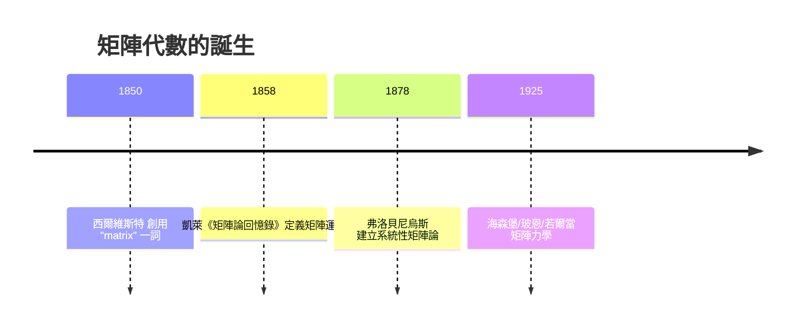

# 2.1 矩陣運算的誕生

## 前言：一門「故意不完美」的代數

矩陣的加法像小學生都會的對位相加，矩陣的乘法卻規則古怪——行乘列、不交換、看似任意。為什麼要這樣定義？答案是：**矩陣乘法不是被發明的，而是被「逼出來的」**——當你要求「先做變換 $B$ 再做變換 $A$ 」對應一個矩陣時，那個矩陣的元素就**必須**由行乘列的公式給出。本節我們重演這段歷史，學會矩陣的四大運算，並理解為什麼 $AB \neq BA$ 不是缺陷，而是深刻的訊息。

## 歷史前因後果

### 凱萊的 1858 年回憶錄

英國數學家**凱萊**（Arthur Cayley, 1821–1895）在 1858 年發表《矩陣論回憶錄》（A Memoir on the Theory of Matrices），被公認為矩陣代數的誕生證書。在此之前，矩陣只是行列式的「容器」；凱萊首次把矩陣本身當作代數物件，定義了：

1. 矩陣相等；
2. 矩陣加法與純量乘法；
3. 矩陣乘法；
4. 單位矩陣與（部分情況的）逆矩陣；
5. 並證明了 $2\times 2$ 的**凱萊–哈密頓定理**：每個矩陣滿足自己的特徵多項式。

凱萊的動機來自他與西爾維斯特（James Joseph Sylvester, 1814–1897）共同發展的不變量理論與幾何變換研究。西爾維斯特在 1850 年創造「matrix」一詞時，想的還是「從中可以拔出行列式的陣列」；凱萊則讓矩陣自己當主角。

- **解決了什麼問題**：線性變換的合成、線性方程組的結構化，都需要一個統一的代數框架。
- **引發了什麼新問題**：矩陣乘法不交換——這是人類遇到的第一個自然的**非交換代數結構**。這個「異常」在 1925 年被海森堡（Werner Heisenberg）發現正是量子世界的本質：位置與動量的矩陣滿足 $[x, p] = xp - px = i\hbar \neq 0$ 。矩陣代數從解方程的工程工具，一躍成為描述物理定律的語言。

## 矩陣加法與純量乘法：與向量無異

### 定義

兩個**同尺寸**矩陣 $A, B \in M_{m\times n}$ 的和是逐元素相加；純量 $c$ 乘矩陣是逐元素相乘：

$$
(A+B)_{ij} = a_{ij} + b_{ij}, \qquad (cA)_{ij} = c\,a_{ij}
$$

這些運算把 $M_{m\times n}$ 變成一個「向量空間」：加法交換、結合，有零矩陣 $O$ ，有負矩陣 $-A$ ，分配律成立——共八條性質與 1.1 節向量的性質完全平行。事實上， $M_{m\times n}$ 可以視為把矩陣「攤平」後的 $\mathbb{R}^{mn}$ ，只是多了列與行的內在結構。這個觀察是 4.1 節「抽象向量空間」的第一個非向量範例：**矩陣也是向量**。

## 矩陣乘法：行乘列的邏輯

### 定義

設 $A$ 是 $m\times n$ ， $B$ 是 $n\times p$ （內維必須相同），則 $AB$ 是 $m\times p$ ：

$$
(AB)_{ij} = \sum_{k=1}^{n} a_{ik}\,b_{kj}
$$

即 $AB$ 的 $(i,j)$ 元素 = $A$ 的第 $i$ 列與 $B$ 的第 $j$ 行的**內積**：

$$
\begin{bmatrix} a_{i1} & \cdots & a_{in} \end{bmatrix}\begin{bmatrix} b_{1j} \\ \vdots \\ b_{nj} \end{bmatrix} = a_{i1}b_{1j} + \cdots + a_{in}b_{nj}
$$

### 為什麼是這樣定義？三個推導

**推導一（線性變換合成）**：設 $\mathbf{y} = A\mathbf{x}$ 與 $\mathbf{z} = B\mathbf{y}$ 。代入得 $\mathbf{z} = A(B\mathbf{x})$ 。「先 $B$ 後 $A$ 」的效果應該由單一矩陣 $C$ 實現： $\mathbf{z} = C\mathbf{x}$ ，且**必須** $C = AB$ 。展開驗證：

$$
z_i = \sum_j b_{ij}\left(\sum_k a_{jk} x_k\right) = \sum_k \left(\sum_j b_{ij}a_{jk}\right) x_k = \sum_k (AB)_{ik}\,x_k \checkmark
$$

**推導二（方程組代入）**：把變數替換 $\mathbf{y} = B\mathbf{x}$ 代入 $\mathbf{z} = A\mathbf{y}$ ，係數的組合正是行乘列。

**推導三（單位元要求）**：若要存在「什麼都不做」的矩陣 $I$ 使 $IA = A$ 對一切 $A$ 成立， $I$ 必須是對角線為 1、其餘為 0 的方陣——**單位矩陣**就此現身。

### 乘法的四種「切片」觀點

同一個 $AB$ 可以從四個角度閱讀，每個角度都有實用價值：

| 觀點 | 說法 | 用途 |
|------|------|------|
| 元素 | $(AB)_{ij}$ = 第 $i$ 列與第 $j$ 行的內積 | 手算單一元素 |
| 行 | $AB$ 的第 $j$ 行 = $A\,(\mathbf{b}_j)$ ，即 $B$ 的第 $j$ 行作用 | 一次算一整行 |
| 列 | $AB$ 的第 $i$ 列 = $(\mathbf{a}_i^T)B$ | 線性泛函的觀點 |
| 和 | $AB = \sum_k \mathbf{a}_k \mathbf{b}_k^T$ （第 $k$ 行向量 × 第 $k$ 列向量的外積） | 低秩逼近、SVD（第 9 章） |

### 乘法性質與不交換性

| 性質 | 成立嗎 | 備註 |
|------|--------|------|
| $A(BC) = (AB)C$ | ✓ | 結合律，允許省略括號 |
| $A(B+C) = AB + AC$ | ✓ | 左分配律 |
| $(A+B)C = AC + BC$ | ✓ | 右分配律 |
| $(cA)B = c(AB)$ | ✓ | 純量可自由穿梭 |
| $AB = BA$ | ✗ | 一般不成立！ |
| $AB = O \Rightarrow A = O$ 或 $B = O$ | ✗ | 可以兩個非零矩陣乘出零 |
| $AC = BC,\ C\ne O \Rightarrow A = B$ | ✗ | 不能隨意消去 $C$ |

** $AB = O$ 但 $A,B$ 皆非零的例子**：

$$
\begin{bmatrix} 1 & 0 \\ 0 & 0 \end{bmatrix}\begin{bmatrix} 0 & 0 \\ 0 & 1 \end{bmatrix} = \begin{bmatrix} 0 & 0 \\ 0 & 0 \end{bmatrix}
$$

幾何解釋： $B$ 把平面壓扁到 $y$ 軸， $A$ 再把 $y$ 軸壓扁到原點——兩次「壓扁」串起來徹底毀滅資訊。這也預告了：**不可逆矩陣存在**（2.2 節），而「壓扁」正是奇異值 $\sigma = 0$ 的幾何意義（9.1 節）。

## 方陣的冪與矩陣多項式

$A^n = A\cdot A \cdots A$ （ $n$ 個，僅對方陣有意義），並約定 $A^0 = I$ 。因為結合律成立，冪的運算良好。重要的計算技巧：

- 對角矩陣的冪極易計算： $\mathrm{diag}(d_1,\dots,d_n)^k = \mathrm{diag}(d_1^k,\dots,d_n^k)$ 。這正是 6.2 節對角化的全部動機。
- 若 $A = PDP^{-1}$ ，則 $A^k = PD^kP^{-1}$ ——把難算的冪轉移到好算的對角矩陣上。

**矩陣多項式**：若 $p(t) = t^2 - 3t + 2$ ，可定義 $p(A) = A^2 - 3A + 2I$ 。凱萊–哈密頓定理斷言：每個方陣 $A$ 滿足其特徵多項式 $p_A(A) = O$ 。例如 $A = \begin{bmatrix} 1 & 2 \\ 3 & 4 \end{bmatrix}$ 滿足 $A^2 - 5A - 2I = O$ （請自行驗證）。此定理能把高次冪 $A^n$ 化為低次組合，在 6.2 節將再次出現。

## 例題

**例題 2.1-1**：設

$$
A = \begin{bmatrix} 1 & 2 \\ 0 & 1 \end{bmatrix}, \qquad B = \begin{bmatrix} 1 & 0 \\ 3 & 1 \end{bmatrix}
$$

計算 $AB$ 與 $BA$ ，並解釋其幾何意義。

**解**：

$$
AB = \begin{bmatrix} 1\cdot1+2\cdot3 & 1\cdot0+2\cdot1 \\ 0\cdot1+1\cdot3 & 0\cdot0+1\cdot1 \end{bmatrix} = \begin{bmatrix} 7 & 2 \\ 3 & 1 \end{bmatrix}
$$

$$
BA = \begin{bmatrix} 1 & 2 \\ 3+3 & 6+1 \end{bmatrix} = \begin{bmatrix} 1 & 2 \\ 6 & 7 \end{bmatrix}
$$

$AB \neq BA$ 。幾何上： $A$ 是「水平方向剪切」， $B$ 是「垂直方向剪切」。先剪水平再剪垂直，與先垂直再水平，得到不同的淨效果——就像洗牌順序影響結果。這個例子同時顯示：兩個剪切矩陣可以合出不对称的結果， $AB$ 與 $BA$ 雖不同，但（在第 3 章將看到）它們的行列式相同。

**例題 2.1-2（用矩陣乘法表達線性迴歸）**：三筆資料 $(1,2), (2,3), (3,5)$ 擬合 $y = w_1 x + w_2$ 。設計矩陣與目標：

$$
X = \begin{bmatrix} 1 & 1 \\ 2 & 1 \\ 3 & 1 \end{bmatrix}, \qquad \mathbf{y} = \begin{bmatrix} 2 \\ 3 \\ 5 \end{bmatrix}
$$

則預測值向量為 $X\mathbf{w}$ ，殘差平方和為 $\|X\mathbf{w} - \mathbf{y}\|^2 = (X\mathbf{w}-\mathbf{y})^T(X\mathbf{w}-\mathbf{y})$ ——矩陣乘法與轉置（2.2 節）使統計目標函數變成一行式。對 $\mathbf{w}$ 微分並令為零，得正規方程 $X^TX\mathbf{w} = X^T\mathbf{y}$ ，即 $\begin{bmatrix} 14 & 6 \\ 6 & 3 \end{bmatrix}\mathbf{w} = \begin{bmatrix} 23 \\ 10 \end{bmatrix}$ ，解得 $w_1 = \frac{3}{2}, w_2 = \frac{1}{2}$ （詳見 7.3 節）。線性代數就這樣與統計合流。

## 與其他領域的關聯

- **電腦科學**：矩陣乘法是許多演算法的核心；Strassen（1969）的分治演算法把 $O(n^3)$ 降到約 $O(n^{2.81})$ ，證明「乘法必須逐元素組合」的假設可以被打破。
- **圖論**： $(A^k)_{ij}$ 等於從頂點 $i$ 到 $j$ 長度為 $k$ 的走法數——矩陣冪就是圖上隨機遊走的計數器；Google PageRank 本質上是算轉移矩陣冪的極限（10.2 節）。
- **量子力學**：海森堡矩陣力學中可觀測量是自伴矩陣（Hermitian），「測量順序影響結果」正是 $AB\ne BA$ 的物理化身。
- **控制理論**：離散時間系統 $\mathbf{x}_{t+1} = A\mathbf{x}_t$ 的長期行為由 $A^t$ 決定，對角化（6.2）是分析工具。
- **深度學習**：神經網路一層就是 $\mathbf{a}^{(l+1)} = \sigma(W^{(l)}\mathbf{a}^{(l)} + \mathbf{b}^{(l)})$ ；GPU 的本質是「矩陣乘法機器」。

## 本節小結

1. 凱萊 1858 年的回憶錄讓矩陣成為自主的代數物件；矩陣空間 $M_{m\times n}$ 本身就已是向量空間的範例。
2. 矩陣乘法由「變換合成」逼出： $(AB)_{ij}$ 是列與行的內積；有四種等價的閱讀方式。
3. 結合律與分配律成立，但交換律不成立、消去律失效、零因子存在——這些「缺陷」各有幾何意義，並在量子力學中成為主角。
4. 對角矩陣的冪、矩陣多項式與凱萊–哈密頓定理為對角化鋪路。

## 矩陣乘法的更多面向

### 內積觀點與線性泛函

把 $A\mathbf{x}$ 的第 $i$ 個分量 $\sum_k a_{ik}x_k$ 看成「 $A$ 的第 $i$ 列與 $\mathbf{x}$ 的內積」。於是矩陣可視為 $m$ 個**線性泛函**（把向量映成數的線性函數）的堆疊：

$$
A\mathbf{x} = \begin{bmatrix} \ell_1(\mathbf{x}) \\ \ell_2(\mathbf{x}) \\ \vdots \\ \ell_m(\mathbf{x}) \end{bmatrix}, \qquad \ell_i(\mathbf{x}) = \mathbf{a}_i^{\,T}\mathbf{x}
$$

統計中的「每個樣本算 $m$ 個特徵的加權分數」、神經網路的「每個神經元算一次內積再激活」都是這個結構。**矩陣乘向量 = 批量計算內積**——這就是 GPU 為矩陣乘法而生的原因。

### 置換矩陣與對稱化

**置換矩陣** $P$ ：每列每行恰一個 1 的矩陣——表示座標的重排。性質： $P^T = P^{-1}$ （正交矩陣的特例，7.2 節）、 $PA$ 重排 $A$ 的列、 $AP$ 重排行、 $\det P = \pm1$ 。

**對稱化**：任何方陣 $A$ 可唯一分解

$$
A = \underbrace{\frac{A + A^T}{2}}_{\text{對稱部分}} + \underbrace{\frac{A - A^T}{2}}_{\text{反對稱部分}}
$$

二次型 $\mathbf{x}^TA\mathbf{x}$ 只「看見」對稱部分（反對稱部分貢獻為零，因 $\mathbf{x}^T\frac{A-A^T}{2}\mathbf{x} = \frac12(\mathbf{x}^TA\mathbf{x} - \mathbf{x}^TA\mathbf{x}) = 0$ ）。這預告了第 8 章：**二次型理論天生屬於對稱矩陣**。

### 分解的早期形態： $A =$ 對稱 + 旋轉＋縮放？

矩陣乘法使我們能問「矩陣由哪些基本變換組成」。答案在第 9 章揭曉：**SVD** 把任意矩陣分解為「旋轉 × 軸對齊縮放 × 旋轉」。而更基本的旋轉矩陣

$$
R(\theta) = \begin{bmatrix}\cos\theta & -\sin\theta \\ \sin\theta & \cos\theta\end{bmatrix}
$$

滿足 $R(\alpha)R(\beta) = R(\alpha+\beta)$ ——**矩陣乘法重現角的加法公式**。這不是巧合：三角恆等式 $\cos(\alpha+\beta) = \cos\alpha\cos\beta - \sin\alpha\sin\beta$ 恰是矩陣乘法 $(1,1)$ 元的計算。**矩陣乘法是「組合變換」的代數，而三角恆等式是它的一個特例**。

## 冪、遞迴與斐波那契

### 矩陣冪作為遞迴的壓縮機

線性遞迴可用矩陣冪表達。斐波那契數列 $F_{n+1} = F_n + F_{n-1}$ ：

$$
\begin{bmatrix} F_{n+1} \\ F_n \end{bmatrix} = \begin{bmatrix} 1 & 1 \\ 1 & 0 \end{bmatrix}\begin{bmatrix} F_n \\ F_{n-1} \end{bmatrix} \Rightarrow \begin{bmatrix} F_{n+1} \\ F_n \end{bmatrix} = \begin{bmatrix} 1 & 1 \\ 1 & 0 \end{bmatrix}^n\begin{bmatrix} 1 \\ 0 \end{bmatrix}
$$

矩陣 $M = \begin{bmatrix}1&1\\1&0\end{bmatrix}$ 的特徵值（第 6 章預告）是黃金比 $\varphi = \frac{1+\sqrt5}{2}$ 與 $-\frac1\varphi$ ，由此得**比內（Binet）公式** $F_n = \frac{\varphi^n - (-\varphi)^{-n}}{\sqrt5}$ 。更妙的是：用「平方再平方」計算 $M^n$ （快速冪， $O(\log n)$ 次矩陣乘法），可與任意精確度計算第十億個斐波那契數——**矩陣冪把遞迴變成對數時間的代數運算**。這個技巧在密碼學（模運算下的快速冪）與圖論（路徑計數）中都是標配。

### 馬可夫鏈：矩陣冪與極限

列隨機矩陣 $P$ （列和為 1）描述馬可夫鏈： $P^t$ 的元素 = $t$ 步後的轉移機率。若 $P$ 的非對角元皆正（或鏈不可約非週期）， $P^t \to$ 每列相同的矩陣，列即**平穩分布** $\pi$ （ $P^T\pi = \pi$ ）。這是 6.1 節 Perron–Frobenius 定理的離散預告，也是 Google PageRank 的數學骨架（10.2 節）。

## 例題（續）

**例題 2.1-3（矩陣冪與圖）**：圖有 3 個頂點，邊：1–2、2–3。鄰接矩陣

$$
A = \begin{bmatrix} 0 & 1 & 0 \\ 1 & 0 & 1 \\ 0 & 1 & 0 \end{bmatrix}
$$

計算 $A^2 = \begin{bmatrix} 1 & 0 & 1 \\ 0 & 2 & 0 \\ 1 & 0 & 1 \end{bmatrix}$ 。解讀： $(A^2)_{13} = 1$ 表示從 1 到 3 恰有 1 條長度 2 的走法（ $1\to2\to3$ ）✓； $(A^2)_{22} = 2$ 表示從 2 出發走兩步回到自己有 2 種（經 1 或經 3）✓。** $(A^k)_{ij}$ = 長度 $k$ 的走法數**——用數學歸納法可證： $A^{k+1} = A^k\cdot A$ 的求和正是「先走 $k$ 步到中間點 $m$ ，再走一步到 $j$ 」的計數。

**例題 2.1-4（矩陣多項式與凱萊–哈密頓）**： $A = \begin{bmatrix} 1 & 2 \\ 3 & 4 \end{bmatrix}$ 。驗證 $p_A(t) = t^2 - 5t - 2$ 滿足 $p_A(A) = O$ 。

$A^2 = \begin{bmatrix} 7 & 10 \\ 15 & 22 \end{bmatrix}$ ； $5A = \begin{bmatrix} 5 & 10 \\ 15 & 20 \end{bmatrix}$ ；

$$
A^2 - 5A - 2I = \begin{bmatrix} 7-5-2 & 0 \\ 0 & 22-20-2 \end{bmatrix} = \begin{bmatrix} 0 & 0 \\ 0 & 0 \end{bmatrix} \checkmark
$$

**應用**： $A^2 = 5A + 2I$ 遞推可得 $A^3 = A(5A + 2I) = 5A^2 + 2A = 27A + 10I$ ——**任何高次冪都化為 $aA + bI$ **，不用真的連乘。

## 練習題

1. 設 $A = \begin{bmatrix} 0 & -1 \\ 1 & 0 \end{bmatrix}$ 。計算 $A^2, A^4$ ，並說明 $A$ 的幾何意義。（答： $A^2 = -I$ ， $A^4 = I$ ； $A$ 是 $90°$ 旋轉。）
2. 證明 $\mathrm{tr}(AB) = \mathrm{tr}(BA)$ （對 $m\times n$ 與 $n\times m$ 也成立），並舉一例驗證。
3. 找出 $2\times2$ 非零矩陣 $A, B$ 使 $AB = O$ 但 $BA \ne O$ 。這說明什麼？
4. 證明： $A\mathbf{x} = \mathbf{0}$ 對所有 $\mathbf{x}$ 成立 ⟺ $A = O$ 。
5. 用矩陣冪（快速冪思想）手算 $M^8$ ， $M = \begin{bmatrix}1&1\\1&0\end{bmatrix}$ 。（先算 $M^2 = M + I$ ，再平方。）
6. （思考）為什麼矩陣乘法的定義「不允許」像元素乘法那樣逐元素相乘（Hadamard 積）也有用，但「合成」才是主定義？舉一個 Hadamard 積的應用（提示：影像蒙版、注意力遮罩）。

**預告**：既然 $AB$ 已有定義，那「除以矩陣」呢？下一節 2.2 處理轉置、逆矩陣與單位矩陣，解開 $A^{-1}$ 的存在條件。
