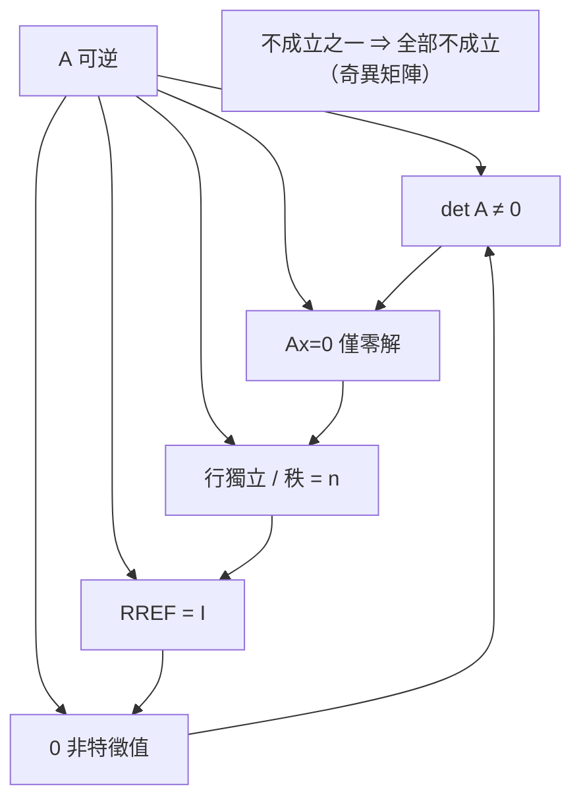

# 2.2 轉置逆與單位矩陣

## 前言：矩陣的「除法」

數有倒數，矩陣有沒有「逆」？這個問題的答案比想像中微妙：**有些矩陣可逆，有些不可逆**，而「可逆」這個性質正是線性代數最核心的分水嶺——它等價於「解唯一」「行列式非零」「行獨立」「秩滿」等十幾個看似無關的命題（本章 3.2 節將整理成著名的「可逆矩陣定理」）。本節我們定義轉置、單位矩陣與逆矩陣，學會求逆的方法，並看見「逆矩陣」在理論與實務上的不同面貌。

## 歷史前因後果

### 凱萊與逆矩陣的誕生

凱萊在 1858 年的《矩陣論回憶錄》中已經定義了單位矩陣與逆矩陣：矩陣 $A$ 的逆 $A^{-1}$ 是滿足 $AA^{-1} = A^{-1}A = I$ 的矩陣。他也指出了關鍵限制：只有**方陣**才可能有逆，而且必須行列式非零。

- **為什麼提出**：解方程組 $A\mathbf{x}=\mathbf{b}$ 時，人們自然希望能像解 $ax=b$ 一樣「兩邊除以 $A$」得到 $\mathbf{x} = A^{-1}\mathbf{b}$。凱萊證明這個願望在 $A$ 可逆時確實實現，並且解是唯一的。
- **解決了什麼問題**：理論上，「$A$ 可逆」成為「解存在且唯一」的代數判準；實務上，把方程組的結構從「逐條消去」升級為「一次性整體求解」。
- **引發了什麼新問題**：不是每個矩陣都可逆——不可逆（奇異）矩陣怎麼辦？這條線最後由摩爾（E. H. Moore, 1920）、彭若斯（Roger Penrose, 1955）的**偽逆**（pseudoinverse）回答，用於處理長方形矩陣與矛盾系統（9.3 節）。另一條線是：計算 $A^{-1}$ 是否值得？1940 年代末的數值分析師發現：**先算逆再乘，通常比直接解方程組更慢又更不精確**——這是理論與計算的著名張力，10.1 節將詳述。

### 轉置：從行列式繼承的對稱操作

轉置 $A^T$（列行互換）的歷史更深，可追溯到行列式理論：1812 年柯西（Augustin-Louis Cauchy, 1789–1857）證明行列式在轉置下不變，這使「列變換的性質自動成立於行變換」。內積 $(\mathbf{u},\mathbf{v}) = \mathbf{u}^T\mathbf{v}$ 用轉置表達後，對稱矩陣 $A = A^T$ 的研究（第 8 章）成為可能。希爾伯特空間理論（1900 年代）中的「伴隨算子」就是轉置的無窮維推廣，通往量子力學的自伴算子。

## 單位矩陣與轉置

### 單位矩陣

$n$ 階**單位矩陣** $I_n$ 是對角線為 1、其餘為 0 的方陣：

$$
I_3 = \begin{bmatrix} 1 & 0 & 0 \\ 0 & 1 & 0 \\ 0 & 0 & 1 \end{bmatrix}
$$

性質：$IA = AI = A$（尺寸允許時）。它是矩陣乘法的單位元素，也是初等變換「什麼都不做」的表現。注意：$I$ 可與任意矩陣交換（尺寸允許時），這是稀有的禮遇——矩陣世界裡大部分同伴不能交換。

### 轉置

$m\times n$ 矩陣 $A$ 的**轉置** $A^T$ 是 $n\times m$ 矩陣，$(A^T)_{ij} = a_{ji}$——把列行互換。性質：

| 性質 | 說明 |
|------|------|
| $(A^T)^T = A$ | 轉置兩次還原 |
| $(A+B)^T = A^T + B^T$ | 加法相容 |
| $(cA)^T = c\,A^T$ | 純量穿越 |
| $(AB)^T = B^TA^T$ | **順序反轉**！「穿襪子與穿鞋」 |
| $(A^T)^{-1} = (A^{-1})^T$ | 轉置與求逆可交換順序 |

$(AB)^T = B^TA^T$ 的直覺（鞋襪引理）：穿襪再穿鞋，脫掉時必須先脫鞋再脫襪——順序反轉。推廣：$(ABC)^T = C^TB^TA^T$。

特別地，內積可寫為 $\mathbf{u}\cdot\mathbf{v} = \mathbf{u}^T\mathbf{v}$，而 $\|\mathbf{v}\|^2 = \mathbf{v}^T\mathbf{v}$——轉置是連接代數與幾何的介面。特殊矩陣的分類：

| 名稱 | 條件 | 幾何／物理意義 |
|------|------|----------------|
| 對稱矩陣 | $A = A^T$ | 二次型、協方差矩陣、譜定理（第 8 章） |
| 反對稱矩陣 | $A^T = -A$ | 對角必為 0；旋轉的無窮小生成元 |
| 正交矩陣 | $Q^TQ = I$ | 保長度與角度（旋轉、反射），第 7 章 |
| 對角矩陣 | 非對角全為 0 | 各維度獨立縮放 |

## 逆矩陣

### 定義與唯一性

$n$ 階方陣 $A$ **可逆**（invertible / nonsingular），若存在 $n$ 階方陣 $A^{-1}$ 使

$$
AA^{-1} = A^{-1}A = I
$$

這時逆矩陣**唯一**：若 $AB = I = CA$，則 $B = IB = (CA)B = C(AB) = CI = C$。單側逆在方陣情況下就足以推得另一側——這是結合律送的禮。

注意：**非方陣不可能有雙側逆**（尺寸不匹配）；長方形矩陣的「單側逆」概念引向偽逆（9.3 節）。

### 2×2 的快速公式與一般公式

$$
A = \begin{bmatrix} a & b \\ c & d \end{bmatrix} \Rightarrow A^{-1} = \frac{1}{ad-bc}\begin{bmatrix} d & -b \\ -c & a \end{bmatrix}, \quad \text{當 } ad - bc \ne 0
$$

一般 $n$ 階可用伴隨矩陣：

$$
A^{-1} = \frac{1}{\det A}\,\mathrm{adj}(A)
$$

其中 $\mathrm{adj}(A)$ 由代數餘子式構成。但實務上 $O(n^3)$ 以上的成本使這公式只有理論價值；**數值計算一律用高斯–若爾當消去或 LU 分解**。

### 求逆的標準方法：高斯–若爾當

對 $[A \mid I]$ 做列變換，化成 $[I \mid A^{-1}]$。理由：若 $E_k\cdots E_1 A = I$，則同一串變換作用於 $I$ 得 $E_k\cdots E_1 I = A^{-1}$——同一套消去動作同時「清空 $A$」與「填入逆」。

### 逆的性質

| 性質 | 說明 |
|------|------|
| $(A^{-1})^{-1} = A$ | 逆的逆是原矩陣 |
| $(AB)^{-1} = B^{-1}A^{-1}$ | **順序反轉**（鞋襪引理再現） |
| $(A^T)^{-1} = (A^{-1})^T$ | 轉置與逆交換 |
| $(A^k)^{-1} = (A^{-1})^k$ | 冪的逆 |

$(AB)^{-1} = B^{-1}A^{-1}$ 的推論：交換矩陣 $S = \begin{bmatrix} 0 & 1 \\ 1 & 0 \end{bmatrix}$ 滿足 $S = S^{-1}$（做兩次交換回到原狀）；旋轉矩陣的逆是反向旋轉。

### 可逆性的等價刻畫（可逆矩陣定理節選）

以下對 $n$ 階方陣 $A$ 全部等價（完整清單見 3.2 節）：

1. $A$ 可逆；
2. $A\mathbf{x} = \mathbf{0}$ 只有零解；
3. $A\mathbf{x} = \mathbf{b}$ 對每個 $\mathbf{b}$ 恰有一解；
4. $A$ 的 RREF 是 $I$；
5. $A$ 的行線性獨立、且張成 $\mathbb{R}^n$；
6. $\det A \neq 0$（第 3 章）；
7. $A$ 的秩為 $n$（第 4 章）；
8. $0$ 不是 $A$ 的特徵值（第 6 章）。

這張清單是線性代數的「中央車站」：各章的理論在這裡交會。

## 例題

**例題 2.2-1（求逆與解方程）**：求 $A = \begin{bmatrix} 2 & 1 \\ 5 & 3 \end{bmatrix}$ 的逆，並用它解 $A\mathbf{x} = \begin{bmatrix} 4 \\ 11 \end{bmatrix}$。

**解**：$ad - bc = 6 - 5 = 1 \neq 0$，故可逆：

$$
A^{-1} = \frac{1}{1}\begin{bmatrix} 3 & -1 \\ -5 & 2 \end{bmatrix}
$$

驗算：$\begin{bmatrix} 2 & 1 \\ 5 & 3 \end{bmatrix}\begin{bmatrix} 3 & -1 \\ -5 & 2 \end{bmatrix} = \begin{bmatrix} 6-5 & -2+2 \\ 15-15 & -5+6 \end{bmatrix} = I$ ✓。

$$
\mathbf{x} = A^{-1}\mathbf{b} = \begin{bmatrix} 3 & -1 \\ -5 & 2 \end{bmatrix}\begin{bmatrix} 4 \\ 11 \end{bmatrix} = \begin{bmatrix} 12 - 11 \\ -20 + 22 \end{bmatrix} = \begin{bmatrix} 1 \\ 2 \end{bmatrix}
$$

**例題 2.2-2（高斯–若爾當求 3 階逆）**：求 $A = \begin{bmatrix} 1 & 0 & 2 \\ 0 & 1 & 1 \\ 1 & 1 & 4 \end{bmatrix}$ 的逆。

$$
\left[\begin{array}{ccc|ccc} 1 & 0 & 2 & 1 & 0 & 0 \\ 0 & 1 & 1 & 0 & 1 & 0 \\ 1 & 1 & 4 & 0 & 0 & 1 \end{array}\right]
\xrightarrow{R_3 \to R_3 - R_1}
\left[\begin{array}{ccc|ccc} 1 & 0 & 2 & 1 & 0 & 0 \\ 0 & 1 & 1 & 0 & 1 & 0 \\ 0 & 1 & 2 & -1 & 0 & 1 \end{array}\right]
$$

$$
\xrightarrow{R_3 \to R_3 - R_2}
\left[\begin{array}{ccc|ccc} 1 & 0 & 2 & 1 & 0 & 0 \\ 0 & 1 & 1 & 0 & 1 & 0 \\ 0 & 0 & 1 & -1 & -1 & 1 \end{array}\right]
\xrightarrow{R_1 \to R_1 - 2R_3,\ R_2 \to R_2 - R_3}
\left[\begin{array}{ccc|ccc} 1 & 0 & 0 & 3 & 2 & -2 \\ 0 & 1 & 0 & 1 & 2 & -1 \\ 0 & 0 & 1 & -1 & -1 & 1 \end{array}\right]
$$

故 $A^{-1} = \begin{bmatrix} 3 & 2 & -2 \\ 1 & 2 & -1 \\ -1 & -1 & 1 \end{bmatrix}$。驗算 $AA^{-1} = I$：第一列乘第一行 $1\cdot3 + 0\cdot1 + 2\cdot(-1) = 1$ ✓。

**例題 2.2-3（不可逆的辨識）**：$A = \begin{bmatrix} 1 & 3 \\ 2 & 6 \end{bmatrix}$。$ad - bc = 6 - 6 = 0$，不可逆。理由：第二行是第一行的 $3$ 倍，$A$ 把整個平面壓到一條直線上——資訊已丟失，不可能有矩陣能還原。用消去法看：$[A \mid I]$ 化簡後會出現 $[0 \mid 1]$ 型列，矛盾。這個例子同時預告 3.1 節：**行列式為零 ⇔ 體積被壓扁 ⇔ 不可逆**。

## 初等矩陣：把列變換變成矩陣

將單位矩陣做一次初等列變換所得的矩陣稱**初等矩陣**（elementary matrix）。三種類型：

| 類型 | 例子（3 階） | 對應列變換 |
|------|--------------|------------|
| 交換 | $S_{12} = \begin{bmatrix} 0 & 1 & 0 \\ 1 & 0 & 0 \\ 0 & 0 & 1 \end{bmatrix}$ | $R_1 \leftrightarrow R_2$ |
| 倍乘 | $M_2(3) = \begin{bmatrix} 1 & 0 & 0 \\ 0 & 3 & 0 \\ 0 & 0 & 1 \end{bmatrix}$ | $R_2 \to 3R_2$ |
| 倍加 | $E_{21}(4) = \begin{bmatrix} 1 & 0 & 0 \\ 4 & 1 & 0 \\ 0 & 0 & 1 \end{bmatrix}$ | $R_2 \to R_2 + 4R_1$ |

**關鍵定理**：左乘初等矩陣 ⇔ 做對應的列變換。推論：

- 每個初等矩陣都可逆，且其逆是同型初等矩陣；
- $A$ 可逆 $\iff$ $A$ 可寫成初等矩陣的乘積；
- 這就是 1.3 節 LU 分解 $A = LU$ 的正式基礎。

## 與其他領域的關聯

- **密碼學**：希爾密碼的解密金鑰就是加密矩陣的逆；矩陣可逆性直接決定密碼是否可用。
- **圖論／網路**：圖的生成樹計數（矩陣–樹定理）透過「刪行刪列的行列式」與可逆性連結。
- **機器學習**：正規方程中的 $X^TX$ 若不可逆（特徵共線性），需改用嶺迴歸 $X^TX + \lambda I$——加 $\lambda I$ 保證可逆，這是「正則化」的線性代數本質（10.2 節）。
- **微分方程**：一階線性系統解中的矩陣指數 $e^{At}$ 之逆為 $e^{-At}$；離散化的傳遞矩陣可逆性決定系統能否回溯。
- **量子力學**：演化算子 $U$ 滿足 $U^\dagger U = I$（酉矩陣，複數版的正交矩陣），「量子演化可逆」是物理基本要求。

## 本節小結

1. 轉置「列行互換」，乘法下順序反轉；$\mathbf{u}^T\mathbf{v}$ 把內積代數化，通往第 7、8 章。
2. 逆矩陣由 $AA^{-1}=I$ 定義、唯一、可用高斯–若爾當求出；$(AB)^{-1}=B^{-1}A^{-1}$ 的鞋襪原理反覆出現。
3. 「$A$ 可逆」有一整張等價清單，貫穿行列式、秩、特徵值各章。
4. 初等矩陣把列變換矩陣化，使 LU 分解與消去法理論獲得代數基礎。
5. 不可逆不是邊角情況：壓扁空間的矩陣到處都是，偽逆（9.3）與正則化是現代補救方案。

## 深入議題：逆矩陣的理論與實務

### 為什麼不該「先算逆再乘」？

理論上 $\mathbf{x} = A^{-1}\mathbf{b}$ 優雅；數值上這是反模式。原因有三：

1. **成本**：求 $A^{-1}$ 需要 LU 分解 + $n$ 次三角求解（$O(n^3) + O(n^3)$），而直接解 $A\mathbf{x}=\mathbf{b}$ 只需 $O(n^3) + O(n^2)$。
2. **精度**：$A^{-1}$ 的元素可能條件不佳，形成 $A^{-1}\mathbf{b}$ 時誤差再放大；直接 LU 求解的向後誤差更小。
3. **稀疏性**：$A$ 稀疏時 $A^{-1}$ 通常**稠密**——逆矩陣會摧毁稀疏結構，LU 分解（配合排序）則多數情況保持稀疏。

1970 年代 Forsythe–Moler 的經典教科書已明文警告；今天 LAPACK 的文件仍重複同一句話：**「Don't invert, solve.」**這是「數學恆等式 ≠ 計算程序」的最好教材。

### 條件數的第一次出場

對可逆 $A$，解 $A\mathbf{x} = \mathbf{b}$ 的相對誤差滿足

$$
\frac{\|\Delta\mathbf{x}\|}{\|\mathbf{x}\|} \le \|A\|\,\|A^{-1}\|\cdot\frac{\|\Delta\mathbf{b}\|}{\|\mathbf{b}\|} = \kappa(A)\,\frac{\|\Delta\mathbf{b}\|}{\|\mathbf{b}\|}
$$

乘積 $\kappa(A) = \|A\|\|A^{-1}\|$ 稱**條件數**——誤差放大器（9.3 節完整發展）。此處先記住直覺：$\kappa$ 大 = 矩陣「接近奇異」= 解對資料極敏感。**注意**：$\kappa(A)$ 是矩陣的屬性，與 $\mathbf{b}$ 無關；挑對演算法改變不了 $\kappa$，只能避免雪上加霜。

### 伴隨矩陣的恆等式

凱萊時代的公式

$$
A\,\mathrm{adj}(A) = (\det A)\,I
$$

是 3.2 節可逆矩陣定理「$\det A \ne 0 \Rightarrow A^{-1} = \mathrm{adj}(A)/\det A$」的證明核心，也直接推出克萊姆法則（把恆等式逐行讀出）。$n = 3$ 時共 9 個二階行列式、$n = 10$ 時是 100 個九階行列式——計算量隨 $n$ 爆炸，再次印證「公式漂亮 ≠ 計算可行」。

## 矩陣函數與群的視角

### 可逆矩陣構成一個群

滿足以下三點的物件集合 $GL_n(\mathbb{R})$（可逆 $n$ 階實矩陣）構成**群**：封閉（$A, B$ 可逆 → $AB$ 可逆）、結合律、單位元 $I$、反元素 $A^{-1}$。這個群是**李群**（Lie group）最著名的例子之一——它的「無窮小鄰域」的代數（矩陣指數 $e^{tA}$）正是微分方程與剛體力學的數學基礎。

正交矩陣 $Q^TQ = I$ 構成子群 $O(n)$；$\det = 1$ 的旋轉群 $SO(n)$ 是其指標 2 的子群——**「旋轉」與「反射」的分類（3.3 節）在群論中就是這兩個連通分支**。

### 矩陣指數預告

定義 $e^{A} = \sum_{k\ge0}\frac{A^k}{k!}$。對可交換的 $A, B$（例如 $A$ 與 $I$）指數律成立；一般情況**不成立**，且

$$
e^{A}e^{B} \neq e^{B}e^{A} \iff AB \neq BA \quad \text{（等價！）}
$$

著名恆等式：$e^{\theta S} = \cos\theta\,I + \sin\theta\,S$，其中 $S = \begin{bmatrix} 0 & -1 \\ 1 & 0\end{bmatrix}$（$90°$ 旋轉生成元，$S^2 = -I$）——**旋轉矩陣是指數函數**，這是 6.3 節複特徵值 $e^{i\theta}$ 的矩陣版本，也是微分方程組 $\mathbf{x}' = A\mathbf{x}$ 解為 $e^{At}\mathbf{x}_0$ 的根據（第 6 章）。

## 例題（續）

**例題 2.2-4（用逆解矩陣方程）**：解 $\begin{bmatrix} 2 & 1 \\ 1 & 1 \end{bmatrix}X\begin{bmatrix} 1 & 2 \\ 0 & 1 \end{bmatrix} = \begin{bmatrix} 4 & 5 \\ 3 & 4 \end{bmatrix}$。

**解**：兩邊左乘 $A^{-1}$、右乘 $B^{-1}$：$X = A^{-1}\begin{bmatrix} 4 & 5 \\ 3 & 4 \end{bmatrix}B^{-1}$。

$A^{-1} = \begin{bmatrix} 1 & -1 \\ -1 & 2 \end{bmatrix}$（$\det A = 1$）；$B^{-1} = \begin{bmatrix} 1 & -2 \\ 0 & 1 \end{bmatrix}$（$\det B = 1$）。

$$
A^{-1}\begin{bmatrix} 4 & 5 \\ 3 & 4 \end{bmatrix} = \begin{bmatrix} 4-3 & 5-4 \\ -4+6 & -5+8 \end{bmatrix} = \begin{bmatrix} 1 & 1 \\ 2 & 3 \end{bmatrix}
$$

$$
X = \begin{bmatrix} 1 & 1 \\ 2 & 3 \end{bmatrix}\begin{bmatrix} 1 & -2 \\ 0 & 1 \end{bmatrix} = \begin{bmatrix} 1 & -1 \\ 2 & -1 \end{bmatrix}
$$

驗算左側：$AX = \begin{bmatrix} 2&1\\1&1\end{bmatrix}\begin{bmatrix}1&-1\\2&-1\end{bmatrix} = \begin{bmatrix}4&-3\\3&-2\end{bmatrix}$；$AXB = \begin{bmatrix}4&-3\\3&-2\end{bmatrix}\begin{bmatrix}1&2\\0&1\end{bmatrix} = \begin{bmatrix}4&5\\3&4\end{bmatrix}$ ✓。

**例題 2.2-5（正交矩陣的預演）**：驗證 $Q = \frac{1}{\sqrt2}\begin{bmatrix} 1 & -1 \\ 1 & 1 \end{bmatrix}$ 滿足 $Q^TQ = I$，並計算 $\det Q$。

$$
Q^TQ = \frac12\begin{bmatrix} 1 & 1 \\ -1 & 1 \end{bmatrix}\begin{bmatrix} 1 & -1 \\ 1 & 1 \end{bmatrix} = \frac12\begin{bmatrix} 2 & 0 \\ 0 & 2 \end{bmatrix} = I \checkmark
$$

$\det Q = \frac12(1\cdot1 - (-1)\cdot1) = 1$——**保定向的正交矩陣 = 旋轉**（角度 $\arctan(1/1)\cdot$ 符號判讀 = $45°$）。求逆免費：$Q^{-1} = Q^T = \frac{1}{\sqrt2}\begin{bmatrix} 1 & 1 \\ -1 & 1 \end{bmatrix}$（即反向旋轉 $45°$）。

## 練習題

1. 用兩種方法求 $A = \begin{bmatrix} 4 & 7 \\ 2 & 6 \end{bmatrix}$ 的逆（公式法與高斯–若爾當），核對一致。
2. 證明：若 $A$ 可逆且 $AB = O$，則 $B = O$。逆矩陣的什麼性質使「消去律」恢復？
3. 設 $A$ 滿足 $A^2 + 2A + I = O$。證明 $A$ 可逆並求 $A^{-1}$（用 $A$ 表示）。（答：$A^{-1} = -A - 2I$。）
4. 證明上三角可逆矩陣的逆仍上三角。
5. 計算 $\det\left(\mathrm{adj}(A)\right)$ 與 $\det A$ 的關係（$n$ 階）。（答：$\det\,\mathrm{adj}(A) = (\det A)^{n-1}$。）
6. （思考）非方陣 $m\times n$（$m \ne n$）為什麼不可能有雙側逆？用「維度守恆」（第 4 章預告）的語言解釋。

**預告**：矩陣太大時，能否切成小塊處理？下一節 2.3 介紹**分塊矩陣**——工程與數值計算中管理龐大矩陣的標準手藝。
