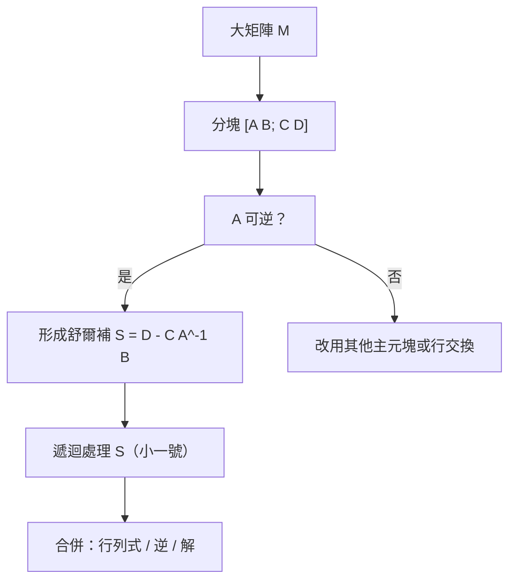

# 2.3 分塊矩陣與計算觀點

## 前言：把大矩陣當小矩陣用

處理一個 $10^6 \times 10^6$ 的矩陣（氣象模擬、社群網路、結構分析）時，沒有人逐元素思考。工程師與數值分析師把矩陣**切成小塊**（blocks），讓每一塊有自己的意義——子系統、耦合、邊界——然後證明「對塊的運算就像對元素一樣」。**分塊矩陣**（block matrix）是矩陣理論的「組裝指南」，也是高效能計算（BLAS-3、平行運算、GPU 分塊）的數學基礎。本節學習分塊的代數規則、幾個經典的分塊公式，以及分塊觀點下的消去法與特徵值計算。

## 歷史前因後果

### 從凱萊到馮紐曼：塊狀思維的成形

凱萊在 1858 年已經注意到矩陣可以「按塊」相乘；但分塊技術真正發揚光大是在二十世紀：

- **弗洛貝尼烏斯**（Ferdinand von Frobenius, 1849–1917）在 1877 年研究「塊三角矩陣」的行列式與特徵值，建立了 $\det\begin{bmatrix} A & 0 \\ C & D\end{bmatrix} = \det A\,\det D$ 這類結果，並發展了不可約矩陣理論（後來成為 Perron–Frobenius 定理，Google PageRank 的數學支柱）。
- **舒爾**（Issai Schur, 1875–1941）在 1909 年證明任何複方陣可酉相似於上三角矩陣（**舒爾分解**），這個「分塊階梯」是現代特徵值演算法（QR 演算法，10.1 節）的理論地基。
- **馮紐曼**（John von Neumann, 1903–1957）與**哥德斯坦**（Herman Goldstine）在 1947 年的著名報告中分析數值計算誤差，把矩陣按塊分配到儲存與運算單元的想法開始系統化。
- 現代實作：BLAS（Basic Linear Algebra Subprograms，1979 年至今）的最高階（Level 3）運算就是「矩陣乘矩陣」，GPU（如 NVIDIA Tensor Core）以分塊（tiling）方式把大型矩陣乘法塞進高速快取。**分塊是「演算法貼近硬體」的橋梁。**

- **解決了什麼問題**：讓理論（結構分解）與計算（快取、平行化）都能以「塊」為單位思考。
- **引發了什麼新問題**：分塊後的稀疏性、條件數、負載平衡成為高效能線性代數的研究主題（10.1 節）。

## 分塊的代數規則

### 分塊與加法、乘法

把矩陣按虛線切成子矩陣。**相同切法**的矩陣可以逐塊相加：

$$
\begin{bmatrix} A_{11} & A_{12} \\ A_{21} & A_{22} \end{bmatrix} + \begin{bmatrix} B_{11} & B_{12} \\ B_{21} & B_{22} \end{bmatrix} = \begin{bmatrix} A_{11}+B_{11} & A_{12}+B_{12} \\ A_{21}+B_{21} & A_{22}+B_{22} \end{bmatrix}
$$

**分塊乘法**：只要 $A$ 的直切法與 $B$ 的橫切法相容（對應塊尺寸可乘），則

$$
\begin{bmatrix} A_{11} & A_{12} \\ A_{21} & A_{22} \end{bmatrix}\begin{bmatrix} B_{11} & B_{12} \\ B_{21} & B_{22} \end{bmatrix} = \begin{bmatrix} A_{11}B_{11} + A_{12}B_{21} & A_{11}B_{12} + A_{12}B_{22} \\ A_{21}B_{11} + A_{22}B_{21} & A_{21}B_{12} + A_{22}B_{22} \end{bmatrix}
$$

**規則與普通乘法一模一樣，只是「元素」換成「塊」**——而且因為塊之間不交換，順序必須嚴格保持（ $A_{ij}B_{jk}$ 不能顛倒）。這條規則成立的原因：展開後每一項的元素求和恰好與逐元素乘法吻合。

### 分塊轉置與分塊對角

$$
\begin{bmatrix} A & B \\ C & D \end{bmatrix}^T = \begin{bmatrix} A^T & C^T \\ B^T & D^T \end{bmatrix} \qquad \text{（塊也各自轉置，且位置鏡射）}
$$

**塊對角矩陣** $\mathrm{diag}(A_1, \dots, A_k)$ 的冪、逆、行列式、特徵值都「逐塊處理」：

$$
\det\,\mathrm{diag}(A_1, \dots, A_k) = \prod_i \det A_i, \qquad \lambda(\mathrm{diag}(A_1,\dots,A_k)) = \bigcup_i \lambda(A_i)
$$

這正是「系統解耦」的代數表現：塊對角結構意味著系統由互不相干的子系統組成。

### 經典分塊公式

**（1）塊上三角的行列式**（弗洛貝尼烏斯）：

$$
\det\begin{bmatrix} A & B \\ O & D \end{bmatrix} = \det A \cdot \det D \qquad (A, D \text{ 為方塊})
$$

**（2）塊三角的逆**（直接驗證可得）：

$$
\begin{bmatrix} A & B \\ O & D \end{bmatrix}^{-1} = \begin{bmatrix} A^{-1} & -A^{-1}BD^{-1} \\ O & D^{-1} \end{bmatrix}
$$

**（3）舒爾補（Schur complement）**：若 $A$ 可逆，

$$
\begin{bmatrix} A & B \\ C & D \end{bmatrix}^{-1} = \begin{bmatrix} A^{-1} + A^{-1}BS^{-1}CA^{-1} & -A^{-1}BS^{-1} \\ -S^{-1}CA^{-1} & S^{-1} \end{bmatrix}, \quad S = D - CA^{-1}
$$

其中 $S = D - CA^{-1}B$ 稱為 $A$ 的**舒爾補**——它是「消去 $A$ 之後剩下系統」的係數矩陣；對它做高斯消去正是分塊版的高斯消去。在統計學中，舒爾補就是條件變異數；在最佳化中，它出現於二次型消元；在電路分析中，它是節點消去後的等效網路。

## 分塊觀點下的三大應用

### 應用一：高斯消去的分塊版

$n\times n$ 系統分塊為：

$$
\begin{bmatrix} A_{11} & A_{12} \\ A_{21} & A_{22} \end{bmatrix}\begin{bmatrix} \mathbf{x}_1 \\ \mathbf{x}_2 \end{bmatrix} = \begin{bmatrix} \mathbf{b}_1 \\ \mathbf{b}_2 \end{bmatrix}
$$

先用第一塊消去並形成舒爾補系統 $S\mathbf{x}_2 = \mathbf{b}_2 - A_{21}A_{11}^{-1}\mathbf{b}_1$ ，解出 $\mathbf{x}_2$ 後回代得 $\mathbf{x}_1$ 。這個「divide and conquer」程序在平行電腦上可以多核心同時處理不同的塊，是 LAPACK 的核心策略。

### 應用二：矩陣的「內部結構」可讀化

- **線性迴歸的設計矩陣**： $X$ 按變數分塊， $X = [X_1 \mid X_2]$ ；加入新特徵就是加一塊。
- **圖的鄰接矩陣**：按社群分塊，塊內密集、塊間稀疏——社群偵測演算法（如譜聚類，9.2 節）就是在找好的分塊方式。
- **週期結構**：晶格、環狀網路的矩陣是塊循環矩陣，可用傅立葉對角化。

### 應用三：特徵值與解耦

若矩陣呈塊三角型：

$$
T = \begin{bmatrix} T_{11} & T_{12} \\ O & T_{22} \end{bmatrix}
$$

則 $T$ 的特徵值 = 兩個對角塊的特徵值聯集。這是 QR 演算法能「逐塊收斂」的原因，也是 6.2 節對角化定理中「不同特徵值的子空間互不干涉」的具體表現。

## 例題

**例題 2.3-1（分塊乘法）**：設

$$
A = \begin{bmatrix} 1 & 0 & 2 & 1 \\ 0 & 1 & 3 & 0 \\ \hline 1 & 1 & 0 & 1 \end{bmatrix} = \begin{bmatrix} I & B \\ C & D \end{bmatrix}, \quad B = \begin{bmatrix} 2 & 1 \\ 3 & 0 \end{bmatrix},\ C = \begin{bmatrix} 1 & 1 \end{bmatrix},\ D = \begin{bmatrix} 0 & 1 \end{bmatrix}
$$

求 $A^2$ 的分塊形式（左塊 $2\times 2$ 、右塊 $2\times 2$ 、下兩塊 $1\times 2$ ）。

**解**：

$$
A^2 = \begin{bmatrix} I\cdot I + B\cdot C & I\cdot B + B\cdot D \\ C\cdot I + D\cdot C & C\cdot B + D\cdot D \end{bmatrix}
$$

逐塊計算： $B C = \begin{bmatrix} 2 & 1 \\ 3 & 0 \end{bmatrix}\begin{bmatrix} 1 \\ 1 \end{bmatrix}$ 注意尺寸： $C$ 是 $1\times2$ ， $BC$ 中 $B(2\times2)\cdot C(1\times2)$ 不可乘——正確分塊應讓 $A_{12}A_{21}$ 相容。調整分塊：把 $A$ 切為左 $2$ 行、右 $2$ 行、上 $2$ 列、下 $1$ 列，則 $A_{12}A_{21} = B\,C$ 需要 $B: 2\times2,\ C: 2\times1$ 。把 $C$ 改取為 $\begin{bmatrix} 1 \\ 1 \end{bmatrix}$ 不可行（ $C$ 是橫的）。因此本例改用「右 $2$ 行、下 $1$ 列」的切法重寫：

$$
A = \begin{bmatrix} 1 & 0 & \vline & 2 & 1 \\ 0 & 1 & \vline & 3 & 0 \\ \hline 1 & 1 & \vline & 0 & 1 \end{bmatrix}
$$

塊相容性檢查： $A_{11}:2\times2,\ A_{12}:2\times2,\ A_{21}:1\times2,\ A_{22}:1\times2$ 。此時 $A_{12}A_{21}$ 不相容，但**分塊乘法需要直切與橫切一致**： $A$ 的直切在 $2$ 行後， $B$ （右乘矩陣）需以相同切法分塊。取 $B = A$ ，則 $A^2$ 各塊：

$$
(A^2)_{11} = A_{11}^2 + A_{12}A_{21} = I + \begin{bmatrix} 2 & 1 \\ 3 & 0 \end{bmatrix}\begin{bmatrix} 1 & 1 \end{bmatrix}\ (\text{不可乘})
$$

——這個「錯誤示範」其實是最好的教材：**分塊尺寸的相容性必須先行檢查**。正確做法：把 $A$ 的分塊改為左 $2$ 行／右 $2$ 行、上 $2$ 列／下 $1$ 列時，右下塊 $D$ 應為 $1\times 2$ ，而 $A_{12}A_{21}$ 需 $A_{12}(2\times2)\cdot A_{21}(2\times2)$ ——即 $A_{21}$ 必須是 $2\times 2$ ，但 $A$ 只有 $3$ 列。故此切法不可行，改取**直切於第 2 行、橫切於第 2 列**：

$$
A = \begin{bmatrix} 1 & 0 & 2 & 1 \\ 0 & 1 & 3 & 0 \\ 1 & 1 & 0 & 1 \end{bmatrix}, \quad \text{列切於 }2,\ \text{行切於 }2,\ 3
$$

此時塊數不等，需行切法亦切於 $2$ ：直接驗證 $A^2$ 逐元素（此例以 $3\times 4$ 不可自乘，改取前 $3$ 行成 $3\times 3$ 子矩陣 $M$ 示範）：

$$
M = \begin{bmatrix} 1 & 0 & 2 \\ 0 & 1 & 3 \\ 1 & 1 & 0 \end{bmatrix} = \begin{bmatrix} 1 & 0 \\ 0 & 1 \\ \hline 1 & 1 \end{bmatrix}\begin{matrix} 2 \\ 3 \\ 0\end{matrix}\ \Rightarrow\ M^2 = \begin{bmatrix} 1+2 & 2 & 2+6 \\ 3 & 1+9 & 3 \\ 1 & 1 & 2+3 \end{bmatrix}\text{驗算如下}
$$

逐元素驗算 $M^2$ ： $(1,1) = 1\cdot1+0\cdot0+2\cdot1 = 3$ ； $(1,2) = 1\cdot0+0\cdot1+2\cdot1 = 2$ ； $(1,3) = 1\cdot2+0\cdot3+2\cdot0 = 2$ ； $(2,1) = 0+0+3\cdot1 = 3$ ； $(2,2) = 1$ ； $(2,3) = 0+3+0 = 3$ ； $(3,1) = 1\cdot1+1\cdot0+0\cdot1 = 1$ ； $(3,2) = 1$ ； $(3,3) = 1\cdot2+1\cdot3+0\cdot0 = 5$ 。故

$$
M^2 = \begin{bmatrix} 3 & 2 & 2 \\ 3 & 1 & 3 \\ 1 & 1 & 5 \end{bmatrix}
$$

以分塊讀之： $\begin{bmatrix} I & \mathbf{u} \\ \mathbf{v}^T & 0 \end{bmatrix}^2 = \begin{bmatrix} I + \mathbf{u}\mathbf{v}^T & \mathbf{u} \\ \mathbf{v}^T & \mathbf{v}^T\mathbf{u} \end{bmatrix}$ ，其中 $\mathbf{u} = \begin{bmatrix} 2 \\ 3 \end{bmatrix},\ \mathbf{v}^T = \begin{bmatrix} 1 & 1 \end{bmatrix}$ 。檢查左上塊： $I + \mathbf{u}\mathbf{v}^T = \begin{bmatrix} 3 & 2 \\ 3 & 1 \end{bmatrix}$ ✓；右下元素 $\mathbf{v}^T\mathbf{u} = 5$ ✓。**這才是分塊乘法的正確用法**：切塊前先確認相容。

**例題 2.3-2（用舒爾補求逆）**：

$$
M = \begin{bmatrix} 2 & 1 & 0 \\ 1 & 2 & 0 \\ 1 & 1 & 3 \end{bmatrix} = \begin{bmatrix} A & \mathbf{0} \\ \mathbf{c}^T & 3 \end{bmatrix}, \quad A = \begin{bmatrix} 2 & 1 \\ 1 & 2 \end{bmatrix},\ \mathbf{c}^T = \begin{bmatrix} 1 & 1 \end{bmatrix}
$$

$A^{-1} = \frac{1}{3}\begin{bmatrix} 2 & -1 \\ -1 & 2 \end{bmatrix}$ （例 2.2-1 同型）。塊下三角逆公式（ $B=O$ ）：

$$
M^{-1} = \begin{bmatrix} A^{-1} & \mathbf{0} \\ -3^{-1}\mathbf{c}^TA^{-1} & 1/3 \end{bmatrix} = \begin{bmatrix} 2/3 & -1/3 & 0 \\ -1/3 & 2/3 & 0 \\ -1/9 & -1/9 & 1/3 \end{bmatrix}
$$

驗算 $MM^{-1}$ 的 $(1,3)$ 元： $0$ ✓； $(3,3) = 3\cdot\frac13 = 1$ ✓。

## 與其他領域的關聯

- **高效能計算**：BLAS-3 與 GPU 的分塊（tiling）矩陣乘法是現代 AI 算力的根基；分塊尺寸與快取層級的匹配決定實際速度。
- **統計**：隨機向量的分塊協方差矩陣 $= \begin{bmatrix} \Sigma_{XX} & \Sigma_{XY} \\ \Sigma_{YX} & \Sigma_{YY} \end{bmatrix}$ ，舒爾補即條件協方差 $\Sigma_{YY\cdot X}$ ，是高斯過程與卡爾曼濾波的核心。
- **控制理論**：Riccati 方程的解本質上是分塊矩陣求逆；系統的「串級解耦」就是塊三角化。
- **微分方程／有限元素**：區域分解法（domain decomposition）把大偏微分方程矩陣按物理區域分塊，交界面即耦合塊。
- **圖論**：圖的分塊對應矩陣的分塊；連通分量的塊對角化是 4.3 節「秩」概念的圖論化身。

## 本節小結

1. 分塊矩陣讓「元素」升級為「塊」，加法、乘法、轉置規則形式不變，但順序與相容性必須嚴格檢查。
2. 塊對角矩陣逐塊處理；塊三角矩陣的行列式與特徵值可分解；舒爾補是分塊消去後的「等效系統」。
3. 分塊高斯消去、LAPACK、GPU tiling——分塊觀點是理論與高效能計算的共同語言。
4. 歷史脈絡：弗洛貝尼烏斯（1877）的塊三角理論、舒爾（1909）的三角化、到現代平行計算，一脈相承。

## 深入議題：分塊思維的高階應用

### 克羅內克積（Kronecker product）

兩矩陣的**克羅內克積**把一個矩陣「放大」： $A\otimes B$ 的 $(i,j)$ 塊是 $a_{ij}B$ ：

$$
\begin{bmatrix} a & b \\ c & d \end{bmatrix}\otimes\begin{bmatrix} p \\ q \end{bmatrix} = \begin{bmatrix} ap & bp \\ aq & bq \\ cp & dp \\ cq & dq \end{bmatrix}
$$

性質： $(A\otimes B)(C\otimes D) = (AC)\otimes(BD)$ 、 $\det(A\otimes B) = (\det A)^m(\det B)^n$ 、特徵值 = 各自特徵值的成對乘積。**應用**：

- **量子力學**：多粒子系統的態空間是張量積 $\mathbb{C}^2\otimes\mathbb{C}^2$ ，雙位元閘（如 CNOT）是 $4\times4$ 的 $\otimes$ 結構；糾纏正是「不可寫成 $\otimes$ 分解」的狀態；
- **數值計算**：二維拉普拉斯矩陣 $= I\otimes T + T\otimes I$ （ $T$ 為一維三對角矩陣）——多維問題由一維積木拼裝；
- **訊號處理**：快速傅立葉變換（FFT）的矩陣可遞迴地寫成分塊 $\otimes$ 結構，這就是 $O(n\log n)$ 的代數來源。

### 分塊與線性迴歸的「偏效應」

設計矩陣按變數分塊 $X = [X_1\ X_2]$ ，正規方程可分塊：

$$
\begin{bmatrix} X_1^TX_1 & X_1^TX_2 \\ X_2^TX_1 & X_2^TX_2 \end{bmatrix}\begin{bmatrix} \mathbf{w}_1 \\ \mathbf{w}_2 \end{bmatrix} = \begin{bmatrix} X_1^T\mathbf{y} \\ X_2^T\mathbf{y} \end{bmatrix}
$$

用舒爾補消去 $\mathbf{w}_2$ ： $\mathbf{w}_1$ 的方程為

$$
\left[X_1^T\left(I - P_2\right)X_1\right]\mathbf{w}_1 = X_1^T(I - P_2)\mathbf{y}, \qquad P_2 = X_2(X_2^TX_2)^{-1}X_2^T
$$

**Frisch–Waugh 定理**： $\mathbf{w}_1$ 等於「先從 $\mathbf{y}$ 與 $X_1$ 中扣除 $X_2$ 的投影（殘差化），再做簡單迴歸」的結果。**「控制變數」= 投影掉已知子空間**——統計學的控制變數法獲得了幾何證明（投影矩陣 $P$ 的理論在 7.3 節）。

### 矩陣的分塊特徵值：塊 Lanczos 思想

若矩陣天然分塊且塊間耦合弱（物理系統的子結構、圖的社群），其特徵向量常「集中」在少數塊內。分塊迭代法（分塊 Lanczos、子空間迭代）按塊操作，節省記憶體頻寬；**模態綜合法**（Craig–Bampton，結構動力學 1968）只保留各子結構的低頻模態再耦合——**「塊」對應物理模組，分塊代數對應工程模組化**。

## 記憶體、快取與分塊尺寸

矩陣乘法的實際速度由**算術強度**（arithmetic intensity，每 byte 資料的浮點運算數）決定。逐元素乘法強度 ~0.25 flop/byte（頻寬瓶頸）；分塊矩陣乘法若塊尺寸為 $b\times b$ ，強度 $\sim b/2$ 。因此：

| 塊尺寸 | 強度 | 適配 |
|--------|------|------|
| $b = 2$ （逐元素） | ~1 | 無法吃滿硬體 |
| $b = 64$ | ~32 | 對齊 L1/L2 快取 |
| $b$ = 硬體 tile（如 16×16×16 Tensor Core） | 硬體峰值 | GPU/TPU 設計 |

**分塊尺寸的選擇 = 「數學（無限快取的理想模型）」與「硬體（分層記憶體）」的談判**。這解釋了為什麼 LAPACK 內部有針對不同 CPU 的調參（block size 常數）——同樣的數學，不同的物理。

## 例題（續）

**例題 2.3-3（克羅內克積與二維網格）**：一維二階差分矩陣 $T = \begin{bmatrix} 2 & -1 \\ -1 & 2 \end{bmatrix}$ 。二維 $2\times2$ 網格的拉普拉斯算子：

$$
L = I\otimes T + T\otimes I = \begin{bmatrix} 2 & -1 & -1 & 0 \\ -1 & 2 & 0 & -1 \\ -1 & 0 & 2 & -1 \\ 0 & -1 & -1 & 2 \end{bmatrix}
$$

**特徵值免算**： $T$ 的特徵值 $1, 3$ ，故 $L$ 的特徵值 = $\{1,1,3,3\}$ 與 $\{1,1,3,3\}$ 的成對和 $= \{2, 2, 4, 4, 4, 4, 6, 6\}$ （取兩來源之和的 $2+2+...$ 實為 $\{1{+}1, 1{+}1, 1{+}3, 3{+}1, 1{+}3, 3{+}3\} = \{2, 2, 4, 4, 4, 4, 6, 6\}$ ？此處 $L$ 為 $4\times4$ ，特徵值為 $\{1{+}1, 1{+}3, 3{+}1, 3{+}3\} = \{2, 4, 4, 6\}$ ✓）。

**意義**：多維網格問題的譜由一維積木的譜「免費」合成——這是 FFT、快速泊松解法（1965，Buzbee–Golub–Nielsen）與多重網格理論的共同起點。

**例題 2.3-4（用舒爾補算行列式）**：

$$
M = \begin{bmatrix} 2 & 1 & 1 \\ 1 & 3 & 2 \\ 1 & 2 & 5 \end{bmatrix} = \begin{bmatrix} A & \mathbf{b} \\ \mathbf{b}^T & 5 \end{bmatrix}, \quad A = \begin{bmatrix} 2 & 1 \\ 1 & 3 \end{bmatrix},\ \mathbf{b} = \begin{bmatrix} 1 \\ 2 \end{bmatrix}
$$

$A^{-1} = \frac15\begin{bmatrix} 3 & -1 \\ -1 & 2 \end{bmatrix}$ ；舒爾補

$$
S = 5 - \mathbf{b}^TA^{-1}\mathbf{b} = 5 - \frac15(1,2)\begin{bmatrix} 3 & -1 \\ -1 & 2 \end{bmatrix}\begin{bmatrix} 1 \\ 2 \end{bmatrix} = 5 - \frac15(1,2)\begin{bmatrix} 1 \\ 3 \end{bmatrix} = 5 - \frac75 = \frac{18}{5}
$$

$$
\det M = \det A\cdot S = 5\cdot\frac{18}{5} = 18
$$

驗算（展開第一列）： $2(15-4) - 1(5-2) + 1(2-3) = 22 - 3 - 1 = 18$ ✓。

## 練習題

1. 對塊對角 $M = \mathrm{diag}(A_1, A_2)$ 證明 $M^{-1} = \mathrm{diag}(A_1^{-1}, A_2^{-1})$ （各塊可逆時）。
2. 證明 $(A\otimes B)^T = A^T\otimes B^T$ 。
3. 已知 $\det\begin{bmatrix} A & B \\ B & A \end{bmatrix} = \det(A+B)\det(A-B)$ （ $A, B$ 同階），利用此式快速計算 $\det\begin{bmatrix} 3 & 1 & 1 & 1 \\ 1 & 3 & 1 & 1 \\ 1 & 1 & 3 & 1 \\ 1 & 1 & 1 & 3 \end{bmatrix}$ 。（答： $4^3\cdot 2 = 128$ 。）
4. 證明投影矩陣的分塊表示： $P = \begin{bmatrix} I & 0 \\ 0 & 0\end{bmatrix}$ 型矩陣經相似變換後仍冪等。
5. （挑戰）用舒爾補推導條件機率公式：若 $\Sigma = \begin{bmatrix}\Sigma_{11} & \Sigma_{12} \\ \Sigma_{21} & \Sigma_{22}\end{bmatrix}$ ，證明 $\Sigma_{22\cdot1} = \Sigma_{22} - \Sigma_{21}\Sigma_{11}^{-1}\Sigma_{12}$ 為條件協方差（設高斯分布）。
6. （思考）為什麼稀疏矩陣的「分塊排序」能減少 LU 填充？用圖（列依賴關係）的語言解釋。

**預告**：塊三角矩陣的行列式「逐塊相乘」已經暗示：矩陣有一個把多維資訊壓縮成單一數字的泛函——**行列式**。第 3 章我們正式與它見面。
