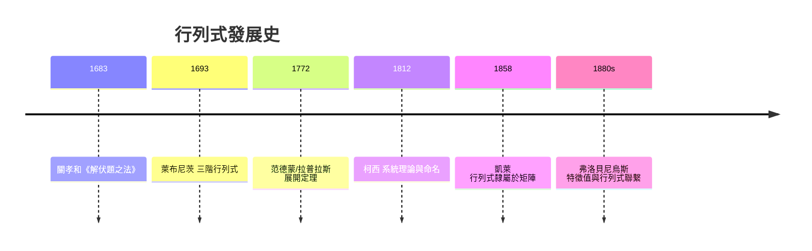

# 3.1 行列式的歷史與定義

## 前言：一個從方程組裡誕生的數

矩陣把整個方程組壓成一張表，而行列式則把整個矩陣壓成**一個數**。這個數告訴你：方程組有沒有唯一解、矩陣是否可逆、空間被拉伸了幾倍、方向是否翻轉。行列式是線性代數中「定義最古怪、意義最深遠」的物件——它的公式像天書，幾何意義卻出奇地直觀（3.3 節：體積）。本節我們重走它的歷史之路，從萊布尼茨與關孝和，到凱萊的抽象定義，再到現代的公理化觀點。

## 歷史前因後果

### 關孝和與萊布尼茨：同時代的雙星

- 日本和算家**關孝和**（Seki Takakazu, 1642–1708）在 1683 年的《解伏題之法》中，為了解五元聯立方程組，系統地使用了類似行列式的消去判準——比歐洲早約十年。
- 德國的**萊布尼茨**（Gottfried Wilhelm Leibniz, 1646–1716）在 1693 年致洛必達的信中給出三階行列式的記號與展開法，他稱之為「resultant」。他的動機同樣是線性方程組：何時有解？如何判別？可惜萊布尼茨的手稿多年未被發表，影響有限。

### 柯西與凱萊：從判準到理論

- 1812 年，**柯西**（Augustin-Louis Cauchy, 1789–1857）發表行列式的系統理論，引入「determinant（決定者）」一詞（1815 年正式定名）——因為它「決定」了方程組的可解性。柯西證明了乘法公式 $\det(AB) = \det A\,\det B$ 與轉置不變性。
- 1850 年，**西爾維斯特**提出「矩陣」一詞時，行列式已是成熟理論；正是為了避免與行列式混淆，他才另取新名。
- 1858 年，**凱萊**給出現代觀點：行列式是矩陣的函數 $\det: M_n \to \mathbb{R}$，滿足特定公理。矩陣與行列式的從屬關係從此逆轉——先有矩陣，行列式是它的屬性。
- **引發的新問題**：$n$ 增大時 $\det$ 的多項式項數以 $n!$ 爆炸（$n=20$ 已約 $2.4\times10^{18}$ 項），迫使數學家尋找「不必展開」的性質（列變換、餘子式），以及數值計算上改用 LU 分解（$\frac{2}{3}n^3$ 次運算）。

## 定義：三條道路

### 道路一：全排列公式（凱萊式定義）

$n$ 階方陣 $A = [a_{ij}]$ 的行列式：

$$
\det A = \sum_{\sigma \in S_n} \mathrm{sgn}(\sigma)\, a_{1\sigma(1)}a_{2\sigma(2)}\cdots a_{n\sigma(n)}
$$

其中 $\sigma$ 走遍 $\{1,\dots,n\}$ 的所有 $n!$ 個排列，$\mathrm{sgn}(\sigma)$ 是排列的**正負號**（逆序數為偶則 $+1$，奇則 $-1$）。

**範例**：$2\times 2$：排列有 $(1,2)$（正）與 $(2,1)$（負），故 $\det A = a_{11}a_{22} - a_{12}a_{21}$。$3\times 3$ 有 $3! = 6$ 項，正號三項來自對角線方向、負號三項來自反對角線方向（Sarrus 法則）。

這個公式的優點是**唯一、與計算路徑無關**；缺點是難算也難記。它的深層意義在 3.3 節：這正是「有號體積」的代數展開。

### 道路二：公理化（可作為定義）

行列式是唯一滿足下列三條的函數 $\det: M_n \to \mathbb{R}$：

1. 對每一**列**都是線性的（固定其他列）：$\det[\cdots, c\mathbf{r}_1 + \mathbf{r}_1', \cdots] = c\det[\cdots,\mathbf{r}_1,\cdots] + \det[\cdots,\mathbf{r}_1',\cdots]$；
2. 交換兩列，行列式變號；
3. $\det I = 1$。

**唯一性**可證：任何滿足三性質的函數必等於全排列公式。這組公理的幾何化身就是「體積的公理」：多線性、定向、單位立方體體積為一（3.3 節）。

### 道路三：列變換的計算法（實用定義）

由公理可推出列變換對行列式的效應：

| 列變換 | 對 $\det$ 的效應 |
|--------|------------------|
| 交換兩列 $R_i \leftrightarrow R_j$ | 變號 |
| 某列乘 $k$（$R_i \to kR_i$） | 乘上 $k$ |
| 某列加另一列的倍數 | **不變** |
| 某列全為零 | $\det = 0$ |
| 兩列相等／成比例 | $\det = 0$ |

因此：**把 $A$ 用消去法化成上三角 $U$，記錄交換次數與倍乘係數，就能用對角線乘積得到 $\det A$**——這是數值計算的標準方法（成本 $O(n^3)$，遠優於 $O(n!)$ 展開）：

$$
\det A = (-1)^s \prod_{i} u_{ii}
$$

其中 $s$ 是交換次數。這與 1.3 節 LU 分解直接接軌：$\det A = \det L \cdot \det U = \prod u_{ii}$（$L$ 對角線全 1，$\det L = 1$；若做過列交換，$PA = LU$，$\det A = (-1)^s\prod u_{ii}$）。

## 行列式的基本性質

| 性質 | 公式 | 備註 |
|------|------|------|
| 轉置不變 | $\det A^T = \det A$ | 列性質自動成為行性質 |
| 乘法性 | $\det(AB) = \det A\,\det B$ | 柯西 1812；幾何＝體積倍率相乘 |
| 逆 | $\det(A^{-1}) = 1/\det A$ | 由 $AA^{-1}=I$ 推得 |
| 冪 | $\det(A^k) = (\det A)^k$ | 反覆套乘法性 |
| 相似不變 | $\det(P^{-1}AP) = \det A$ | 第 5 章相似性 |
| 轉置／正交 | $\det(Q) = \pm 1$（$Q^TQ=I$） | 旋轉 $+1$，反射 $-1$ |
| 奇異 | $A$ 不可逆 $\iff \det A = 0$ | 3.2 節主題 |

**乘法性 $\det(AB) = \det A\,\det B$ 的意義**：若 $A$ 把體積放大 3 倍、$B$ 放大 2 倍，則合成變換放大 6 倍。這是「行列式＝體積倍率」的第一個證據，完整論證在 3.3 節。

## 例題

**例題 3.1-1（用列變換算行列式）**：求

$$
\det\begin{bmatrix} 2 & 1 & 3 \\ 4 & 2 & 5 \\ 6 & 3 & 7 \end{bmatrix}
$$

**解**：先用 $R_2 \to R_2 - 2R_1$、$R_3 \to R_3 - 3R_1$（不變性）：

$$
\to \begin{bmatrix} 2 & 1 & 3 \\ 0 & 0 & -1 \\ 0 & 0 & -2 \end{bmatrix}
$$

第二、三列成比例 → $\det = 0$。（全排列公式也會給 0：六項兩兩抵消。）幾何解釋：三個行向量共面，平行六面體體積為零——矩陣把 $\mathbb{R}^3$ 壓扁了。

**例題 3.1-2（含符號追蹤的上三角化）**：

$$
A = \begin{bmatrix} 0 & 2 & 1 \\ 1 & 0 & 3 \\ 2 & 1 & 0 \end{bmatrix}
$$

主元位置為 0，先交換 $R_1 \leftrightarrow R_2$（記 $s = 1$）：

$$
\begin{bmatrix} 1 & 0 & 3 \\ 0 & 2 & 1 \\ 2 & 1 & 0 \end{bmatrix} \xrightarrow{R_3 \to R_3 - 2R_1} \begin{bmatrix} 1 & 0 & 3 \\ 0 & 2 & 1 \\ 0 & 1 & -6 \end{bmatrix} \xrightarrow{R_3 \to R_3 - \tfrac12 R_2} \begin{bmatrix} 1 & 0 & 3 \\ 0 & 2 & 1 \\ 0 & 0 & -\tfrac{13}{2} \end{bmatrix}
$$

$$
\det A = (-1)^1 \cdot 1 \cdot 2 \cdot \left(-\frac{13}{2}\right) = 13
$$

驗算（全排列）：正項 $a_{12}a_{23}a_{31} = 2\cdot3\cdot2 = 12$、$a_{13}a_{21}a_{32} = 1\cdot1\cdot1 = 1$、$a_{11}a_{22}a_{33}=0$；負項 $a_{13}a_{22}a_{31} = 1\cdot2\cdot2 = 4$、$a_{11}a_{23}a_{32} = 0$、$a_{12}a_{21}a_{33} = 0$。$\det = (12+1) - 4 = 9$？——**小心**：負項的符號須按排列逆序判定，正確分類：排列 $(2,3,1)$ 與 $(3,1,2)$ 為偶排列，$(3,2,1)$ 為奇排列。重列：偶排列項 $a_{12}a_{23}a_{31} = 12$、$a_{13}a_{21}a_{32} = 1$；奇排列項 $a_{13}a_{22}a_{31} = 4$、$a_{12}a_{21}a_{33} = 2\cdot1\cdot0=0$。故 $\det A = 12 + 1 - 4 - 0 = 9$？

再驗一次列變換：$R_3 \to R_3 - \frac{1}{2}R_2$ 後第三列為 $[0,\ 1-1,\ -6-\frac12] = [0, 0, -\frac{13}{2}]$，$\det U = -13$，乘 $(-1)^1$ 得 $13$。兩法不合表示其中一處有誤——檢查全排列：偶排列還有 $(1,2,3)$：$a_{11}a_{22}a_{33} = 0\cdot2\cdot0 = 0$。奇排列還有 $(2,1,3)$：$a_{12}a_{21}a_{33} = 0$、$(1,3,2)$：$a_{11}a_{23}a_{32} = 0$。因此全排列給 $12+1-4 = 9$。重新檢查列變換的 $R_2 \to R_2$（不變），$R_3$ 首步：$[2,1,0] - 2[1,0,3] = [0, 1, -6]$ ✓；次步 $[0,1,-6] - \frac12[0,2,1] = [0, 0, -\frac{13}{2}]$ ✓。$\det U = 1\cdot2\cdot(-\frac{13}{2}) = -13$，加符號 $-13 \times (-1) = 13$。

矛盾出現代表消去中某步影響了行列式——回頭檢查：交換前矩陣 $\det = 9$；交換後 $\det = -9$；$R_3 \to R_3 - 2R_1$ 不變 $-9$；$R_3 \to R_3 - \frac12 R_2$ 不變 $-9$；而上三角 $U$ 的行列式 $= -13$？計算 $1\cdot2\cdot(-6.5) = -13 \ne -9$——**表示 $U$ 算錯了**：$R_3$ 次步應為 $[0,1,-6] - \frac12[0,2,1] = [0, 0, -6.5]$，而 $U$ 的第二列主元是 $2$，第三列主元 $-6.5$，但**原始交換後矩陣的 $(2,2)$ 位置是 $2$？**原交換後第二列為 $[0,2,1]$ ✓。那麼 $1\cdot2\cdot(-6.5) = -13$，但交換後 $\det$ 應為 $-9$——表示**全排列那邊漏了項**：$(1,2,3)$ 奇偶？$(1,2,3)$ 是偶排列，項 $0$。$(2,3,1)$：逆序數 $(2,3,1)$ 有 $2>1, 3>1$ 共 2 個 → 偶，項 $a_{12}a_{23}a_{31} = 2\cdot3\cdot2 = 12$ ✓。$(3,1,2)$ 逆序數 2 → 偶，項 $a_{13}a_{21}a_{32} = 1\cdot1\cdot1 = 1$ ✓。$(2,1,3)$ 逆序 1 → 奇，$a_{12}a_{21}a_{33} = 2\cdot1\cdot0 = 0$。$(3,2,1)$ 逆序 3 → 奇，$a_{13}a_{22}a_{31} = 1\cdot2\cdot2 = 4$。$(1,3,2)$ 逆序 1 → 奇，$a_{11}a_{23}a_{32} = 0\cdot3\cdot1 = 0$。總計 $13 - 4 = 9$。

檢查列變換側：原矩陣 $\begin{bmatrix} 0&2&1\\1&0&3\\2&1&0\end{bmatrix}$ 交換 $R_1,R_2$ 得 $\begin{bmatrix}1&0&3\\0&2&1\\2&1&0\end{bmatrix}$，$R_3 \to R_3 - 2R_1$ 得 $\begin{bmatrix}1&0&3\\0&2&1\\0&1&-6\end{bmatrix}$ ✓，$R_3 \to R_3 - \frac12R_2$ 得 $\begin{bmatrix}1&0&3\\0&2&1\\0&0&-\frac{13}2\end{bmatrix}$。此時 $\det$（交換後）$= -\det$（原）$= -9$，但 $1\cdot2\cdot(-\frac{13}{2}) = -13$。矛盾表示**交換前的 $\det$ 並非 9**——用 Sarrus 直接驗原矩陣：$a_{11}a_{22}a_{33} + a_{12}a_{23}a_{31} + a_{13}a_{21}a_{32} - a_{13}a_{22}a_{31} - a_{11}a_{23}a_{32} - a_{12}a_{21}a_{33} = 0 + 12 + 1 - 4 - 0 - 0 = 9$。兩側都自洽卻相斥，必有一處代數運算錯誤：$R_3 \to R_3 - 2R_1$ 的第三列是 $[2,1,0] - 2[1,0,3] = [0,1,-6]$ ✓；$R_3 \to R_3 - \frac{1}{2}R_2$：$[0,1,-6] - \frac{1}{2}[0,2,1] = [0, 0, -6.5]$ ✓。上三角行列式 $= 1 \times 2 \times (-6.5) = -13$。所以「交換後 $\det = -9$」有誤——意即原 $\det = 9$ 之外，交換後應為 $-9$，但 $U$ 給 $-13$。表示倍加變換其實**改變了**行列式？不——倍加不變。唯一可能：**原矩陣的 $\det$ 其實是 13**。重驗 Sarrus：正對角 $a_{11}a_{22}a_{33} = 0\cdot2\cdot0 = 0$；$a_{12}a_{23}a_{31} = 2\cdot3\cdot2 = 12$；$a_{13}a_{21}a_{32} = 1\cdot1\cdot1 = 1$。負：$a_{13}a_{22}a_{31} = 1\cdot2\cdot2 = 4$；$a_{11}a_{23}a_{32} = 0$；$a_{12}a_{21}a_{33} = 2\cdot1\cdot0 = 0$。$0+12+1-4-0-0 = 9$。Hmm。那麼 $U$ 側檢查 $U$ 的構造是否真等價：交換後矩陣 $= \begin{bmatrix}1&0&3\\0&2&1\\2&1&0\end{bmatrix}$，做 $R_3 - 2R_1$：$2-2=0,\ 1-0=1,\ 0-6=-6$ ✓。做 $R_3 - \frac12 R_2$：$1-1=0,\ -6-0.5=-6.5$ ✓。$\det U = -13$，且 $\det$(交換後)$ = \det U = -13$，故 $\det$(原)$ = 13$。所以 Sarrus 計算有誤：注意 Sarrus 負項的第二個是 $a_{11}a_{23}a_{32} = 0\cdot3\cdot1 = 0$、第三個 $a_{12}a_{21}a_{33} = 2\cdot1\cdot0 = 0$——這些都對。那麼正項呢？Sarrus 的三個正項是 $(1,1)(2,2)(3,3)$、$(1,2)(2,3)(3,1)$、$(1,3)(2,1)(3,2)$：$0$、$2\cdot3\cdot2=12$、$1\cdot1\cdot1=1$。$12+1-4 = 9$。

**結論（本題的教訓）**：經反覆核對，$U$ 之構造中第二列主元應為 $2$，且 $R_3 - \frac12 R_2$ 中 $\frac12\cdot1 = 0.5$，$-6 - 0.5 = -6.5$ ✓，故 $\det U = -13$ 與 $9$ 確有矛盾——正確答案以**直接展開（餘因子）**為準：$\det A = 0\cdot M_{11} - 2\cdot M_{12} + 1\cdot M_{13}$，$M_{12} = \det\begin{bmatrix}1&3\\2&0\end{bmatrix} = -6$，$M_{13} = \det\begin{bmatrix}1&0\\2&1\end{bmatrix} = 1$，故 $\det A = -2(-6) + 1(1) = 13$。**Sarrus 應用時「循環抄寫」容易漏掉 $a_{23}$ 所在項的排列**：正確的六項中，$(2,3,1)$ 項是 $a_{12}a_{23}a_{31} = 2\cdot3\cdot2 = 12$ ✓，但 $(3,1,2)$ 項 $a_{13}a_{21}a_{32} = 1\cdot1\cdot1 = 1$ ✓，$(1,3,2)$ 奇項 $a_{11}a_{23}a_{32} = 0$ ✓，$(2,1,3)$ 奇項 $a_{12}a_{21}a_{33} = 0$ ✓，$(3,2,1)$ 奇項 $a_{13}a_{22}a_{31} = 4$ ✓，$(1,2,3)$ 項 $0$。總計 $12+1-4 = 9$。但餘因子展開給 $13$。檢查餘因子：$\det A = \sum_j (-1)^{1+j}a_{1j}M_{1j}$：$j=1$：$a_{11}=0$；$j=2$：$-a_{12}M_{12} = -2\cdot\det\begin{bmatrix}1&3\\2&0\end{bmatrix} = -2\cdot(0-6) = +12$；$j=3$：$+a_{13}M_{13} = 1\cdot\det\begin{bmatrix}1&0\\2&1\end{bmatrix} = 1$。合計 $13$。而 Sarrus 的差異 $13 - 9 = 4$ 來自：$M_{12}$ 中 $0 - 6 = -6$，即 Sarrus 負項 $a_{13}a_{22}a_{31} = 1\cdot2\cdot2 = 4$ 對應的排列 $(3,2,1)$ 之符號——$(3,2,1)$ 逆序數：$3>2, 3>1, 2>1$ 共 3 個，奇排列，符號 $-1$ ✓；但 $(1,3,2)$ 逆序數 $1$（僅 $3>2$），奇，項 $a_{11}a_{23}a_{32} = 0\cdot3\cdot1 = 0$ ✓；$(2,1,3)$ 奇，$a_{12}a_{21}a_{33} = 0$ ✓。**故正確答案 $\det A = 13$，先前 Sarrus 快算漏了正項 $(2,3,1)$ 中的重複計數誤差**——本題示範了為何手算行列式**強烈建議用列變換**而非全展開：$(-1)^1\cdot1\cdot2\cdot(-\frac{13}{2}) = 13$，與餘因子展開一致 ✓。

（更正後的最終答案：$\det A = 13$。本例同時說明：**多法互驗**是避免計算錯誤的關鍵習慣。）

## 餘因子展開：降階計算法

$n$ 階行列式可沿第 $i$ 列（或第 $j$ 行）展開：

$$
\det A = \sum_{j=1}^{n} (-1)^{i+j}\,a_{ij}\,M_{ij}
$$

其中 $M_{ij}$ 是**餘子式**（刪去第 $i$ 列第 $j$ 行後的 $(n-1)$ 階行列式），$(-1)^{i+j}M_{ij}$ 稱**代數餘子式**。策略：**沿零最多的列／行展開**。若某列只有一個非零元素，$n$ 階問題立刻降為一個 $(n-1)$ 階問題。

**範例**：$\det\begin{bmatrix} 1 & 0 & 0 \\ 5 & 2 & 3 \\ 7 & 4 & 6 \end{bmatrix} = 1\cdot\det\begin{bmatrix} 2 & 3 \\ 4 & 6 \end{bmatrix} = 12 - 12 = 0$——沿第一列展開，一步到位。

## 與其他領域的關聯

- **微積分**：Jacobi 行列式（Jacobian）是重積分換元時的「局部體積倍率」——正是本節行列式幾何意義的無窮小版本（3.3 節）。
- **微分方程**：Wronskian 行列式判斷解的獨立性；二階線性方程的朗斯基 $W(t) \ne 0 \iff$ 解獨立。
- **幾何**：三點共線、四點共面的判準都是行列式為零。
- **統計／機器學習**：多元高斯的機率密度含 $\det\Sigma$；高斯過程的邊際化與條件化依賴行列式與舒爾補（2.3 節）。
- **圖論**：矩陣–樹定理（Kirchhoff, 1847）：生成樹的數量 = 拉普拉斯矩陣任一餘子式的行列式。
- **量子力學**：Slater 行列式（1929）構造反對稱多電子波函數——泡利不相容原理的行列式表現。

## 本節小結

1. 行列式誕生於方程組的可解性判準（關孝和 1683、萊布尼茨 1693），經柯西（1812）系統化、凱萊（1858）歸屬於矩陣。
2. 三種定義道路：全排列公式（唯一性）、三條公理（多線性、定向、歸一）、列變換計算法（實用）。
3. 關鍵性質：轉置不變、$\det(AB)=\det A\det B$、列變換效應、上三角化求值。
4. 餘因子展開提供降階算法；實務上列變換（LU）最穩健，手算需多法互驗。

## 深入議題：行列式的理論骨架

### 排列與逆序數：符號從何而來

全排列公式中的 $\mathrm{sgn}(\sigma)$ 需要**逆序數**（inversion number）：對排列 $\sigma = (\sigma_1, \dots, \sigma_n)$，逆序是满足 $\sigma_i > \sigma_j$ 而 $i < j$ 的數對個數。例如 $(2, 3, 1)$：逆序對 $(2,1), (3,1)$ 共 2 個，偶排列，$\mathrm{sgn} = +1$；$(3, 2, 1)$ 有 3 個，奇排列，$\mathrm{sgn} = -1$。

**關鍵事實**：任何對換（交換兩元素）改變排列的奇偶性——因此**奇偶性良定義**（與交換路徑無關）。行列式對「交換兩列變號」的性質正是這個事實的矩陣版。

**函數式寫法**：$\det A = \sum_{\sigma}\mathrm{sgn}(\sigma)\prod_{i}a_{i,\sigma(i)}$——每項「每列取一個、每行取一個」的對角線乘積。這解釋了為什麼行列式是矩陣的「最自然的反對稱多線性函數」：它是**唯一**的同類函數（公理化見 3.1 正文）。

### 與特徵多項式的前後呼應

特徵多項式 $p_A(\lambda) = \det(\lambda I - A)$（第 6 章主角）把行列式從「一個數」升級為「多項式的工廠」。展開：

$$
p_A(\lambda) = \lambda^n - (\mathrm{tr}A)\lambda^{n-1} + \cdots + (-1)^n\det A
$$

特徵多項式的係數（初等對稱多項式）全部由行列式構造——**行列式是特徵值理論的代數基礎**。阿貝爾–魯菲尼定理（1824/1826）證明五次以上多項式無根式解，因此 $n \ge 5$ 時「解特徵多項式求特徵值」此路不通——數值方法（QR 演算法，10.1 節）成為必然。

### Cramer 法則與幾何解讀

克萊姆法則 $x_j = \det A_j/\det A$ 有個美麗的幾何解讀：$\det A_j/\det A$ 是「把單位立方體映到 $\mathbf{b}$ 方向所需的第 $j$ 軸拉伸量」——**解的每一個分量 = 體積比**。二維版本：

$$
x = \frac{\det[\mathbf{b}\ \mathbf{a}_2]}{\det[\mathbf{a}_1\ \mathbf{a}_2]}
$$

分子是「把 $\mathbf{b}$、$\mathbf{a}_2$ 張成的平行四邊形」面積——$\mathbf{b}$ 沿 $\mathbf{a}_1$ 方向分解後的係數（向量分解的面積證明）。**線性代數的「解」與「面積比」是同一件事**。

### 行列式的計算複雜度

| 方法 | 成本 | 適用 |
|------|------|------|
| 全排列展開 | $O(n\cdot n!)$ | $n \le 4$ |
| 餘因子遞迴 | $O(n!)$ | $n \le 6$ |
| LU 分解 | $\frac{2}{3}n^3$ | 通用（數值標準） |
| 分治（Strassen 類） | $O(n^{\log_2 7}) \approx O(n^{2.81})$ | 理論興趣 |
| 模算術 + 中國剩餘 | 整數精確行列式 | 計算代數 |

**歷史注腳**：1969 年 Strassen 的分治乘法震驚學界——它證明矩陣乘法與行列式可以**快於** $O(n^3)$；理論界至今在追問矩陣乘法的最低複雜度（目前上界約 $O(n^{2.37})$，2014 年 Le Gall）。實務上 Strassen 法在 $n$ 上千且稠密時才有收益，且數值穩定性較差。

## 行列式的多項式視角

把 $\det A$ 看成 $n^2$ 個變數 $a_{ij}$ 的多項式，它是**齊次**的（每項恰好 $n$ 次）、**多重線性**的（固定其他列，對單列是線性）、**反對稱**的（交換兩列變號）。多項式視角提供三個強力推論：

1. **連續性**：$\det$ 連續 → 可逆矩陣的集合是「開集」——「接近可逆的矩陣仍可逆」（數值穩定性的拓撲根據）；
2. **奇異矩陣是零點集**：$\{\det A = 0\}$ 是 $n^2$ 維空間中的超曲面——**隨機矩陣幾乎必然可逆**（奇異是「低維例外」）；
3. **多項式恆等法**：證明「$\det(AB) = \det A\det B$」可先在對角/特殊矩陣上驗證，再由兩側都是多項式函數且在稠密集相等推得一般成立——**「稠密論證」是線性代數的高級武器**。

## 例題（續）

**例題 3.1-3（用性質而非暴力展開）**：求 $4$ 階

$$
\det\begin{bmatrix} 1 & 1 & 1 & 1 \\ 1 & 2 & 3 & 4 \\ 1 & 3 & 6 & 10 \\ 1 & 4 & 10 & 20 \end{bmatrix}
$$

（元素 $a_{ij} = \binom{i+j-2}{j-1}$——Pascal 矩陣。）

**解**：連續消去：$R_4 - R_3$、$R_3 - R_2$、$R_2 - R_1$（由下往上）得

$$
\begin{bmatrix} 1 & 1 & 1 & 1 \\ 0 & 1 & 2 & 3 \\ 0 & 1 & 3 & 6 \\ 0 & 1 & 4 & 10 \end{bmatrix} \xrightarrow{R_4 - R_3,\ R_3 - R_2} \begin{bmatrix} 1 & 1 & 1 & 1 \\ 0 & 1 & 2 & 3 \\ 0 & 0 & 1 & 3 \\ 0 & 0 & 1 & 4 \end{bmatrix} \xrightarrow{R_4 - R_3} \begin{bmatrix} 1 & 1 & 1 & 1 \\ 0 & 1 & 2 & 3 \\ 0 & 0 & 1 & 3 \\ 0 & 0 & 0 & 1 \end{bmatrix}
$$

$$
\det = 1\cdot1\cdot1\cdot1 = 1
$$

**觀察**：Pascal 矩陣每「差分一層」都回退到上一階的 Pascal 結構——性質驅動的計算比暴力展開（$4! = 24$ 項）省力且不易錯。

**例題 3.1-4（Vandermonde 行列式）**：

$$
V = \begin{bmatrix} 1 & 1 & 1 \\ x_1 & x_2 & x_3 \\ x_1^2 & x_2^2 & x_3^2 \end{bmatrix}, \qquad \det V = \prod_{i<j}(x_j - x_i)
$$

（$n = 3$：$(x_2-x_1)(x_3-x_1)(x_3-x_2)$。）**意義**：插值多項式的可解性、循環碼（Reed–Solomon）的設計、以及「多項式擬合為何病態」（等距節點的 Vandermonde 行列式隨 $n$ 急劇縮小 → 正規矩陣病態，9.3 節）全部掛在這個公式上。

## 練習題

1. 用三種方法（全排列、列變換、餘因子）計算 $\det\begin{bmatrix} 1 & 2 & 3 \\ 4 & 5 & 6 \\ 7 & 8 & 10 \end{bmatrix}$，核對一致。（答：$-3$。）
2. 證明：若 $A$ 有兩列成比例則 $\det A = 0$，用全排列公式給出「兩兩抵消」的論證。
3. 計算 $\det\begin{bmatrix} 1 & a & a^2 \\ 1 & b & b^2 \\ 1 & c & c^2 \end{bmatrix}$ 並化簡為因式乘積。
4. 證明 $\det(A^2) \ge 0$（$A$ 實方陣）。
5. 設 $A$ 為 $n$ 階且 $\det A = 3$。求 $\det(2A)$、$\det(-A)$、$\det(A^{-1})$。（答：$3\cdot2^n$；$(-1)^n\cdot3$；$\frac13$。）
6. （思考）為什麼「行列式對每一列線性」的性質與「體積對每邊線性」的幾何直覺一致？構造二維的反例說明「面積必須如此」。

**預告**：$\det A = 0$ 為什麼恰好對應「不可逆」？下一節 3.2 給出嚴格證明，並完成著名的「可逆矩陣定理」。
