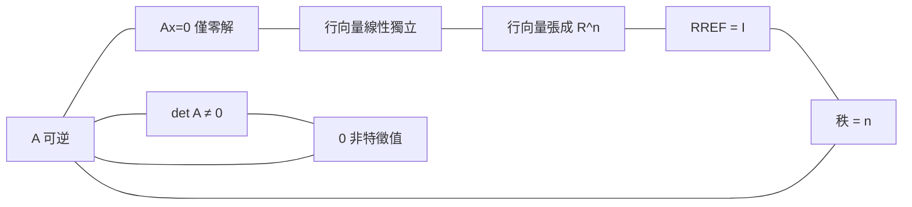

# 3.2 行列式與可逆性

## 前言：零與非零的分水嶺

上一節我們學會計算行列式；這一節我們回答最關鍵的問題：**行列式到底「決定」了什麼？**答案是： $\det A \neq 0$ 與 $A$ 可逆完全等價。這個等價把消去法（第 1 章）、逆矩陣（2.2）、向量獨立性（第 4 章）、特徵值（第 6 章）串成一張巨大的等價網——「可逆矩陣定理」。本節證明其核心環節，並用體積觀點預習 $\det A = 0$ 的幾何意義（壓扁）。

## 歷史前因後果

### 從「判準」到「等價網」

- 1693 年萊布尼茨引入行列式的原始動機就是**判準**：線性方程組何時有唯一解？他與關孝和都意識到「某個由係數組成的量為零」意味著解的退化。
- 1750 年，瑞士數學家**克萊姆**（Gabriel Cramer, 1704–1752）發表**克萊姆法則**：若 $\det A \ne 0$ ，則 $A\mathbf{x}=\mathbf{b}$ 的解可寫成行列式的比值：

$$
x_j = \frac{\det A_j}{\det A}, \qquad A_j \text{ 為把 } A \text{ 的第 } j \text{ 行換成 } \mathbf{b}
$$

這是行列式第一次以「顯式公式」解決方程組。克萊姆法則優雅但昂貴（ $n+1$ 個行列式， $O(n^4)$ 成本），實務上被消去法取代，但它的**理論價值**巨大：它把「唯一解」與「 $\det A \neq 0$ 」劃上等號，並說明解對係數的**連續依賴**（分母非零則微擾係數解只微擾）。
- 1858 年凱萊在矩陣論中把可逆性定義為「存在 $A^{-1}$ 」，並證明其與 $\det A \neq 0$ 等價（利用伴隨矩陣 $A\,\mathrm{adj}(A) = (\det A)I$ ）。
- 1880 年代弗洛貝尼烏斯把秩、行列式與方程組理論整合，「可逆矩陣定理」的完整形態在二十世紀教科書中定型。

- **解決了什麼問題**：給「解是否存在且唯一」一個可以計算的判準；解釋了為什麼有些系統「天生無法唯一確定」。
- **引發了什麼新問題**： $\det A = 0$ 時克萊姆法則失效，但問題並未消失——最小平方（第 7 章）、偽逆（9.3）、正則化（10.2）都是「在奇異邊緣」工作的技術。

## 可逆矩陣定理：中央車站

**定理（可逆矩陣定理）**：對 $n$ 階方陣 $A$ ，下列命題全部等價：

| # | 命題 | 領域 |
|---|------|------|
| (a) | $A$ 可逆（存在 $A^{-1}$ ） | 代數 |
| (b) | $\det A \neq 0$ | 行列式 |
| (c) | $A\mathbf{x}=\mathbf{0}$ 只有零解 | 方程組 |
| (d) | 對每個 $\mathbf{b}$ ， $A\mathbf{x}=\mathbf{b}$ 恰有一解 | 方程組 |
| (e) | $A$ 的列（行）向量線性獨立 | 向量空間（第 4 章） |
| (f) | $A$ 的列（行）向量張成 $\mathbb{R}^n$ | 向量空間 |
| (g) | $A$ 的 RREF 是 $I_n$ | 消去法 |
| (h) | $A$ 的秩 $= n$ （滿秩） | 秩理論 |
| (i) | $A^T$ 可逆 | 轉置 |
| (j) | $0$ 不是 $A$ 的特徵值 | 譜理論（第 6 章） |
| (k) | $A$ 可表示為初等矩陣之積 | 消去法 |
| (l) | $A$ 的行向量構成 $\mathbb{R}^n$ 的基底 | 基底理論 |

**證明路線圖**（選關鍵環節）：

- **(a) ⇒ (c)**： $A\mathbf{x}=\mathbf{0}$ 兩邊左乘 $A^{-1}$ 得 $\mathbf{x} = \mathbf{0}$ 。
- **(c) ⇒ (b)（反證）**：若 $\det A = 0$ ，消去法會把 $A$ 化成含零列的階梯形，於是 $A\mathbf{x} = \mathbf{0}$ 有非零解（自由變數存在），矛盾。
- **(b) ⇒ (a)**：由伴隨矩陣恆等式 $A\,\mathrm{adj}(A) = (\det A)I$ ，當 $\det A \neq 0$ 時 $A^{-1} = \mathrm{adj}(A)/\det A$ 。
- **(c) ⇔ (e)**： $A\mathbf{x} = \mathbf{0}$ 寫成 $x_1\mathbf{a}_1 + \cdots + x_n\mathbf{a}_n = \mathbf{0}$ ，僅零解 ⇔ 行向量線性獨立。
- **(g) ⇔ (h)**：RREF 為 $I$ ⇔ 主元數 $= n$ ⇔ 秩 $= n$ 。
- 其餘環節依此類推，構成一個循環論證圈。

**實用意義**：要判斷任何一條命題，只需驗證其中「最好算」的一條。例如判斷行向量是否獨立，可以改算行列式（ $n$ 小時）或做消去（ $n$ 大時）。

## 克萊姆法則

**定理（克萊姆法則，1750）**：設 $A$ 為 $n$ 階可逆方陣， $\mathbf{b} \in \mathbb{R}^n$ ， $A\mathbf{x}=\mathbf{b}$ 的唯一解為

$$
x_j = \frac{\det A_j}{\det A}, \qquad A_j = [\mathbf{a}_1, \dots, \mathbf{b}, \dots, \mathbf{a}_n]\ (\text{第 } j \text{ 行換成 } \mathbf{b})
$$

**證明摘要**： $\mathbf{x}$ 的第 $j$ 分量可從 $A\mathbf{x}$ 展開的餘因子結構得到——把 $\mathbf{b} = A\mathbf{x}$ 沿第 $j$ 行展開， $\det A_j = \sum_k x_k\,(\text{第 } j \text{ 行的代數餘子式與 } A_j\text{'s})$ ，利用「把第 $j$ 行換成 $\mathbf{b}$ 不改變第 $j$ 行以外的餘子式」，得 $\det A_j = x_j \det A$ 。

**例**： $\begin{cases} 2x + y = 5 \\ 3x - y = 0 \end{cases}$ ：

$$
\det A = \det\begin{bmatrix} 2 & 1 \\ 3 & -1 \end{bmatrix} = -5, \quad \det A_1 = \det\begin{bmatrix} 5 & 1 \\ 0 & -1 \end{bmatrix} = -5, \quad \det A_2 = \det\begin{bmatrix} 2 & 5 \\ 3 & 0 \end{bmatrix} = -15
$$

$$
x = \frac{-5}{-5} = 1, \qquad y = \frac{-15}{-5} = 3
$$

**評註**：克萊姆法則的計算複雜度約 $O(n^4)$ （ $n+1$ 個 $O(n^3)$ 的行列式），遠差於高斯消去的 $O(n^3)$ ；且在 $\det A$ 接近零時數值災難（分子分母都微小而雜訊放大，見 9.3 節條件數）。它的現代價值是**理論工具**：證明解對參數的光滑依賴性（隱函數定理的矩陣版本）。

## $\det A = 0$ 的幾何意義：壓扁

預習 3.3 節的結論： $\det A$ 是 $A$ 對體積的**有號倍率**。因此：

- $\det A \neq 0$ ： $A$ 不壓扁空間，體積倍率 $|\det A| > 0$ ，可逆——資訊完整保留；
- $\det A = 0$ ： $A$ 把空間壓進一個低維子空間（直線、平面……），體積歸零，資訊丟失，**不可逆**——你無法從一條直線上的影子還原整個空間。

| $\det A$ | 幾何 | 代數 |
|----------|------|------|
| $> 0$ | 保持定向的膨脹／收縮 | 可逆，偶數次定向翻轉 |
| $< 0$ | 反轉定向（鏡射） | 可逆，含奇數次反射 |
| $= 0$ | 壓扁到低維 | 奇異，無逆 |

這也解釋了乘法公式 $\det(AB) = \det A\det B$ ：「倍率相乘」；以及 $\det A^{-1} = 1/\det A$ ：「還原倍率取倒數」。

## 例題

**例題 3.2-1（用行列式判斷可逆與獨立）**：下列三個矩陣何者可逆？

$$
A = \begin{bmatrix} 1 & 2 & 1 \\ 2 & 5 & 3 \\ 1 & 3 & 2 \end{bmatrix}, \qquad B = \begin{bmatrix} 1 & 2 & 0 \\ 2 & 4 & 0 \\ 1 & 1 & 3 \end{bmatrix}
$$

**解**：

$$
\det A \xrightarrow{R_2 - 2R_1,\ R_3 - R_1} \det\begin{bmatrix} 1 & 2 & 1 \\ 0 & 1 & 1 \\ 0 & 1 & 1 \end{bmatrix} = 0 \quad (\text{第 2、3 列相等})
$$

故 $A$ **不可逆**（雖然外表看不出明顯相依，消去 2 步後現形——這是消去法的價值）。

$$
B: \text{第 2 行} = 2\times\text{第 1 行} \Rightarrow \det B = 0 \Rightarrow B \text{ 不可逆}
$$

順帶： $B$ 的行向量 $(1,2,1), (2,4,1)$ 不獨立—— $A\mathbf{x}=\mathbf{0}$ 有非零解，例如取 $\mathbf{x} = (2, -1, 0)^T$ 檢驗 $A\mathbf{x} = \mathbf{0}$ 對 $A$ 的行？此處對 $B$ 的行驗證： $2(1,2,1) - 1(2,4,1) = (0, 0, 1)$ ，不為零——需再湊： $2(1,2,1) - (2,4,1) - 0\cdot(0,0,3) = (0,0,1)$ ，而 $(0,0,3)$ 可補： $2\mathbf{b}_1 - \mathbf{b}_2 - \frac13\mathbf{b}_3 = \mathbf{0}$ ，即非零解 $\mathbf{x} = (2, -1, -\tfrac13)^T$ ✓。

**例題 3.2-2（用可逆性解矩陣方程）**：設 $A = \begin{bmatrix} 1 & 1 \\ 0 & 1 \end{bmatrix}$ ，解 $AX = B$ ，其中 $B = \begin{bmatrix} 2 & 0 \\ 1 & 3 \end{bmatrix}$ 。

**解**： $\det A = 1 \neq 0$ ，可逆。 $A$ 是剪切矩陣， $A^{-1} = \begin{bmatrix} 1 & -1 \\ 0 & 1 \end{bmatrix}$ （把 $+1$ 剪切反向）。

$$
X = A^{-1}B = \begin{bmatrix} 1 & -1 \\ 0 & 1 \end{bmatrix}\begin{bmatrix} 2 & 0 \\ 1 & 3 \end{bmatrix} = \begin{bmatrix} 2-1 & 0-3 \\ 1 & 3 \end{bmatrix} = \begin{bmatrix} 1 & -3 \\ 1 & 3 \end{bmatrix}
$$

驗算 $AX = \begin{bmatrix} 1 & 1 \\ 0 & 1 \end{bmatrix}\begin{bmatrix} 1 & -3 \\ 1 & 3 \end{bmatrix} = \begin{bmatrix} 2 & 0 \\ 1 & 3 \end{bmatrix} = B$ ✓。

**例題 3.2-3（參數與奇異性）**：求 $k$ 使 $M = \begin{bmatrix} 1 & 2 & 3 \\ 2 & k & 6 \\ 3 & 6 & 9 \end{bmatrix}$ 不可逆。

**解**：第三列 $= 3\times$ 第一列。行列式沿第三列展開等價於判斷第二行與第一行的關係：交換思維—— $M$ 的 $(1,3)$ 位置使第三列成比例，若 $k = 4$ 則第二列 $= 2\times$ 第一列，**三列全部成比例**， $\det = 0$ 。一般地做消去： $R_2 \to R_2 - 2R_1 = [0, k-4, 0]$ 、 $R_3 \to R_3 - 3R_1 = [0,0,0]$ ，得

$$
\det M = \det\begin{bmatrix} 1 & 2 & 3 \\ 0 & k-4 & 0 \\ 0 & 0 & 0 \end{bmatrix} = 0 \quad \text{對**所有** } k
$$

有趣：無論 $k$ 為何， $M$ 都不可逆——因為第三列恆為第一列的 3 倍。本題教訓：**先觀察結構再計算**，可省去大量功夫。

## 與其他領域的關聯

- **微積分**：隱函數定理——非線性系統局部可解的條件是 Jacobi 行列式非零，正是本節定理的非線性版本。
- **微分方程**：線性系統 $\mathbf{x}' = A\mathbf{x}$ 的平衡點唯一 ⇔ $\det A \neq 0$ ；Wronskian 非零 ⇔ 解獨立。
- **經濟學**：投入產出模型（Leontief, 1941） $(I - C)\mathbf{x} = \mathbf{d}$ 的可解性要求 $I - C$ 可逆；一般均衡的存在性證明用矩陣的滿秩性。
- **機器學習**：特徵共線性使 $X^TX$ 奇異，最小平方解不唯一——嶺迴歸以 $\lambda I$ 微擾恢復可逆性。
- **密碼學**：Hill 密碼要求金鑰矩陣模 26 可逆，即 $\gcd(\det A, 26) = 1$ ——行列式在模算術中的可逆判準。
- **量子力學**：密度矩陣 $\rho$ 的 $\det\rho = 0$ 對應純態與混合態的區別。

## 本節小結

1. 可逆矩陣定理把十幾條命題縫合成一個等價網：可逆 ⇔ 行列式非零 ⇔ 僅零解 ⇔ 獨立 ⇔ 滿秩 ⇔ $0$ 非特徵值。
2. 克萊姆法則（1750）以行列式顯式表達解： $x_j = \det A_j / \det A$ ；理論上重要，計算上昂貴。
3. $\det A = 0$ 的幾何本質是**壓扁**：體積倍率為零、資訊丟失、無法還原。
4. 參數化的奇異性分析（例 3.2-3）顯示：先看結構、再動手算。

## 深入議題：克萊姆法則的現代身分

### 克萊姆法則的「不可替代之處」

雖然計算昂貴，克萊姆法則在**理論與符號計算**中不可替代：

1. **解對參數的顯式依賴**： $x_j(\mathbf{b}) = \det A_j(\mathbf{b})/\det A$ 是 $\mathbf{b}$ 的**有理函數**——這證明解隨參數「光滑變化」（可微、可級數展開）。隱函數定理的非線性版本完全依賴這一點：若 Jacobi 行列式 $\ne 0$ ，非線性系統的局部解也光滑依賴參數。
2. **符號計算**：電腦代數系統（Mathematica/SymPy）中含符號參數的小型系統用克萊姆法則保持符號簡潔。
3. **分式線性結構**：解是分子（行列式）÷ 分母（行列式）——這個「比」的結構在投影幾何（齊次座標）中是本質的。

### 體積比讀解（幾何證明）

二維克萊姆的幾何： $A = [\mathbf{a}_1\ \mathbf{a}_2]$ ， $\mathbf{b} = x\mathbf{a}_1 + y\mathbf{a}_2$ 。兩邊與 $(\mathbf{a}_2)^{\perp}$ （旋轉 $90°$ ）做「叉積式」運算：

$$
\det[\mathbf{b}\ \mathbf{a}_2] = x\det[\mathbf{a}_1\ \mathbf{a}_2] + y\underbrace{\det[\mathbf{a}_2\ \mathbf{a}_2]}_{=0}
$$

$$
x = \frac{\det[\mathbf{b}\ \mathbf{a}_2]}{\det[\mathbf{a}_1\ \mathbf{a}_2]} = \frac{S(\mathbf{b}, \mathbf{a}_2)}{S(\mathbf{a}_1, \mathbf{a}_2)} \quad (\text{面積比})
$$

**幾何敘述**： $x$ 等於「 $\mathbf{b}$ 與 $\mathbf{a}_2$ 張成的平行四邊形面積」除以「基底平行四邊形面積」。高維同構：用 $(n-1)$ 個基底向量張的超平面做「切割」，解的分量是超體積比。**克萊姆法則 = 用體積丈量座標**。

### 解的連續依賴與良態

由克萊姆： $\|\mathbf{x}\| \le \sqrt{n}\,\|\mathbf{b}\|/|\det A| \cdot (\text{其他因子的界})$ ——**分母 $\det A$ 越小，解越大**。當 $\det A \to 0$ ，解的範數爆炸：這就是「接近奇異 = 解巨大且敏感」的第一個定量跡象，通往 9.3 節條件數 $\kappa \sim 1/\sigma_{\min}$ （注意精確關係用奇異值，行列式只是粗糙代理—— $\det$ 小不必然病態，如 $\mathrm{diag}(10^{-6}, 10^{-6})$ 的 $\det = 10^{-12}$ 但 $\kappa = 1$ ！**「行列式小」≠「病態」，這是初學者最常見的誤解之一**）。

## 可逆矩陣定理的證明補遺

### 環 (e) ⇔ (g)：獨立與 RREF

**命題**： $A$ （ $n$ 階）的行獨立 ⟺ $\mathrm{RREF}(A) = I$ 。

**證明**：行獨立 ⟺ $A\mathbf{x} = \mathbf{0}$ 僅零解（3.2 節 (c)）。做消去：若 RREF 非 $I$ ，必有自由變數 → 非零解；反之 RREF $= I$ 時 $\mathbf{x} = \mathbf{0}$ 唯一。∎

**環 (h) 與秩的登場**：秩 $= n$ （滿秩）⟺ RREF 主元數 $= n$ ⟺ RREF $= I$ 。第 4 章將給「秩」的抽象定義（行空間維度），證明主元秩 = 行秩 = 列秩（弗洛貝尼烏斯定理），完成整張網。

### (j) 預告：0 不是特徵值

$A\mathbf{v} = 0\cdot\mathbf{v} = \mathbf{0}$ 有非零解 ⟺ $A$ 奇異。因此：

$$
A \text{ 可逆} \iff 0 \notin \text{譜}(A) \iff \det A \ne 0 \quad (\det = \prod \lambda_i)
$$

第 6 章將看到：**特徵值把「可逆性」變成「譜的位置問題」**——判斷一個矩陣可不可逆，等價於問「0 在不在它的譜裡」。

### 一個經典應用：矩陣的冪何時回到單位矩陣

若 $A^k = I$ （某正整數 $k$ ），則 $A$ 可逆且 $A^{-1} = A^{k-1}$ ——**「有限階」保證可逆**。例子：置換矩陣（每個置換有限階）、旋轉矩陣 $R(\frac{2\pi}{m})$ （ $R^m = I$ ）。這在群論中是「有限群中的元素必可逆」的矩陣版；在密碼學中，Hill 密碼的金鑰矩陣必須在模 26 的意義下有限階/可逆。

## 奇異性在日常計算中的三種面貌

| 面貌 | 現象 | 線性代數診斷 |
|------|------|--------------|
| 幾何 | 投影、壓扁（ $\det = 0$ ） | 行向量共面/共線 |
| 代數 | 方程組解不唯一或無解 | 秩 $< n$ 、自由變數 |
| 數值 | 近奇異：小擾動 → 解劇變 | 條件數 $\kappa \gg 1$ |

**重要分辨**：奇異（ $\det = 0$ ）是**精確**的性質；病態（ $\kappa$ 大）是**接近**奇異的數值症狀。理論上二者界限分明（ $\det \ne 0$ 即可逆），實務中「 $\det = 10^{-20}$ 」的矩陣幾乎不可用——**數值世界只有「健康程度」的連續譜**，條件數才是判官（第 9 章）。

## 例題（續）

**例題 3.2-4（克萊姆 + 幾何）**：用面積比解 $\begin{cases} 2x + y = 5 \\ x - y = 1 \end{cases}$ 。

$$
x = \frac{\det\begin{bmatrix} 5 & 1 \\ 1 & -1 \end{bmatrix}}{\det\begin{bmatrix} 2 & 1 \\ 1 & -1 \end{bmatrix}} = \frac{-5 - 1}{-2 - 1} = \frac{-6}{-3} = 2; \qquad y = \frac{\det\begin{bmatrix} 2 & 5 \\ 1 & 1 \end{bmatrix}}{-3} = \frac{2 - 5}{-3} = 1
$$

幾何驗證： $\mathbf{a}_1 = (2, 1)$ 、 $\mathbf{a}_2 = (1, -1)$ 、 $\mathbf{b} = (5, 1)$ 。平行四邊形 $S(\mathbf{b}, \mathbf{a}_2) = |5\cdot(-1) - 1\cdot1| = 6$ ；基底 $S(\mathbf{a}_1, \mathbf{a}_2) = |2\cdot(-1) - 1\cdot1| = 3$ 。比值 $6/3 = 2 = x$ ✓（有號面積給出正確符號）。

**例題 3.2-5（矩陣方程的可逆性分析）**：解 $A\mathbf{x} = \mathbf{b}$ 其中 $A = \begin{bmatrix} 1 & 1 & 0 \\ 0 & 1 & 1 \\ 1 & 0 & 1 \end{bmatrix}$ 。

$$
\det A = 1(1 - 0) - 1(0 - 1) + 0 = 2 \ne 0 \Rightarrow \text{可逆，解唯一}
$$

$$
\mathrm{adj}(A) = \begin{bmatrix} 1 & -1 & 1 \\ 1 & 1 & -1 \\ -1 & 1 & 1 \end{bmatrix} \Rightarrow A^{-1} = \frac12\begin{bmatrix} 1 & -1 & 1 \\ 1 & 1 & -1 \\ -1 & 1 & 1 \end{bmatrix}
$$

驗算 $(1,1)$ ： $A A^{-1}$ 的 $(1,1) = \frac12(1\cdot1 + 1\cdot1 + 0\cdot(-1)) = 1$ ✓。對 $\mathbf{b} = (2, 3, 5)^T$ ：

$$
\mathbf{x} = \frac12\begin{bmatrix} 2 - 3 + 5 \\ 2 + 3 - 5 \\ -2 + 3 + 5 \end{bmatrix} = \frac12\begin{bmatrix} 4 \\ 0 \\ 6 \end{bmatrix} = \begin{bmatrix} 2 \\ 0 \\ 3 \end{bmatrix}
$$

## 練習題

1. 用克萊姆法則解 $\begin{cases} 3x + 2y = 6 \\ x - y = 0 \end{cases}$ ，並用面積比解釋 $x$ 的符號。
2. 證明： $A$ 可逆 ⟺ $A^TA$ 可逆（用 $\det$ 與 $\mathbf{x}^TA^TA\mathbf{x} = \|A\mathbf{x}\|^2$ 兩種方法）。
3. 設 $A$ 為 $3$ 階、 $\det A = 2$ 。求 $\det(\mathrm{adj}(A))$ 。（答： $4$ 。）
4. 找出 $k$ 使 $\begin{bmatrix} 1 & 1 & 1 \\ 1 & k & k^2 \\ 1 & k^2 & k \end{bmatrix}$ 奇異。（提示：Vandermonde 型， $k = -1$ 或 $1$ ？仔細驗。）
5. 證明：若 $A$ 反對稱（ $A^T = -A$ ）且 $n$ 為奇數，則 $A$ 不可逆。
6. （思考）為什麼「 $\det$ 接近零」不必然「病態」？構造一個 $\det$ 極小但條件數為 1 的矩陣。

**預告**：「壓扁」到底壓掉多少體積？ $\det A$ 的正負號又代表什麼？下一節 3.3 用**平行六面體體積**與**定向**給行列式最直觀的圖像。
