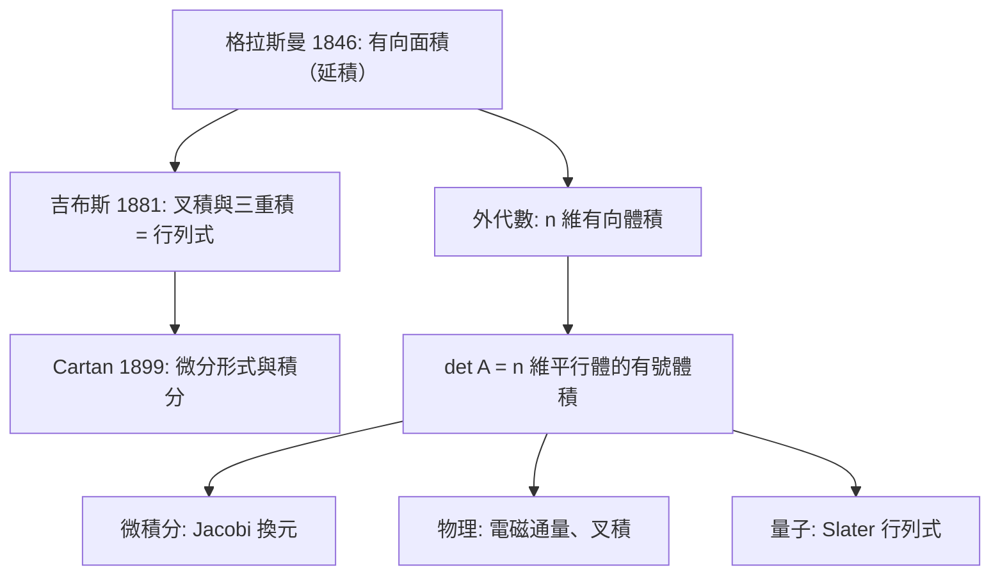

# 3.3 行列式：體積與定向

## 前言：看見行列式

全排列公式像天書，列變換像手藝，但行列式的**靈魂**是幾何的： $\det A$ 是矩陣 $A$ 對體積的有號放大倍率。正號表示空間未被翻轉，負號表示鏡射（定向反轉），零表示壓扁。本節建立「行列式＝有號體積」的完整圖像，證明乘法公式的幾何意義，並連接微積分的 Jacobi 行列式與物理的叉積、定向、及量子力學的相位。

## 歷史前因後果

### 體積觀點的誕生

- 行列式在十八、十九世紀主要被當作**代數判準**；把它解讀為**體積**，要到向量分析時代才明朗。1846 年，**格拉斯曼**（Hermann Grassmann, 1809–1877）在《線性延論》中已經把「兩個向量的延積」理解為有向面積——這是外積與「有號體積」的先聲，可惜當時無人理會。
- 1881 年，吉布斯的向量分析確立了三維叉積 $\mathbf{u}\times\mathbf{v}$ 的幾何（大小＝平行四邊形面積，方向＝右手法則），而三重積 $\mathbf{u}\cdot(\mathbf{v}\times\mathbf{w})$ 的絕對值恰為平行六面體體積——以座標寫出正是 $3\times 3$ 行列式。**行列式的體積意義自此成為物理學家的常識。**
- 十九世紀末至二十世紀初，**Peano、Volterra 與外代數（exterior algebra）**的發展把「有向體積」推廣到 $n$ 維：行列式就是 $n$ 個向量構成的「 $n$ 維平行體」的有號體積，而外代數是它的嚴格語言。Cartan（Élie Cartan, 1869–1951）於 1899 年發展**微分形式**，把 Jacobi 行列式升級為積分理論的基石（ generalized Stokes 定理）。

- **解決了什麼問題**：解釋了為何行列式有這些「古怪」性質（多線性、反對稱、乘法性）——因為體積本來就如此；統一了積分換元、叉積、定向等散落的理論。
- **引發了什麼新問題**： $n$ 維定向與外代數成為微分幾何、廣義相對論（體積元 $dV = \sqrt{\det g}\,dx^1\cdots dx^n$ ）、量子力學（費米子波函數的反对称）的必備工具。

## 行列式＝有號體積

### 二維：有向面積

設 $\mathbf{u} = (a, c)$ 、 $\mathbf{v} = (b, d)$ 為 $\mathbb{R}^2$ 中的兩向量，矩陣 $A = \begin{bmatrix} a & b \\ c & d \end{bmatrix}$ （以 $\mathbf{u},\mathbf{v}$ 為行）把單位正方形 $[0,1]^2$ 映到由 $\mathbf{u},\mathbf{v}$ 張成的平行四邊形。其面積：

$$
|\det A| = |ad - bc|
$$

**證明（面積的公理化）**：定義 $F(\mathbf{u}, \mathbf{v}) = \det[\mathbf{u}\ \mathbf{v}]$ 。檢驗它具備面積應有的三個性質：

1. **單位正方形面積為 1**： $F(\mathbf{e}_1, \mathbf{e}_2) = \det I = 1$ ✓
2. **其中一邊滑動不變面積**（Cavalieri 原理）：固定 $\mathbf{v}$ 時 $F$ 對 $\mathbf{u}$ 是線性的——把 $\mathbf{u}$ 加上 $\mathbf{v}$ 的倍數只是讓平行四邊形「平移剪切」，底與高不變 ✓
3. **定向翻轉變號**：交換 $\mathbf{u},\mathbf{v}$ 時行列式變號 ✓

而滿足這三條的函數唯一（3.1 節公理的唯一性），故**行列式就是有號面積**。

### 三維：平行六面體

三向量 $\mathbf{u},\mathbf{v},\mathbf{w}$ 張成的平行六面體之有號體積：

$$
\det[\mathbf{u}\ \mathbf{v}\ \mathbf{w}] = \mathbf{u}\cdot(\mathbf{v}\times\mathbf{w})
$$

右端即**純量三重積**：叉積 $\mathbf{v}\times\mathbf{w}$ 的大小是底面積、方向沿法線；與 $\mathbf{u}$ 的內積再乘以 $\cos\theta$ （高與底之夾角）——恰為「底面積 × 高」。

### n 維：一般理論

$n$ 個向量 $\mathbf{a}_1, \dots, \mathbf{a}_n \in \mathbb{R}^n$ 構成的平行體體積：

$$
\mathrm{Vol} = \left|\det[\mathbf{a}_1\ \cdots\ \mathbf{a}_n]\right|
$$

| 情況 | 體積 | 意義 |
|------|------|------|
| 行向量獨立 | $|\det A| > 0$ | 真正的 $n$ 維平行體 |
| 行向量相依 | $\det A = 0$ | 壓扁：體積為零的平面/直線 |

## 定向（Orientation）

### 什麼是定向？

$\mathbb{R}^n$ 的**定向**是對「哪一組基底算正向」的整體約定。標準定向由 $(\mathbf{e}_1, \dots, \mathbf{e}_n)$ 給出（二維：逆時針；三維：右手法則）。一組基底 $(\mathbf{v}_1, \dots, \mathbf{v}_n)$ 為**正向**，若 $\det[\mathbf{v}_1\ \cdots\ \mathbf{v}_n] > 0$ ；負向則 $< 0$ 。

矩陣 $A$ 的符號 $\mathrm{sgn}(\det A)$ 告訴我們 $A$ 如何作用於定向：

- $\det A > 0$ ：**保定向**——純旋轉與拉伸；
- $\det A < 0$ ：**反定向**——含奇數次反射（鏡射）；
- $\det A = 0$ ：壓扁，定向概念失效（低維子空間有自己的定向問題）。

**例子**：旋轉矩陣 $R(\theta) = \begin{bmatrix} \cos\theta & -\sin\theta \\ \sin\theta & \cos\theta \end{bmatrix}$ ， $\det R = \cos^2\theta + \sin^2\theta = 1$ ——永遠保定向 ✓。鏡射矩陣 $F = \begin{bmatrix} 1 & 0 \\ 0 & -1 \end{bmatrix}$ ， $\det F = -1$ ——翻轉定向 ✓。

### 定向與線積分、通量

微積分中的 Green 定理、Stokes 定理都依賴定向：曲線的繞行方向（二維定向）與曲面的法線方向（三維定向）決定積分的正負號。這些「符號約定」在本質上都是本節的定向概念；微分形式理論（Cartan）把它們統一。

## 乘法公式與體積倍率

**定理**： $\det(AB) = \det A\,\det B$ 。

**幾何證明**： $AB$ 表示「先作用 $B$ 再作用 $A$ 」。 $B$ 把單位立方體放大 $|\det B|$ 倍， $A$ 再放大 $|\det A|$ 倍，總倍率 $|\det A|\cdot|\det B|$ 。定向方面：兩次「定向翻轉」相乘，符號恰為 $\mathrm{sgn}(\det A)\cdot\mathrm{sgn}(\det B)$ 。合併得 $\det(AB) = \det A\,\det B$ 。∎

**推論**：

| 公式 | 幾何解釋 |
|------|----------|
| $\det A^{-1} = 1/\det A$ | 還原變換取倒數倍率 |
| $\det(P^{-1}AP) = \det A$ | 換座標不變（相似性，第 5 章） |
| $\det A^T = \det A$ | 以行向量為邊與以列向量為邊的平行體同體積 |
| $Q^TQ = I \Rightarrow |\det Q| = 1$ | 剛體運動不改變體積 |
| $\det(\lambda A) = \lambda^n \det A$ | 每一維都放大 $\lambda$ 倍 |

## 例題

**例題 3.3-1（面積計算）**：求由 $\mathbf{u} = (3, 1)$ 、 $\mathbf{v} = (1, 4)$ 張成的平行四邊形面積，並判斷基底 $(\mathbf{u},\mathbf{v})$ 是否正向。

**解**：

$$
\det\begin{bmatrix} 3 & 1 \\ 1 & 4 \end{bmatrix} = 12 - 1 = 11
$$

面積 $= 11$ ； $\det > 0$ ，故 $(\mathbf{u},\mathbf{v})$ 是正向基底（從 $\mathbf{e}_1$ 到 $\mathbf{e}_2$ 的轉向一致）。驗證：底 $= \|\mathbf{u}\| = \sqrt{10}$ ，高 $= \|\mathbf{v}\|\sin\theta$ ； $\cos\theta = \frac{\mathbf{u}\cdot\mathbf{v}}{\|\mathbf{u}\|\|\mathbf{v}\|} = \frac{7}{\sqrt{10}\sqrt{17}}$ ， $\sin\theta = \sqrt{1 - \frac{49}{170}} = \frac{\sqrt{121}}{\sqrt{170}} = \frac{11}{\sqrt{170}}$ 。面積 $= \sqrt{10}\cdot\sqrt{17}\cdot\frac{11}{\sqrt{170}} = 11$ ✓。

**例題 3.3-2（三維體積與共面判準）**：四點 $P_0=(0,0,0)$ 、 $P_1=(1,2,0)$ 、 $P_2=(0,1,1)$ 、 $P_3=(2,4,1)$ 是否共面？

**解**：四點共面 ⇔ 三向量 $\mathbf{u} = P_1 - P_0 = (1,2,0)$ 、 $\mathbf{v} = P_2 - P_0 = (0,1,1)$ 、 $\mathbf{w} = P_3 - P_0 = (2,4,1)$ 的混合積為零：

$$
\det\begin{bmatrix} 1 & 0 & 2 \\ 2 & 1 & 4 \\ 0 & 1 & 1 \end{bmatrix}
$$

沿第一列展開： $1\cdot\det\begin{bmatrix}1&4\\1&1\end{bmatrix} - 0 + 2\cdot\det\begin{bmatrix}2&1\\0&1\end{bmatrix} = 1(1-4) + 2(2) = -3 + 4 = 1 \neq 0$ 。**不共面**，平行六面體體積為 $1$ 。

**例題 3.3-3（Jacobi 行列式：換元積分）**：計算 $\displaystyle\iint_R e^{(x+2y)/3}\,dA$ ，其中 $R$ 是由 $x + 2y = 0, 3$ 與 $x - y = 0, 6$ 圍成的平行四邊形。令 $u = x+2y,\ v = x-y$ ，則 $x = \frac{u+2v}{3},\ y = \frac{u-v}{3}$ ，Jacobi 行列式：

$$
\frac{\partial(x,y)}{\partial(u,v)} = \det\begin{bmatrix} 1/3 & 2/3 \\ 1/3 & -1/3 \end{bmatrix} = -\frac{1}{9} - \frac{2}{9} = -\frac{1}{3}, \qquad \left|\det J\right| = \frac13
$$

$$
\iint_R e^{(x+2y)/3}\,dA = \int_0^3\int_0^6 e^{u/3}\cdot\frac13\,dv\,du = 2\int_0^3 e^{u/3}\,du = 6\left[e^{u/3}\right]_0^3 = 6(e - 1)
$$

**注意**：Jacobi 行列式是負的（變換反轉定向），積分取絕對值 $\frac13$ 。 $-\frac13$ 的負號正是本節「定向」概念的日常體現——換元不應改變積分值，定向資訊由面積元吸收。

## 為什麼列變換對體積合理？

回到 3.1 節的列變換效應，現在每條都有了幾何證明：

| 列變換 | 幾何操作 | 對體積的效應 |
|--------|----------|--------------|
| $R_i \to R_i + kR_j$ | 平行四邊形「滑邊」（Cavalieri） | 不變 |
| $R_i \to kR_i$ | 某一邊放大 $k$ 倍 | 體積 $\times k$ |
| $R_i \leftrightarrow R_j$ | 換邊的順序（定向翻轉） | 變號 |
| 一列為零 | 平行體退化（壓扁） | 體積 0 |

**這解開了「行列式為何如此定義」的謎**：行列式被設計成「體積的公理化函數」，所有代數性質都是體積直覺的翻譯。

## 與其他領域的關聯

- **微積分**：重積分換元的 Jacobi 行列式（例 3.3-3）、曲面積分與通量的定向約定、極座標 $r\,dr\,d\theta$ 中的 $r$ （ $\det\begin{bmatrix}\cos\theta & -r\sin\theta\\ \sin\theta & r\cos\theta\end{bmatrix} = r$ ）。
- **物理**：電磁通量 $\Phi = \mathbf{B}\cdot\mathbf{A}$ 是三重積；流體力學的體積守恆（連續方程）以 $\det(\text{變形梯度})$ 表達；廣義相對論體積元 $\sqrt{\det g}$ 。
- **機器學習**：常態分布的馬氏距離密度含 $(\det\Sigma)^{-1/2}$ ；normalizing flows 的變換機率密度公式 $\log|\det J|$ ——體積倍率決定機率質量的伸縮。
- **量子力學**：費米子波函數必為反對稱——Slater 行列式自動滿足：交換兩粒子（兩列交換）波函數變號，這是泡利不相容原理的線性代數化身。
- **電腦圖學**：三角形有向面積（叉積符號）用於判斷點在三角形內外、背面剔除（backface culling）——即 $\det$ 的符號測試。

## 本節小結

1. 行列式的幾何靈魂： $|\det A|$ 是體積倍率， $\mathrm{sgn}(\det A)$ 是定向指標， $\det A = 0$ 表示壓扁。
2. 三條公理（單位體積、滑邊不變、定向翻轉）唯一決定行列式——代數定義與幾何定義殊途同歸。
3. 乘法公式 $\det(AB) = \det A\det B$ 是「倍率相乘」的翻譯；所有衍生公式（逆、相似、正交）都有幾何解釋。
4. Jacobi 行列式把這套理論帶進微積分與機率論；定向概念支撐 Stokes 定理與物理學。

## 深入議題：外積、Hadamard 與高階幾何

### 叉積的行列式表達（記憶法）

$$
\mathbf{u}\times\mathbf{v} = \det\begin{bmatrix} \mathbf{i} & \mathbf{j} & \mathbf{k} \\ u_1 & u_2 & u_3 \\ v_1 & v_2 & v_3 \end{bmatrix}
$$

（形式化記號——「第一列是向量」在嚴格意義下需要外代數語言，但作為記憶工具極有效。）展開：

$$
\mathbf{u}\times\mathbf{v} = (u_2v_3 - u_3v_2,\ u_3v_1 - u_1v_3,\ u_1v_2 - u_2v_1)
$$

驗證 $\langle\mathbf{u}, \mathbf{u}\times\mathbf{v}\rangle = u_1u_2v_3 - u_1u_3v_2 + u_2u_3v_1 - u_1u_2v_3 + u_3u_1v_2 - u_2u_3v_1 = 0$ ✓——**叉積自動垂直於兩輸入**，這是「反對稱性」的幾何必然。

### Lagrange 恆等式

$$
(\mathbf{u}\times\mathbf{v})\cdot(\mathbf{w}\times\mathbf{z}) = (\mathbf{u}\cdot\mathbf{w})(\mathbf{v}\cdot\mathbf{z}) - (\mathbf{u}\cdot\mathbf{z})(\mathbf{v}\cdot\mathbf{w})
$$

它是柯西–施瓦茨不等式在叉積上的化身（取 $\mathbf{w} = \mathbf{u}, \mathbf{z} = \mathbf{v}$ ）： $\|\mathbf{u}\times\mathbf{v}\|^2 = \|\mathbf{u}\|^2\|\mathbf{v}\|^2 - (\mathbf{u}\cdot\mathbf{v})^2 = \|\mathbf{u}\|^2\|\mathbf{v}\|^2\sin^2\theta$ ✓。**內積與叉積不是兩個獨立運算，而是同一幾何結構的兩個投影**（外代數： $\wedge$ 與內積由 Hodge 星算子連接）。

### 高維「叉積」不存在的原因

三維中叉積吃兩個向量吐一個向量（ $2 \to 1$ ），但只有 $\mathbb{R}^3$ 的維度恰好允許「法線方向」是唯一的。一般而言：

- $\mathbb{R}^2$ ： $2$ 個向量的「叉積」是純量（有號面積）；
- $\mathbb{R}^3$ ： $2$ 個向量 → $1$ 個法向量（雙重身份）；
- $\mathbb{R}^n$ ： $n-1$ 個向量 → 1 個法向量（廣義叉積，Hodge 對偶的化身）。

而「二元的、雙線性的、反對稱的、保歐氏結構的」叉積只在 $n = 3$ 與 $n = 7$ 存在（與四元數、八元數的乘法結構相關——1863 年 Hamilton 的掙扎與 1898 年 Hurwitz 的分類定理）。**「為什麼物理在 3+1 維如此方便」的數學根源之一**。

## 例題（續）

**例題 3.3-4（叉積與法平面）**：求過點 $P(1, 2, 3)$ 且包含向量 $\mathbf{u} = (1, 0, 1)$ 、 $\mathbf{v} = (0, 1, -1)$ 的平面方程。

**解**：法向量 $= \mathbf{u}\times\mathbf{v} = (0\cdot(-1) - 1\cdot1,\ 1\cdot0 - 1\cdot(-1),\ 1\cdot1 - 0\cdot0) = (-1, 1, 1)$ 。

$$
-(x - 1) + (y - 2) + (z - 3) = 0 \Rightarrow -x + y + z = 4
$$

驗證 $P$ ： $-1 + 2 + 3 = 4$ ✓；驗證 $\mathbf{u}$ 方向在平面內： $-1 + 0 + 1 = 0$ ✓。

**例題 3.3-5（體積與「有向」符號的物理）**：計算 $\mathbf{a} = (2, 0, 1)$ 、 $\mathbf{b} = (0, 3, 0)$ 、 $\mathbf{c} = (1, 1, 2)$ 的混合積，並解釋符號。

$$
\det[\mathbf{a}\ \mathbf{b}\ \mathbf{c}] = \mathbf{a}\cdot(\mathbf{b}\times\mathbf{c}) = (2, 0, 1)\cdot(3\cdot2 - 0\cdot1,\ 0\cdot1 - 0\cdot2,\ 0\cdot1 - 3\cdot1) = (2,0,1)\cdot(6, 0, -3) = 12 - 3 = 9
$$

**解讀**：體積 $9$ ； $\det > 0$ 表示 $(\mathbf{a}, \mathbf{b}, \mathbf{c})$ 與右手系 $(\mathbf{e}_1, \mathbf{e}_2, \mathbf{e}_3)$ 同向——右手螺旋從 $\mathbf{a}$ 轉向 $\mathbf{b}$ 時拇指大致指向 $\mathbf{c}$ 側。**電磁學中的磁通量 $\Phi = \mathbf{B}\cdot\mathbf{A}$ 、力矩 $\boldsymbol\tau = \mathbf{r}\times\mathbf{F}$ 的「方向規則」全是這個定向概念**。

**例題 3.3-6（極座標的 Jacobi 是面積倍率）**：驗證 $dA = r\,dr\,d\theta$ 。

變換 $(r, \theta) \to (r\cos\theta, r\sin\theta)$ ，Jacobi 矩陣：

$$
J = \begin{bmatrix} \cos\theta & -r\sin\theta \\ \sin\theta & r\cos\theta \end{bmatrix}, \qquad \det J = r\cos^2\theta + r\sin^2\theta = r
$$

**幾何**： $(r, \theta)$ 的小矩形 $dr \times d\theta$ 在實際平面上被拉成「徑向長 $dr$ × 弧長 $r\,d\theta$ 」的小扇形——面積 $r\,dr\,d\theta$ 。行列式就是這個局部放大率的代數表達； $\det J > 0$ 說明極座標保持定向。

## 定向的高維簡筆

- $\mathbb{R}^n$ 的定向 = 基底的「符號類」；改變定向的變換 $\det < 0$ 。
- **物理法則的定向依賴**：安培右手定則、Fleming 左手定則、CPT 對稱……物理在鏡像世界（ $\det = -1$ ）中「幾乎」一樣，但弱交互作用打破宇稱（1957 年吳健雄實驗）——**自然界竟真的「偏好」一個定向**！
- **電腦圖學**：三角形的頂點順序（順/逆時針）決定正面/背面——backface culling 就是一次 $\det$ 的符號測試，每秒在 GPU 上執行數十億次。

## 練習題

1. 計算 $(1, 2, 2)\times(2, 1, -2)$ 並驗證與兩輸入都垂直。
2. 求由 $(1,0,0), (1,1,0), (1,1,1)$ 張成的四面體體積。（提示：平行六面體的 $1/6$ 。）
3. 判斷 $(2, 3), (4, 6), (1, 5)$ 是否共線。（用二維叉積。）
4. 證明球面座標的 Jacobi 行列式為 $\rho^2\sin\phi$ ，並推導 $dV = \rho^2\sin\phi\,d\rho\,d\phi\,d\theta$ 。
5. 用 Lagrange 恆等式證明： $\|\mathbf{u}\times\mathbf{v}\| = \|\mathbf{u}\|\|\mathbf{v}\|\sin\theta$ 。
6. （思考）反射矩陣 $F = \mathrm{diag}(1, 1, -1)$ 的 $\det = -1$ 。說明「鏡子裡的世界」哪三種幾何性質不變、哪兩種反轉。

**預告**：我們已擁有「計算與判準」的完整工具箱。第 4 章將跨出決定性的一步：不再問「怎麼算」，而問「什麼是空間？」——**向量空間**的公理化，將把前面所有具體經驗升級為一般理論。
