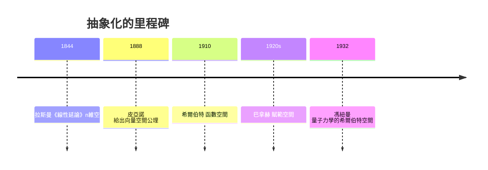

# 4.1 從具體到抽象：向量空間公理

## 前言：母雞換羽毛

前三章的「向量」都是數組： $(x,y)$ 、 $(x,y,z)$ 、784 維的圖片。本章要跨出大膽的一步：**把「向量」的定義從「是什麼」改成「做什麼」**。任何一套物件，只要能相加、能乘純量、並遵守幾條公理，就是一個向量空間——多項式、矩陣、函數、甚至微分方程的解，全都適用同一套理論。這個抽象化是線性代數從「計算技術」蛻變為「空間思維」的關鍵時刻。

## 歷史前因後果

### 三位先驅：格拉斯曼、皮亞諾與希爾伯特

- **格拉斯曼**（Hermann Grassmann, 1809–1877）在 1844 年出版《線性延論》（Ausdehnungslehre），首次系統地處理 $n$ 維抽象空間。他的書太超前：幾乎無人讀懂，第一版只賣出數百本。格拉斯曼是中學教師兼神學研究者，他自學成才的理論（線性獨立、基底、外積）在四十年後才被承認為天才之作。1862 年他重寫了較易讀的版本。
- **皮亞諾**（Giuseppe Peano, 1858–1932）在 1888 年的《幾何演算》（Calcolo geometrico）中首次給出**向量空間的公理化定義**——就是我們今天用的那組公理。他也幾乎被同時代人忽略。
- 1890–1910 年代，**希爾伯特**（David Hilbert, 1862–1943）研究積分方程時引入無窮維函數空間（後稱**希爾伯特空間**）；**巴拿赫**（Stefan Banach, 1892–1945）在 1920 年代完成賦範空間理論。抽象向量空間終於成為二十世紀數學的通用語言。
- **馮紐曼**在 1932 年的《量子力學數學基礎》把希爾伯特空間公理化地應用於量子力學——「狀態是向量」從此成為物理學的正式語言。

- **解決了什麼問題**：微分方程、傅立葉級數、量子力學中的對象（函數）行為很像向量，但沒有統一理論。公理化之後，一個定理證一次，處處適用。
- **引發了什麼新問題**：無窮維空間中「基底」的意義（Hamel 基底 vs. 正交基底）、收斂與完備性等分析問題湧現，催生了泛函分析。

## 向量空間的公理

**定義**：一個（實）**向量空間**（vector space）是集合 $V$ 配上兩種運算——加法 $\mathbf{u}+\mathbf{v} \in V$ 與純量乘法 $c\mathbf{v} \in V$ ——滿足十條公理（對所有 $\mathbf{u},\mathbf{v},\mathbf{w}\in V$ 與純量 $c,d$ ）：

| # | 公理 | 名稱 |
|---|------|------|
| 1 | $\mathbf{u}+\mathbf{v} = \mathbf{v}+\mathbf{u}$ | 加法交換律 |
| 2 | $(\mathbf{u}+\mathbf{v})+\mathbf{w} = \mathbf{u}+(\mathbf{v}+\mathbf{w})$ | 加法結合律 |
| 3 | 存在 $\mathbf{0}$ 使 $\mathbf{u}+\mathbf{0}=\mathbf{u}$ | 零元素 |
| 4 | 對每個 $\mathbf{u}$ 存在 $-\mathbf{u}$ | 負元素 |
| 5 | $c(\mathbf{u}+\mathbf{v}) = c\mathbf{u}+c\mathbf{v}$ | 純量分配律 |
| 6 | $(c+d)\mathbf{u} = c\mathbf{u}+d\mathbf{u}$ | 純量分配律（另一側） |
| 7 | $c(d\mathbf{u}) = (cd)\mathbf{u}$ | 純量結合律 |
| 8 | $1\cdot\mathbf{u} = \mathbf{u}$ | 單位純量 |
| 9 | 加法封閉： $\mathbf{u}+\mathbf{v}\in V$ | （包含於運算定義） |
| 10 | 純量乘法封閉： $c\mathbf{u}\in V$ | （包含於運算定義） |

這些公理全部是 1.1 節具體向量性質的**抄寫**——但現在它們是**要求**而非**結論**。任何滿足公理的系統，前三章所有只用到這些性質的定理（消去法、秩理論、獨立性）自動成立。

### 由公理可證的基本事實

看似平凡的推論都需要公理支持（這是抽象化的基本功）：

1. **零向量唯一**：若 $\mathbf{0}'$ 也是零元素，則 $\mathbf{0}' = \mathbf{0}' + \mathbf{0} = \mathbf{0}$ 。
2. ** $0\cdot\mathbf{u} = \mathbf{0}$ **： $0\mathbf{u} = (0+0)\mathbf{u} = 0\mathbf{u} + 0\mathbf{u}$ ，兩邊加 $-0\mathbf{u}$ 得 $0\mathbf{u} = \mathbf{0}$ 。
3. ** $c\cdot\mathbf{0} = \mathbf{0}$ **、 $(-1)\mathbf{u} = -\mathbf{u}$ 、 $c\mathbf{u} = \mathbf{0} \Rightarrow c=0$ 或 $\mathbf{u}=\mathbf{0}$ 。

## 常見與不常見的向量空間：範例集

### 標準範例

| 空間 | 元素 | 加法/純量乘法 | 「維度」 |
|------|------|---------------|----------|
| $\mathbb{R}^n$ | $n$ 維數組 | 逐分量 | $n$ |
| $M_{m\times n}$ | $m\times n$ 矩陣 | 逐元素 | $mn$ |
| $P_n$ | 次數 $\le n$ 的多項式 | 逐係數 | $n+1$ |
| $C[a,b]$ | 區間上連續函數 | 逐點 | 無窮維 |
| $\{f: f'' + f = 0\}$ | $\sin, \cos$ 的組合 | 逐點 | $2$ |

### 驗證範例：多項式空間 $P_2$

$P_2 = \{a_0 + a_1x + a_2x^2\}$ 。兩多項式相加即係數相加； $c\,p(x)$ 即係數乘 $c$ 。十條公理全部滿足（因為多項式運算繼承了實數運算的交換、結合、分配律）。零元素是零多項式； $-p(x)$ 是係數變號。

### 反例：不是向量空間的集合

**反例一**： $\mathbb{R}^2$ 中第一象限 $\{(x,y): x\ge0, y\ge0\}$ 。加法封閉 ✓，但 $-1\cdot(1,1) = (-1,-1)$ 跑出集合——公理 10 失效。✗

**反例二**： $\mathbb{R}^2$ 中的圓盤 $\{x^2+y^2 \le 1\}$ 。純量乘大會跑出去。✗

**反例三（微妙）**：集合 $\{(x,y): y = x^2\}$ （拋物線上的點）。 $(1,1)+(2,4) = (3,5)$ ，但 $5 \neq 3^2$ ——加法不封閉。✗

**反例四（最具啟發）**：取運算 $\mathbf{u}\oplus\mathbf{v} = \mathbf{u}+\mathbf{v}+\mathbf{e}_1$ （自訂加法），純量乘法照舊。檢查：交換 ✓、結合 ✓，但零元素是 $-\mathbf{e}_1$ 而非 $\mathbf{0}$ ……最終 $\mathbf{0}\oplus\mathbf{v} = \mathbf{v} + \mathbf{e}_1 \ne \mathbf{v}$ ，公理 3 對「標準零」失效但集合 $\{-\mathbf{e}_1\}$ 可當零。細究後發現此系統其實**同構**於 $\mathbb{R}^2$ 平移——公理允許的「空間」比直覺寬廣。

**反例五（物理味）**：非負實數配上「乘法當加法、開方當純量乘」： $\mathbf{u}\oplus\mathbf{v} = uv$ ， $c\odot\mathbf{u} = u^c$ 。驗證：交換 ✓ 結合 ✓、零元素 $= 1$ 、分配律 $(uv)^c = u^cv^c$ ✓、 $c\odot(d\odot u) = (u^d)^c = u^{cd}$ ✓、 $1\odot u = u$ ✓。**這是向量空間！**（對數把它變回 $\mathbb{R}$ 的加法。）——公理的威力：連「乘法世界」都可以是向量空間。

## 子空間：空間中的空間

**定義**： $W \subseteq V$ 非空，若對加法與純量乘法**封閉**，則 $W$ 是 $V$ 的**子空間**（subspace）。

**定理（子空間檢驗法）**： $W$ 是子空間 ⇔ (1) $\mathbf{0}\in W$ ；(2) 封閉於加法；(3) 封閉於純量乘法。

**為什麼 $\mathbf{0}\in W$ 重要**：反例—— $W = \{\mathbf{v}: \|\mathbf{v}\| = 1\}$ （單位球面）封閉於加法？ $(1,0)+(0,1) = (1,1)$ 長度 $\sqrt2 \ne 1$ ，加法都不封閉；更基本的，零向量不在其中。

**標準範例**：

| 母空間 | 子空間 | 幾何 |
|--------|--------|------|
| $\mathbb{R}^3$ | 過原點的直線 / 平面 | 0 維、1 維、2 維子空間 |
| $\mathbb{R}^3$ | 不過原點的直線/平面 | **不是**子空間！（缺 $\mathbf{0}$ ） |
| $P_3$ | $P_2 \subseteq P_3 \subseteq P_1$ 的反例 | 次數鏈 |
| $C[a,b]$ | 可微函數、多項式、 $\{f(a)=0\}$ | 函數子空間 |
| $M_{n\times n}$ | 對稱矩陣、反對稱矩陣、上三角 | 結構性子空間 |

**過原點為什麼是底線**：線性變換與線性方程組的解集都必過「原點」（齊次解）；平移後的解集（仿射集）不是子空間，但可表示為「子空間 + 一個特解」（1.2 節例 1.2-3 已預演）。

**例： $A\mathbf{x}=\mathbf{0}$ 的解集是子空間**（第 1 章的齊次系統）！驗證： $\mathbf{0}$ 是解；若 $A\mathbf{u} = A\mathbf{v} = \mathbf{0}$ 則 $A(\mathbf{u}+\mathbf{v}) = \mathbf{0}$ 、 $A(c\mathbf{u}) = c\,A\mathbf{u} = \mathbf{0}$ ✓。這個子空間稱為 $A$ 的**零空間**（null space），是 5.3 節的主角。

## 例題

**例題 4.1-1（驗證子空間）**：判斷 $W = \{(x, y, z) \in \mathbb{R}^3 : x + y - 2z = 0\}$ 是否為 $\mathbb{R}^3$ 的子空間。

**解**：
1. $\mathbf{0} = (0,0,0)$ ： $0+0-2\cdot0 = 0$ ✓
2. 封閉於加法：若 $x_1+y_1-2z_1 = 0$ 且 $x_2+y_2-2z_2 = 0$ ，則 $(x_1+x_2)+(y_1+y_2)-2(z_1+z_2) = 0 + 0 = 0$ ✓
3. 封閉於純量乘法： $c(x+y-2z) = c\cdot0 = 0$ ✓

**是子空間**。它就是齊次方程 $x+y-2z=0$ 的解集——一個過原點的平面。求參數化：令 $y = s, z = t$ ， $x = 2t - s$ ：

$$
(x,y,z) = s\begin{bmatrix} -1 \\ 1 \\ 0 \end{bmatrix} + t\begin{bmatrix} 2 \\ 0 \\ 1 \end{bmatrix}, \quad s,t\in\mathbb{R}
$$

兩個向量 $\begin{bmatrix} -1\\1\\0\end{bmatrix}, \begin{bmatrix} 2\\0\\1\end{bmatrix}$ 張成 $W$ ——它們將被證明是 $W$ 的一個**基底**（4.2–4.3 節）。

**例題 4.1-2（非子空間）**： $W = \{(x,y): xy \ge 0\}$ （第一、三象限含軸）。取 $\mathbf{u} = (1, 0)$ 、 $\mathbf{v} = (-1, 1)$ ：兩者皆在 $W$ （ $1\cdot0 = 0 \ge 0$ 、 $-1\cdot1 = -1 \ge 0$ ？不—— $-1 < 0$ ）。改取 $\mathbf{u} = (2,1)$ 、 $\mathbf{v} = (-1,-2)$ ： $\mathbf{u}\in W$ （ $2\ge0$ ）、 $\mathbf{v}\in W$ （ $(-1)(-2) = 2 \ge 0$ ）。但 $\mathbf{u}+\mathbf{v} = (1, -1)$ ， $1\cdot(-1) = -1 < 0$ ，**不在** $W$ 。加法不封閉 → 非子空間。（第一與第三象限的「合併」不是空間——它們以原點對稱相連卻不能相互加。）

**例題 4.1-3（函數空間）**：證明 $W = \{f \in C[0,1] : f(0) = f(1)\}$ 是 $C[0,1]$ 的子空間。

**解**：零函數滿足 $0 = 0$ ✓。若 $f(0)=f(1)$ 、 $g(0)=g(1)$ ，則 $(f+g)(0) = f(0)+g(0) = f(1)+g(1) = (f+g)(1)$ ✓； $(cf)(0) = c f(0) = c f(1) = (cf)(1)$ ✓。故為子空間。這類「邊界條件定義的函數空間」正是微分方程邊值問題（如熱傳導的兩端等溫條件）的數學舞台。

## 與其他領域的關聯

- **微分方程**： $\{f: f'' + \omega^2 f = 0\}$ 是二維子空間（由 $\sin\omega t, \cos\omega t$ 張成）——「通解 = 基底的線性組合」；疊加原理就是「解集是子空間」。
- **量子力學**：狀態空間是複希爾伯特空間；測量的「可選結果」對應子空間；疊加態 $\alpha|\psi_1\rangle + \beta|\psi_2\rangle$ 就是線性組合。
- **訊號處理**：帶限訊號、週期訊號都是函數空間的子空間；取樣定理（Shannon, 1949）本質是子空間的基底問題。
- **機器學習**：線性模型空間 $\{f(\mathbf{x}) = \mathbf{w}\cdot\mathbf{x} + b\}$ 、核方法中的再生核希爾伯特空間——模型集合是（或近似是）子空間。
- **編碼理論**：線性碼就是 $\mathbb{F}_2^n$ （有限體上的向量空間）的子空間；QR code、衛星通訊都靠它。

## 本節小結

1. 公理化（皮亞諾 1888）把「向量」從數組解放為「任何可加可乘純量的系統」： $\mathbb{R}^n$ 、矩陣、多項式、函數皆是。
2. 十條公理全部來自 1.1 節的具體性質；由公理可證零向量唯一、 $0\mathbf{u}=\mathbf{0}$ 等基本事實。
3. 子空間＝封閉於加法與純量乘法的非空子集，**必過原點**；齊次方程的解集是原型。
4. 抽象化的回報：一個定理，處處適用——微分方程的疊加、量子的疊加、訊號的合成，全是「線性組合」。

## 深入議題：抽象化的回報與代價

### 「一個定理，千種應用」的實例清單

抽象公理的最大紅利：定理證明一次，全宇宙適用。對照表：

| 抽象定理 | 在 $\mathbb{R}^n$ | 在 $P_n$ | 在微分方程 | 在量子力學 |
|----------|-------------------|----------|------------|------------|
| 基底存在 | 標準基 $\mathbf{e}_i$ | $1, x, \dots, x^n$ | 齊次解的基本組 | 測量基 |
| 維度良定義 | $n$ | $n+1$ | 階數相關自由度 | 系統維度 |
| 線性組合唯一性 | 座標唯一 | 係數唯一 | 初值決定常數 | 展開係數 |
| 子空間交和 | 平面交線 | 共同因式 | 解的疊加 | 態的疊加 |

**例**：「解 $L\mathbf{x} = \mathbf{0}$ 的集合是子空間」這條定理同時說明 (1) 齊次線性方程組的解可疊加；(2) 線性微分方程的解可疊加；(3) 量子態的疊加仍是合法態。三個領域的「疊加原理」共享同一證明——**公理化把重複勞動壓縮成一次**。

### 公理的獨立性：為什麼十條都不能少

數學家喜歡檢驗公理的**獨立性**（能否去掉一條仍有模型）。反例建構：

- 去掉「交換律」：四元數是「左向量空間」但乘法不交換（加法仍交換——此例針對純量乘法的側面更微妙）；
- 去掉「 $1\cdot\mathbf{u} = \mathbf{u}$ 」：取 $c\odot\mathbf{u} = \mathbf{0}$ （所有純量乘法歸零）——除公理 8 外全滿足，但空間塌縮；
- 去掉「負元素」：半空間 $\{x \ge 0\}$ 封閉於加法與正純量乘，但 $-\mathbf{u}$ 缺失。

**歷史注腳**：皮亞諾 1888 年的原始版本就有細微疏漏（未明確分離兩種分配律），後由二十世紀教科書修正——**公理化是精細的工藝，不是靈感的一揮而就**。

### 複向量空間與量子力學

複數域 $\mathbb{C}$ 上的向量空間（複向量空間）只改一處：純量取自 $\mathbb{C}$ 。量子力學的狀態空間 $\mathbb{C}^n$ （或 $L^2(\mathbb{R})$ ）：

- 疊加 $\alpha|\psi_1\rangle + \beta|\psi_2\rangle$ 中的**複係數**攜帶相位——干涉現象的來源；
- 「歸一化」 $\|\psi\| = 1$ 使座標成為機率振幅；
- 基底變換（5.2 節）= 表象變換（位置表象 vs 動量表象）。

**為什麼必須複數**：實數域的「旋轉」沒有本徵方向（6.3 節），而物理要求每個可觀測量有本徵態——複數域（代數封閉）保證特徵值存在。**域的選擇不是技術細節，而是物理內容**。

## 子空間的和與交：子空間的代數

子空間本身可以「加」與「交」：

- **交** $W_1 \cap W_2$ ：同屬兩者的向量——永遠是子空間；
- **和** $W_1 + W_2 = \{\mathbf{w}_1 + \mathbf{w}_2\}$ ：所有組合——永遠是子空間；
- **維數公式**：

$$
\dim(W_1 + W_2) = \dim W_1 + \dim W_2 - \dim(W_1 \cap W_2)
$$

（與集合論的容斥原理同構！）當 $W_1 \cap W_2 = \{\mathbf{0}\}$ 時即**直和** $W_1 \oplus W_2$ ，維數相加。

**例子**： $\mathbb{R}^3$ 中兩個不同的過原點平面（各 2 維）相交於直線（1 維）： $2 + 2 - 1 = 3 = \dim\mathbb{R}^3$ ✓。這條公式在 4.3 節將成為「四大子空間」維度計算的基礎。

## 例題（續）

**例題 4.1-4（維數公式應用）**： $W_1 = \{(x, y, z): x + y = 0\}$ 、 $W_2 = \{(x, y, z): y + z = 0\}$ 。求 $W_1 \cap W_2$ 與 $W_1 + W_2$ 的維度。

**解**：各為 2 維平面（各一條獨立約束）。交集： $x + y = 0$ 且 $y + z = 0$ → $x = -y = z$ ，即 $\mathrm{span}\{(1, -1, 1)\}$ ，1 維。

$$
\dim(W_1 + W_2) = 2 + 2 - 1 = 3 \Rightarrow W_1 + W_2 = \mathbb{R}^3
$$

（兩個平面「張滿」整個空間，但**不是直和**——交集非零。任一向量的分解 $v = w_1 + w_2$ 不唯一：可沿交集方向「互借」。）

**例題 4.1-5（函數空間的反例與正例）**：

(a) $W = \{f \in C[0,1]: f(0) = 1\}$ ——**非子空間**（零函數不在；且兩個「 $f(0)=1$ 」的函數之和有 $f(0) = 2$ ，封閉性都破）。這是「仿射集」（平移的子空間）的例子。

(b) $W = \{p \in P_3: p(1) = 0\}$ ——**是子空間**（驗證：零多項式 ✓； $p(1) = q(1) = 0 \Rightarrow (p+q)(1) = 0$ ✓； $(cp)(1) = 0$ ✓）。基底： $(x - 1), (x-1)x, (x-1)x^2$ ——**根條件 = 因式條件**， $p(x) = (x-1)q(x)$ ， $q \in P_2$ ，故 $\dim = 3$ （比 $P_3$ 少一維：一個點值約束）。

**例題 4.1-6（同構的預演）**： $P_2$ 與 $\mathbb{R}^3$ 「本質相同」——映射 $p(x) = a_0 + a_1x + a_2x^2 \mapsto (a_0, a_1, a_2)$ 保存加法與純量乘法，且雙射。**同構**（isomorphism）允許我們把抽象空間的問題「翻譯」回 $\mathbb{R}^n$ 解決——但記住：同構依賴於**基底的選擇**（5.2 節的伏筆）。

## 練習題

1. 驗證 $W = \{(x, y, z): x - 2y + z = 0\}$ 是子空間，並求一組含兩個元素的生成集。
2. 判斷下列是否為 $\mathbb{R}^3$ 子空間：(a) $\{(x,y,z): z \ge 0\}$ ；(b) 上半單位球面；(c) $\{(x, y, z): x = y = z\}$ ；(d) $\{(x, y, z): x + y \in \mathbb{Z}\}$ 。
3. 在 $P_2$ 中， $W = \{p: p(0) = p(1)\}$ 是子空間嗎？求其維度。（答：是；維度 2。）
4. 證明：兩個子空間的並集 $W_1 \cup W_2$ 是子空間 ⟺ $W_1 \subseteq W_2$ 或 $W_2 \subseteq W_1$ 。（提示：取 $u \in W_1 \setminus W_2$ 、 $v \in W_2 \setminus W_1$ ，考慮 $u + v$ 。）
5. 用維數公式： $\mathbb{R}^4$ 中 $\dim W_1 = 3$ 、 $\dim W_2 = 3$ ，交集維度的可能範圍？（答： $2 \le \dim \cap \le 3$ 。）
6. （思考）為什麼「所有可逆矩陣」不是 $M_{n\times n}$ 的子空間，但「所有 $A^T = -A$ 的矩陣」是？各給一句幾何理由。

**預告**：空間中的向量如何「生成」整個空間？哪些向量是「多餘的」？下一節 4.2 處理**線性組合、張成與獨立**——向量空間理論的心臟。
