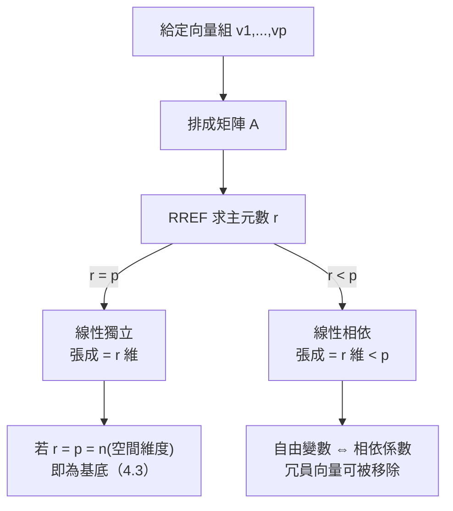

# 4.2 線性組合、張成與獨立

## 前言：用幾支箭畫出整個世界

給你兩支箭，你能畫出多大的區域？在 $\mathbb{R}^2$ 中，兩支不平行的箭能覆盖整個平面；兩支平行的箭只能畫出一條直線。這個直覺就是本章兩個核心概念：**張成**（span，能畫多大）與**線性獨立**（有沒有多餘的箭）。這兩個概念的張力——「够大」與「不多餘」——在下一節 4.3 匯合為**基底**，成為空間維度的定義。

## 歷史前因後果

### 從格拉斯曼的「延論」到現代術語

- 1844 年，格拉斯曼在《線性延論》中首次系統定義了線性組合、相依與獨立、基底與維度——現代線性代數的整個詞彙表幾乎都出自這本書（以及他 1862 年的修訂版）。他稱之為「延論」是因為關心「如何由基本元素**延伸**出整個空間」。
- 他的同行起初完全忽視這部著作。數學史家估計 1844 版只賣出不到 500 本。1860 年代莫比烏斯與漢克爾（Hermann Hankel, 1839–1873）開始引述；1878 年克萊因（Felix Klein）在《Erlangen 綱領》的氛圍下推廣了格拉斯曼的思想。
- 同時，英國的凱萊與西爾維斯特透過矩陣與不變量理論獨立發展了相關概念（如西爾維斯特 1851 年的「rank」用語，後由弗洛貝尼烏斯 1879 年精確化）。
- 1910 年，**史泰尼茨**（Ernst Steinitz, 1871–1928）發表《體的代數理論》，把基底、維度、交換體上的向量空間理論完整公理化——現代教科書的骨架至此定型。

- **解決了什麼問題**：替「方程組有幾個獨立方程」「解空間多大」「座標最少需要幾個」這類問題提供統一語言。
- **引發了什麼新問題**：無窮維空間的基底（Hamel 基底存在但不可構造，需要選擇公理——1920 年代 Hamel 與 Zermelo 的工作）與正交基（希爾伯特空間，第 7 章）。

## 線性組合與張成

### 定義

給定向量 $\mathbf{v}_1, \dots, \mathbf{v}_p \in V$ 與純量 $c_1, \dots, c_p$，表達式

$$
c_1\mathbf{v}_1 + c_2\mathbf{v}_2 + \cdots + c_p\mathbf{v}_p
$$

稱為 $\mathbf{v}_1,\dots,\mathbf{v}_p$ 的**線性組合**（linear combination）。所有線性組合的集合稱為它們的**張成**（span）：

$$
\mathrm{span}\{\mathbf{v}_1, \dots, \mathbf{v}_p\} = \{c_1\mathbf{v}_1 + \cdots + c_p\mathbf{v}_p : c_i \in \mathbb{R}\}
$$

**定理**：$\mathrm{span}\{\mathbf{v}_1,\dots,\mathbf{v}_p\}$ 是 $V$ 的子空間，且是包含這些向量的**最小**子空間。

**證明要點**：零向量是係數全零的組合；兩個組合之和仍是組合（係數相加）；組合的純量倍仍是組合（係數相乘）。最小性：任何包含 $\mathbf{v}_i$ 的子空間必包含所有線性組合（封閉性）。∎

### 幾何直覺：張成的形狀

| $\mathbb{R}^3$ 中的情況 | 張成的形狀 | 維度 |
|--------------------------|-----------|------|
| $\{\mathbf{0}\}$ | 一個點 | 0 |
| 一個非零向量 | 過原點的直線 | 1 |
| 兩個不平行向量 | 過原點的平面 | 2 |
| 三個「不共面」向量 | 整個 $\mathbb{R}^3$ | 3 |
| 三個共面向量 | 一個平面 | 2 |

**關鍵觀察**：$\mathbb{R}^3$ 的標準基底 $\mathbf{e}_1, \mathbf{e}_2, \mathbf{e}_3$ 張成一切，但**任何三個不共面的向量也行**——座標軸沒有特權。這是「座標系可以任意選」的線性代數根源，通往 5.2 節的基底變換。

### 張成與線性方程組的匯合

「$\mathbf{b} \in \mathrm{span}\{\mathbf{a}_1,\dots,\mathbf{a}_n\}$ 是否成立？」正是 1.2 節的問題：

$$
x_1\mathbf{a}_1 + \cdots + x_n\mathbf{a}_n = \mathbf{b}
$$

即方程組 $A\mathbf{x}=\mathbf{b}$ 是否有解。所以：

- **有解** ⇔ $\mathbf{b}$ 在 $A$ 的行空間（column space）中；
- **對每個 $\mathbf{b}$ 有解** ⇔ 行向量張成整個 $\mathbb{R}^m$ ⇔ 秩 $= m$（4.3 節）。

## 線性相依與獨立

### 定義

向量組 $\mathbf{v}_1, \dots, \mathbf{v}_p$ **線性相依**（linearly dependent），若存在**不全為零**的係數使

$$
c_1\mathbf{v}_1 + \cdots + c_p\mathbf{v}_p = \mathbf{0}
$$

否則稱**線性獨立**（linearly independent）：上式只有零解 $c_1 = \cdots = c_p = 0$。

**等價刻畫**（相依 ⇔ 以下任一）：

1. 至少一個向量是其他向量的線性組合（「多餘」）；
2. 齊次方程組 $[\mathbf{v}_1\ \cdots\ \mathbf{v}_p]\mathbf{x} = \mathbf{0}$ 有非零解；
3. 係數矩陣的秩 $< p$；
4. 某個向量加入後張成不變（「沒有新增維度」）。

### 直覺與重要事實

- **直覺**：獨立 = 每個向量都帶來「新方向」；相依 = 有向量可被其他人合成，是冗員。
- **含零向量的組必相依**：$1\cdot\mathbf{0} = \mathbf{0}$ 即為非平凡組合。
- **兩向量相依 ⇔ 平行**（互為倍數）。
- **單個向量**：獨立 ⇔ 非零。
- **多即相依**：$\mathbb{R}^n$ 中任何 $n+1$ 個向量必相依（維度的第一個預告，4.3 節定理）。

**相依的例子**：$\begin{bmatrix}1\\2\end{bmatrix}, \begin{bmatrix}2\\4\end{bmatrix}, \begin{bmatrix}3\\5\end{bmatrix}$：$-2\mathbf{v}_1 + \mathbf{v}_2 + \mathbf{0}\mathbf{v}_3 = \mathbf{0}$，相依（$\mathbf{v}_2 = 2\mathbf{v}_1$）。

### 獨立性的實用判斷法

**方法一（行列式，方陣）**：$n$ 個 $n$ 維向量排列成方陣 $A$，獨立 ⇔ $\det A \neq 0$（3.2 節）。
**方法二（消去法）**：把向量排成矩陣做 RREF，主元數 $= p$ ⇔ 獨立。
**方法三（觀察）**：含零向量、明顯成比例、數量超過維度——立即判相依。

## 例題

**例題 4.2-1（張成與方程組）**：設 $\mathbf{a}_1 = \begin{bmatrix} 1 \\ 1 \\ 0 \end{bmatrix}$，$\mathbf{a}_2 = \begin{bmatrix} 0 \\ 1 \\ 1 \end{bmatrix}$，$\mathbf{a}_3 = \begin{bmatrix} 1 \\ 2 \\ 1 \end{bmatrix}$。$\mathbf{b} = \begin{bmatrix} 3 \\ 5 \\ 2 \end{bmatrix}$ 是否在 $\mathrm{span}\{\mathbf{a}_1, \mathbf{a}_2, \mathbf{a}_3\}$ 中？

**解**：解 $x_1\mathbf{a}_1 + x_2\mathbf{a}_2 + x_3\mathbf{a}_3 = \mathbf{b}$：

$$
\left[\begin{array}{ccc|c} 1 & 0 & 1 & 3 \\ 1 & 1 & 2 & 5 \\ 0 & 1 & 1 & 2 \end{array}\right]
\xrightarrow{R_2 \to R_2 - R_1}
\left[\begin{array}{ccc|c} 1 & 0 & 1 & 3 \\ 0 & 1 & 1 & 2 \\ 0 & 1 & 1 & 2 \end{array}\right]
\xrightarrow{R_3 \to R_3 - R_2}
\left[\begin{array}{ccc|c} 1 & 0 & 1 & 3 \\ 0 & 1 & 1 & 2 \\ 0 & 0 & 0 & 0 \end{array}\right]
$$

一致且有自由變數：$x_3 = t$，$x_1 = 3 - t$，$x_2 = 2 - t$。**有無窮多種表示**（這本身透露 $\mathbf{a}_1,\mathbf{a}_2,\mathbf{a}_3$ 相依——稍後驗證）。取 $t = 0$：$\mathbf{b} = 3\mathbf{a}_1 + 2\mathbf{a}_2 + 0\mathbf{a}_3$。

**相依性驗證**：解 $c_1\mathbf{a}_1 + c_2\mathbf{a}_2 + c_3\mathbf{a}_3 = \mathbf{0}$。同樣的消去（右端改為零）得 $c_3 = t$，$c_1 = -t$，$c_2 = -t$。取 $t = 1$：$-\mathbf{a}_1 - \mathbf{a}_2 + \mathbf{a}_3 = \mathbf{0}$，即 $\mathbf{a}_3 = \mathbf{a}_1 + \mathbf{a}_2$——**$\mathbf{a}_3$ 是冗員**。因此 $\mathrm{span}\{\mathbf{a}_1,\mathbf{a}_2,\mathbf{a}_3\} = \mathrm{span}\{\mathbf{a}_1,\mathbf{a}_2\}$（一個平面）。

**例題 4.2-2（獨立性的完整判定）**：判斷 $\mathbf{u}_1 = (1, -2, 3)$、$\mathbf{u}_2 = (2, -5, 8)$、$\mathbf{u}_3 = (-1, 2, 1)$ 是否獨立。

**解**：做消去：

$$
\begin{bmatrix} 1 & 2 & -1 \\ -2 & -5 & 2 \\ 3 & 8 & 1 \end{bmatrix}
\xrightarrow{R_2 + 2R_1,\ R_3 - 3R_1}
\begin{bmatrix} 1 & 2 & -1 \\ 0 & -1 & 0 \\ 0 & 2 & 4 \end{bmatrix}
\xrightarrow{R_3 + 2R_2}
\begin{bmatrix} 1 & 2 & -1 \\ 0 & -1 & 0 \\ 0 & 0 & 4 \end{bmatrix}
$$

三個主元，秩 $= 3 = p$，**獨立**。（等價地 $\det \neq 0$：$1\cdot(-1)\cdot4 = -4 \ne 0$。）

**例題 4.2-3（多即相依）**：$\mathbb{R}^3$ 中取 $\mathbf{w}_1 = (1,0,0)$、$\mathbf{w}_2 = (0,1,0)$、$\mathbf{w}_3 = (1,1,0)$、$\mathbf{w}_4 = (0,0,1)$。四個向量在 $\mathbb{R}^3$ 中必相依。找出關係：$\mathbf{w}_3 = \mathbf{w}_1 + \mathbf{w}_2$，故 $1\cdot\mathbf{w}_1 + 1\cdot\mathbf{w}_2 - 1\cdot\mathbf{w}_3 + 0\cdot\mathbf{w}_4 = \mathbf{0}$。**注意**：雖然相依，$\mathbf{w}_1,\mathbf{w}_2,\mathbf{w}_4$ 卻獨立——相依關係**不必牽涉所有向量**（本例 $\mathbf{w}_4$ 的係數為 0）。

## 張成、獨立與「效率」

把兩個概念並置，就得到空間理論的核心張力：

| 目標 | 概念 | 失敗模式 |
|------|------|----------|
| 「够大」（覆盖整個空間） | 張成 = $V$ | 太小（有盲區） |
| 「不多餘」（無冗員） | 線性獨立 | 太大（有冗員） |
| **兩者兼得** | **基底**（4.3 節） | 剛剛好 |

實務中，機器學習的「特徵選擇」就是找一組獨立（不相關）的特徵；統計的「多重共線性」就是特徵相依導致模型冗餘；訊號處理的「壓縮感知」問的是：能否用遠少於維度的獨立量測重建訊號？

## 與其他領域的關聯

- **微分方程**：二階線性 ODE 的兩個解**線性獨立**（Wronskian $\ne 0$，第 3 章關聯）才能寫出通解 $y = c_1y_1 + c_2y_2$；相依的解（如 $y_2 = 2y_1$）無法生成一般解。
- **量子力學**：狀態的「正交歸一基底」是獨立性的極致；冗餘態會使機率詮釋失效（測量的完備性問題）。
- **統計／機器學習**：共線性診斷（VIF）、主成分分析（PCA 尋找最大的獨立方向，9.2 節）、特徵選擇。
- **化學**：分子振動模式的簡正座標是獨立方向；反應路徑的自由度分析用空間維度。
- **編碼理論**：線性碼的生成矩陣之列必獨立（否則碼字冗餘不可控）；校驗矩陣與對偶碼的關係就是正交補（7 章預告）。

## 本節小結

1. 線性組合是「合成」的基本操作；張成是所有組合的集合，是最小包含子空間。
2. 線性相依 ⇔ 存在非平凡組合為零 ⇔ 有冗員 ⇔ 齊次系統有非零解 ⇔ 秩不足。
3. 判斷獨立性的三大工具：觀察（零向量、比例、數量）、行列式（方陣）、消去法（通用）。
4. 「張成够大」與「獨立不多餘」的張力，將由基底完美調和。

**預告**：基底與維度——空間的「門牌號碼系統」——以及把 1.2 節的秩、3.2 的可逆定理、本節的獨立性全部統一起來的**秩定理**。見 4.3。
