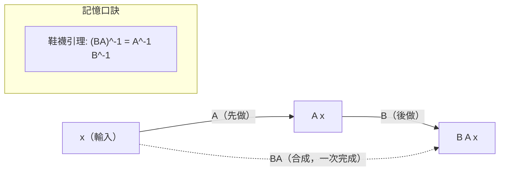

# 5.1 變換即矩陣

## 前言：矩陣的真正身分

到目前為止，矩陣 $A$ 在 $A\mathbf{x} = \mathbf{b}$ 中像是「係數表」。本章揭示它的真身：**線性變換**（linear transformation）——把一個向量空間送到另一個空間、且保存線性結構的函數。旋轉、投影、剪切、縮放，全是矩陣；矩陣乘法就是「變換的合成」。這個觀點讓「$A$ 的行是什麼」獲得動態意義：**第 $j$ 行是第 $j$ 個基底向量被送到哪裡**。

## 歷史前因後果

### 幾何變換與矩陣的聯姻

- 1820–40 年代，投影幾何的復興（彭賽列 Poncelet, 1822）迫使數學家研究「保持直線的變換」；莫比烏斯（August Ferdinand Möbius, 1790–1868）在 1827 年《重心演算》中已實質使用線性變換與齊次座標——電腦圖學今日的齊次矩陣（4 維表示 3 維變換）直接源於此。
- 凱萊 1858 年的矩陣乘法定義，其原始動機正是「變換的合成」：他在研究中需要處理幾何座標變換的疊代。
- 「線性變換」作為函數概念的精確化由皮亞諾（1888）與二十世紀的泛函分析完成：**線性算子**（linear operator）成為希爾伯特空間量子力學的核心（馮紐曼 1932）。
- 1962 年，**Schur 與現代譜理論**之前的關鍵一步由 1909 年舒爾（Issai Schur）的三角化完成；而「變換的矩陣依賴於基底」這個現代觀點的系統化，主要歸功於 1930 年代 van der Waerden 的《近代代數》與 Bourbaki 學派。

- **解決了什麼問題**：幾何操作（旋轉、投影）可以用統一的代數處理與合成；抽象算子的計算落地為矩陣計算。
- **引發了什麼新問題**：同一變換在不同基底下的矩陣不同——什麼是不變的？（特徵值、行列式、跡——本章 5.2 與第 6 章。）

## 線性變換的定義

**定義**：函數 $T: V \to W$ 是**線性變換**，若對所有 $\mathbf{u},\mathbf{v}\in V$、純量 $c$：

1. $T(\mathbf{u}+\mathbf{v}) = T(\mathbf{u}) + T(\mathbf{v})$（保存加法）
2. $T(c\mathbf{u}) = c\,T(\mathbf{u})$（保存純量乘法）

等價條件：$T(c_1\mathbf{u} + c_2\mathbf{v}) = c_1T(\mathbf{u}) + c_2T(\mathbf{v})$（保存一切線性組合）。

**線性的幾何含義**：把網格線變成直線（不彎曲）、原點不動、平行線保持平行、等距的點映射後仍等距（沿每個方向）。

**非線性的例子**：平移 $T(\mathbf{x}) = \mathbf{x} + \mathbf{t}$（$\mathbf{t}\neq\mathbf{0}$）：$T(\mathbf{0}) = \mathbf{t} \ne \mathbf{0}$，不線性！平方 $T(x) = x^2$：$T(2\cdot 1) = 4 \ne 2T(1)$。

**檢驗線性的快捷法**：$T(\mathbf{0}) = \mathbf{0}$ 是必要條件（由 $T(\mathbf{0}) = T(0\cdot\mathbf{0}) = 0\,T(\mathbf{0})$）。

## 矩陣表示：變換的基因碼

### 標準矩陣的構造

**定理**：設 $T: \mathbb{R}^n \to \mathbb{R}^m$ 線性，則 $T$ 由它在標準基底的值完全決定，且

$$
T(\mathbf{x}) = A\mathbf{x}, \qquad A = \begin{bmatrix} T(\mathbf{e}_1) & T(\mathbf{e}_2) & \cdots & T(\mathbf{e}_n) \end{bmatrix}
$$

$A$ 稱為 $T$ 的**標準矩陣**。證明：任何 $\mathbf{x} = x_1\mathbf{e}_1 + \cdots + x_n\mathbf{e}_n$，由線性：

$$
T(\mathbf{x}) = x_1T(\mathbf{e}_1) + \cdots + x_nT(\mathbf{e}_n) = A\mathbf{x} \checkmark
$$

**口訣**：「把每個標準基底向量送進 $T$，得到的像排成矩陣的行」——矩陣的行就是變換的**基因**。

### 經典變換的標準矩陣

| 變換（$\mathbb{R}^2$） | 標準矩陣 | 幾何 |
|--------------------------|----------|------|
| 旋轉 $\theta$ | $\begin{bmatrix}\cos\theta & -\sin\theta \\ \sin\theta & \cos\theta\end{bmatrix}$ | 繞原點旋轉，$\det = 1$ |
| 對 $x$ 軸鏡射 | $\begin{bmatrix}1 & 0 \\ 0 & -1\end{bmatrix}$ | $\det = -1$，反定向 |
| 對直線 $y=x$ 鏡射 | $\begin{bmatrix}0 & 1 \\ 1 & 0\end{bmatrix}$ | 交換座標 |
| 水平剪切（因子 $k$） | $\begin{bmatrix}1 & k \\ 0 & 1\end{bmatrix}$ | 上邊滑動，面積不變 $\det = 1$ |
| 均勻縮放 $s$ | $\begin{bmatrix}s & 0 \\ 0 & s\end{bmatrix}$ | 面積 $\times s^2$ |
| 投影到 $x$ 軸 | $\begin{bmatrix}1 & 0 \\ 0 & 0\end{bmatrix}$ | 壓扁到直線，$\det = 0$，不可逆 |
| 投影到直線（單位向量 $\mathbf{u}$） | $\mathbf{u}\mathbf{u}^T$ | 秩 1，第 7 章主角 |

**驗證旋轉**：$\mathbf{e}_1 = (1,0) \mapsto (\cos\theta, \sin\theta)$、$\mathbf{e}_2 = (0,1) \mapsto (-\sin\theta, \cos\theta)$，排成矩陣的行即得上表 ✓。

### 合成 = 乘法

**定理**：$(T_B \circ T_A)(\mathbf{x}) = T_B(T_A(\mathbf{x}))$ 的標準矩陣是 $BA$。

這回收了 2.1 節「乘法定義由合成逼出」的論證。**順序**：矩陣從右往左讀（先 $A$ 後 $B$）——如同函數記號 $f\circ g$。

### 變換的性質對應矩陣的性質

| 變換性質 | 矩陣性質 | 所在章 |
|----------|----------|--------|
| 可逆（一對一且映成） | $A$ 可逆（$\det \ne 0$） | 3.2 |
| 一對一 | $\mathrm{Null}(A) = \{\mathbf{0}\}$ | 4.3 |
| 映成（盖滿對應域） | $\mathrm{Col}(A) = \mathbb{R}^m$（秩 $= m$） | 4.3 |
| 保持長度（剛體） | $A^TA = I$（正交） | 第 7 章 |
| 保持面積（符號可變） | $|\det A| = 1$ | 3.3 |
| 壓扁維度 | $\det A = 0$ | 3.3 |

**單射與滿射不可兼得（非方陣）**：$T: \mathbb{R}^n \to \mathbb{R}^m$，$n \ne m$ 時秩–零度定理禁止：$r \le \min(m,n)$，故 $r = n$（單射）與 $r = m$（滿射）不能同時成立——**維度是變換的命運**。

## 例題

**例題 5.1-1（構造標準矩陣）**：設 $T: \mathbb{R}^3 \to \mathbb{R}^2$，$T(x, y, z) = (x + 2y - z,\ 3x - z)$。求標準矩陣，並求 $T(1, -1, 2)$。

**解**：$T(\mathbf{e}_1) = T(1,0,0) = (1, 3)$；$T(\mathbf{e}_2) = (2, 0)$；$T(\mathbf{e}_3) = (-1, -1)$。

$$
A = \begin{bmatrix} 1 & 2 & -1 \\ 3 & 0 & -1 \end{bmatrix}, \qquad T(1,-1,2) = \begin{bmatrix} 1 & 2 & -1 \\ 3 & 0 & -1 \end{bmatrix}\begin{bmatrix} 1 \\ -1 \\ 2 \end{bmatrix} = \begin{bmatrix} 1 - 2 - 2 \\ 3 - 2 \end{bmatrix} = \begin{bmatrix} -3 \\ 1 \end{bmatrix}
$$

**例題 5.1-2（合成與旋轉）**：求「先旋轉 $90°$ 再對 $x$ 軸鏡射」的單一矩陣，並與「先鏡射再旋轉」比較。

**解**：$R = \begin{bmatrix} 0 & -1 \\ 1 & 0 \end{bmatrix}$（$90°$ 旋轉），$F = \begin{bmatrix} 1 & 0 \\ 0 & -1 \end{bmatrix}$。

先旋轉後鏡射：$FR = \begin{bmatrix} 1 & 0 \\ 0 & -1 \end{bmatrix}\begin{bmatrix} 0 & -1 \\ 1 & 0 \end{bmatrix} = \begin{bmatrix} 0 & -1 \\ -1 & 0 \end{bmatrix}$。

先鏡射後旋轉：$RF = \begin{bmatrix} 0 & -1 \\ 1 & 0 \end{bmatrix}\begin{bmatrix} 1 & 0 \\ 0 & -1 \end{bmatrix} = \begin{bmatrix} 0 & 1 \\ 1 & 0 \end{bmatrix}$。

兩者**不同**（$FR = -RF$），且都不是旋轉或鏡射，而是對直線 $y = -x$ 與 $y = x$ 的鏡射。**順序重要**——非交換性的幾何化身。注意兩者行列式同為 $-1\cdot1\cdot1 = \pm$：$\det(FR) = \det F\det R = (-1)(1) = -1$，皆為反定向。

**例題 5.1-3（判斷線性）**：判斷下列何者線性：(a) $T(x,y) = (x + 1, y)$；(b) $T(x,y) = (x^2, y)$；(c) $T(x,y) = (x - y, 2x)$；(d) $T(\mathbf{x}) = \|\mathbf{x}\|$。

**解**：
(a) $T(\mathbf{0}) = (1, 0) \ne \mathbf{0}$——非線性（平移）。
(b) $T(1,0) = (1,0)$、$T(2,0) = (4,0) \ne 2T(1,0) = (2,0)$——非線性。
(c) 兩個分量都是線性組合：$T(c\mathbf{u} + \mathbf{v}) = ((c u_1 + v_1) - (cu_2 + v_2),\ 2(cu_1 + v_1)) = cT(\mathbf{u}) + T(\mathbf{v})$——**線性** ✓。
(d) $T(2\mathbf{u}) = 2\|\mathbf{u}\| = 2T(\mathbf{u})$ 但 $T(-\mathbf{u}) = \|\mathbf{u}\| \ne -\|\mathbf{u}\|$——非線性（長度不會是負）。

**例題 5.1-4（電腦圖學：齊次座標）**：把「旋轉 $30°$ 後平移 $(2,3)$」合併為一個 $3\times 3$ 矩陣。齊次座標把點 $(x,y)$ 寫成 $(x, y, 1)$，平移變成線性變換：

$$
T = \begin{bmatrix} \cos30° & -\sin30° & 2 \\ \sin30° & \cos30° & 3 \\ 0 & 0 & 1 \end{bmatrix} \approx \begin{bmatrix} 0.866 & -0.5 & 2 \\ 0.5 & 0.866 & 3 \\ 0 & 0 & 1 \end{bmatrix}
$$

作用於 $(1, 0, 1)^T$：$(0.866 + 2,\ 0.5 + 3) = (2.866, 3.5)$。**平移本非線性，齊次座標多一維後把它線性化**——這是莫比烏斯 1827 年思想在 GPU 中的日常應用；OpenGL/DirectX 的所有場景變換都是一連串 $4\times 4$ 矩陣的乘積。

## 與其他領域的關聯

- **微積分**：可微函數的局部行為是線性變換——導數 $f'(a)$ 是線性逼近 $f(a + h) \approx f(a) + f'(a)h$；多變數的 Jacobi 矩陣就是「最好的線性變換」。
- **微分方程**：$\mathbf{x}' = A\mathbf{x}$ 的向量場由 $A$ 決定；平衡點附近的分類（鞍點、螺旋、結點）是線性變換幾何的動力系統版本（第 6 章）。
- **電腦圖學／機器人學**：模型、視圖、投影矩陣；機械臂的正逆運動學是旋轉矩陣的合成。
- **量子力學**：可觀測量與演化都是（希爾伯特空間上的）線性算子；「測量」是到特徵子空間的投影。
- **機器學習**：神經網路一層 $= $ 線性變換 + 非線性激活；「表徵學習」就是尋找好的內部線性座標（5.2 節基底變換的直接應用）。

## 本節小結

1. 線性變換 $=$ 保存加法與純量乘法的函數；$\mathbb{R}^n \to \mathbb{R}^m$ 的線性變換與 $m\times n$ 矩陣一一對應。
2. 標準矩陣的行 $= T(\mathbf{e}_j)$——「矩陣的行是變換的基因」。
3. 合成對應乘法、順序從右往左、一般不交換；變換的幾何性質（可逆、保長、壓扁）一一對應矩陣代數性質。
4. 齊次座標把平移線性化，是電腦圖學的基石。

**預告**：同一個變換在不同基底下的矩陣長得不同——哪些性質不變？如何選基底讓矩陣「最簡單」？下一節 5.2：**基底變換與相似性**。
