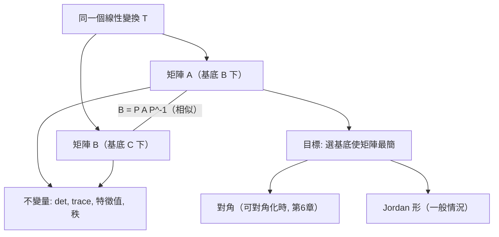

# 5.2 基底變換與相似性

## 前言：換一副眼鏡看同一個變換

同一支箭，用東西南北描述是一組數，用前後左右描述是另一組數。同一個線性變換，在不同基底下的矩陣也不同。那麼，矩陣的哪些性質是「眼鏡的產物」、哪些是「變換的本質」？答案是：**特徵值、行列式、跡、秩是本質**（座標無關），而矩陣的具體樣貌是座標的產物。**相似性**（similarity）刻劃「同一變換、不同座標」的關係；**對角化**（第 6 章）則是「選一副最好的眼鏡」。

## 歷史前因後果

### 座標無關思想的勝利

- 座標變換的研究可追溯到十九世紀的投影幾何與不變量理論：西爾維斯特與凱萊在 1850 年代的「不變量」（invariants）研究，正是在問「什麼性質在座標變換下不變」。凱萊 1858 年已注意到相似矩陣有相同的特徵多項式。
- **若爾當**（Camille Jordan, 1838–1922）在 1870 年的《線性與雙線性方程組論》中給出**若爾當標準形**：任何複方陣相似於塊對角（若爾當塊）形式——這是「變換的本質結構」的完整分類，把相似性問題徹底解決。
- 1896–1905 年，**弗洛貝尼烏斯**確立了跡（trace）的理論地位：$\mathrm{tr}(AB) = \mathrm{tr}(BA)$ 使跡成為相似不變量；跡與行列式分別等於特徵值的和與積（凱萊–哈密頓脈絡）。
- 二十世紀物理學：量子力學的「表象變換」（Schrödinger 表象 vs. Heisenberg 表象，1926 年 Dirac 與 Schrödinger 證明等價）就是基底變換——物理結果（特徵值＝能階）必須表象無關。

- **解決了什麼問題**：釐清矩陣性質中「本質」與「表象」的分界；提供把矩陣化簡（甚至對角化）的理論依據。
- **引發了什麼新問題**：什麼矩陣能對角化？不能時最簡形式是什麼（若爾當形）？數值上如何在浮點環境實現（舒爾形＋ QR 演算法，10.1 節）？

## 座標向量與基底變換

### 同一向量的兩種座標

設 $V$ 有兩組基底 $\mathcal{B} = \{\mathbf{b}_1, \dots, \mathbf{b}_n\}$ 與 $\mathcal{C} = \{\mathbf{c}_1, \dots, \mathbf{c}_n\}$。同一向量 $\mathbf{v}$：

$$
\mathbf{v} = [\mathbf{v}]_{\mathcal{B}}\text{（用 } \mathcal{B} \text{ 的座標）} = [\mathbf{v}]_{\mathcal{C}}\text{（用 } \mathcal{C} \text{ 的座標）}
$$

兩種座標之間由**座標變換矩陣**連接。設 $P$ 的第 $j$ 行是 $\mathbf{b}_j$ 的 $\mathcal{C}$ 座標：

$$
P = \begin{bmatrix} [\mathbf{b}_1]_{\mathcal{C}} & \cdots & [\mathbf{b}_n]_{\mathcal{C}} \end{bmatrix}, \qquad [\mathbf{v}]_{\mathcal{C}} = P\,[\mathbf{v}]_{\mathcal{B}}
$$

$P$ 可逆（因為 $\mathcal{B}$ 是基底），逆方向用 $P^{-1}$：$[\mathbf{v}]_{\mathcal{B}} = P^{-1}[\mathbf{v}]_{\mathcal{C}}$。

### 變換矩陣的相似關係

設線性算子 $T: V \to V$ 在基底 $\mathcal{B}$ 下的矩陣為 $A$、在 $\mathcal{C}$ 下的矩陣為 $B$。同一個 $T$，用 $\mathcal{B}$ 座標進入、換成 $\mathcal{C}$ 座標做 $T$、再換回：

$$
A = P^{-1}BP, \qquad \text{等價地 } B = PAP^{-1}
$$

**定義**：方陣 $A, B$ **相似**（similar），若存在可逆 $P$ 使 $B = PAP^{-1}$。相似性是等價關係（反身、對稱、傳遞）。

## 相似不變量：本質的指紋

**定理**：若 $B = PAP^{-1}$，則 $A, B$ 有相同的：

1. **特徵多項式**與**特徵值**：$\det(\lambda I - B) = \det(P(\lambda I - A)P^{-1}) = \det(\lambda I - A)$；
2. **行列式**：$\det B = \det P\det A\det P^{-1} = \det A$；
3. **跡**：$\mathrm{tr}(PAP^{-1}) = \mathrm{tr}(AP^{-1}P) = \mathrm{tr}(A)$（用 $\mathrm{tr}(XY) = \mathrm{tr}(YX)$）；
4. **秩**：可逆變換不改變壓扁程度；
5. **特徵值的代數重數**、若爾當結構。

**注意不相似不變的**：對稱性、正定性、正交性、矩陣本身的元素——這些都依賴基底（除非變換是正交的，見第 7 章）。

**跡與行列式的特徵值公式**（第 6 章的主角）：

$$
\mathrm{tr}(A) = \lambda_1 + \lambda_2 + \cdots + \lambda_n, \qquad \det A = \lambda_1\lambda_2\cdots\lambda_n
$$

**選基底的最優目標**：找到基底使 $T$ 的矩陣最簡單——理想是對角形（各方向互不干涉）。對角矩陣的優點：冪易算、解耦、特徵值在對角線上明示。**特徵向量就是「能實現這個目標的基底」**——第 6 章的序幕。

## 例題

**例題 5.2-1（座標變換）**：$\mathbb{R}^2$ 中 $\mathcal{B} = \left\{\begin{bmatrix} 1 \\ 1 \end{bmatrix}, \begin{bmatrix} -1 \\ 2 \end{bmatrix}\right\}$。求 $\mathbf{v} = \begin{bmatrix} 5 \\ 4 \end{bmatrix}$ 的 $\mathcal{B}$ 座標。

**解**：解 $c_1\begin{bmatrix} 1 \\ 1 \end{bmatrix} + c_2\begin{bmatrix} -1 \\ 2 \end{bmatrix} = \begin{bmatrix} 5 \\ 4 \end{bmatrix}$，即

$$
\begin{cases} c_1 - c_2 = 5 \\ c_1 + 2c_2 = 4 \end{cases} \Rightarrow c_2 = -\frac{1}{3},\ c_1 = \frac{14}{3}
$$

故 $[\mathbf{v}]_{\mathcal{B}} = \left(\frac{14}{3}, -\frac{1}{3}\right)$。驗證：$\frac{14}{3}(1,1) - \frac13(-1,2) = \left(\frac{14}{3}+\frac13,\ \frac{14}{3}-\frac23\right) = (5, 4)$ ✓。

（座標不一定是「好看」的數——這正是非標準基底的日常。特殊基底（正交歸一）會讓計算漂亮，見第 7 章。）

**例題 5.2-2（驗證相似性）**：$A = \begin{bmatrix} 4 & 1 \\ 2 & 3 \end{bmatrix}$ 與 $P = \begin{bmatrix} 1 & 1 \\ 1 & 2 \end{bmatrix}$。計算 $B = PAP^{-1}$ 並驗證不變量。

**解**：$P^{-1} = \frac{1}{2-1}\begin{bmatrix} 2 & -1 \\ -1 & 1 \end{bmatrix} = \begin{bmatrix} 2 & -1 \\ -1 & 1 \end{bmatrix}$。

$$
AP^{-1} = \begin{bmatrix} 4 & 1 \\ 2 & 3 \end{bmatrix}\begin{bmatrix} 2 & -1 \\ -1 & 1 \end{bmatrix} = \begin{bmatrix} 7 & -3 \\ 1 & 1 \end{bmatrix}, \qquad B = P(AP^{-1}) = \begin{bmatrix} 1 & 1 \\ 1 & 2 \end{bmatrix}\begin{bmatrix} 7 & -3 \\ 1 & 1 \end{bmatrix} = \begin{bmatrix} 8 & -2 \\ 9 & -1 \end{bmatrix}
$$

**驗證不變量**：

- $\det A = 12 - 2 = 10$；$\det B = -8 + 18 = 10$ ✓
- $\mathrm{tr}(A) = 7$；$\mathrm{tr}(B) = 8 + (-1) = 7$ ✓
- 特徵多項式 $\lambda^2 - 7\lambda + 10 = (\lambda - 5)(\lambda - 2)$，特徵值 $\{5, 2\}$，兩矩陣相同 ✓

（有趣的事實：$A$ 的行是 $(4,2),(1,3)$；$B$ 看起來更「亂」，但本質相同——**可見矩陣的樣貌不可信，不變量才是身分證**。）

**例題 5.2-3（用基底變換簡化變換）**：$T(x, y) = (x + y,\ y)$（剪切），在標準基底下的矩陣 $A = \begin{bmatrix} 1 & 1 \\ 0 & 1 \end{bmatrix}$。取 $\mathcal{B} = \{\mathbf{b}_1 = (1, 0), \mathbf{b}_2 = (1, 1)\}$，求 $T$ 在 $\mathcal{B}$ 下的矩陣。

**解**：$T(\mathbf{b}_1) = (1, 0) = 1\cdot\mathbf{b}_1 + 0\cdot\mathbf{b}_2$；$T(\mathbf{b}_2) = (2, 1) = 1\cdot\mathbf{b}_1 + 1\cdot\mathbf{b}_2$。

$$
[T]_{\mathcal{B}} = \begin{bmatrix} 1 & 1 \\ 0 & 1 \end{bmatrix}\ (\text{座標行}) \Rightarrow [T]_{\mathcal{B}} = \begin{bmatrix} 1 & 1 \\ 0 & 1 \end{bmatrix}
$$

嗯——本例矩陣不變（因為剪切沿 $\mathbf{b}_1$ 方向不變），這告訴我們：**並非所有矩陣都能靠換基底「大幅」簡化**。實際上 $A$ 的特徵值是 $1$（二重），特徵空間只有一維（$\mathrm{span}\{\mathbf{e}_1\}$），它**不可對角化**——只能化成若爾當塊 $\begin{bmatrix} 1 & 1 \\ 0 & 1 \end{bmatrix}$，而它已經就是若爾當形！這個例子預告第 6 章的核心分界：**特徵向量夠多（$n$ 個獨立）才可對角化**。

## 例題 5.2-4：可對角化的完整預演

$A = \begin{bmatrix} 4 & 1 \\ 2 & 3 \end{bmatrix}$（例 5.2-2）。特徵值 $\lambda = 5, 2$：

- $\lambda = 5$：$(A - 5I)\mathbf{x} = \begin{bmatrix} -1 & 1 \\ 2 & -2 \end{bmatrix}\mathbf{x} = \mathbf{0} \Rightarrow \mathbf{v}_1 = (1, 1)$；
- $\lambda = 2$：$\begin{bmatrix} 2 & 1 \\ 2 & 1 \end{bmatrix}\mathbf{x} = \mathbf{0} \Rightarrow \mathbf{v}_2 = (1, -2)$。

取 $P = [\mathbf{v}_1\ \mathbf{v}_2] = \begin{bmatrix} 1 & 1 \\ 1 & -2 \end{bmatrix}$，則

$$
P^{-1}AP = \begin{bmatrix} 5 & 0 \\ 0 & 2 \end{bmatrix} = D
$$

**驗證**：$AP = \begin{bmatrix} 4 & 1 \\ 2 & 3 \end{bmatrix}\begin{bmatrix} 1 & 1 \\ 1 & -2 \end{bmatrix} = \begin{bmatrix} 5 & 2 \\ 5 & -4 \end{bmatrix}$；$PD = \begin{bmatrix} 1 & 1 \\ 1 & -2 \end{bmatrix}\begin{bmatrix} 5 & 0 \\ 0 & 2 \end{bmatrix} = \begin{bmatrix} 5 & 2 \\ 5 & -4 \end{bmatrix}$ ✓（$AP = PD$）。

在基底 $\{\mathbf{v}_1, \mathbf{v}_2\}$ 下，$T$ 只是「沿 $\mathbf{v}_1$ 放大 5 倍、沿 $\mathbf{v}_2$ 放大 2 倍」——**複雜的剪切與縮放，換一副眼鏡後只是兩個獨立的縮放**。這是對角化的全部哲學，第 6 章將系統展開。

## 與其他領域的關聯

- **量子力學**：Heisenberg 與 Schrödinger 表象的等價性（1926）就是相似變換；物理可觀測量（能階）必須表象無關——「特徵值不變」的物理版。
- **動力系統**：平衡點的穩定性分類在線性化後不變於座標選擇；Poincaré 正規形理論用相似變換化簡非線性系統。
- **機器學習**：詞向量空間中「旋轉不變性」的檢驗、圖神經網路的置换等變性——都要求「好性質座標無關」。
- **訊號處理**：選擇傅立葉基底使卷積對角化（DFT 矩陣的特徵向量性）——「換基底使問題變簡單」的最著名成功案例。
- **微分方程**：對角化把 $\mathbf{x}' = A\mathbf{x}$ 解耦成 $n$ 個獨立的標量方程 $y_i' = \lambda_i y_i$（第 6 章主角）。

## 本節小結

1. 同一變換在不同基底下矩陣不同，關係為 $B = PAP^{-1}$（相似）；座標向量經 $P$ 轉換。
2. 相似不變量：特徵值、行列式、跡、秩、特徵多項式——它們是「變換的本質指紋」。
3. 換基底的目標是把矩陣化到最簡：可對角化時得對角形，否則若爾當形（Jordan 1870）。
4. 特徵向量是「天然最好的基底」：變換在其上只是縮放（例 5.2-4 的預演）。

**預告**：什麼樣的矩陣有足夠的特徵向量可對角化？特徵值如何從微分方程、幾何穩定性中誕生？第 6 章正式進入**特徵值理論**。
